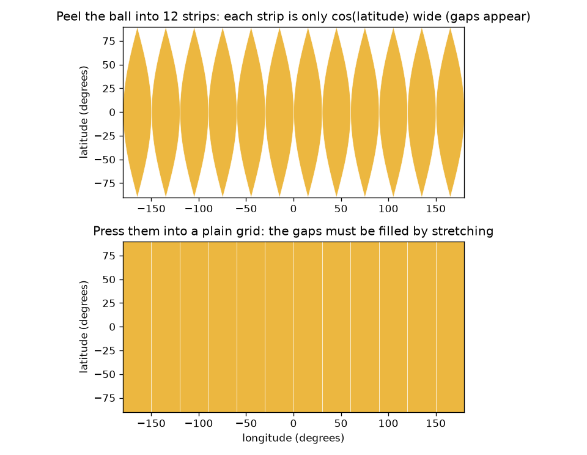
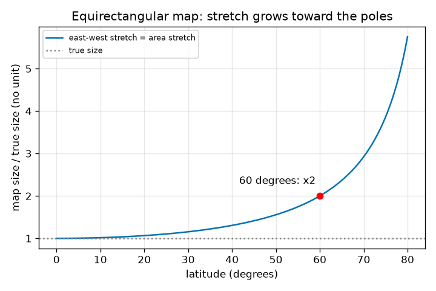

# సెషన్ 1: బంతి యొక్క చదునైన పటం ఎందుకు వక్రీకరించాల్సిందే

[Session 1 — हिन्दी](README.hi.md) · [Session 1 — മലയാളം](README.ml.md) · [Session 1 — தமிழ்](README.ta.md) · [Session 1 — తెలుగు](README.te.md)

*స్థాయి 1 (భావనాత్మక ఇంటరాక్టివ్ నమూనా) · సుమారు 60 నిమిషాలు · openmapproject*

> ఇది సరళీకరించిన విద్యా నమూనా. ఇది ధృవీకరించబడిన (validated) డిజైన్ సాధనం కాదు; నిజమైన నిర్మాణాలు, విద్యుత్ సంస్థాపనలు, వాహనాలు, పారిశ్రామిక ప్రక్రియలు లేదా వైద్య నిర్ణయాల కోసం దీన్ని ఉపయోగించకూడదు.

**ముందస్తు జ్ఞానం (Prerequisites)**

- పాఠశాల త్రికోణమితి: ఒక కోణం యొక్క కొసైన్.
- మీరు PRIMER.md చదివి `python start.py 1` ఒకసారి నడిపారు.

**అభ్యసన లక్ష్యాలు (Learning objectives).** ఈ సెషన్ తర్వాత మీరు:

- నారింజ తొక్కతో, గోళాన్ని సాగదీయకుండా లేదా చింపకుండా చదును చేయలేమని ఎందుకో వివరించగలరు.
- భూమిపై ఒక బిందువును అక్షాంశం, రేఖాంశం (latitude, longitude) తో వర్ణించి, సమదీర్ఘచతురస్ర (equirectangular) పటంపై ఉంచగలరు.
- అక్షాంశ వృత్తం యొక్క నిజమైన పొడవును, చదునైన గ్రిడ్ పటం యొక్క సాగుదల (stretch) 1 / cos(latitude) ను లెక్కించగలరు.
- అక్షాంశానికి వ్యతిరేకంగా సాగుదల గ్రాఫ్ చదవగలరు.

## A. వాస్తవ ప్రపంచ సమస్య
ఒక నారింజ తొక్కను ఒకే ముక్కగా వలిచి బల్లపై చదునుగా నొక్కండి. అది చీలిపోతుంది, లేదా దాన్ని సాగదీయాల్సి వస్తుంది. భూమి ఒక బంతి, దాని ప్రతి చదునైన పటం నొక్కిన తొక్క. అతి సరళమైన పటం అక్షాంశం, రేఖాంశాలను చతురస్ర కాగితంపై గ్రిడ్ రేఖలుగా వాడుతుంది. అది నార్వేను, నైజీరియాను సరైన పరిమాణంలో చూపిస్తుందా? 60 డిగ్రీల ఉత్తరం వద్ద అది ఎంత తప్పు, ఎందుకు?

## B. భావన మరియు సిద్ధాంతం
అక్షాంశం అంటే భూమధ్యరేఖకు ఉత్తరంగా (+) లేదా దక్షిణంగా (-) కోణం; రేఖాంశం అంటే ఒక సూచన మధ్యాహ్న రేఖకు తూర్పున లేదా పశ్చిమాన కోణం. సమదీర్ఘచతురస్ర పటంలో అక్షాంశం phi, రేఖాంశం lambda (రేడియన్లలో) ఉన్న బిందువు x = R lambda, y = R phi వద్ద గీయబడుతుంది, ఇక్కడ R బంతి వ్యాసార్థం. ఒక అక్షాంశ వృత్తం వ్యాసార్థం R cos(phi), కాబట్టి దాని నిజమైన పొడవు 2 pi R cos(phi). పటం ప్రతి అక్షాంశ వృత్తాన్ని భూమధ్యరేఖ పొడవుతో, 2 pi R, గీస్తుంది. కాబట్టి తూర్పు-పడమర దూరాలు 1 / cos(phi) కారకంతో చాలా పొడవుగా గీయబడతాయి, ఉత్తర-దక్షిణ దూరాలు నిజమైన పరిమాణంలో గీయబడతాయి. వైశాల్యం రెండింటి లబ్ధం, కాబట్టి పటంపై వైశాల్యం నిజమైన వైశాల్యం గుణకారం 1 / cos(phi).

| గుర్తు | అర్థం | యూనిట్ |
|---|---|---|
| phi | అక్షాంశం, ఉత్తరం ధనాత్మకం | రేడియన్లు (యాప్‌లో డిగ్రీలు) |
| lambda | రేఖాంశం, తూర్పు ధనాత్మకం | రేడియన్లు (యాప్‌లో డిగ్రీలు) |
| R | గోళం వ్యాసార్థం (భూమికి 6371 km) | km |
| x, y | చదునైన పటంపై స్థానం | km |
| stretch | పట పొడవు భాగహారం నిజమైన పొడవు | యూనిట్ లేదు |

**ఊహలు (Assumptions)**

- భూమి 6371 km వ్యాసార్థం ఉన్న పరిపూర్ణ గోళం (నిజమైన భూమి సుమారు 0.3 శాతం చదునైనది).
- సూత్రాల లోపల కోణాలు రేడియన్లలో; యాప్, వచనం డిగ్రీలు వాడతాయి.
- ఇది సరళీకరించిన విద్యా నమూనా.

$$ x = R\lambda,\qquad y = R\varphi $$

$$ L_{\text{true}}(\varphi)=2\pi R\cos\varphi,\qquad L_{\text{map}}=2\pi R $$

$$ \text{east-west stretch}=\frac{L_{\text{map}}}{L_{\text{true}}}=\frac{1}{\cos\varphi}=\sec\varphi $$

$$ \frac{\text{area on map}}{\text{true area}}=\sec\varphi $$

## C. దృశ్య వివరణ
మొదటి చిత్రం బంతిని 12 పట్టీలుగా వలుస్తుంది. బంతిపై ప్రతి పట్టీ వెడల్పు cos(latitude) మాత్రమే, కాబట్టి ధ్రువాల వైపు ఖాళీలు తెరుచుకుంటాయి; దాని కింద ఉన్న సాదా గ్రిడ్ పట్టీలను పక్కలకు సాగదీసి ఖాళీలను నింపుతుంది. రెండో చిత్రం అక్షాంశానికి వ్యతిరేకంగా సాగుదల 1 / cos(latitude) ను ప్లాట్ చేస్తుంది: భూమధ్యరేఖ వద్ద అది 1, 30 డిగ్రీల వద్ద 1.155, 60 డిగ్రీల వద్ద సరిగ్గా 2, 80 డిగ్రీల వద్ద 5.76, ధ్రువం వద్ద అంతులేకుండా పెరుగుతుంది.

*వలిచిన బంతి: పట్టీలు అక్షాంశంతో ఇరుకవుతాయి, కాబట్టి సాదా గ్రిడ్ వాటిని సాగదీయాలి.*

*తూర్పు-పడమర సాగుదల 1 / cos(latitude): భూమధ్యరేఖ వద్ద 1, 60 డిగ్రీల వద్ద 2, 80 డిగ్రీల వద్ద 5.76.*

## D. ఇంటరాక్టివ్ సిమ్యులేషన్
పాఠాన్ని నడపండి (`python start.py 1`), తర్వాత లైవ్ యాప్‌ను తెరవండి: [సెషన్ 1: చదునైన గ్రిడ్ పటం ఎంత సాగుతుంది?](https://krunalpanchal1995.github.io/pan-iit-oss/openmapproject/session-01/) (లేదా ఈ ఫోల్డర్‌లోని `app.html`). అక్షాంశ స్లైడర్‌ను కదిపి పటంపై నీలి ప్యాచ్‌ను, బంతిపై ఆకుపచ్చ నిజమైన ఆకారాన్ని గమనించండి: నీలి ప్యాచ్ తన వెడల్పును నిలుపుకుంటుంది, ఆకుపచ్చది ఇరుకవుతుంది. తర్వాత గ్రాఫ్ వీక్షణ తెరిచి వక్రంపై చుక్క ఎక్కడ ఉందో చూడండి. ప్యాచ్ వెడల్పు మార్చి ఏ సంఖ్యలు మారతాయో గమనించండి.

**సవాలు.** చదునైన పటం తూర్పు-పడమర దూరాలను కనీసం 1.99 రెట్లు (సుమారు 2) సాగదీసే అక్షాంశాన్ని కనుగొనండి.

## E. సాధించిన ఉదాహరణ మరియు ప్రయోగం
**సమస్య.** 6371 km వ్యాసార్థం ఉన్న బంతిపై 60 డిగ్రీల ఉత్తరం వద్ద అక్షాంశ వృత్తం పొడవు ఎంత, చదునైన గ్రిడ్ పటం దాన్ని ఎంత పొడవుగా గీస్తుంది, సాగుదల ఎంత?

1. భూమధ్యరేఖ: 2 pi R = 2 x 3.14159 x 6371 = 40030.2 km. పటం ప్రతి అక్షాంశ వృత్తాన్ని ఈ పొడవుతో గీస్తుంది.
2. 60 డిగ్రీల వద్ద నిజమైన వృత్తం: 2 pi R cos 60 = 40030.2 x 0.5 = 20015.1 km.
3. సాగుదల = పట పొడవు / నిజమైన పొడవు = 40030.2 / 20015.1 = 2.000. ఇది 1 / cos 60 = 1 / 0.5 = 2.
4. ఒక డిగ్రీ రేఖాంశం భూమధ్యరేఖ వద్ద R x pi/180 = 111.19 km, కానీ 60 డిగ్రీల ఉత్తరం వద్ద 55.60 km మాత్రమే; పటం రెండింటినీ 111.19 km గా గీస్తుంది.

**సమాధానం.** నిజమైన వృత్తం 20015.1 km, పటం 40030.2 km గీస్తుంది, కాబట్టి 60 డిగ్రీల ఉత్తరం వద్ద తూర్పు-పడమర పొడవులు, వైశాల్యాలు రెండు రెట్లు పెద్దవిగా గీయబడతాయి.

**ప్రయోగం.** ఒక నారింజ, ఒక మార్కర్ తీసుకోండి. భూమధ్యరేఖను, సుమారు 60 డిగ్రీల ఉత్తరం వద్ద ఒక అక్షాంశ వృత్తాన్ని గీయండి (ఉపరితలం వెంబడి భూమధ్యరేఖ నుండి ధ్రువానికి దారిలో మూడింట రెండు వంతులు). ప్రతి వృత్తం చుట్టూ దారం చుట్టి రెండు పొడవులను కొలవండి: 2 కు దగ్గరగా నిష్పత్తి రావాలి. యాప్‌తో, checkpoint.py తో పోల్చండి. నమూనాలో పరిపూర్ణ గోళం ఉంది; నిజమైన నారింజ ఎగుడుదిగుడుగా ఉంటుంది, మీ దారానికి మందం ఉంటుంది, కాబట్టి కొన్ని శాతం లోపాన్ని ఆశించండి.

## F. మూల్యాంకనం మరియు డిజైన్ సవాలు
**ప్రశ్న రకం A: భావనాత్మక.** ఒక నారింజ తొక్కను చింపకుండా లేదా సాగదీయకుండా ఎందుకు చదును చేయలేం? భూమి యొక్క ప్రతి చదునైన పటానికి ఇది ఏమి సూచిస్తుంది?

సూచన

బంతిపై ఒక అక్షాంశ వృత్తం పొడవును చదునైన గ్రిడ్ దానికి ఇచ్చే వెడల్పుతో పోల్చండి.

దశలవారీ పరిష్కారం

ధ్రువాల దగ్గర తొక్క ఇరుకైన పట్టీలుగా ఒత్తిడికి గురవుతుంది: అక్షాంశ వృత్తం భూమధ్యరేఖ కంటే చాలా చిన్నది (అక్షాంశం కొసైన్ రెట్లు మాత్రమే పొడవు). చదునైన దీర్ఘచతురస్రానికి ప్రతి ఎత్తులోనూ ఒకే వెడల్పు, కాబట్టి దాన్ని నింపడానికి పట్టీలను పక్కలకు సాగదీయాలి లేదా ఖాళీలు వదలాలి. కాబట్టి ఏ చదునైన పటమైనా కొన్ని పొడవులను, వైశాల్యాలను లేదా కోణాలను మార్చాల్సిందే. అది అన్నిచోట్లా పరిపూర్ణంగా ఉండలేదు; ఏ లోపాన్ని అంగీకరించాలో మీరు ఎంచుకుంటారు.

**ప్రశ్న రకం B: సంఖ్యాత్మక.** 45 డిగ్రీల ఉత్తరం వద్ద 10 డిగ్రీల రేఖాంశం యొక్క నిజమైన పొడవు ఎంత, సమదీర్ఘచతురస్ర పటం దాన్ని ఎంత పొడవుగా గీస్తుంది, సాగుదల ఎంత? R = 6371 km వాడండి.

సూచన

నిజమైన పొడవు = R cos(phi) గుణకారం రేడియన్లలో కోణం; పట పొడవు = R గుణకారం రేడియన్లలో కోణం.

దశలవారీ పరిష్కారం

10 డిగ్రీలు = 0.17453 రేడియన్లు. నిజమైన పొడవు = 6371 x cos 45 x 0.17453 = 6371 x 0.70711 x 0.17453 = 786.3 km. పట పొడవు = 6371 x 0.17453 = 1111.9 km. సాగుదల = 1111.9 / 786.3 = 1.414 = 1 / cos 45. సహేతుకత తనిఖీ (sanity check): అది 1 (భూమధ్యరేఖ), 2 (60 డిగ్రీలు) మధ్య ఉంది, అలాగే ఉండాలి.

**ప్రశ్న రకం C: గ్రాఫ్ మరియు సిమ్యులేషన్ వ్యాఖ్యానం.** సాగుదల గ్రాఫ్‌లో 60 డిగ్రీల వద్ద, 80 డిగ్రీల వద్ద సాగుదల చదవండి. ఈ పటంలో 60 మరియు 80 డిగ్రీల మధ్య ఒక స్థిర పరిమాణం ఉన్న దేశం వైశాల్యం ఎన్ని రెట్లు పెరుగుతుంది?

సూచన

ఈ పటంలో వైశాల్య సాగుదల తూర్పు-పడమర సాగుదలకు సమానం.

దశలవారీ పరిష్కారం

వక్రం 60 డిగ్రీల వద్ద 2.00 గుండా, 80 డిగ్రీల వద్ద 5.76 గుండా వెళ్తుంది. కాబట్టి స్థిర నిజమైన పరిమాణం ఉన్న దేశం 80 డిగ్రీల వద్ద 60 డిగ్రీల కంటే 5.76 / 2.00 = 2.88 రెట్లు పెద్దదిగా కనిపిస్తుంది. వక్రం మరింత మరింత నిటారుగా పెరుగుతుంది: మధ్య అక్షాంశాల కంటే ధ్రువం దగ్గర పటం చాలా అధ్వాన్నం.

**ప్రశ్న రకం D: డిజైన్ మరియు ఆప్టిమైజేషన్ సవాలు.** ఒక వాతావరణ కార్యాలయానికి ఒక ప్రాంతం యొక్క చదునైన గ్రిడ్ పటం కావాలి, దానిలో తూర్పు-పడమర పొడవులు ఎప్పుడూ 25 శాతం కంటే ఎక్కువ సాగకూడదు. ఆ ప్రాంతం చేరగల అత్యధిక అక్షాంశం ఎంత? 70 డిగ్రీలను చేరే ప్రాంతానికి మీరు ఏమి చేస్తారు?

సూచన

1 / cos(phi) = 1.25 సాధించండి.

దశలవారీ పరిష్కారం

cos(phi) = 1 / 1.25 = 0.8, కాబట్టి phi = 36.9 డిగ్రీలు. ఆ ప్రాంతం ఉత్తరం లేదా దక్షిణం 36.9 డిగ్రీల వరకు చేరవచ్చు. 70 డిగ్రీల వద్ద సాగుదల 1 / cos 70 = 2.92, కాబట్టి సాదా గ్రిడ్ తగదు; వేరే ప్రక్షేపణ (projection) (సెషన్లు 2, 3) లేదా ఆ అక్షాంశం కేంద్రంగా ఉన్న పటం ఎంచుకోండి. రాజీ (trade-off): సాదా గ్రిడ్ లెక్కించడానికి, గీయడానికి అతి సులభం, కానీ భూమధ్యరేఖ దగ్గర మాత్రమే మంచిది.

[RUBRIC.md](../../RUBRIC.md) తో మిమ్మల్ని మీరు అంచనా వేసుకోండి. కాగితంపై పని చేయడానికి [కార్యాచరణ పత్రాన్ని](activity_sheet.md) ప్రింట్ చేయండి.

## సాధారణ అపోహలు
| సాధారణ అపోహ | నిజానికి సరైనది |
|---|---|
| పటం తయారుచేసేవారు తగినంత జాగ్రత్తగా ఉంటే చదునైన పటాన్ని పరిపూర్ణం చేయవచ్చు. | గోళం యొక్క ఏ చదునైన పటమూ అన్ని పొడవులను, కోణాలను, వైశాల్యాలను నిలుపుకోలేదు; కొంత వక్రీకరణ తప్పనిసరి. |
| వాస్తవంలో ధ్రువం పటం పైభాగంలో ఒక పొడవైన రేఖ. | ధ్రువం ఒకే బిందువు; సాదా గ్రిడ్ దాన్ని పై అంచు మొత్తంగా గీస్తుంది, ఇది సాగుదల యొక్క తీవ్ర సందర్భం. |
| గ్రిడ్ రేఖల సమాన అంతరం అంటే నేలపై సమాన దూరం. | ఒక డిగ్రీ అక్షాంశం ఎప్పుడూ 111.19 km, కానీ ఒక డిగ్రీ రేఖాంశం cos(latitude) తో కుదించుకుపోయి 60 డిగ్రీల వద్ద 55.60 km అవుతుంది. |
| వక్రీకరణ పటంపై ప్రతిచోటా ఒకేలా ఉంటుంది. | సాదా గ్రిడ్‌లో అది భూమధ్యరేఖ వద్ద సున్నా, ధ్రువాల వైపు పెరుగుతుంది; వక్రీకరణ ప్రదేశంపై ఆధారపడుతుంది. |

## పదకోశం (Glossary)
- **అక్షాంశం (latitude)**: భూమధ్యరేఖకు ఉత్తరం లేదా దక్షిణం కోణం, -90 నుండి +90 డిగ్రీల వరకు
- **రేఖాంశం (longitude)**: సూచన మధ్యాహ్న రేఖకు తూర్పు లేదా పశ్చిమ కోణం, -180 నుండి +180 డిగ్రీల వరకు
- **సమదీర్ఘచతురస్ర పటం (equirectangular map)**: రేఖాంశం, అక్షాంశాలను సాదా గ్రిడ్ నిరూపకాలుగా వాడే పటం
- **అక్షాంశ వృత్తం (circle of latitude)**: ఒకే అక్షాంశం వద్ద ఉన్న అన్ని బిందువులు; సమాంతరం (parallel) అని కూడా అంటారు
- **సాగుదల (stretch)**: పట పొడవును అది సూచించే నిజమైన పొడవుతో భాగించినది

## ముగింపు
1. [exercises.md](exercises.md) లోని మూడు కోడింగ్ పనులు చేయండి.
2. మీ మార్పుల తర్వాత `python start.py 1` ను మళ్ళీ నడపండి. అది చెక్‌పాయింట్‌తో ముగుస్తుంది; అది `PASS` అని ప్రింట్ చేసినప్పుడు మీరు పూర్తి చేశారు. (చెక్‌పాయింట్ మాత్రమే: `python start.py check 1`.)

తదుపరి: [సెషన్ 2](../session-02/README.md)
