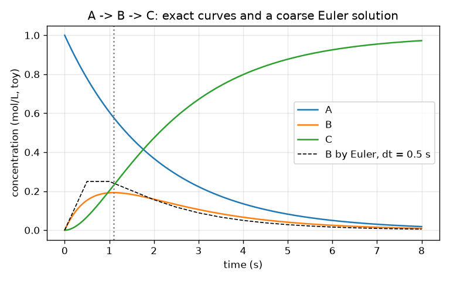
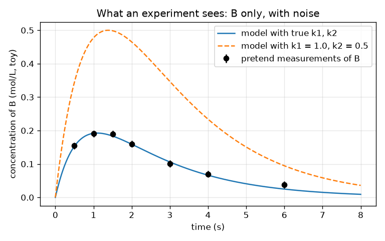

# सत्र 1: समीकरणों के रूप में एक अभिक्रिया जाल, और प्रयोग क्या देखता है

*स्तर 1 (वैचारिक इंटरैक्टिव मॉडल) · लगभग 60 मिनट · openmechanism*

> यह एक सरलीकृत शैक्षिक मॉडल है। यह कोई प्रमाणित डिज़ाइन उपकरण नहीं है और इसका उपयोग वास्तविक संरचनाओं, बिजली की स्थापनाओं, वाहनों, औद्योगिक प्रक्रियाओं या चिकित्सा निर्णयों के लिए नहीं किया जाना चाहिए।

**पूर्वापेक्षाएँ (Prerequisites)**

- स्कूल का बीजगणित और घातांकी फलन exp(x)।
- आपने PRIMER.md पढ़ लिया है और `python start.py 1` एक बार चला लिया है।

**सीखने के उद्देश्य।** इस सत्र के बाद आप:

- दो-चरणीय अभिक्रिया जाल (reaction network) A -> B -> C को तीन दर समीकरणों (rate equations) के रूप में लिख सकेंगे।
- समीकरणों को छोटे समय-चरणों (ऑयलर विधि, Euler's method) से हल कर सकेंगे और सटीक सूत्र से तुलना कर सकेंगे।
- समझा सकेंगे कि मध्यवर्ती (intermediate) B क्यों बढ़ता है, शिखर पर पहुँचता है और गिरता है, और ज्ञात कर सकेंगे कि शिखर कब आता है।
- वर्णन कर सकेंगे कि एक प्रयोग क्या मापता है और शोर (noise) उसकी जानकारी को कैसे सीमित करता है।

## A. वास्तविक दुनिया की समस्या
ईंधन का जलना कभी एक चरण नहीं होता: अणु दूसरे अणुओं में बदलते हैं, जो फिर औरों में बदलते हैं। ऐसे चरणों की सूची, हर एक की अपनी चाल के साथ, क्रियाविधि (mechanism) कहलाती है, और वास्तविक क्रियाविधियों में सैकड़ों चरण होते हैं। प्रयोग हर अणु को नहीं देख सकता; वह एक चीज़ मापता है, जैसे कुछ क्षणों पर किसी मध्यवर्ती की मात्रा। क्या हम सबसे छोटी संभव क्रियाविधि, दो चरण, बनाकर उसे समीकरणों में लिख सकते हैं, और देख सकते हैं कि बीच वाले अणु B का मापन दोनों चालों के बारे में क्या बता सकता है? (पूरे पाठ में खिलौना संख्याएँ; यह एक शिक्षण मॉडल है, वास्तविक रसायन आँकड़े नहीं।)

## B. अवधारणा और सिद्धांत
दर स्थिरांक (rate constant) k बताता है कि अभिक्रिया कितनी तेज़ी से चलती है: A -> B में A की मात्रा k1 गुणा A की मात्रा की चाल से घटती है। A -> B -> C के लिए हमें तीन जुड़े हुए समीकरण मिलते हैं: A केवल क्षय होता है, B को A से पोषण मिलता है और वह C में निकल जाता है, और C केवल बढ़ता है। कुल A + B + C स्थिर रहता है क्योंकि अणु खोते नहीं। k1 के k2 से भिन्न होने पर सटीक हल दो घातांकों का अंतर है। B शून्य से शुरू होता है, जब तक A भरपूर है तब तक बढ़ता है, और जब वह पोषण से तेज़ी से निकलने लगता है तब गिरता है; यह ठीक तब शिखर पर होता है जब पोषण k1 A, निकासी k2 B के बराबर होता है। ऑयलर विधि चिकने परिवर्तन को (दर x समय-चरण) आकार की छोटी छलाँगों से बदल देती है, और चरण छोटा होने पर बेहतर होती जाती है। प्रयोग कुछ समयों पर शोरयुक्त संख्याएँ देता है, इसलिए बहुत-से जोड़े (k1, k2) लगभग सही दिख सकते हैं; बेमेल (misfit) (वर्ग-माध्य-मूल अंतर, root-mean-square difference) बताता है कि मॉडल आँकड़ों से कितना दूर है।

| प्रतीक | अर्थ | इकाई |
|---|---|---|
| A, B, C | तीनों अणुओं की सांद्रताएँ | mol/L (खिलौना) |
| t | समय | s |
| k1, k2 | A -> B और B -> C के दर स्थिरांक | 1/s |
| dt | ऑयलर समय-चरण | s |
| t* | वह समय जब B सबसे बड़ा है | s |

**मान्यताएँ (Assumptions)**

- दोनों अभिक्रियाएँ प्रथम कोटि (first order) की हैं: चाल अभिक्रिया करने वाले अणु की मात्रा के समानुपाती है।
- A = 1 mol/L, B = C = 0 से शुरुआत; तापमान स्थिर है।
- संख्याएँ शिक्षण के लिए गढ़ी गई हैं और किसी वास्तविक अभिक्रिया के आँकड़े नहीं हैं।

$$ \frac{dA}{dt}=-k_1A,\qquad \frac{dB}{dt}=k_1A-k_2B,\qquad \frac{dC}{dt}=k_2B $$

$$ A(t)=e^{-k_1t},\qquad B(t)=\frac{k_1}{k_2-k_1}\left(e^{-k_1t}-e^{-k_2t}\right),\qquad C=1-A-B $$

$$ t^{*}=\frac{\ln(k_2/k_1)}{k_2-k_1},\qquad B_{\max}=\left(\frac{k_1}{k_2}\right)^{k_2/(k_2-k_1)} $$

$$ y_{n+1}=y_n+\Delta t\,f(y_n)\quad\text{(Euler step)} $$

## C. दृश्य व्याख्या
पहला चित्र A को गिरते, B को एक शिखर तक बढ़कर फिर गिरते, और C को 1 तक बढ़ते दिखाता है, साथ में मोटा ऑयलर हल (डैश वाला) सटीक वक्र से स्पष्ट रूप से भटकता है। दूसरा चित्र दिखाता है कि प्रयोग क्या देखता है: केवल B, सात समयों पर, त्रुटि पट्टियों (error bars) के साथ, और दो मॉडल वक्र। वास्तविक दर स्थिरांकों वाला वक्र बिंदुओं से होकर गुज़रता है; k1 = 1.0 और k2 = 0.5 वाला वक्र उनसे बहुत ऊपर है।

*k1 = 0.5 और k2 = 1.5 प्रति s के लिए समय के सापेक्ष A, B और C, एक मोटे ऑयलर हल (डैश वाला) के साथ।*

*प्रयोग क्या देखता है: केवल B के शोरयुक्त मापन, और दो मॉडल वक्र।*

## D. इंटरैक्टिव सिमुलेशन
पाठ चलाइए (`python start.py 1`), फिर लाइव ऐप खोलिए: [सत्र 1: A -> B -> C](https://krunalpanchal1995.github.io/pan-iit-oss/openmechanism/session-01/) (या इसी फ़ोल्डर में `app.html`)। k1 और k2 स्लाइडर खिसकाइए और टंकियों तथा वक्रों को देखिए। पता लगाइए कि B का शिखर किससे पहले या बाद में और ऊँचा या नीचा आता है, और टंकियों के स्तर पढ़ने के लिए समय स्लाइडर का उपयोग कीजिए।

**चुनौती।** B का शिखर लगभग 2 s पर (1.9 और 2.1 s के बीच) लाइए।

## E. हल किया गया उदाहरण और प्रयोग
**समस्या।** k1 = 0.5 प्रति s और k2 = 1.5 प्रति s के साथ, B का शिखर कब आता है, तब B कितना बड़ा है, और t = 1 s पर B क्या है?

1. शिखर समय: t* = ln(k2/k1) / (k2 - k1) = ln 3 / 1.0 = 1.0986 s।
2. शिखर ऊँचाई: B = (k1/k2)^(k2/(k2-k1)) = (1/3)^1.5 = 0.1925 mol/L।
3. शिखर पर जाँच: A = exp(-0.5 x 1.0986) = 0.577, इसलिए पोषण k1 A = 0.289 और निकासी k2 B = 1.5 x 0.1925 = 0.289। वे बराबर हैं, जैसा कि अधिकतम पर होना चाहिए।
4. t = 1 s पर: B = 0.5 / 1.0 x (exp(-0.5) - exp(-1.5)) = 0.5 x (0.6065 - 0.2231) = 0.1917 mol/L, शिखर से ज़रा नीचे, जैसी अपेक्षा थी।

**उत्तर।** B का शिखर 1.099 s पर 0.1925 mol/L है; 1 s पर यह 0.1917 mol/L है।

**प्रयोग।** इसकी नकल रिसती बाल्टी मॉडल से कीजिए: ऊपर वाली बाल्टी में पानी डालिए जो एक छेद से दूसरी बाल्टी में रिसता है जिसमें भी एक छेद है, और रूलर से दूसरी बाल्टी के स्तर का समय के साथ माप लीजिए। यह बढ़ता है, शिखर पर पहुँचता है और गिरता है, जैसे B। मॉडल वास्तविकता से भिन्न है क्योंकि वास्तविक रिसाव पानी के स्तर पर 'स्तर के समानुपाती' से अधिक जटिल ढंग से निर्भर करता है, और क्योंकि रूलर पढ़ने से शोर जुड़ता है: समीकरण मॉडल के लिए सटीक हैं, बाल्टियों के लिए नहीं।

## F. मूल्यांकन और डिज़ाइन चुनौती
**प्रश्न प्रकार A: वैचारिक।** B पहले क्यों बढ़ता है और फिर क्यों गिरता है, जबकि दोनों अभिक्रियाएँ पूरे समय चलती हैं? किस क्षण उसके परिवर्तन की दर शून्य होती है?

संकेत

B को कितनी तेज़ी से पोषण मिलता है, इसकी तुलना इससे कीजिए कि वह कितनी तेज़ी से निकलता है।

चरण-दर-चरण हल

B को k1 A से पोषण मिलता है, जो शुरू में बड़ा होता है (A भरपूर है) और A के ख़र्च होने के साथ घटता है; B, k2 B से निकलता है, जो शुरू में शून्य है और B के साथ बढ़ता है। शुरू में पोषण जीतता है और B बढ़ता है; बाद में निकासी जीतती है और B गिरता है। B के परिवर्तन की दर ठीक तब शून्य होती है जब पोषण निकासी के बराबर हो, k1 A = k2 B, जो शिखर है।

**प्रश्न प्रकार B: संख्यात्मक।** k1 = 0.4 प्रति s और k2 = 0.8 प्रति s के लिए B के शिखर का समय और ऊँचाई ज्ञात कीजिए। इकाइयाँ जाँचिए और देखिए कि उत्तर समझदार है।

संकेत

t* = ln(k2/k1)/(k2 - k1) और B_max = (k1/k2)^(k2/(k2-k1)) का उपयोग कीजिए।

चरण-दर-चरण हल

t* = ln 2 / 0.4 = 0.6931 / 0.4 = 1.733 s। B_max = (0.5)^(0.8/0.4) = 0.5^2 = 0.25 mol/L। इकाइयाँ: किसी अनुपात के ln की कोई इकाई नहीं, 1/s से भाग देने पर s मिलता है; B प्रारंभिक 1 mol/L का एक अंश है, इसलिए 0.25 mol/L उचित है (1 से कम)। पूरे सूत्र से जाँच: B(1.733) = 0.4/0.4 x (exp(-0.693) - exp(-1.386)) = 0.5 - 0.25 = 0.25।

**प्रश्न प्रकार C: ग्राफ़ और सिमुलेशन की व्याख्या।** k1 = 0.5 और k2 = 1.5 वाले सांद्रता ग्राफ़ में, जिस क्षण B अपने शिखर पर है, कौन-सा वक्र सबसे तेज़ी से बढ़ रहा है, और क्यों?

संकेत

C, k2 B की चाल से बढ़ता है।

चरण-दर-चरण हल

C, k2 B से बढ़ता है। B अपने शिखर पर सबसे बड़ा है, इसलिए C की वृद्धि दर वहीं सबसे बड़ी है: C वक्र 1.1 s पर सबसे खड़ा है। A वक्र पूरे समय गिर रहा है और t = 0 पर सबसे खड़ा है।

**प्रश्न प्रकार D: डिज़ाइन और अनुकूलन (optimisation) चुनौती।** डिज़ाइन: आप B को केवल एक समय पर माप सकते हैं। अज्ञात क्रियाविधि या तो (k1, k2) = (0.5, 1.5) है या (1.5, 0.5), और मापन शोर 0.01 mol/L है। आप कौन-सा समय चुनेंगे, और आप दोनों को कितनी अच्छी तरह अलग पहचान पाएँगे?

संकेत

दोनों के लिए B(t) की गणना कीजिए और अंतर देखिए। एक उपयोगी तथ्य: k1 और k2 की अदला-बदली B को एक स्थिर गुणक से बदलती है।

चरण-दर-चरण हल

दोनों दर स्थिरांकों की अदला-बदली हर समय पर B को k2/k1 = 3 से गुणा कर देती है, इसलिए दूसरी क्रियाविधि हमेशा 3 गुना B देती है। अंतर वहाँ सबसे बड़ा है जहाँ B सबसे बड़ा है, साझा शिखर समय 1.099 s पर: 0.1925 बनाम 0.577 mol/L, 0.385 mol/L का अंतर, शोर का लगभग 38 गुना। सिद्धांत रूप में कोई भी समय काम करता है, पर शिखर सबसे बड़ा अंतर देता है। समझौता (trade-off): t = 0 पर मापन (B = 0) कुछ नहीं बताता, और बहुत देर के समय शोर के क़रीब बहुत छोटे संकेत देते हैं।

[RUBRIC.md](../../RUBRIC.md) से स्वयं को अंक दीजिए। काग़ज़ पर काम करने के लिए [गतिविधि पत्रक](activity_sheet.md) प्रिंट कीजिए।

## सामान्य भ्रांतियाँ
| सामान्य भ्रांति | वास्तव में क्या सच है |
|---|---|
| मध्यवर्ती B तब तक बढ़ता ही रहता है जब तक A ख़त्म न हो जाए। | B को एक ही समय में पोषण मिलता है और वह निकलता भी है; जब पोषण निकासी के बराबर होता है तब वह शिखर पर होता है और फिर गिरता है। |
| दोनों दर स्थिरांकों को दोगुना करने से B दोगुना हो जाता है। | दोनों को दोगुना करने से पूरी प्रक्रिया तेज़ हो जाती है (शिखर आधे समय पर आता है); B(t) का आकार बदलता है और शिखर की ऊँचाई वही रहती है, क्योंकि केवल अनुपात k1/k2 ऊँचाई तय करता है। |
| छोटा ऑयलर चरण उत्तर को हमेशा सटीक बना देता है। | यह उसे बेहतर बनाता है, सटीक नहीं: त्रुटि मोटे तौर पर चरण के अनुपात में घटती है, और बहुत छोटे चरणों के साथ कंप्यूटर अधिक समय लेता है। |
| यदि मॉडल आँकड़ों से होकर गुज़रता है, तो दर स्थिरांक निश्चित रूप से सही हैं। | शोरयुक्त आँकड़े दर स्थिरांकों की एक सीमा की अनुमति देते हैं; बेमेल बताता है कि आप कितने दूर हैं, यह नहीं कि उत्तर अद्वितीय है या नहीं। |

## शब्दावली
- **क्रियाविधि (mechanism)**: अभिक्रियाओं की उनके दर स्थिरांकों सहित सूची
- **दर स्थिरांक (rate constant)**: संख्या k जो तय करती है कि अभिक्रिया कितनी तेज़ चलती है; यहाँ 1/s में
- **मध्यवर्ती (intermediate)**: ऐसा अणु जो बनता है और फिर ख़र्च हो जाता है, जैसे B
- **ऑयलर विधि (Euler's method)**: (दर x समय-चरण) के छोटे चरणों को दोहराकर समीकरण हल करना
- **बेमेल (misfit)**: मॉडल और मापनों के बीच वर्ग-माध्य-मूल अंतर

## समापन
1. [exercises.md](exercises.md) में दिए तीन कोडिंग कार्य कीजिए।
2. अपने बदलावों के बाद `python start.py 1` फिर से चलाइए। यह चेकपॉइंट (checkpoint) पर समाप्त होता है; जब यह `PASS` छापे, तो आपका काम पूरा है। (केवल चेकपॉइंट: `python start.py check 1`।)

अगला: [सत्र 2](../session-02/README.md)
