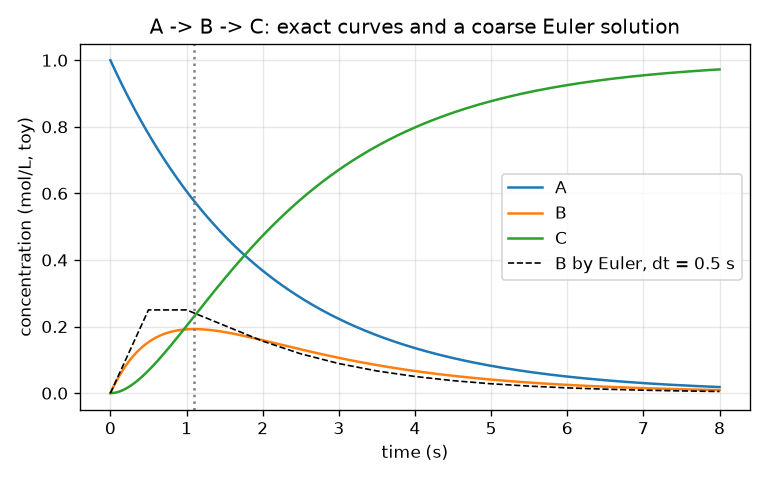
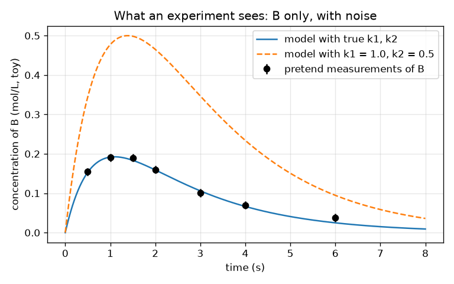

# സെഷൻ 1: സമവാക്യങ്ങളായി ഒരു രാസപ്രവർത്തന ശൃംഖല, ഒരു പരീക്ഷണം കാണുന്നത് എന്ത്

[Session 1 — हिन्दी](README.hi.md)

*ലെവൽ 1 (ആശയപരമായ ഇന്ററാക്ടീവ് മോഡൽ) · ഏകദേശം 60 മിനിറ്റ് · openmechanism*

> ഇത് ലളിതമാക്കിയ ഒരു വിദ്യാഭ്യാസ മോഡൽ ആണ്. ഇത് സാധൂകരിച്ച (validated) ഡിസൈൻ ഉപകരണമല്ല; യഥാർത്ഥ നിർമിതികൾ, വൈദ്യുത ഇൻസ്റ്റലേഷനുകൾ, വാഹനങ്ങൾ, വ്യാവസായിക പ്രക്രിയകൾ അല്ലെങ്കിൽ വൈദ്യശാസ്ത്ര തീരുമാനങ്ങൾ എന്നിവയ്ക്ക് ഇത് ഉപയോഗിക്കരുത്.

**മുൻകൂട്ടി അറിയേണ്ടവ (Prerequisites)**

- സ്കൂൾ ബീജഗണിതവും എക്സ്പോണൻഷ്യൽ ഫംഗ്ഷൻ exp(x)-ഉം.
- നിങ്ങൾ PRIMER.md വായിച്ചിട്ടുണ്ട്, `python start.py 1` ഒരിക്കൽ റൺ ചെയ്തിട്ടുണ്ട്.

**പഠന ലക്ഷ്യങ്ങൾ (Learning objectives).** ഈ സെഷനു ശേഷം നിങ്ങൾക്ക്:

- A -> B -> C എന്ന രണ്ട്-ഘട്ട രാസപ്രവർത്തന ശൃംഖല മൂന്ന് നിരക്ക് സമവാക്യങ്ങളായി (rate equations) എഴുതാം.
- ചെറിയ സമയ ഘട്ടങ്ങൾ (ഓയ്‌ലർ രീതി, Euler's method) ഉപയോഗിച്ച് സമവാക്യങ്ങൾ നിർധാരണം ചെയ്ത് കൃത്യമായ സൂത്രവാക്യവുമായി താരതമ്യം ചെയ്യാം.
- മധ്യവർത്തി (intermediate) B ഉയരുകയും ഉച്ചസ്ഥായിയിലെത്തുകയും താഴുകയും ചെയ്യുന്നത് എന്തുകൊണ്ടെന്ന് വിശദീകരിച്ച് അത് എപ്പോൾ ഉച്ചസ്ഥായിയിലെത്തുന്നു എന്ന് കണ്ടെത്താം.
- ഒരു പരീക്ഷണം എന്ത് അളക്കുന്നു എന്നും ശബ്ദം (noise) അത് പറയാനാകുന്നതിനെ എങ്ങനെ പരിമിതപ്പെടുത്തുന്നു എന്നും വിവരിക്കാം.

## A. യഥാർത്ഥ ലോക പ്രശ്നം
ഒരു ഇന്ധനം കത്തിക്കുന്നത് ഒരിക്കലും ഒരു ഘട്ടമല്ല: തന്മാത്രകൾ മറ്റ് തന്മാത്രകളായി മാറുന്നു, അവ വീണ്ടും മറ്റുള്ളവയായി മാറുന്നു. ഓരോന്നിനും ഒരു വേഗതയുള്ള അത്തരം ഘട്ടങ്ങളുടെ പട്ടികയെ മെക്കാനിസം (mechanism) എന്ന് വിളിക്കുന്നു, യഥാർത്ഥവയ്ക്ക് നൂറുകണക്കിന് ഘട്ടങ്ങളുണ്ട്. ഒരു പരീക്ഷണത്തിന് ഓരോ തന്മാത്രയെയും നിരീക്ഷിക്കാനാകില്ല; അത് ഒരു കാര്യം മാത്രം അളക്കുന്നു, ഉദാഹരണത്തിന് ചില നിമിഷങ്ങളിൽ ഒരു മധ്യവർത്തി എത്ര ഉണ്ടെന്ന്. സാധ്യമായ ഏറ്റവും ചെറിയ മെക്കാനിസം, രണ്ട് ഘട്ടങ്ങൾ, നിർമ്മിച്ച് സമവാക്യങ്ങളായി എഴുതി, മധ്യത്തിലെ തന്മാത്ര B-യുടെ ഒരു അളവ് രണ്ട് വേഗതകളെക്കുറിച്ച് എന്ത് വെളിപ്പെടുത്താനാകും എന്ന് നമുക്ക് കാണാനാകുമോ? (എല്ലായിടത്തും കളിപ്പാട്ട സംഖ്യകൾ; ഇതൊരു അധ്യാപന മോഡൽ ആണ്, യഥാർത്ഥ രസതന്ത്ര ഡാറ്റ അല്ല.)

## B. ആശയവും സിദ്ധാന്തവും
ഒരു നിരക്ക് സ്ഥിരാങ്കം (rate constant) k ഒരു രാസപ്രവർത്തനം എത്ര വേഗത്തിൽ നടക്കുന്നു എന്ന് പറയുന്നു: A -> B-യിൽ A-യുടെ അളവ് k1 ഗുണം A-യുടെ അളവ് എന്ന വേഗതയിൽ കുറയുന്നു. A -> B -> C-ക്ക് നമുക്ക് മൂന്ന് ബന്ധിത സമവാക്യങ്ങൾ ലഭിക്കുന്നു: A ക്ഷയിക്കുക മാത്രം ചെയ്യുന്നു, B-ക്ക് A-യിൽ നിന്ന് ലഭിക്കുകയും C-യിലേക്ക് ഒഴുകിപ്പോകുകയും ചെയ്യുന്നു, C വളരുക മാത്രം ചെയ്യുന്നു. തന്മാത്രകൾ നഷ്ടപ്പെടാത്തതിനാൽ ആകെ A + B + C സ്ഥിരമായി തുടരുന്നു. k1, k2-ൽ നിന്ന് വ്യത്യസ്തമാണെങ്കിൽ കൃത്യമായ നിർധാരണം രണ്ട് എക്സ്പോണൻഷ്യലുകളുടെ വ്യത്യാസമാണ്. B പൂജ്യത്തിൽ തുടങ്ങുന്നു, A ധാരാളമുള്ളപ്പോൾ ഉയരുന്നു, ലഭിക്കുന്നതിനേക്കാൾ വേഗത്തിൽ ഒഴുകിപ്പോകുമ്പോൾ താഴുന്നു; ലഭ്യത k1 A, ഒഴുക്ക് k2 B-ക്ക് തുല്യമാകുമ്പോൾ കൃത്യമായി ഉച്ചസ്ഥായിയിലെത്തുന്നു. ഓയ്‌ലർ രീതി സുഗമമായ മാറ്റത്തെ (നിരക്ക് ഗുണം സമയ ഘട്ടം) വലിപ്പമുള്ള ചെറിയ ചാട്ടങ്ങളാക്കി മാറ്റുന്നു, ഘട്ടം ചുരുങ്ങുമ്പോൾ മെച്ചപ്പെടുന്നു. ഒരു പരീക്ഷണം ചില സമയങ്ങളിൽ ശബ്ദമുള്ള സംഖ്യകൾ നൽകുന്നു, അതിനാൽ പല ജോടികളും (k1, k2) ഏതാണ്ട് ശരിയായി തോന്നാം; മിസ്‌ഫിറ്റ് (misfit; റൂട്ട്-മീൻ-സ്ക്വയർ വ്യത്യാസം) ഒരു മോഡൽ ഡാറ്റയിൽ നിന്ന് എത്ര അകലെയാണെന്ന് പറയുന്നു.

| ചിഹ്നം | അർത്ഥം | യൂണിറ്റ് |
|---|---|---|
| A, B, C | മൂന്ന് തന്മാത്രകളുടെ ഗാഢത | mol/L (കളിപ്പാട്ടം) |
| t | സമയം | s |
| k1, k2 | A -> B, B -> C എന്നിവയുടെ നിരക്ക് സ്ഥിരാങ്കങ്ങൾ | 1/s |
| dt | ഓയ്‌ലർ സമയ ഘട്ടം | s |
| t* | B ഏറ്റവും വലുതാകുന്ന സമയം | s |

**അനുമാനങ്ങൾ (Assumptions)**

- രണ്ട് രാസപ്രവർത്തനങ്ങളും ഒന്നാം കോടിയാണ് (first order): വേഗത പ്രതിപ്രവർത്തിക്കുന്ന തന്മാത്രയുടെ അളവിന് ആനുപാതികമാണ്.
- A = 1 mol/L, B = C = 0 എന്നിങ്ങനെ തുടങ്ങുക; താപനില സ്ഥിരമാണ്.
- സംഖ്യകൾ അധ്യാപനത്തിനായി കണ്ടുപിടിച്ചവയാണ്, ഒരു യഥാർത്ഥ രാസപ്രവർത്തനത്തിന്റെയും ഡാറ്റ അല്ല.

$$ \frac{dA}{dt}=-k_1A,\qquad \frac{dB}{dt}=k_1A-k_2B,\qquad \frac{dC}{dt}=k_2B $$

$$ A(t)=e^{-k_1t},\qquad B(t)=\frac{k_1}{k_2-k_1}\left(e^{-k_1t}-e^{-k_2t}\right),\qquad C=1-A-B $$

$$ t^{*}=\frac{\ln(k_2/k_1)}{k_2-k_1},\qquad B_{\max}=\left(\frac{k_1}{k_2}\right)^{k_2/(k_2-k_1)} $$

$$ y_{n+1}=y_n+\Delta t\,f(y_n)\quad\text{(Euler step)} $$

## C. ദൃശ്യ വിശദീകരണം
ആദ്യ ചിത്രം A താഴുന്നതും, B ഒരൊറ്റ ഉച്ചസ്ഥായിയിലേക്ക് ഉയർന്ന് പിന്നെ താഴുന്നതും, C 1-ലേക്ക് ഉയരുന്നതും കാണിക്കുന്നു, പരുക്കൻ ഓയ്‌ലർ നിർധാരണം (ഡാഷ്) കൃത്യമായ വക്രത്തിൽ നിന്ന് വ്യക്തമായി അകന്നുപോകുന്നു. രണ്ടാമത്തെ ചിത്രം ഒരു പരീക്ഷണം കാണുന്നത് കാണിക്കുന്നു: B മാത്രം, ഏഴ് സമയങ്ങളിൽ, പിശക് ബാറുകളോടെ, രണ്ട് മോഡൽ വക്രങ്ങൾക്കൊപ്പം. യഥാർത്ഥ നിരക്ക് സ്ഥിരാങ്കങ്ങളുള്ള വക്രം പോയിന്റുകളിലൂടെ കടന്നുപോകുന്നു; k1 = 1.0, k2 = 0.5 ഉള്ള വക്രം അവയ്ക്ക് വളരെ മുകളിലാണ്.

*k1 = 0.5, k2 = 1.5 പ്രതി സെക്കൻഡ് എന്നിവയ്ക്ക് സമയത്തിനെതിരെ A, B, C, ഒരു പരുക്കൻ ഓയ്‌ലർ നിർധാരണത്തോടൊപ്പം (ഡാഷ്).*

*ഒരു പരീക്ഷണം കാണുന്നത്: B-യുടെ മാത്രം ശബ്ദമുള്ള അളവുകളും രണ്ട് മോഡൽ വക്രങ്ങളും.*

## D. ഇന്ററാക്ടീവ് സിമുലേഷൻ
പാഠം റൺ ചെയ്യുക (`python start.py 1`), തുടർന്ന് ലൈവ് ആപ്പ് തുറക്കുക: [സെഷൻ 1: A -> B -> C](https://krunalpanchal1995.github.io/pan-iit-oss/openmechanism/session-01/) (അല്ലെങ്കിൽ ഈ ഫോൾഡറിലെ `app.html`). k1, k2 സ്ലൈഡറുകൾ നീക്കി ടാങ്കുകളും വക്രങ്ങളും നിരീക്ഷിക്കുക. B നേരത്തെയോ വൈകിയോ, ഉയർന്നോ താഴ്ന്നോ ഉച്ചസ്ഥായിയിലെത്തുന്നത് എന്താണെന്ന് കണ്ടെത്തുക, ടാങ്ക് നിലകൾ വായിക്കാൻ ടൈം സ്ലൈഡർ ഉപയോഗിക്കുക.

**വെല്ലുവിളി.** B ഏകദേശം 2 s-ൽ (1.9 നും 2.1 s നും ഇടയിൽ) ഉച്ചസ്ഥായിയിലെത്തിക്കുക.

## E. ഉദാഹരണവും പരീക്ഷണവും
**പ്രശ്നം.** k1 = 0.5 പ്രതി സെക്കൻഡും k2 = 1.5 പ്രതി സെക്കൻഡും ആകുമ്പോൾ, B എപ്പോൾ ഉച്ചസ്ഥായിയിലെത്തുന്നു, അപ്പോൾ B എത്ര വലുതാണ്, t = 1 s-ൽ B എത്രയാണ്?

1. ഉച്ചസ്ഥായി സമയം: t* = ln(k2/k1) / (k2 - k1) = ln 3 / 1.0 = 1.0986 s.
2. ഉച്ചസ്ഥായി ഉയരം: B = (k1/k2)^(k2/(k2-k1)) = (1/3)^1.5 = 0.1925 mol/L.
3. ഉച്ചസ്ഥായിയിൽ പരിശോധന: A = exp(-0.5 x 1.0986) = 0.577, അതിനാൽ ലഭ്യത k1 A = 0.289, ഒഴുക്ക് k2 B = 1.5 x 0.1925 = 0.289. ഒരു പരമാവധിയിൽ ആയിരിക്കേണ്ടതുപോലെ അവ തുല്യമാണ്.
4. t = 1 s-ൽ: B = 0.5 / 1.0 x (exp(-0.5) - exp(-1.5)) = 0.5 x (0.6065 - 0.2231) = 0.1917 mol/L, പ്രതീക്ഷിച്ചതുപോലെ ഉച്ചസ്ഥായിക്ക് തൊട്ടുതാഴെ.

**ഉത്തരം.** B 1.099 s-ൽ 0.1925 mol/L-ൽ ഉച്ചസ്ഥായിയിലെത്തുന്നു; 1 s-ൽ അത് 0.1917 mol/L ആണ്.

**പരീക്ഷണം.** ചോർച്ചയുള്ള ബക്കറ്റ് മോഡൽ ഉപയോഗിച്ച് ഇതിനെ അനുകരിക്കുക: മുകളിലെ ബക്കറ്റിലേക്ക് വെള്ളം ഒഴിക്കുക, അത് ഒരു ദ്വാരത്തിലൂടെ ഒഴുകി ഒരു ദ്വാരമുള്ള രണ്ടാമത്തെ ബക്കറ്റിലേക്ക് പോകുന്നു, രണ്ടാമത്തെ ബക്കറ്റിന്റെ നിരപ്പ് ഒരു സ്കെയിൽ ഉപയോഗിച്ച് സമയം നോക്കി അളക്കുക. B പോലെ അത് ഉയരുകയും ഉച്ചസ്ഥായിയിലെത്തുകയും താഴുകയും ചെയ്യുന്നു. മോഡൽ യാഥാർത്ഥ്യത്തിൽ നിന്ന് വ്യത്യസ്തമാണ്, കാരണം യഥാർത്ഥ ഒഴുക്ക് 'നിരപ്പിന് ആനുപാതികം' എന്നതിനേക്കാൾ സങ്കീർണ്ണമായ രീതിയിൽ ജലനിരപ്പിനെ ആശ്രയിക്കുന്നു, ഒരു സ്കെയിൽ വായിക്കുന്നത് ശബ്ദം ചേർക്കുന്നു: സമവാക്യങ്ങൾ മോഡലിന് കൃത്യമാണ്, ബക്കറ്റുകൾക്കല്ല.

## F. വിലയിരുത്തലും ഡിസൈൻ വെല്ലുവിളിയും
**ചോദ്യ തരം A: ആശയപരം.** രണ്ട് രാസപ്രവർത്തനങ്ങളും എല്ലായ്‌പ്പോഴും നടക്കുന്നുണ്ടെങ്കിലും B ആദ്യം ഉയരുകയും പിന്നെ താഴുകയും ചെയ്യുന്നത് എന്തുകൊണ്ട്? ഏത് നിമിഷത്തിലാണ് അതിന്റെ മാറ്റ നിരക്ക് പൂജ്യമാകുന്നത്?

സൂചന

B-ക്ക് എത്ര വേഗത്തിൽ ലഭിക്കുന്നു എന്നതിനെ എത്ര വേഗത്തിൽ ഒഴുകിപ്പോകുന്നു എന്നതുമായി താരതമ്യം ചെയ്യുക.

ഘട്ടം ഘട്ടമായുള്ള പരിഹാരം

B-ക്ക് k1 A നിരക്കിൽ ലഭിക്കുന്നു, അത് തുടക്കത്തിൽ വലുതാണ് (A ധാരാളം) A ഉപയോഗിക്കപ്പെടുമ്പോൾ ചുരുങ്ങുന്നു; B k2 B നിരക്കിൽ ഒഴുകിപ്പോകുന്നു, അത് തുടക്കത്തിൽ പൂജ്യമാണ്, B-യോടൊപ്പം വളരുന്നു. തുടക്കത്തിൽ ലഭ്യത ജയിക്കുന്നു, B ഉയരുന്നു; പിന്നീട് ഒഴുക്ക് ജയിക്കുന്നു, B താഴുന്നു. ലഭ്യതയും ഒഴുക്കും തുല്യമാകുമ്പോൾ, k1 A = k2 B, B-യുടെ മാറ്റ നിരക്ക് കൃത്യമായി പൂജ്യമാണ്, അതാണ് ഉച്ചസ്ഥായി.

**ചോദ്യ തരം B: സംഖ്യാപരം.** k1 = 0.4 പ്രതി സെക്കൻഡ്, k2 = 0.8 പ്രതി സെക്കൻഡ് എന്നിവയ്ക്ക്, B-യുടെ ഉച്ചസ്ഥായിയുടെ സമയവും ഉയരവും കണ്ടെത്തുക. യൂണിറ്റുകളും ഉത്തരം യുക്തിസഹമാണോ എന്നും പരിശോധിക്കുക.

സൂചന

t* = ln(k2/k1)/(k2 - k1), B_max = (k1/k2)^(k2/(k2-k1)) ഉപയോഗിക്കുക.

ഘട്ടം ഘട്ടമായുള്ള പരിഹാരം

t* = ln 2 / 0.4 = 0.6931 / 0.4 = 1.733 s. B_max = (0.5)^(0.8/0.4) = 0.5^2 = 0.25 mol/L. യൂണിറ്റുകൾ: ഒരു അനുപാതത്തിന്റെ ln-ന് യൂണിറ്റില്ല, 1/s കൊണ്ട് ഹരിച്ചാൽ s ലഭിക്കുന്നു; B തുടക്കത്തിലെ 1 mol/L-ന്റെ ഒരു ഭിന്നമാണ്, അതിനാൽ 0.25 mol/L യുക്തിസഹമാണ് (1-ൽ കുറവ്). പൂർണ്ണ സൂത്രവാക്യം കൊണ്ട് പരിശോധന: B(1.733) = 0.4/0.4 x (exp(-0.693) - exp(-1.386)) = 0.5 - 0.25 = 0.25.

**ചോദ്യ തരം C: ഗ്രാഫും സിമുലേഷനും വ്യാഖ്യാനിക്കൽ.** k1 = 0.5, k2 = 1.5 ഉള്ള ഗാഢത ഗ്രാഫിൽ, B ഉച്ചസ്ഥായിയിലായിരിക്കുന്ന നിമിഷത്തിൽ ഏത് വക്രമാണ് ഏറ്റവും വേഗത്തിൽ ഉയരുന്നത്, എന്തുകൊണ്ട്?

സൂചന

C k2 B വേഗതയിൽ വളരുന്നു.

ഘട്ടം ഘട്ടമായുള്ള പരിഹാരം

C k2 B നിരക്കിൽ വളരുന്നു. B അതിന്റെ ഉച്ചസ്ഥായിയിൽ ഏറ്റവും വലുതാണ്, അതിനാൽ C-യുടെ വളർച്ചാ നിരക്ക് അവിടെ ഏറ്റവും വലുതാണ്: C വക്രം 1.1 s-ൽ ഏറ്റവും കുത്തനെയുള്ളതാണ്. A വക്രം എല്ലായ്‌പ്പോഴും താഴുന്നു, t = 0-ൽ ഏറ്റവും കുത്തനെയുള്ളതാണ്.

**ചോദ്യ തരം D: ഡിസൈനും ഒപ്റ്റിമൈസേഷനും വെല്ലുവിളി.** ഡിസൈൻ: നിങ്ങൾക്ക് ഒരു സമയത്ത് മാത്രമേ B അളക്കാനാകൂ. അജ്ഞാത മെക്കാനിസം (k1, k2) = (0.5, 1.5) അല്ലെങ്കിൽ (1.5, 0.5) ആണ്, അളക്കൽ ശബ്ദം 0.01 mol/L ആണ്. നിങ്ങൾ ഏത് സമയം തിരഞ്ഞെടുക്കും, ഇവ രണ്ടും എത്ര നന്നായി വേർതിരിച്ചറിയാനാകും?

സൂചന

രണ്ടിനും B(t) കണക്കാക്കി വ്യത്യാസം നോക്കുക. ഉപയോഗപ്രദമായ വസ്തുത: k1, k2 പരസ്പരം മാറ്റുന്നത് B-യെ ഒരു സ്ഥിര ഘടകം കൊണ്ട് മാറ്റുന്നു.

ഘട്ടം ഘട്ടമായുള്ള പരിഹാരം

രണ്ട് നിരക്ക് സ്ഥിരാങ്കങ്ങളും പരസ്പരം മാറ്റുന്നത് ഓരോ സമയത്തും B-യെ k2/k1 = 3 കൊണ്ട് ഗുണിക്കുന്നു, അതിനാൽ രണ്ടാമത്തെ മെക്കാനിസം എപ്പോഴും 3 മടങ്ങ് B നൽകുന്നു. B ഏറ്റവും വലുതാകുന്നിടത്ത്, പൊതു ഉച്ചസ്ഥായി സമയമായ 1.099 s-ൽ, വ്യത്യാസം ഏറ്റവും വലുതാണ്: 0.1925 നെതിരെ 0.577 mol/L, 0.385 mol/L വ്യത്യാസം, ശബ്ദത്തിന്റെ ഏകദേശം 38 മടങ്ങ്. തത്വത്തിൽ ഏത് സമയവും പ്രവർത്തിക്കും, എന്നാൽ ഉച്ചസ്ഥായി ഏറ്റവും വലിയ മാർജിൻ നൽകുന്നു. വിട്ടുവീഴ്ച (trade-off): t = 0-ലെ അളവ് (B = 0) ഒന്നും പറയുന്നില്ല, വളരെ വൈകിയ സമയങ്ങൾ ശബ്ദത്തോട് അടുത്ത ചെറിയ സിഗ്നലുകൾ നൽകുന്നു.

[RUBRIC.md](../../RUBRIC.md) ഉപയോഗിച്ച് സ്വയം സ്കോർ ചെയ്യുക. പേപ്പറിൽ ചെയ്യാൻ [ആക്ടിവിറ്റി ഷീറ്റ്](activity_sheet.md) പ്രിന്റ് ചെയ്യുക.

## സാധാരണ തെറ്റിദ്ധാരണകൾ
| സാധാരണ തെറ്റിദ്ധാരണ | യഥാർത്ഥത്തിൽ ശരിയായത് |
|---|---|
| മധ്യവർത്തി B, A തീരുന്നതുവരെ ഉയർന്നുകൊണ്ടേയിരിക്കുന്നു. | B-ക്ക് ഒരേ സമയം ലഭിക്കുകയും ഒഴുകിപ്പോകുകയും ചെയ്യുന്നു; ലഭ്യതയും ഒഴുക്കും തുല്യമാകുമ്പോൾ അത് ഉച്ചസ്ഥായിയിലെത്തുകയും പിന്നെ താഴുകയും ചെയ്യുന്നു. |
| രണ്ട് നിരക്ക് സ്ഥിരാങ്കങ്ങളും ഇരട്ടിയാക്കിയാൽ B ഇരട്ടിയാകുന്നു. | രണ്ടും ഇരട്ടിയാക്കുന്നത് മുഴുവൻ പ്രക്രിയയെയും വേഗത്തിലാക്കുന്നു (ഉച്ചസ്ഥായി പകുതി സമയത്തിൽ വരുന്നു); B(t)-യുടെ ആകൃതി മാറുന്നു, ഉച്ചസ്ഥായി ഉയരം അതേപടി തുടരുന്നു, കാരണം ഉയരം നിശ്ചയിക്കുന്നത് k1/k2 അനുപാതം മാത്രമാണ്. |
| ചെറിയ ഓയ്‌ലർ ഘട്ടം എപ്പോഴും ഉത്തരം കൃത്യമാക്കുന്നു. | അത് മെച്ചപ്പെടുത്തുന്നു, കൃത്യമാക്കുന്നില്ല: പിശക് ഏകദേശം ഘട്ടത്തിന് ആനുപാതികമായി ചുരുങ്ങുന്നു, വളരെ ചെറിയ ഘട്ടങ്ങളുള്ള ഒരു കമ്പ്യൂട്ടറിന് കൂടുതൽ സമയമെടുക്കുന്നു. |
| മോഡൽ ഡാറ്റയിലൂടെ കടന്നുപോകുന്നുവെങ്കിൽ നിരക്ക് സ്ഥിരാങ്കങ്ങൾ തീർച്ചയായും ശരിയാണ്. | ശബ്ദമുള്ള ഡാറ്റ ഒരു പരിധി നിരക്ക് സ്ഥിരാങ്കങ്ങളെ അനുവദിക്കുന്നു; ഉത്തരം അദ്വിതീയമാണോ എന്നല്ല, നിങ്ങൾ എത്ര അകലെയാണെന്നാണ് മിസ്‌ഫിറ്റ് കാണിക്കുന്നത്. |

## പദാവലി (Glossary)
- **മെക്കാനിസം (mechanism)**: നിരക്ക് സ്ഥിരാങ്കങ്ങളോടെയുള്ള രാസപ്രവർത്തനങ്ങളുടെ പട്ടിക
- **നിരക്ക് സ്ഥിരാങ്കം (rate constant)**: ഒരു രാസപ്രവർത്തനം എത്ര വേഗത്തിൽ നടക്കുന്നു എന്ന് നിശ്ചയിക്കുന്ന സംഖ്യ k; ഇവിടെ 1/s-ൽ
- **മധ്യവർത്തി (intermediate)**: B പോലെ, ഉണ്ടാക്കപ്പെടുകയും പിന്നെ ഉപയോഗിച്ചുതീർക്കപ്പെടുകയും ചെയ്യുന്ന തന്മാത്ര
- **ഓയ്‌ലർ രീതി (Euler's method)**: (നിരക്ക് x സമയ ഘട്ടം) എന്ന ചെറിയ ഘട്ടങ്ങൾ ആവർത്തിച്ച് ഒരു സമവാക്യം നിർധാരണം ചെയ്യൽ
- **മിസ്‌ഫിറ്റ് (misfit)**: മോഡലും അളവുകളും തമ്മിലുള്ള റൂട്ട്-മീൻ-സ്ക്വയർ വ്യത്യാസം

## പൂർത്തിയാക്കുക
1. [exercises.md](exercises.md)-ലെ മൂന്ന് കോഡിംഗ് ടാസ്കുകൾ ചെയ്യുക.
2. നിങ്ങളുടെ മാറ്റങ്ങൾക്ക് ശേഷം `python start.py 1` വീണ്ടും റൺ ചെയ്യുക. അത് ചെക്ക്‌പോയിന്റോടെ അവസാനിക്കുന്നു; അത് `PASS` പ്രിന്റ് ചെയ്യുമ്പോൾ നിങ്ങൾ പൂർത്തിയാക്കി. (ചെക്ക്‌പോയിന്റ് മാത്രം: `python start.py check 1`.)

അടുത്തത്: [സെഷൻ 2](../session-02/README.md)
