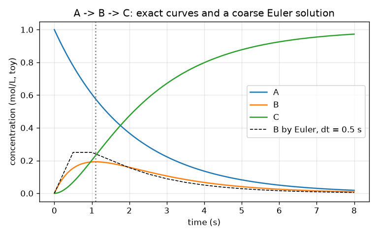
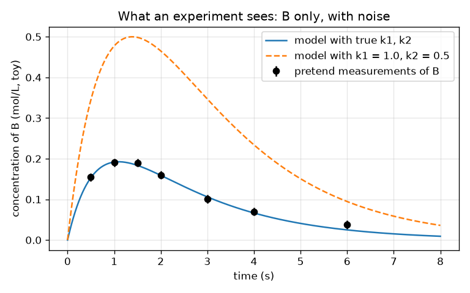

# அமர்வு 1: சமன்பாடுகளாக ஒரு வினை வலைப்பின்னல், ஒரு சோதனை காண்பது என்ன

[Session 1 — हिन्दी](README.hi.md)

*நிலை 1 (கருத்தியல் ஊடாடும் மாதிரி) · சுமார் 60 நிமிடங்கள் · openmechanism*

> இது எளிமைப்படுத்தப்பட்ட ஒரு கல்வி மாதிரி. இது சரிபார்க்கப்பட்ட (validated) வடிவமைப்புக் கருவி அல்ல; உண்மையான கட்டமைப்புகள், மின் நிறுவல்கள், வாகனங்கள், தொழிற்சாலை செயல்முறைகள் அல்லது மருத்துவ முடிவுகளுக்கு இதைப் பயன்படுத்தக் கூடாது.

**முன்தேவைகள் (Prerequisites)**

- பள்ளி இயற்கணிதமும் அடுக்குக்குறிச் சார்பு exp(x) உம்.
- நீங்கள் PRIMER.md படித்து, `python start.py 1` ஒருமுறை இயக்கியுள்ளீர்கள்.

**கற்றல் நோக்கங்கள் (Learning objectives).** இந்த அமர்வுக்குப் பிறகு நீங்கள்:

- A -> B -> C என்ற இரண்டு-படி வினை வலைப்பின்னலை மூன்று வீதச் சமன்பாடுகளாக (rate equations) எழுதலாம்.
- சிறிய நேரப் படிகளுடன் (ஆய்லர் முறை, Euler's method) சமன்பாடுகளைத் தீர்த்து, துல்லியமான சூத்திரத்துடன் ஒப்பிடலாம்.
- இடைநிலை (intermediate) B ஏன் உயர்ந்து, உச்சமடைந்து, தாழ்கிறது என்று விளக்கி, அது எப்போது உச்சமடைகிறது என்று கண்டறியலாம்.
- ஒரு சோதனை எதை அளக்கிறது என்றும், இரைச்சல் (noise) அது சொல்லக்கூடியதை எவ்வாறு வரையறுக்கிறது என்றும் விவரிக்கலாம்.

## A. நிஜ உலகப் பிரச்சினை
ஓர் எரிபொருளை எரிப்பது ஒருபோதும் ஒரே படி அல்ல: மூலக்கூறுகள் மற்ற மூலக்கூறுகளாகின்றன, அவை மேலும் மற்றவையாகின்றன. ஒவ்வொன்றுக்கும் ஒரு வேகம் கொண்ட அத்தகைய படிகளின் பட்டியல் வினை இயங்குமுறை (mechanism) எனப்படுகிறது, உண்மையானவற்றில் நூற்றுக்கணக்கான படிகள் உள்ளன. ஒரு சோதனையால் ஒவ்வொரு மூலக்கூறையும் பார்க்க முடியாது; அது ஒன்றை மட்டும் அளக்கிறது, உதாரணமாகச் சில கணங்களில் ஓர் இடைநிலை எவ்வளவு இருக்கிறது என்று. சாத்தியமான மிகச் சிறிய இயங்குமுறையை, இரண்டு படிகளை, உருவாக்கி சமன்பாடுகளாக எழுதி, நடுவிலுள்ள மூலக்கூறு B இன் அளவீடு இரண்டு வேகங்களைப் பற்றி என்ன வெளிப்படுத்தும் என்று நாம் காண முடியுமா? (எங்கும் பொம்மை எண்கள்; இது ஒரு கற்பித்தல் மாதிரி, உண்மை வேதியியல் தரவு அல்ல.)

## B. கருத்தும் கோட்பாடும்
ஒரு வினைவேக மாறிலி (rate constant) k ஒரு வினை எவ்வளவு வேகமாக நடக்கிறது என்று சொல்கிறது: A -> B இல் A இன் அளவு k1 பெருக்கல் A இன் அளவு என்ற வேகத்தில் குறைகிறது. A -> B -> C க்கு மூன்று இணைந்த சமன்பாடுகள் கிடைக்கின்றன: A சிதைவது மட்டுமே, B க்கு A இலிருந்து வரவு உண்டு, C க்கு வெளியேற்றம் உண்டு, C வளர்வது மட்டுமே. மூலக்கூறுகள் இழக்கப்படாததால் மொத்தம் A + B + C மாறாமல் இருக்கும். k1, k2 இலிருந்து வேறுபட்டால் துல்லியத் தீர்வு இரண்டு அடுக்குக்குறிகளின் வேறுபாடு. B பூஜ்ஜியத்தில் தொடங்குகிறது, A மிகுதியாக இருக்கும்போது உயர்கிறது, வரவை விட வேகமாக வெளியேறும்போது தாழ்கிறது; வரவு k1 A வெளியேற்றம் k2 B க்குச் சமமாகும்போது சரியாக உச்சமடைகிறது. ஆய்லர் முறை சீரான மாற்றத்தை (வீதம் பெருக்கல் நேரப் படி) அளவுள்ள சிறிய தாவல்களாக மாற்றுகிறது, படி சுருங்கும்போது மேம்படுகிறது. ஒரு சோதனை சில நேரங்களில் இரைச்சலுள்ள எண்களைத் தருகிறது, எனவே பல ஜோடிகள் (k1, k2) கிட்டத்தட்ட சரியாகத் தோன்றலாம்; பொருத்தமின்மை (misfit; வர்க்க சராசரி மூல வேறுபாடு) ஒரு மாதிரி தரவிலிருந்து எவ்வளவு தொலைவில் உள்ளது என்று சொல்கிறது.

| குறியீடு | பொருள் | அலகு |
|---|---|---|
| A, B, C | மூன்று மூலக்கூறுகளின் செறிவுகள் | mol/L (பொம்மை) |
| t | நேரம் | s |
| k1, k2 | A -> B, B -> C இன் வினைவேக மாறிலிகள் | 1/s |
| dt | ஆய்லர் நேரப் படி | s |
| t* | B மிகப் பெரிதாக இருக்கும் நேரம் | s |

**அனுமானங்கள் (Assumptions)**

- இரண்டு வினைகளும் முதல் வகை (first order): வேகம் வினைபுரியும் மூலக்கூறின் அளவுக்கு விகிதசமம்.
- A = 1 mol/L, B = C = 0 உடன் தொடங்கவும்; வெப்பநிலை மாறாது.
- எண்கள் கற்பித்தலுக்காகக் கண்டுபிடிக்கப்பட்டவை, எந்த உண்மை வினையின் தரவும் அல்ல.

$$ \frac{dA}{dt}=-k_1A,\qquad \frac{dB}{dt}=k_1A-k_2B,\qquad \frac{dC}{dt}=k_2B $$

$$ A(t)=e^{-k_1t},\qquad B(t)=\frac{k_1}{k_2-k_1}\left(e^{-k_1t}-e^{-k_2t}\right),\qquad C=1-A-B $$

$$ t^{*}=\frac{\ln(k_2/k_1)}{k_2-k_1},\qquad B_{\max}=\left(\frac{k_1}{k_2}\right)^{k_2/(k_2-k_1)} $$

$$ y_{n+1}=y_n+\Delta t\,f(y_n)\quad\text{(Euler step)} $$

## C. காட்சி விளக்கம்
முதல் படம் A வீழ்வதையும், B ஒரே உச்சத்திற்கு உயர்ந்து பின்னர் தாழ்வதையும், C 1 க்கு உயர்வதையும் காட்டுகிறது; கரடுமுரடான ஆய்லர் தீர்வு (கோடிட்டது) துல்லிய வளைவிலிருந்து தெளிவாக விலகுகிறது. இரண்டாவது படம் ஒரு சோதனை காண்பதைக் காட்டுகிறது: B மட்டும், ஏழு நேரங்களில், பிழைப் பட்டைகளுடன், இரண்டு மாதிரி வளைவுகளுடன். உண்மை வினைவேக மாறிலிகள் கொண்ட வளைவு புள்ளிகள் வழியாகச் செல்கிறது; k1 = 1.0 மற்றும் k2 = 0.5 கொண்ட வளைவு அவற்றுக்கு மிக மேலே உள்ளது.

*k1 = 0.5 மற்றும் k2 = 1.5 ஒரு நொடிக்கு என்பதற்கு நேரத்திற்கு எதிராக A, B, C, ஒரு கரடுமுரடான ஆய்லர் தீர்வுடன் (கோடிட்டது).*

*ஒரு சோதனை காண்பது: B இன் மட்டும் இரைச்சலுள்ள அளவீடுகளும் இரண்டு மாதிரி வளைவுகளும்.*

## D. ஊடாடும் உருவகப்படுத்தல் (Interactive simulation)
பாடத்தை இயக்கவும் (`python start.py 1`), பின்னர் நேரடிச் செயலியைத் திறக்கவும்: [அமர்வு 1: A -> B -> C](https://krunalpanchal1995.github.io/pan-iit-oss/openmechanism/session-01/) (அல்லது இந்தக் கோப்புறையிலுள்ள `app.html`). k1 மற்றும் k2 ஸ்லைடர்களை நகர்த்தித் தொட்டிகளையும் வளைவுகளையும் கவனிக்கவும். B முன்னதாகவோ பின்னதாகவோ, உயரமாகவோ தாழ்வாகவோ உச்சமடைவது எது என்று கண்டறியவும், தொட்டி அளவுகளைப் படிக்க நேர ஸ்லைடரைப் பயன்படுத்தவும்.

**சவால்.** B ஐ சுமார் 2 s இல் (1.9 முதல் 2.1 s க்கு இடையே) உச்சமடையச் செய்யவும்.

## E. தீர்க்கப்பட்ட எடுத்துக்காட்டும் சோதனையும்
**பிரச்சினை.** k1 = 0.5 ஒரு நொடிக்கு மற்றும் k2 = 1.5 ஒரு நொடிக்கு எனும்போது, B எப்போது உச்சமடைகிறது, அப்போது B எவ்வளவு பெரிது, t = 1 s இல் B என்ன?

1. உச்ச நேரம்: t* = ln(k2/k1) / (k2 - k1) = ln 3 / 1.0 = 1.0986 s.
2. உச்ச உயரம்: B = (k1/k2)^(k2/(k2-k1)) = (1/3)^1.5 = 0.1925 mol/L.
3. உச்சத்தில் சரிபார்ப்பு: A = exp(-0.5 x 1.0986) = 0.577, எனவே வரவு k1 A = 0.289, வெளியேற்றம் k2 B = 1.5 x 0.1925 = 0.289. ஒரு பெருமத்தில் இருக்க வேண்டியபடி அவை சமம்.
4. t = 1 s இல்: B = 0.5 / 1.0 x (exp(-0.5) - exp(-1.5)) = 0.5 x (0.6065 - 0.2231) = 0.1917 mol/L, எதிர்பார்த்தபடி உச்சத்திற்குச் சற்றுக் கீழே.

**விடை.** B 1.099 s இல் 0.1925 mol/L உடன் உச்சமடைகிறது; 1 s இல் அது 0.1917 mol/L.

**சோதனை.** கசியும் வாளி மாதிரியால் இதைப் பின்பற்றுங்கள்: மேல் வாளியில் நீர் ஊற்றவும், அது ஒரு துளை வழியாக வடிந்து துளை உள்ள இரண்டாவது வாளிக்குச் செல்கிறது; இரண்டாவது வாளியின் மட்டத்தை ஓர் அளவுகோலால் நேரம் பார்த்து அளக்கவும். B ஐப் போல அது உயர்ந்து, உச்சமடைந்து, தாழ்கிறது. மாதிரி நிஜத்திலிருந்து வேறுபடுகிறது, ஏனெனில் உண்மை வடிதல் 'மட்டத்திற்கு விகிதசமம்' என்பதை விடச் சிக்கலான முறையில் நீர் மட்டத்தைச் சார்ந்தது, அளவுகோலைப் படிப்பது இரைச்சலைச் சேர்க்கிறது: சமன்பாடுகள் மாதிரிக்குத் துல்லியமானவை, வாளிகளுக்கு அல்ல.

## F. மதிப்பீடும் வடிவமைப்புச் சவாலும்
**கேள்வி வகை A: கருத்தியல்.** இரண்டு வினைகளும் எப்போதும் நடந்துகொண்டிருந்தாலும் B ஏன் முதலில் உயர்ந்து பின்னர் தாழ்கிறது? எந்தக் கணத்தில் அதன் மாற்ற வீதம் பூஜ்ஜியம்?

குறிப்பு

B க்கு எவ்வளவு வேகமாக வரவு உள்ளது என்பதை எவ்வளவு வேகமாக வெளியேறுகிறது என்பதுடன் ஒப்பிடுக.

படிப்படியான தீர்வு

B க்கு k1 A வீதத்தில் வரவு உண்டு, அது தொடக்கத்தில் பெரியது (A மிகுதி) A செலவாகும்போது சுருங்குகிறது; B k2 B வீதத்தில் வெளியேறுகிறது, அது தொடக்கத்தில் பூஜ்ஜியம், B உடன் வளர்கிறது. ஆரம்பத்தில் வரவு வெல்கிறது, B உயர்கிறது; பின்னர் வெளியேற்றம் வெல்கிறது, B தாழ்கிறது. வரவும் வெளியேற்றமும் சமமாகும்போது, k1 A = k2 B, B இன் மாற்ற வீதம் சரியாகப் பூஜ்ஜியம், அதுவே உச்சம்.

**கேள்வி வகை B: எண்ணியல்.** k1 = 0.4 ஒரு நொடிக்கு மற்றும் k2 = 0.8 ஒரு நொடிக்கு எனும்போது, B இன் உச்சத்தின் நேரத்தையும் உயரத்தையும் கண்டறியவும். அலகுகளையும் விடை நியாயமானதா என்பதையும் சரிபார்க்கவும்.

குறிப்பு

t* = ln(k2/k1)/(k2 - k1) மற்றும் B_max = (k1/k2)^(k2/(k2-k1)) ஐப் பயன்படுத்தவும்.

படிப்படியான தீர்வு

t* = ln 2 / 0.4 = 0.6931 / 0.4 = 1.733 s. B_max = (0.5)^(0.8/0.4) = 0.5^2 = 0.25 mol/L. அலகுகள்: ஒரு விகிதத்தின் ln க்கு அலகு இல்லை, 1/s ஆல் வகுத்தால் s கிடைக்கிறது; B தொடக்க 1 mol/L இன் ஒரு பின்னம், எனவே 0.25 mol/L நியாயமானது (1 ஐ விடக் குறைவு). முழுச் சூத்திரத்துடன் சரிபார்ப்பு: B(1.733) = 0.4/0.4 x (exp(-0.693) - exp(-1.386)) = 0.5 - 0.25 = 0.25.

**கேள்வி வகை C: வரைபடம் மற்றும் உருவகப்படுத்தல் விளக்கம்.** k1 = 0.5 மற்றும் k2 = 1.5 கொண்ட செறிவு வரைபடத்தில், B தனது உச்சத்தில் இருக்கும் கணத்தில் எந்த வளைவு மிக வேகமாக உயர்கிறது, ஏன்?

குறிப்பு

C k2 B வேகத்தில் வளர்கிறது.

படிப்படியான தீர்வு

C k2 B வீதத்தில் வளர்கிறது. B தனது உச்சத்தில் மிகப் பெரியது, எனவே C இன் வளர்ச்சி வீதம் அங்கு மிகப் பெரியது: C வளைவு 1.1 s இல் மிகச் செங்குத்தானது. A வளைவு எப்போதும் வீழ்கிறது, t = 0 இல் மிகச் செங்குத்தானது.

**கேள்வி வகை D: வடிவமைப்பு மற்றும் உகப்பாக்கச் (optimisation) சவால்.** வடிவமைப்பு: நீங்கள் ஒரே நேரத்தில் மட்டுமே B ஐ அளக்கலாம். அறியப்படாத இயங்குமுறை (k1, k2) = (0.5, 1.5) அல்லது (1.5, 0.5), அளவீட்டு இரைச்சல் 0.01 mol/L. எந்த நேரத்தைத் தேர்ந்தெடுப்பீர்கள், இரண்டையும் எவ்வளவு நன்றாகப் பிரித்தறிய முடியும்?

குறிப்பு

இரண்டுக்கும் B(t) ஐக் கணக்கிட்டு வேறுபாட்டைப் பாருங்கள். பயனுள்ள உண்மை: k1 ஐயும் k2 ஐயும் இடமாற்றுவது B ஐ ஒரு மாறாக் காரணியால் மாற்றுகிறது.

படிப்படியான தீர்வு

இரண்டு வினைவேக மாறிலிகளையும் இடமாற்றுவது ஒவ்வொரு நேரத்திலும் B ஐ k2/k1 = 3 ஆல் பெருக்குகிறது, எனவே இரண்டாவது இயங்குமுறை எப்போதும் 3 மடங்கு B ஐத் தருகிறது. B மிகப் பெரிதாக இருக்கும் இடத்தில், பொது உச்ச நேரம் 1.099 s இல், வேறுபாடு மிகப் பெரியது: 0.1925 க்கு எதிராக 0.577 mol/L, 0.385 mol/L வேறுபாடு, இரைச்சலைப் போல் சுமார் 38 மடங்கு. கோட்பாட்டில் எந்த நேரமும் வேலை செய்யும், ஆனால் உச்சம் மிகப் பெரிய வரம்பைத் தருகிறது. சமரசம் (trade-off): t = 0 இல் அளவீடு (B = 0) எதுவும் சொல்லாது, மிகத் தாமதமான நேரங்கள் இரைச்சலுக்கு அருகிலுள்ள சிறிய சமிக்ஞைகளைத் தருகின்றன.

[RUBRIC.md](../../RUBRIC.md) மூலம் உங்களை நீங்களே மதிப்பிடுங்கள். தாளில் செய்ய [செயல்பாட்டுத் தாளை](activity_sheet.md) அச்சிடவும்.

## பொதுவான தவறான கருத்துகள்
| பொதுவான தவறான கருத்து | உண்மையில் சரியானது |
|---|---|
| இடைநிலை B, A தீரும் வரை உயர்ந்துகொண்டே இருக்கும். | B க்கு ஒரே நேரத்தில் வரவும் வெளியேற்றமும் உண்டு; வரவு வெளியேற்றத்திற்குச் சமமாகும்போது அது உச்சமடைந்து பின்னர் தாழ்கிறது. |
| இரண்டு வினைவேக மாறிலிகளையும் இரட்டிப்பாக்கினால் B இரட்டிப்பாகும். | இரண்டையும் இரட்டிப்பாக்குவது முழுச் செயல்முறையையும் வேகப்படுத்துகிறது (உச்சம் பாதி நேரத்தில் வருகிறது); B(t) இன் வடிவம் மாறுகிறது, உச்ச உயரம் அதேபடி இருக்கும், ஏனெனில் உயரத்தை நிர்ணயிப்பது k1/k2 விகிதம் மட்டுமே. |
| சிறிய ஆய்லர் படி எப்போதும் விடையைத் துல்லியமாக்கும். | அது மேம்படுத்துகிறது, துல்லியமாக்குவதில்லை: பிழை சுமார் படியின் விகிதத்தில் சுருங்குகிறது, மிகச் சிறிய படிகளுடன் கணினிக்கு அதிக நேரம் ஆகிறது. |
| மாதிரி தரவு வழியாகச் சென்றால் வினைவேக மாறிலிகள் நிச்சயம் சரி. | இரைச்சலுள்ள தரவு வினைவேக மாறிலிகளின் ஒரு வரம்பை அனுமதிக்கிறது; பொருத்தமின்மை நீங்கள் எவ்வளவு தொலைவில் இருக்கிறீர்கள் என்று காட்டுகிறது, விடை தனித்துவமானதா என்று அல்ல. |

## சொற்களஞ்சியம் (Glossary)
- **வினை இயங்குமுறை (mechanism)**: வினைவேக மாறிலிகளுடன் வினைகளின் பட்டியல்
- **வினைவேக மாறிலி (rate constant)**: ஒரு வினை எவ்வளவு வேகமாக ஓடுகிறது என்பதை அமைக்கும் எண் k; இங்கே 1/s இல்
- **இடைநிலை (intermediate)**: B போல உருவாக்கப்பட்டு பின்னர் செலவாகும் மூலக்கூறு
- **ஆய்லர் முறை (Euler's method)**: (வீதம் x நேரப் படி) என்ற சிறிய படிகளை மீண்டும் மீண்டும் செய்து ஒரு சமன்பாட்டைத் தீர்த்தல்
- **பொருத்தமின்மை (misfit)**: மாதிரிக்கும் அளவீடுகளுக்கும் இடையிலான வர்க்க சராசரி மூல வேறுபாடு

## நிறைவு
1. [exercises.md](exercises.md)-இல் உள்ள மூன்று நிரலாக்கப் பணிகளைச் செய்யவும்.
2. உங்கள் மாற்றங்களுக்குப் பிறகு `python start.py 1` மீண்டும் இயக்கவும். அது சோதனைச் சாவடியுடன் (checkpoint) முடிகிறது; அது `PASS` அச்சிடும்போது நீங்கள் முடித்துவிட்டீர்கள். (சோதனைச் சாவடி மட்டும்: `python start.py check 1`.)

அடுத்து: [அமர்வு 2](../session-02/README.md)
