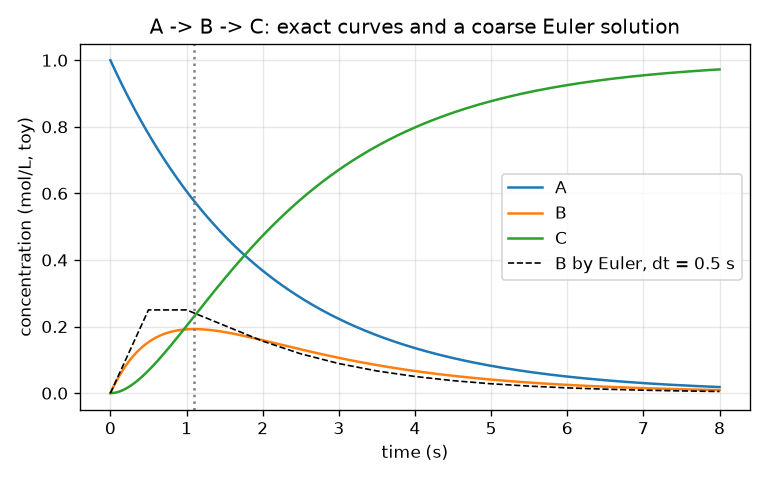
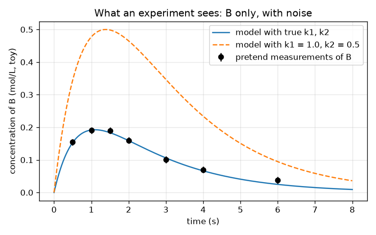

# సెషన్ 1: సమీకరణాలుగా ఒక చర్య నెట్‌వర్క్, ఒక ప్రయోగం చూసేది ఏమిటి

[Session 1 — हिन्दी](README.hi.md)

*స్థాయి 1 (భావనాత్మక ఇంటరాక్టివ్ నమూనా) · సుమారు 60 నిమిషాలు · openmechanism*

> ఇది సరళీకరించిన విద్యా నమూనా. ఇది ధృవీకరించబడిన (validated) డిజైన్ సాధనం కాదు; నిజమైన నిర్మాణాలు, విద్యుత్ ఇన్‌స్టలేషన్లు, వాహనాలు, పారిశ్రామిక ప్రక్రియలు లేదా వైద్య నిర్ణయాల కోసం దీనిని ఉపయోగించకూడదు.

**ముందస్తు అవసరాలు (Prerequisites)**

- పాఠశాల బీజగణితం మరియు ఘాతాంక ప్రమేయం exp(x).
- మీరు PRIMER.md చదివి, `python start.py 1` ఒకసారి రన్ చేశారు.

**అభ్యసన లక్ష్యాలు (Learning objectives).** ఈ సెషన్ తర్వాత మీరు:

- A -> B -> C అనే రెండు-దశల చర్య నెట్‌వర్క్‌ను మూడు రేటు సమీకరణాలుగా (rate equations) రాయగలరు.
- చిన్న కాల అడుగులతో (ఆయిలర్ పద్ధతి, Euler's method) సమీకరణాలను సాధించి, ఖచ్చితమైన సూత్రంతో పోల్చగలరు.
- మధ్యస్థ పదార్థం (intermediate) B ఎందుకు పెరిగి, శిఖరం చేరి, తగ్గుతుందో వివరించి, అది ఎప్పుడు శిఖరం చేరుతుందో కనుగొనగలరు.
- ఒక ప్రయోగం ఏమి కొలుస్తుందో, శబ్దం (noise) అది చెప్పగలిగే దానిని ఎలా పరిమితం చేస్తుందో వివరించగలరు.

## A. వాస్తవ ప్రపంచ సమస్య
ఇంధనాన్ని కాల్చడం ఎప్పుడూ ఒకే దశ కాదు: అణువులు ఇతర అణువులుగా మారతాయి, అవి మళ్ళీ ఇతరాలుగా మారతాయి. ప్రతిదానికి ఒక వేగం ఉన్న అలాంటి దశల జాబితాను యంత్రాంగం (mechanism) అంటారు, నిజమైన వాటిలో వందల దశలు ఉంటాయి. ఒక ప్రయోగం ప్రతి అణువును చూడలేదు; అది ఒక్కదాన్ని మాత్రమే కొలుస్తుంది, ఉదాహరణకు కొన్ని క్షణాల్లో ఒక మధ్యస్థ పదార్థం ఎంత ఉందో. సాధ్యమైనంత చిన్న యంత్రాంగాన్ని, రెండు దశలను, నిర్మించి సమీకరణాలుగా రాసి, మధ్య అణువు B యొక్క కొలత రెండు వేగాల గురించి ఏమి వెల్లడించగలదో మనం చూడగలమా? (అంతటా బొమ్మ సంఖ్యలు; ఇది బోధనా నమూనా, నిజమైన రసాయన డేటా కాదు.)

## B. భావన మరియు సిద్ధాంతం
రేటు స్థిరాంకం (rate constant) k ఒక చర్య ఎంత వేగంగా జరుగుతుందో చెబుతుంది: A -> B లో A పరిమాణం k1 గుణకారం A పరిమాణం వేగంతో తగ్గుతుంది. A -> B -> C కి మూడు అనుసంధాన సమీకరణాలు వస్తాయి: A క్షీణించడం మాత్రమే, B కి A నుండి సరఫరా ఉంటుంది మరియు C లోకి ఖాళీ అవుతుంది, C పెరగడం మాత్రమే. అణువులు కోల్పోబడవు కాబట్టి మొత్తం A + B + C స్థిరంగా ఉంటుంది. k1, k2 కంటే భిన్నంగా ఉంటే ఖచ్చితమైన సాధన రెండు ఘాతాంకాల భేదం. B సున్నాతో మొదలవుతుంది, A సమృద్ధిగా ఉన్నప్పుడు పెరుగుతుంది, సరఫరా కంటే వేగంగా ఖాళీ అయినప్పుడు తగ్గుతుంది; సరఫరా k1 A, ఖాళీ k2 B కి సమానమైనప్పుడు సరిగ్గా శిఖరం చేరుతుంది. ఆయిలర్ పద్ధతి సున్నితమైన మార్పును (రేటు గుణకారం కాల అడుగు) పరిమాణం గల చిన్న దూకులుగా మారుస్తుంది, అడుగు తగ్గినప్పుడు మెరుగవుతుంది. ప్రయోగం కొన్ని సమయాల్లో శబ్దం గల సంఖ్యలను ఇస్తుంది, కాబట్టి అనేక జతలు (k1, k2) దాదాపు సరైనవిగా కనిపించవచ్చు; అసంగతి (misfit; వర్గమూల సగటు వ్యత్యాసం) నమూనా డేటా నుండి ఎంత దూరంలో ఉందో చెబుతుంది.

| గుర్తు | అర్థం | ప్రమాణం |
|---|---|---|
| A, B, C | మూడు అణువుల గాఢతలు | mol/L (బొమ్మ) |
| t | కాలం | s |
| k1, k2 | A -> B, B -> C యొక్క రేటు స్థిరాంకాలు | 1/s |
| dt | ఆయిలర్ కాల అడుగు | s |
| t* | B అత్యధికంగా ఉండే సమయం | s |

**ఊహలు (Assumptions)**

- రెండు చర్యలూ ప్రథమ క్రమం (first order): వేగం చర్య జరిపే అణువు పరిమాణానికి అనులోమానుపాతం.
- A = 1 mol/L, B = C = 0 తో ప్రారంభించండి; ఉష్ణోగ్రత స్థిరం.
- సంఖ్యలు బోధన కోసం కనిపెట్టినవి మరియు ఏ నిజమైన చర్య డేటా కాదు.

$$ \frac{dA}{dt}=-k_1A,\qquad \frac{dB}{dt}=k_1A-k_2B,\qquad \frac{dC}{dt}=k_2B $$

$$ A(t)=e^{-k_1t},\qquad B(t)=\frac{k_1}{k_2-k_1}\left(e^{-k_1t}-e^{-k_2t}\right),\qquad C=1-A-B $$

$$ t^{*}=\frac{\ln(k_2/k_1)}{k_2-k_1},\qquad B_{\max}=\left(\frac{k_1}{k_2}\right)^{k_2/(k_2-k_1)} $$

$$ y_{n+1}=y_n+\Delta t\,f(y_n)\quad\text{(Euler step)} $$

## C. దృశ్య వివరణ
మొదటి చిత్రం A పడిపోవడం, B ఒకే శిఖరానికి పెరిగి తర్వాత తగ్గడం, C 1 కి పెరగడం చూపిస్తుంది, ముతక ఆయిలర్ సాధన (చుక్కల గీత) ఖచ్చితమైన వక్రం నుండి స్పష్టంగా తప్పుతుంది. రెండవ చిత్రం ప్రయోగం చూసేదాన్ని చూపిస్తుంది: B మాత్రమే, ఏడు సమయాల్లో, దోష బార్‌లతో, రెండు నమూనా వక్రాలతో పాటు. నిజమైన రేటు స్థిరాంకాలు గల వక్రం బిందువుల గుండా వెళుతుంది; k1 = 1.0 మరియు k2 = 0.5 గల వక్రం వాటికి చాలా పైన ఉంటుంది.

*k1 = 0.5 మరియు k2 = 1.5 సెకనుకు కోసం కాలానికి వ్యతిరేకంగా A, B, C, ముతక ఆయిలర్ సాధనతో (చుక్కల గీత).*

*ప్రయోగం చూసేది: B యొక్క శబ్దంతో కూడిన కొలతలు మాత్రమే మరియు రెండు నమూనా వక్రాలు.*

## D. ఇంటరాక్టివ్ సిమ్యులేషన్
పాఠాన్ని రన్ చేయండి (`python start.py 1`), తర్వాత లైవ్ యాప్‌ను తెరవండి: [సెషన్ 1: A -> B -> C](https://krunalpanchal1995.github.io/pan-iit-oss/openmechanism/session-01/) (లేదా ఈ ఫోల్డర్‌లోని `app.html`). k1 మరియు k2 స్లైడర్‌లను కదిలించి ట్యాంకులను మరియు వక్రాలను గమనించండి. B ముందుగానో ఆలస్యంగానో, ఎత్తుగానో తక్కువగానో శిఖరం చేరేలా చేసేది ఏమిటో కనుగొనండి, ట్యాంకు స్థాయిలను చదవడానికి టైమ్ స్లైడర్ ఉపయోగించండి.

**సవాలు.** B ను సుమారు 2 s వద్ద (1.9 మరియు 2.1 s మధ్య) శిఖరం చేరేలా చేయండి.

## E. సాధించిన ఉదాహరణ మరియు ప్రయోగం
**సమస్య.** k1 = 0.5 సెకనుకు మరియు k2 = 1.5 సెకనుకు అయినప్పుడు, B ఎప్పుడు శిఖరం చేరుతుంది, అప్పుడు B ఎంత పెద్దది, t = 1 s వద్ద B ఎంత?

1. శిఖర సమయం: t* = ln(k2/k1) / (k2 - k1) = ln 3 / 1.0 = 1.0986 s.
2. శిఖర ఎత్తు: B = (k1/k2)^(k2/(k2-k1)) = (1/3)^1.5 = 0.1925 mol/L.
3. శిఖరం వద్ద తనిఖీ: A = exp(-0.5 x 1.0986) = 0.577, కాబట్టి సరఫరా k1 A = 0.289, ఖాళీ k2 B = 1.5 x 0.1925 = 0.289. గరిష్టం వద్ద ఉండాల్సినట్లే అవి సమానం.
4. t = 1 s వద్ద: B = 0.5 / 1.0 x (exp(-0.5) - exp(-1.5)) = 0.5 x (0.6065 - 0.2231) = 0.1917 mol/L, ఆశించినట్లే శిఖరం కంటే కొంచెం కింద.

**సమాధానం.** B 1.099 s వద్ద 0.1925 mol/L తో శిఖరం చేరుతుంది; 1 s వద్ద అది 0.1917 mol/L.

**ప్రయోగం.** లీకయ్యే బకెట్ నమూనాతో దీనిని అనుకరించండి: పై బకెట్‌లో నీరు పోయండి, అది రంధ్రం ద్వారా కారి రంధ్రం ఉన్న రెండవ బకెట్‌లోకి వెళ్తుంది, రెండవ బకెట్ మట్టాన్ని రూలర్‌తో సమయం చూసి కొలవండి. B లాగే అది పెరిగి, శిఖరం చేరి, తగ్గుతుంది. నమూనా వాస్తవం నుండి భిన్నంగా ఉంటుంది, ఎందుకంటే నిజమైన కారడం 'మట్టానికి అనులోమానుపాతం' కంటే సంక్లిష్టంగా నీటి మట్టంపై ఆధారపడుతుంది, రూలర్ చదవడం శబ్దాన్ని జోడిస్తుంది: సమీకరణాలు నమూనాకు ఖచ్చితమైనవి, బకెట్లకు కాదు.

## F. మూల్యాంకనం మరియు డిజైన్ సవాలు
**ప్రశ్న రకం A: భావనాత్మక.** రెండు చర్యలూ ఎల్లప్పుడూ జరుగుతున్నా B మొదట ఎందుకు పెరిగి తర్వాత తగ్గుతుంది? ఏ క్షణంలో దాని మార్పు రేటు సున్నా?

సూచన

B కి ఎంత వేగంగా సరఫరా అవుతుందో, ఎంత వేగంగా ఖాళీ అవుతుందో పోల్చండి.

దశలవారీ పరిష్కారం

B కి k1 A రేటుతో సరఫరా అవుతుంది, ఇది ప్రారంభంలో పెద్దది (A సమృద్ధి) A ఖర్చయ్యేకొద్దీ తగ్గుతుంది; B k2 B రేటుతో ఖాళీ అవుతుంది, ఇది ప్రారంభంలో సున్నా, B తో పాటు పెరుగుతుంది. ముందుగా సరఫరా గెలుస్తుంది, B పెరుగుతుంది; తర్వాత ఖాళీ గెలుస్తుంది, B తగ్గుతుంది. సరఫరా మరియు ఖాళీ సమానమైనప్పుడు, k1 A = k2 B, B మార్పు రేటు సరిగ్గా సున్నా, అదే శిఖరం.

**ప్రశ్న రకం B: సంఖ్యాత్మక.** k1 = 0.4 సెకనుకు మరియు k2 = 0.8 సెకనుకు కోసం, B శిఖరం యొక్క సమయం మరియు ఎత్తును కనుగొనండి. ప్రమాణాలను మరియు సమాధానం సమంజసమేనా అని తనిఖీ చేయండి.

సూచన

t* = ln(k2/k1)/(k2 - k1) మరియు B_max = (k1/k2)^(k2/(k2-k1)) ఉపయోగించండి.

దశలవారీ పరిష్కారం

t* = ln 2 / 0.4 = 0.6931 / 0.4 = 1.733 s. B_max = (0.5)^(0.8/0.4) = 0.5^2 = 0.25 mol/L. ప్రమాణాలు: నిష్పత్తి యొక్క ln కు ప్రమాణం లేదు, 1/s తో భాగిస్తే s వస్తుంది; B ప్రారంభ 1 mol/L లో ఒక భిన్నం, కాబట్టి 0.25 mol/L సమంజసం (1 కంటే తక్కువ). పూర్తి సూత్రంతో తనిఖీ: B(1.733) = 0.4/0.4 x (exp(-0.693) - exp(-1.386)) = 0.5 - 0.25 = 0.25.

**ప్రశ్న రకం C: గ్రాఫ్ మరియు సిమ్యులేషన్ వ్యాఖ్యానం.** k1 = 0.5 మరియు k2 = 1.5 గల గాఢత గ్రాఫ్‌లో, B తన శిఖరం వద్ద ఉన్న క్షణంలో ఏ వక్రం అత్యంత వేగంగా పెరుగుతుంది, ఎందుకు?

సూచన

C k2 B వేగంతో పెరుగుతుంది.

దశలవారీ పరిష్కారం

C k2 B రేటుతో పెరుగుతుంది. B శిఖరం వద్ద అత్యధికం, కాబట్టి C వృద్ధి రేటు అక్కడ అత్యధికం: C వక్రం 1.1 s వద్ద అత్యంత నిటారుగా ఉంటుంది. A వక్రం ఎల్లప్పుడూ పడుతూ ఉంటుంది, t = 0 వద్ద అత్యంత నిటారుగా ఉంటుంది.

**ప్రశ్న రకం D: డిజైన్ మరియు ఆప్టిమైజేషన్ (optimisation) సవాలు.** డిజైన్: మీరు ఒకే సమయంలో మాత్రమే B ను కొలవగలరు. తెలియని యంత్రాంగం (k1, k2) = (0.5, 1.5) లేదా (1.5, 0.5), కొలత శబ్దం 0.01 mol/L. మీరు ఏ సమయాన్ని ఎంచుకుంటారు, ఈ రెండింటినీ ఎంత బాగా వేరు చేయగలరు?

సూచన

రెండింటికీ B(t) లెక్కించి వ్యత్యాసం చూడండి. ఉపయోగకరమైన వాస్తవం: k1 మరియు k2 ను మార్చుకోవడం B ను ఒక స్థిర కారకంతో మారుస్తుంది.

దశలవారీ పరిష్కారం

రెండు రేటు స్థిరాంకాలను మార్చుకోవడం ప్రతి సమయంలో B ను k2/k1 = 3 తో గుణిస్తుంది, కాబట్టి రెండవ యంత్రాంగం ఎల్లప్పుడూ 3 రెట్లు B ఇస్తుంది. B అత్యధికంగా ఉన్న చోట, ఉమ్మడి శిఖర సమయం 1.099 s వద్ద, వ్యత్యాసం అత్యధికం: 0.1925 కు వ్యతిరేకంగా 0.577 mol/L, 0.385 mol/L వ్యత్యాసం, శబ్దానికి సుమారు 38 రెట్లు. సిద్ధాంతంలో ఏ సమయమైనా పనిచేస్తుంది, కానీ శిఖరం అతిపెద్ద మార్జిన్ ఇస్తుంది. రాజీ (trade-off): t = 0 వద్ద కొలత (B = 0) ఏమీ చెప్పదు, చాలా ఆలస్యమైన సమయాలు శబ్దానికి దగ్గరగా ఉండే చిన్న సంకేతాలను ఇస్తాయి.

[RUBRIC.md](../../RUBRIC.md) తో మిమ్మల్ని మీరు స్కోర్ చేసుకోండి. కాగితంపై చేయడానికి [కార్యాచరణ పత్రాన్ని](activity_sheet.md) ప్రింట్ చేయండి.

## సాధారణ అపోహలు
| సాధారణ అపోహ | వాస్తవంగా నిజమైనది |
|---|---|
| మధ్యస్థ పదార్థం B, A అయిపోయే వరకు పెరుగుతూనే ఉంటుంది. | B కి ఒకే సమయంలో సరఫరా మరియు ఖాళీ జరుగుతాయి; సరఫరా ఖాళీకి సమానమైనప్పుడు అది శిఖరం చేరి తర్వాత తగ్గుతుంది. |
| రెండు రేటు స్థిరాంకాలను రెట్టింపు చేస్తే B రెట్టింపు అవుతుంది. | రెండింటినీ రెట్టింపు చేయడం మొత్తం ప్రక్రియను వేగవంతం చేస్తుంది (శిఖరం సగం సమయంలో వస్తుంది); B(t) ఆకారం మారుతుంది, శిఖర ఎత్తు అలాగే ఉంటుంది, ఎందుకంటే ఎత్తును నిర్ణయించేది k1/k2 నిష్పత్తి మాత్రమే. |
| చిన్న ఆయిలర్ అడుగు ఎల్లప్పుడూ సమాధానాన్ని ఖచ్చితం చేస్తుంది. | అది మెరుగుపరుస్తుంది, ఖచ్చితం చేయదు: దోషం సుమారుగా అడుగుకు అనులోమానుపాతంలో తగ్గుతుంది, చాలా చిన్న అడుగులతో కంప్యూటర్‌కు ఎక్కువ సమయం పడుతుంది. |
| నమూనా డేటా గుండా వెళితే రేటు స్థిరాంకాలు ఖచ్చితంగా సరైనవి. | శబ్దంతో కూడిన డేటా రేటు స్థిరాంకాల శ్రేణిని అనుమతిస్తుంది; అసంగతి మీరు ఎంత దూరంలో ఉన్నారో చూపిస్తుంది, సమాధానం ఏకైకమా కాదా అని కాదు. |

## పదకోశం (Glossary)
- **యంత్రాంగం (mechanism)**: రేటు స్థిరాంకాలతో చర్యల జాబితా
- **రేటు స్థిరాంకం (rate constant)**: చర్య ఎంత వేగంగా జరుగుతుందో నిర్ణయించే సంఖ్య k; ఇక్కడ 1/s లో
- **మధ్యస్థ పదార్థం (intermediate)**: B వలె తయారై తర్వాత ఖర్చయ్యే అణువు
- **ఆయిలర్ పద్ధతి (Euler's method)**: (రేటు x కాల అడుగు) అనే చిన్న అడుగులను పునరావృతం చేసి సమీకరణాన్ని సాధించడం
- **అసంగతి (misfit)**: నమూనాకు మరియు కొలతలకు మధ్య వర్గమూల సగటు వ్యత్యాసం

## ముగింపు
1. [exercises.md](exercises.md) లోని మూడు కోడింగ్ పనులను చేయండి.
2. మీ మార్పుల తర్వాత `python start.py 1` మళ్ళీ రన్ చేయండి. అది చెక్‌పాయింట్‌తో ముగుస్తుంది; అది `PASS` ప్రింట్ చేసినప్పుడు మీరు పూర్తి చేశారు. (చెక్‌పాయింట్ మాత్రమే: `python start.py check 1`.)

తర్వాత: [సెషన్ 2](../session-02/README.md)
