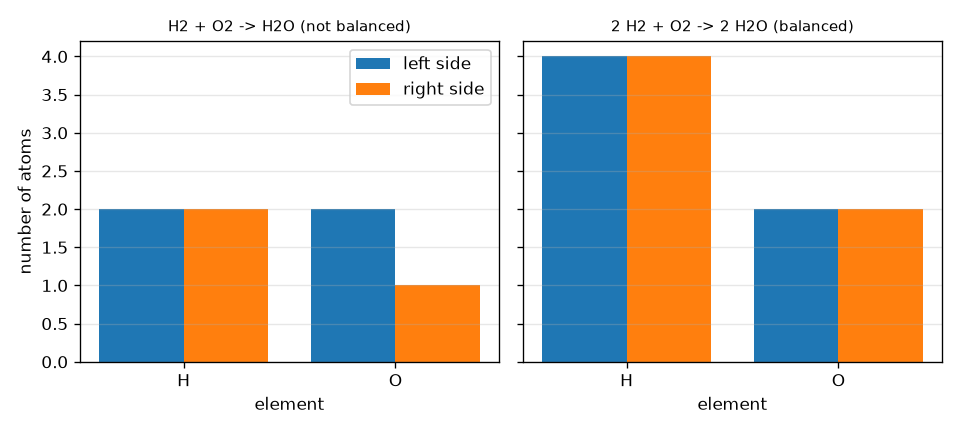
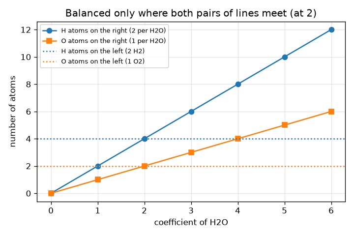

# सत्र 1: परमाणु संरक्षित रहते हैं: संतुलन करना हिसाब-किताब है

*स्तर 1 (अवधारणात्मक इंटरैक्टिव मॉडल) · लगभग 60 मिनट · openmole*

> यह एक सरलीकृत शैक्षिक मॉडल है। यह कोई प्रमाणित डिज़ाइन उपकरण नहीं है और इसका उपयोग वास्तविक संरचनाओं, विद्युत संस्थापनों, वाहनों, औद्योगिक प्रक्रियाओं या चिकित्सा निर्णयों के लिए नहीं किया जाना चाहिए।

**पूर्वापेक्षाएँ (Prerequisites)**

- स्कूल स्तर का अंकगणित: गिनना और गुणा करना।
- आपने PRIMER.md पढ़ लिया है और `python start.py 1` एक बार चला लिया है।

**सीखने के उद्देश्य (Learning objectives)।** इस सत्र के बाद आप:

- एक रासायनिक सूत्र (chemical formula) पढ़ सकेंगे और उसमें हर तत्व के परमाणु गिन सकेंगे।
- गुणांकों (coefficients) का उपयोग करके समीकरण के हर पक्ष पर परमाणु गिन सकेंगे।
- तय कर सकेंगे कि कोई समीकरण संतुलित है या नहीं और बता सकेंगे कि कौन-सा तत्व असंतुलित है।
- किसी छोटे समीकरण के सबसे छोटे पूर्णांक गुणांक ज्ञात कर सकेंगे और किसी नुस्ख़े को बढ़ा या घटा सकेंगे।

## A. वास्तविक दुनिया की समस्या
एक नुस्ख़ा कहता है कि ब्रेड के 2 स्लाइस और चीज़ का 1 स्लाइस मिलकर 1 सैंडविच बनाते हैं। सैंडविच दोगुने करें तो हर सामग्री दोगुनी हो जाती है, पर आप कभी कोई स्लाइस न बनाते हैं न खोते हैं। एक रासायनिक अभिक्रिया ऐसा नुस्ख़ा है जिसकी सामग्री परमाणु हैं: जब हाइड्रोजन ऑक्सीजन में जलकर पानी बनाती है, तो कोई परमाणु न प्रकट होता है न ग़ायब होता है, वे केवल फिर से समूह बनाते हैं। तो आपको कितने हाइड्रोजन अणु और ऑक्सीजन अणु चाहिए, और आपको कितने पानी के अणु मिलते हैं? यह सत्र अंकगणित के बारे में सामान्य शिक्षा है; ये अभिक्रियाएँ घर पर स्वयं करने का प्रयास न करें।

## B. अवधारणा और सिद्धांत
सूत्र बताता है कि किसी अणु में हर तत्व के कितने परमाणु हैं: H2O में प्रतीक के बाद की छोटी संख्या गिनती है (H2 का अर्थ 2 परमाणु, कोई संख्या नहीं का अर्थ 1), और कोष्ठक अपने अंदर की चीज़ को गुणा करते हैं, इसलिए Ca(OH)2 में 1 Ca, 2 O और 2 H हैं। समीकरण में, सूत्र के आगे की बड़ी संख्या (गुणांक) बताती है कि उस पदार्थ के कितने अणु भाग लेते हैं, और यह सूत्र के हर परमाणु को गुणा करती है। चूँकि परमाणु केवल पुनः समूहित होते हैं, हर तत्व के परमाणुओं की कुल संख्या बाएँ और दाएँ समान होनी चाहिए। संतुलन के लिए सूत्र के अंदर की छोटी संख्याएँ कभी न बदलें: इससे पदार्थ बदल जाता है (H2O2 पानी नहीं है)। केवल गुणांक बदले जा सकते हैं। हर गुणांक को एक ही संख्या से गुणा करने से वही नुस्ख़ा कई बार बना हुआ मिलता है।

| प्रतीक | अर्थ | इकाई |
|---|---|---|
| a, b, c | गुणांक (कितने H2, O2 और H2O अणु) | कोई इकाई नहीं (एक गिनती) |
| N_X | एक पक्ष पर तत्व X के परमाणुओं की कुल संख्या | परमाणु (एक गिनती) |
| x_i,X | स्पीशीज़ i के एक अणु में X के परमाणु (छोटी संख्या) | परमाणु प्रति अणु |
| c_i | स्पीशीज़ i का गुणांक | अणु (एक गिनती) |

**मान्यताएँ (Assumptions)**

- अभिक्रिया वास्तव में लिखे अनुसार होती है (हम केवल हिसाब-किताब जाँचते हैं, यह नहीं कि अभिक्रिया संभव या सुरक्षित है)।
- परमाणु न बनते हैं न नष्ट होते हैं (कोई नाभिकीय अभिक्रिया नहीं)।
- गुणांक पूर्ण संख्याएँ हैं और नुस्ख़ा सबसे छोटे गुणांकों के साथ लिखा जाता है।

$$ 2\,\mathrm{H_2}+\mathrm{O_2}\;\longrightarrow\;2\,\mathrm{H_2O} $$

$$ N_X^{\text{left}}=\sum_{i\in\text{reactants}}c_i\,x_{i,X}\qquad N_X^{\text{right}}=\sum_{i\in\text{products}}c_i\,x_{i,X} $$

$$ \text{balanced}\iff N_X^{\text{left}}=N_X^{\text{right}}\ \text{for every element }X $$

## C. दृश्य व्याख्या
पहला चित्र परमाणु गिनतियों को जोड़ीदार पट्टियों के रूप में दिखाता है, असंतुलित H2 + O2 -> H2O (बाएँ 2 O, दाएँ केवल 1) के लिए और संतुलित नुस्ख़े 2 H2 + O2 -> 2 H2O के लिए, जहाँ H 4 और 4 है और O 2 और 2 है। दूसरा चित्र बाएँ पक्ष को 2 H2 + O2 पर स्थिर रखता है और H2O के गुणांक के सापेक्ष दाएँ पक्ष की परमाणु गिनतियाँ दिखाता है: हाइड्रोजन की रेखाएँ गुणांक 2 पर मिलती हैं और ऑक्सीजन की रेखाएँ भी, इसीलिए 2 ही एकमात्र गुणांक है जो दोनों तत्वों को संतुलित करता है।

*बाएँ और दाएँ परमाणु गिनतियाँ: पानी का असंतुलित और संतुलित नुस्ख़ा।*

*H2O के गुणांक के सापेक्ष दाएँ पक्ष की परमाणु गिनतियाँ: दोनों तत्व केवल 2 पर मेल खाते हैं।*

## D. इंटरैक्टिव सिमुलेशन
पाठ चलाएँ (`python start.py 1`), फिर लाइव ऐप खोलें: [सत्र 1: पानी के नुस्ख़े को संतुलित करें](https://krunalpanchal1995.github.io/pan-iit-oss/openmole/session-01/) (या इस फ़ोल्डर में `app.html`)। तीनों गुणांक स्लाइडर खिसकाएँ और देखें कि किसी तत्व के संतुलित होने पर जोड़ीदार पट्टियाँ लाल से हरी हो जाती हैं, फिर ग्राफ़ दृश्य खोलें और देखें कि दाएँ पक्ष की रेखाएँ बाएँ पक्ष की सपाट रेखाओं को कहाँ काटती हैं।

**चुनौती।** H2 + O2 -> H2O को सबसे छोटी पूर्ण संख्याओं से संतुलित करें।

## E. हल किया गया उदाहरण और प्रयोग
**समस्या।** H2 + O2 -> H2O को सबसे छोटी पूर्ण संख्याओं से संतुलित कीजिए और परमाणु गिनतियाँ दिखाइए।

1. शुरुआत गिनें: बाएँ 2 H और 2 O हैं; दाएँ 2 H और 1 O है। हाइड्रोजन मेल खाता है, ऑक्सीजन नहीं (2 बनाम 1)।
2. H2O के आगे 2 लगाएँ: अब दाएँ 4 H और 2 O हैं। ऑक्सीजन संतुलित है (2 और 2) पर हाइड्रोजन नहीं (2 बनाम 4)।
3. H2 के आगे 2 लगाएँ: अब बाएँ 4 H और 2 O हैं।
4. जाँच: बाएँ 4 H और 2 O, दाएँ 4 H और 2 O। गुणांकों 2, 1, 2 का कोई उभयनिष्ठ गुणनखंड नहीं है, इसलिए वे सबसे छोटे हैं।

**उत्तर।** 2 H2 + O2 -> 2 H2O, हर पक्ष पर 4 H और 2 O के साथ।

**प्रयोग।** हाइड्रोजन और ऑक्सीजन परमाणुओं के रूप में दो रंगों के मनके या सिक्के लें, मेज़ पर H-H और O-O जोड़े बनाएँ, और उन्हें H-O-H समूहों में पुनः व्यवस्थित करें: बिना कोई मनका बचे 2 पानी समूह बनाने के लिए आपको ठीक 2 H-H जोड़े और 1 O-O जोड़ा चाहिए होगा। हाइड्रोजन जलाने का प्रयास न करें, यह विस्फोटक है। मॉडल बनाम वास्तविकता: मनके हिसाब-किताब को ठीक-ठीक दिखाते हैं, पर वास्तविक अणु बहुत सारी ऊर्जा भी छोड़ते हैं और शुरू होने के लिए एक चिंगारी चाहिए, जो परमाणु गिनना आपको नहीं बताता।

## F. मूल्यांकन और डिज़ाइन चुनौती
**प्रश्न प्रकार A: अवधारणात्मक।** एक छात्र H2 + O2 -> H2O को उत्पाद को H2O2 के रूप में दोबारा लिखकर संतुलित करता है (ताकि दाएँ 2 O हों)। यह ग़लत क्यों है, और इसके बजाय क्या करना चाहिए?

संकेत

H2O2 कौन-सा पदार्थ है? संतुलन करते समय कौन-सी संख्याएँ बदली जा सकती हैं?

चरण-दर-चरण हल

H2O2 हाइड्रोजन पेरॉक्साइड है, जो पानी से भिन्न पदार्थ है, इसलिए समीकरण अब उसी अभिक्रिया का वर्णन नहीं करता। सूत्र के अंदर की छोटी संख्याएँ पदार्थ की पहचान हैं और उन्हें कभी नहीं बदलना चाहिए; केवल आगे के गुणांक बदले जा सकते हैं। सही सुधार H2O के आगे गुणांक 2 (और H2 के आगे 2) है।

**प्रश्न प्रकार B: संख्यात्मक।** CH4 + O2 -> CO2 + H2O को संतुलित कीजिए। हर पक्ष पर परमाणु गिनतियाँ दीजिए।

संकेत

पहले कार्बन संतुलित करें (1 और 1), फिर हाइड्रोजन, फिर अंत में ऑक्सीजन।

चरण-दर-चरण हल

CH4 + 2 O2 -> CO2 + 2 H2O। बाएँ: 1 C, 4 H, 4 O। दाएँ: 1 C, 4 H (2 H2O), और 2 + 2 = 4 O (एक CO2 और दो H2O)। हर तत्व की गिनती मेल खाती है। इकाई: सभी गिनतियाँ परमाणुओं की संख्या हैं।

**प्रश्न प्रकार C: ग्राफ़ और सिमुलेशन की व्याख्या।** a = 2 और b = 1 वाले ग्राफ़ दृश्य में, H2O के किस गुणांक पर दाएँ पक्ष की H और O रेखाएँ बाएँ पक्ष की सपाट रेखाओं से मिलती हैं? c = 1 और c = 3 पर क्या होता है?

संकेत

पता लगाएँ कि H रेखा (2c) कहाँ 4 तक पहुँचती है और O रेखा (c) कहाँ 2 तक पहुँचती है।

चरण-दर-चरण हल

वे c = 2 पर मिलती हैं: दाएँ H, 2c = 4 = बाएँ H है और दाएँ O, c = 2 = बाएँ O है। c = 1 पर दाएँ पक्ष पर केवल 2 H और 1 O हैं, बहुत कम; c = 3 पर 6 H और 3 O हैं, बहुत अधिक। दोनों तत्व एक ही मान पर संतुलित होते हैं, इसीलिए हल मौजूद है।

**प्रश्न प्रकार D: डिज़ाइन और इष्टतमीकरण (optimisation) चुनौती।** डिज़ाइन: आपको पानी के 12 अणु चाहिए। आपको कितने H2 और O2 अणु चाहिए? यदि आपके पास केवल 20 H2 और 7 O2 अणु हैं, तो आप अधिकतम कितने पानी के अणु बना सकते हैं और क्या बचता है?

संकेत

12 पानी के लिए नुस्ख़ा 2 : 1 : 2 छह बार दोहराया जाता है। दूसरे भाग के लिए, देखें कि कौन-सी सामग्री पहले ख़त्म होती है।

चरण-दर-चरण हल

12 पानी नुस्ख़े का 6 गुना है, इसलिए 12 H2 और 6 O2। 7 O2 से आप अधिकतम 14 पानी के अणु बना सकते हैं, जिसके लिए 14 H2 चाहिए। हाइड्रोजन (20) पर्याप्त है, इसलिए ऑक्सीजन पहले ख़त्म होती है: 14 H2O बनते हैं और 6 H2 बचते हैं। मान्यता: अभिक्रिया पूरी होती है। जो सामग्री पहले ख़त्म होती है उसे सीमांत अभिकर्मक (limiting reagent) कहते हैं (सत्र 2)।

[RUBRIC.md](../../RUBRIC.md) से स्वयं को अंक दें। काग़ज़ पर काम करने के लिए [गतिविधि पत्रक](activity_sheet.md) प्रिंट करें।

## आम भ्रांतियाँ (Common misconceptions)
| आम भ्रांति | वास्तव में क्या सही है |
|---|---|
| समीकरण संतुलित करने के लिए सूत्रों में छोटी संख्याएँ बदलें। | छोटी संख्याएँ पदार्थ को परिभाषित करती हैं। केवल आगे की बड़ी संख्याएँ (गुणांक) बदली जा सकती हैं। |
| गुणांक केवल सूत्र के पहले परमाणु को गुणा करता है। | गुणांक पूरे सूत्र को गुणा करता है: 2 H2O का अर्थ है 4 H और 2 O। |
| दोनों पक्षों पर अणुओं की संख्या समान होनी चाहिए। | हर तत्व के परमाणु मेल खाने चाहिए; यहाँ 3 अणु (2 H2 + O2) से 2 अणु (2 H2O) बनते हैं। |
| यदि एक तत्व संतुलित है, तो समीकरण संतुलित है। | हर तत्व मेल खाना चाहिए; H2 + O2 -> H2O में हाइड्रोजन ठीक है पर ऑक्सीजन नहीं। |

## शब्दावली (Glossary)
- **अभिकारक (reactant)**: वह पदार्थ जो अभिक्रिया में उपयोग होता है (तीर के बाएँ)
- **उत्पाद (product)**: वह पदार्थ जो अभिक्रिया में बनता है (तीर के दाएँ)
- **गुणांक (coefficient)**: सूत्र के आगे की बड़ी संख्या; कितने अणु भाग लेते हैं
- **पादांक (subscript)**: सूत्र के अंदर प्रतीक के बाद की छोटी संख्या; प्रति अणु उस तत्व के परमाणु
- **संतुलित समीकरण (balanced equation)**: ऐसा समीकरण जिसमें दोनों पक्षों पर हर तत्व के परमाणुओं की संख्या समान हो

## समापन
1. [exercises.md](exercises.md) में दिए तीन कोडिंग कार्य करें।
2. अपने बदलावों के बाद `python start.py 1` फिर से चलाएँ। यह चेकपॉइंट के साथ समाप्त होता है; जब यह `PASS` छापे, तो आपका काम पूरा है। (केवल चेकपॉइंट: `python start.py check 1`।)

आगे: [सत्र 2](../session-02/README.md)
