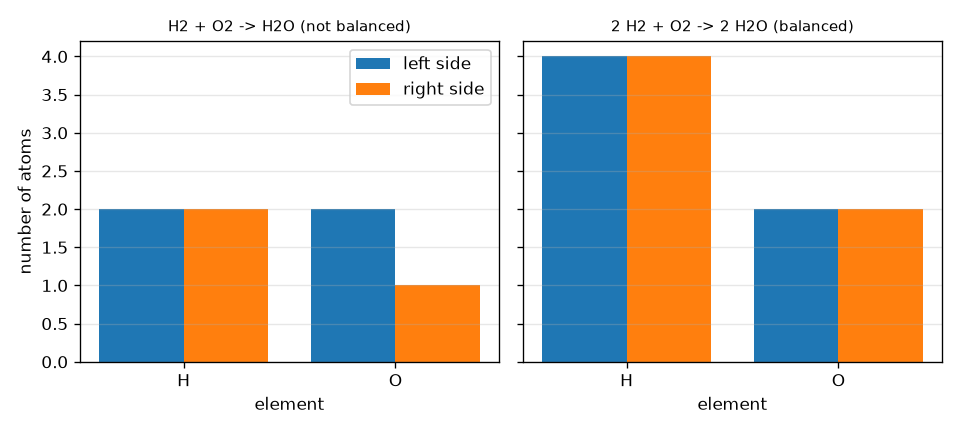
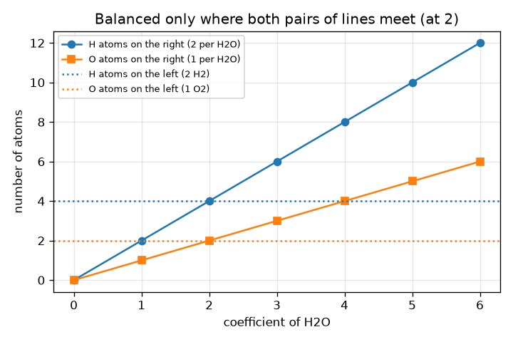

# സെഷൻ 1: ആറ്റങ്ങൾ സംരക്ഷിക്കപ്പെടുന്നു: സന്തുലനം ഒരു കണക്കെഴുത്താണ്

[Session 1 — हिन्दी](README.hi.md)

*ലെവൽ 1 (ആശയപരമായ ഇന്ററാക്ടീവ് മോഡൽ) · ഏകദേശം 60 മിനിറ്റ് · openmole*

> ഇത് ഒരു ലളിതമാക്കിയ വിദ്യാഭ്യാസ മോഡൽ ആണ്. ഇത് സാധൂകരിക്കപ്പെട്ട ഒരു ഡിസൈൻ ഉപകരണമല്ല; യഥാർത്ഥ നിർമ്മിതികൾ, വൈദ്യുത ഇൻസ്റ്റലേഷനുകൾ, വാഹനങ്ങൾ, വ്യാവസായിക പ്രക്രിയകൾ അല്ലെങ്കിൽ വൈദ്യപരമായ തീരുമാനങ്ങൾ എന്നിവയ്ക്ക് ഇത് ഉപയോഗിക്കരുത്.

**മുൻ അറിവ് (Prerequisites)**

- സ്കൂൾ അങ്കഗണിതം: എണ്ണലും ഗുണനവും.
- നിങ്ങൾ PRIMER.md വായിക്കുകയും `python start.py 1` ഒരു തവണ റൺ ചെയ്യുകയും ചെയ്തിട്ടുണ്ട്.

**പഠന ലക്ഷ്യങ്ങൾ (Learning objectives).** ഈ സെഷനു ശേഷം നിങ്ങൾക്ക് കഴിയും:

- ഒരു രാസസൂത്രം (chemical formula) വായിച്ച് അതിലെ ഓരോ മൂലകത്തിന്റെയും ആറ്റങ്ങൾ എണ്ണാൻ.
- ഗുണകങ്ങൾ (coefficients) ഉപയോഗിച്ച് ഒരു സമവാക്യത്തിന്റെ ഓരോ വശത്തെയും ആറ്റങ്ങൾ എണ്ണാൻ.
- ഒരു സമവാക്യം സന്തുലിതമാണോ എന്ന് തീരുമാനിക്കുകയും ഏത് മൂലകമാണ് പിഴച്ചതെന്ന് പറയുകയും ചെയ്യാൻ.
- ഒരു ചെറിയ സമവാക്യത്തിന്റെ ഏറ്റവും ചെറിയ പൂർണ്ണസംഖ്യാ ഗുണകങ്ങൾ കണ്ടെത്താനും ഒരു പാചകക്കുറിപ്പ് വലുതാക്കാനോ ചെറുതാക്കാനോ.

## A. യഥാർത്ഥ ലോക പ്രശ്നം
2 കഷ്ണം ബ്രെഡും 1 കഷ്ണം ചീസും ചേർന്ന് 1 സാൻഡ്‌വിച്ച് ഉണ്ടാകുന്നു എന്ന് ഒരു പാചകക്കുറിപ്പ് പറയുന്നു. സാൻഡ്‌വിച്ചുകൾ ഇരട്ടിയാക്കിയാൽ ഓരോ ചേരുവയും ഇരട്ടിയാകുന്നു, പക്ഷേ ഒരു കഷ്ണം പോലും സൃഷ്ടിക്കുകയോ നഷ്ടപ്പെടുകയോ ചെയ്യുന്നില്ല. ഒരു രാസപ്രവർത്തനം ചേരുവകൾ ആറ്റങ്ങളായ ഒരു പാചകക്കുറിപ്പാണ്: ഹൈഡ്രജൻ ഓക്സിജനിൽ കത്തി വെള്ളം ഉണ്ടാകുമ്പോൾ ഒരു ആറ്റവും പ്രത്യക്ഷപ്പെടുകയോ അപ്രത്യക്ഷമാകുകയോ ചെയ്യുന്നില്ല, അവ വീണ്ടും കൂട്ടം ചേരുക മാത്രമാണ്. അപ്പോൾ എത്ര ഹൈഡ്രജൻ തന്മാത്രകളും ഓക്സിജൻ തന്മാത്രകളും വേണം, എത്ര ജല തന്മാത്രകൾ ലഭിക്കും? ഈ സെഷൻ ഗണിതത്തെക്കുറിച്ചുള്ള പൊതു വിദ്യാഭ്യാസമാണ്; ഈ പ്രവർത്തനങ്ങൾ വീട്ടിൽ സ്വയം പരീക്ഷിക്കരുത്.

## B. ആശയവും സിദ്ധാന്തവും
ഒരു തന്മാത്രയ്ക്ക് ഓരോ മൂലകത്തിന്റെയും എത്ര ആറ്റങ്ങൾ ഉണ്ടെന്ന് ഒരു രാസസൂത്രം പറയുന്നു: H2O ൽ ഒരു ചിഹ്നത്തിന് ശേഷമുള്ള ചെറിയ സംഖ്യ എണ്ണമാണ് (H2 എന്നാൽ 2 ആറ്റം, സംഖ്യയില്ലെങ്കിൽ 1), ബ്രാക്കറ്റുകൾ അകത്തുള്ളതിനെ ഗുണിക്കുന്നു, അതിനാൽ Ca(OH)2 ൽ 1 Ca, 2 O, 2 H ഉണ്ട്. ഒരു സമവാക്യത്തിൽ, ഒരു സൂത്രത്തിന് മുന്നിലുള്ള വലിയ സംഖ്യ (ഗുണകം, coefficient) ആ പദാർത്ഥത്തിന്റെ എത്ര തന്മാത്രകൾ പങ്കെടുക്കുന്നു എന്ന് പറയുന്നു, അത് സൂത്രത്തിലെ ഓരോ ആറ്റത്തെയും ഗുണിക്കുന്നു. ആറ്റങ്ങൾ വീണ്ടും കൂട്ടം ചേരുക മാത്രമാണ് ചെയ്യുന്നത് എന്നതിനാൽ, ഓരോ മൂലകത്തിന്റെയും ആറ്റങ്ങളുടെ ആകെ എണ്ണം ഇടതുവശത്തും വലതുവശത്തും ഒരുപോലെ ആയിരിക്കണം. സന്തുലനത്തിനായി ഒരു സൂത്രത്തിനുള്ളിലെ ചെറിയ സംഖ്യകൾ ഒരിക്കലും മാറ്റരുത്: അത് പദാർത്ഥത്തെ മാറ്റുന്നു (H2O2 വെള്ളമല്ല). ഗുണകങ്ങൾ മാത്രമേ മാറ്റാവൂ. എല്ലാ ഗുണകങ്ങളെയും ഒരേ സംഖ്യ കൊണ്ട് ഗുണിക്കുന്നത് അതേ പാചകക്കുറിപ്പ് പല തവണ ഉണ്ടാക്കുന്നതാണ്.

| ചിഹ്നം | അർത്ഥം | യൂണിറ്റ് |
|---|---|---|
| a, b, c | ഗുണകങ്ങൾ (എത്ര H2, O2, H2O തന്മാത്രകൾ) | യൂണിറ്റില്ല (ഒരു എണ്ണം) |
| N_X | ഒരു വശത്തുള്ള മൂലകം X ന്റെ ആകെ ആറ്റങ്ങളുടെ എണ്ണം | ആറ്റങ്ങൾ (ഒരു എണ്ണം) |
| x_i,X | സ്പീഷീസ് i ന്റെ ഒരു തന്മാത്രയിലെ X ന്റെ ആറ്റങ്ങൾ (ചെറിയ സംഖ്യ) | ആറ്റങ്ങൾ per തന്മാത്ര |
| c_i | സ്പീഷീസ് i ന്റെ ഗുണകം | തന്മാത്രകൾ (ഒരു എണ്ണം) |

**അനുമാനങ്ങൾ (Assumptions)**

- പ്രവർത്തനം എഴുതിയതുപോലെ തന്നെ നടക്കുന്നു (നാം കണക്കെഴുത്ത് മാത്രം പരിശോധിക്കുന്നു, പ്രവർത്തനം സാധ്യമാണോ സുരക്ഷിതമാണോ എന്നല്ല).
- ആറ്റങ്ങൾ സൃഷ്ടിക്കപ്പെടുകയോ നശിപ്പിക്കപ്പെടുകയോ ചെയ്യുന്നില്ല (ന്യൂക്ലിയർ പ്രവർത്തനങ്ങളില്ല).
- ഗുണകങ്ങൾ പൂർണ്ണസംഖ്യകളാണ്, പാചകക്കുറിപ്പ് ഏറ്റവും ചെറിയവ ഉപയോഗിച്ച് എഴുതുന്നു.

$$ 2\,\mathrm{H_2}+\mathrm{O_2}\;\longrightarrow\;2\,\mathrm{H_2O} $$

$$ N_X^{\text{left}}=\sum_{i\in\text{reactants}}c_i\,x_{i,X}\qquad N_X^{\text{right}}=\sum_{i\in\text{products}}c_i\,x_{i,X} $$

$$ \text{balanced}\iff N_X^{\text{left}}=N_X^{\text{right}}\ \text{for every element }X $$

## C. ദൃശ്യ വിശദീകരണം
ആദ്യ ചിത്രം ആറ്റങ്ങളുടെ എണ്ണം ജോഡി ബാറുകളായി കാണിക്കുന്നു, സന്തുലിതമല്ലാത്ത H2 + O2 -> H2O ന് (ഇടത് 2 O, വലത് 1 മാത്രം), സന്തുലിത പാചകക്കുറിപ്പ് 2 H2 + O2 -> 2 H2O ന്, ഇവിടെ H 4 ഉം 4 ഉം O 2 ഉം 2 ഉം ആണ്. രണ്ടാമത്തെ ചിത്രം ഇടതുവശം 2 H2 + O2 ആയി സ്ഥിരമാക്കി വലതുവശത്തെ ആറ്റങ്ങളുടെ എണ്ണത്തെ H2O യുടെ ഗുണകത്തിനെതിരെ പ്ലോട്ട് ചെയ്യുന്നു: ഹൈഡ്രജൻ രേഖകൾ ഗുണകം 2 ൽ കൂടിച്ചേരുന്നു, ഓക്സിജൻ രേഖകളും, അതുകൊണ്ടാണ് രണ്ട് മൂലകങ്ങളെയും സന്തുലിതമാക്കുന്ന ഒരേയൊരു ഗുണകം 2 ആയത്.

*ഇടത്തും വലത്തും ആറ്റങ്ങളുടെ എണ്ണം: വെള്ളത്തിനുള്ള സന്തുലിതമല്ലാത്തതും സന്തുലിതവുമായ പാചകക്കുറിപ്പ്.*

*H2O യുടെ ഗുണകത്തിനെതിരെ വലതുവശത്തെ ആറ്റങ്ങളുടെ എണ്ണം: 2 ൽ മാത്രം രണ്ട് മൂലകങ്ങളും യോജിക്കുന്നു.*

## D. ഇന്ററാക്ടീവ് സിമുലേഷൻ
പാഠം റൺ ചെയ്യുക (`python start.py 1`), തുടർന്ന് ലൈവ് ആപ്പ് തുറക്കുക: [സെഷൻ 1: വെള്ളത്തിന്റെ പാചകക്കുറിപ്പ് സന്തുലിതമാക്കുക](https://krunalpanchal1995.github.io/pan-iit-oss/openmole/session-01/) (അല്ലെങ്കിൽ ഈ ഫോൾഡറിലെ `app.html`). മൂന്ന് ഗുണക സ്ലൈഡറുകൾ നീക്കി ഒരു മൂലകം സന്തുലിതമാകുമ്പോൾ ജോഡി ബാറുകൾ ചുവപ്പിൽ നിന്ന് പച്ചയാകുന്നത് നോക്കുക, തുടർന്ന് ഗ്രാഫ് കാഴ്ച തുറന്ന് വലതുവശത്തെ രേഖകൾ പരന്ന ഇടതുവശ രേഖകളെ എവിടെ മുറിച്ചുകടക്കുന്നു എന്ന് കാണുക.

**വെല്ലുവിളി (Challenge).** ഏറ്റവും ചെറിയ പൂർണ്ണസംഖ്യകൾ ഉപയോഗിച്ച് H2 + O2 -> H2O സന്തുലിതമാക്കുക.

## E. ഉദാഹരണ പ്രശ്നവും പരീക്ഷണവും
**പ്രശ്നം.** ഏറ്റവും ചെറിയ പൂർണ്ണസംഖ്യകൾ ഉപയോഗിച്ച് H2 + O2 -> H2O സന്തുലിതമാക്കുകയും ആറ്റങ്ങളുടെ എണ്ണം കാണിക്കുകയും ചെയ്യുക.

1. തുടക്കം എണ്ണുക: ഇടതിൽ 2 H ഉം 2 O ഉം; വലതിൽ 2 H ഉം 1 O ഉം. ഹൈഡ്രജൻ യോജിക്കുന്നു, ഓക്സിജൻ യോജിക്കുന്നില്ല (2 നെതിരെ 1).
2. H2O ക്ക് മുന്നിൽ 2 വയ്ക്കുക: വലതിൽ ഇപ്പോൾ 4 H ഉം 2 O ഉം. ഓക്സിജൻ സന്തുലിതമാണ് (2 ഉം 2 ഉം) പക്ഷേ ഹൈഡ്രജൻ അല്ല (2 നെതിരെ 4).
3. H2 ന് മുന്നിൽ 2 വയ്ക്കുക: ഇടതിൽ ഇപ്പോൾ 4 H ഉം 2 O ഉം.
4. പരിശോധന: ഇടത് 4 H ഉം 2 O ഉം, വലത് 4 H ഉം 2 O ഉം. ഗുണകങ്ങൾ 2, 1, 2 ന് പൊതു ഘടകമില്ല, അതിനാൽ അവ ഏറ്റവും ചെറിയവയാണ്.

**ഉത്തരം.** 2 H2 + O2 -> 2 H2O, ഓരോ വശത്തും 4 H ഉം 2 O ഉം.

**പരീക്ഷണം.** ഹൈഡ്രജൻ, ഓക്സിജൻ ആറ്റങ്ങളായി രണ്ട് നിറങ്ങളിലുള്ള മുത്തുകളോ നാണയങ്ങളോ ഉപയോഗിക്കുക, ഒരു മേശയിൽ H-H, O-O ജോഡികൾ ഉണ്ടാക്കുക, അവയെ H-O-H കൂട്ടങ്ങളായി വീണ്ടും ചേർക്കുക: ഒരു മുത്തും ബാക്കിയാകാതെ 2 ജല കൂട്ടങ്ങൾ ഉണ്ടാക്കാൻ നിങ്ങൾക്ക് കൃത്യം 2 H-H ജോഡികളും 1 O-O ജോഡിയും വേണം. ഹൈഡ്രജൻ കത്തിക്കാൻ ശ്രമിക്കരുത്, അത് സ്ഫോടനാത്മകമാണ്. മോഡലും യാഥാർത്ഥ്യവും: മുത്തുകൾ കണക്കെഴുത്ത് കൃത്യമായി കാണിക്കുന്നു, പക്ഷേ യഥാർത്ഥ തന്മാത്രകൾ ധാരാളം ഊർജ്ജം പുറത്തുവിടുകയും തുടങ്ങാൻ ഒരു തീപ്പൊരി വേണ്ടിവരികയും ചെയ്യുന്നു, ആറ്റങ്ങളുടെ എണ്ണൽ ഇത് പറയുന്നില്ല.

## F. വിലയിരുത്തലും ഡിസൈൻ വെല്ലുവിളിയും
**ചോദ്യ തരം A: ആശയപരം.** ഒരു വിദ്യാർത്ഥി ഉൽപ്പന്നത്തെ H2O2 എന്ന് മാറ്റി എഴുതി (അങ്ങനെ വലതിൽ 2 O ഉണ്ടാകും) H2 + O2 -> H2O സന്തുലിതമാക്കുന്നു. ഇത് എന്തുകൊണ്ട് തെറ്റാണ്, പകരം എന്ത് ചെയ്യണം?

സൂചന

H2O2 ഏത് പദാർത്ഥമാണ്? സന്തുലനം ചെയ്യുമ്പോൾ ഏത് സംഖ്യകൾ മാറ്റാം?

ഘട്ടം ഘട്ടമായുള്ള പരിഹാരം

H2O2 ഹൈഡ്രജൻ പെറോക്സൈഡ് ആണ്, വെള്ളത്തിൽ നിന്ന് വ്യത്യസ്തമായ പദാർത്ഥം, അതിനാൽ സമവാക്യം ഇനി അതേ പ്രവർത്തനത്തെ വിവരിക്കുന്നില്ല. ഒരു സൂത്രത്തിനുള്ളിലെ ചെറിയ സംഖ്യകൾ പദാർത്ഥത്തെ തിരിച്ചറിയുന്നു, ഒരിക്കലും മാറ്റരുത്; മുന്നിലെ ഗുണകങ്ങൾ മാത്രമേ മാറ്റാവൂ. ശരിയായ പരിഹാരം H2O ക്ക് മുന്നിൽ ഗുണകം 2 (H2 ന് മുന്നിൽ 2 ഉം) ആണ്.

**ചോദ്യ തരം B: സംഖ്യാപരം.** CH4 + O2 -> CO2 + H2O സന്തുലിതമാക്കുക. ഓരോ വശത്തെയും ആറ്റങ്ങളുടെ എണ്ണം നൽകുക.

സൂചന

ആദ്യം കാർബൺ സന്തുലിതമാക്കുക (1 ഉം 1 ഉം), പിന്നെ ഹൈഡ്രജൻ, ഓക്സിജൻ ഏറ്റവും അവസാനം.

ഘട്ടം ഘട്ടമായുള്ള പരിഹാരം

CH4 + 2 O2 -> CO2 + 2 H2O. ഇടത്: 1 C, 4 H, 4 O. വലത്: 1 C, 4 H (2 H2O), 2 + 2 = 4 O (ഒരു CO2 ഉം രണ്ട് H2O ഉം). ഓരോ മൂലകത്തിനും എണ്ണങ്ങൾ യോജിക്കുന്നു. യൂണിറ്റുകൾ: എല്ലാ എണ്ണങ്ങളും ആറ്റങ്ങളുടെ എണ്ണമാണ്.

**ചോദ്യ തരം C: ഗ്രാഫ്, സിമുലേഷൻ വ്യാഖ്യാനം.** a = 2 ഉം b = 1 ഉം ഉള്ള ഗ്രാഫ് കാഴ്ചയിൽ, H2O യുടെ ഏത് ഗുണകത്തിൽ വലതുവശത്തെ H, O രേഖകൾ പരന്ന ഇടതുവശ രേഖകളെ കണ്ടുമുട്ടുന്നു? c = 1 ലും c = 3 ലും എന്ത് സംഭവിക്കുന്നു?

സൂചന

H രേഖ (2c) 4 ൽ എത്തുന്നിടവും O രേഖ (c) 2 ൽ എത്തുന്നിടവും കണ്ടെത്തുക.

ഘട്ടം ഘട്ടമായുള്ള പരിഹാരം

അവ c = 2 ൽ കണ്ടുമുട്ടുന്നു: വലത് H 2c = 4 = ഇടത് H ഉം വലത് O c = 2 = ഇടത് O ഉം. c = 1 ൽ വലതുവശത്ത് 2 H ഉം 1 O ഉം മാത്രം, വളരെ കുറവ്; c = 3 ൽ 6 H ഉം 3 O ഉം, വളരെ കൂടുതൽ. രണ്ട് മൂലകങ്ങളും ഒരേയൊരു മൂല്യത്തിൽ സന്തുലിതമാകുന്നു, അതുകൊണ്ടാണ് ഒരു പരിഹാരം നിലനിൽക്കുന്നത്.

**ചോദ്യ തരം D: ഡിസൈൻ, ഒപ്റ്റിമൈസേഷൻ വെല്ലുവിളി.** ഡിസൈൻ: നിങ്ങൾക്ക് 12 ജല തന്മാത്രകൾ വേണം. എത്ര H2, O2 തന്മാത്രകൾ വേണം? നിങ്ങളുടെ പക്കൽ 20 H2 ഉം 7 O2 ഉം തന്മാത്രകൾ മാത്രമേ ഉള്ളൂ എങ്കിൽ, പരമാവധി എത്ര ജല തന്മാത്രകൾ ഉണ്ടാക്കാം, എന്താണ് ബാക്കിയാകുന്നത്?

സൂചന

12 ജല തന്മാത്രകൾക്ക് പാചകക്കുറിപ്പ് 2 : 1 : 2 6 തവണ ആവർത്തിക്കുന്നു. രണ്ടാം ഭാഗത്തിന്, ഏത് ചേരുവ ആദ്യം തീരുന്നു എന്ന് നോക്കുക.

ഘട്ടം ഘട്ടമായുള്ള പരിഹാരം

12 ജല തന്മാത്രകൾ പാചകക്കുറിപ്പിന്റെ 6 മടങ്ങാണ്, അതിനാൽ 12 H2 ഉം 6 O2 ഉം. 7 O2 ഉപയോഗിച്ച് പരമാവധി 14 ജല തന്മാത്രകൾ ഉണ്ടാക്കാം, അതിന് 14 H2 വേണം. ഹൈഡ്രജൻ (20) മതിയാകും, അതിനാൽ ഓക്സിജൻ ആദ്യം തീരുന്നു: 14 H2O ഉണ്ടാകുന്നു, 6 H2 ബാക്കിയാകുന്നു. അനുമാനം: പ്രവർത്തനം പൂർണ്ണതയിലെത്തുന്നു. ആദ്യം തീരുന്ന ചേരുവയെ പരിമിതപ്പെടുത്തുന്ന അഭികാരകം (limiting reagent) എന്ന് വിളിക്കുന്നു (സെഷൻ 2).

[RUBRIC.md](../../RUBRIC.md) ഉപയോഗിച്ച് സ്വയം സ്കോർ ചെയ്യുക. പേപ്പറിൽ ചെയ്യാൻ [ആക്ടിവിറ്റി ഷീറ്റ്](activity_sheet.md) പ്രിന്റ് ചെയ്യുക.

## സാധാരണ തെറ്റിദ്ധാരണകൾ
| സാധാരണ തെറ്റിദ്ധാരണ | യഥാർത്ഥത്തിൽ ശരിയായത് |
|---|---|
| ഒരു സമവാക്യം സന്തുലിതമാക്കാൻ സൂത്രങ്ങളിലെ ചെറിയ സംഖ്യകൾ മാറ്റുക. | ചെറിയ സംഖ്യകൾ പദാർത്ഥത്തെ നിർവചിക്കുന്നു. മുന്നിലെ വലിയ സംഖ്യകൾ (ഗുണകങ്ങൾ) മാത്രമേ മാറ്റാവൂ. |
| ഗുണകം സൂത്രത്തിലെ ആദ്യ ആറ്റത്തെ മാത്രമാണ് ഗുണിക്കുന്നത്. | ഒരു ഗുണകം മുഴുവൻ സൂത്രത്തെയും ഗുണിക്കുന്നു: 2 H2O എന്നാൽ 4 H ഉം 2 O ഉം. |
| രണ്ട് വശത്തും തന്മാത്രകളുടെ എണ്ണം ഒരുപോലെ ആയിരിക്കണം. | ഓരോ മൂലകത്തിന്റെയും ആറ്റങ്ങളാണ് യോജിക്കേണ്ടത്; ഇവിടെ 3 തന്മാത്രകൾ (2 H2 + O2) 2 തന്മാത്രകൾ (2 H2O) ഉണ്ടാക്കുന്നു. |
| ഒരു മൂലകം സന്തുലിതമാണെങ്കിൽ സമവാക്യം സന്തുലിതമാണ്. | ഓരോ മൂലകവും യോജിക്കണം; H2 + O2 -> H2O ൽ ഹൈഡ്രജൻ ശരിയാണ് പക്ഷേ ഓക്സിജൻ അല്ല. |

## പദാവലി (Glossary)
- **അഭികാരകം (reactant)**: ഒരു പ്രവർത്തനത്തിൽ ഉപയോഗിച്ചുതീരുന്ന പദാർത്ഥം (അമ്പിന്റെ ഇടതുവശം)
- **ഉൽപ്പന്നം (product)**: ഒരു പ്രവർത്തനത്തിൽ ഉണ്ടാകുന്ന പദാർത്ഥം (അമ്പിന്റെ വലതുവശം)
- **ഗുണകം (coefficient)**: ഒരു സൂത്രത്തിന് മുന്നിലുള്ള വലിയ സംഖ്യ; എത്ര തന്മാത്രകൾ പങ്കെടുക്കുന്നു
- **സബ്സ്ക്രിപ്റ്റ് (subscript)**: ഒരു സൂത്രത്തിനുള്ളിൽ ചിഹ്നത്തിന് ശേഷമുള്ള ചെറിയ സംഖ്യ; ഒരു തന്മാത്രയിലെ ആ മൂലകത്തിന്റെ ആറ്റങ്ങൾ
- **സന്തുലിത സമവാക്യം (balanced equation)**: ഇരുവശത്തും ഓരോ മൂലകത്തിന്റെയും ആറ്റങ്ങളുടെ എണ്ണം ഒരുപോലെയുള്ള സമവാക്യം

## പൂർത്തിയാക്കുക
1. [exercises.md](exercises.md) ലെ മൂന്ന് കോഡിംഗ് ടാസ്കുകൾ ചെയ്യുക.
2. നിങ്ങളുടെ മാറ്റങ്ങൾക്കു ശേഷം `python start.py 1` വീണ്ടും റൺ ചെയ്യുക. ഇത് ചെക്ക്‌പോയിന്റോടെ അവസാനിക്കുന്നു; അത് `PASS` എന്ന് പ്രിന്റ് ചെയ്യുമ്പോൾ നിങ്ങൾ പൂർത്തിയാക്കി. (ചെക്ക്‌പോയിന്റ് മാത്രം: `python start.py check 1`.)

അടുത്തത്: [സെഷൻ 2](../session-02/README.md)
