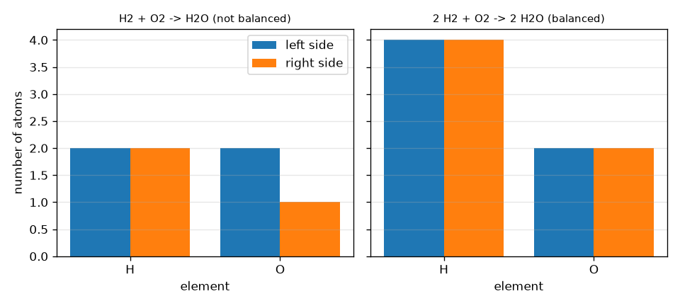
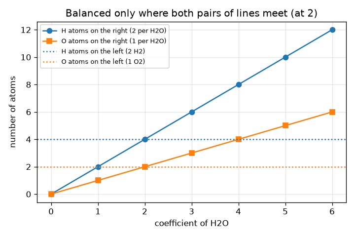

# அமர்வு 1: அணுக்கள் அழிவதில்லை: சமநிலைப்படுத்துதல் ஒரு கணக்கெழுத்து

[Session 1 — हिन्दी](README.hi.md) · [Session 1 — മലയാളം](README.ml.md)

*நிலை 1 (கருத்தியல் ஊடாடும் மாதிரி) · சுமார் 60 நிமிடங்கள் · openmole*

> இது ஒரு எளிமைப்படுத்தப்பட்ட கல்வி மாதிரி. இது சரிபார்க்கப்பட்ட வடிவமைப்புக் கருவி அல்ல; உண்மையான கட்டமைப்புகள், மின் நிறுவல்கள், வாகனங்கள், தொழில்துறை செயல்முறைகள் அல்லது மருத்துவ முடிவுகளுக்கு இதைப் பயன்படுத்தக் கூடாது.

**முன்தேவைகள் (Prerequisites)**

- பள்ளி எண்கணிதம்: எண்ணுதல் மற்றும் பெருக்குதல்.
- நீங்கள் PRIMER.md ஐப் படித்து, `python start.py 1` ஐ ஒரு முறை இயக்கியிருக்கிறீர்கள்.

**கற்றல் நோக்கங்கள் (Learning objectives).** இந்த அமர்வுக்குப் பிறகு உங்களால் முடியும்:

- ஒரு வேதிச் சூத்திரத்தை (chemical formula) படித்து அதிலுள்ள ஒவ்வொரு தனிமத்தின் அணுக்களையும் எண்ண.
- கெழுக்களைப் (coefficients) பயன்படுத்தி ஒரு சமன்பாட்டின் ஒவ்வொரு பக்கத்திலும் உள்ள அணுக்களை எண்ண.
- ஒரு சமன்பாடு சமநிலையில் உள்ளதா என்று தீர்மானித்து, எந்தத் தனிமம் தவறு என்று கூற.
- ஒரு சிறிய சமன்பாட்டின் மிகச் சிறிய முழு எண் கெழுக்களைக் கண்டறிந்து, ஒரு செய்முறையைப் பெரிதாக்க அல்லது சிறிதாக்க.

## A. நிஜ உலகப் பிரச்சினை
2 துண்டு ரொட்டியும் 1 துண்டு பாலாடைக்கட்டியும் 1 சாண்ட்விச் செய்கின்றன என்று ஒரு செய்முறை சொல்கிறது. சாண்ட்விச்களை இரட்டிப்பாக்கினால் ஒவ்வொரு பொருளும் இரட்டிப்பாகிறது, ஆனால் ஒரு துண்டைக் கூட நீங்கள் உருவாக்குவதோ இழப்பதோ இல்லை. ஒரு வேதிவினை என்பது பொருட்கள் அணுக்களாக உள்ள ஒரு செய்முறை: ஹைட்ரஜன் ஆக்சிஜனில் எரிந்து நீரை உண்டாக்கும்போது எந்த அணுவும் தோன்றுவதோ மறைவதோ இல்லை, அவை மீண்டும் குழுவாகின்றன. அப்படியானால் எத்தனை ஹைட்ரஜன் மூலக்கூறுகளும் ஆக்சிஜன் மூலக்கூறுகளும் தேவை, எத்தனை நீர் மூலக்கூறுகள் கிடைக்கும்? இந்த அமர்வு கணிதம் பற்றிய பொதுக் கல்வி; இந்த வினைகளை வீட்டில் நீங்களாகச் செய்ய முயலாதீர்கள்.

## B. கருத்தும் கோட்பாடும்
ஒரு மூலக்கூறில் ஒவ்வொரு தனிமத்தின் எத்தனை அணுக்கள் உள்ளன என்று ஒரு சூத்திரம் சொல்கிறது: H2O இல் ஒரு குறியீட்டுக்குப் பின் உள்ள சிறிய எண் எண்ணிக்கை (H2 என்றால் 2 அணுக்கள், எண் இல்லையென்றால் 1), அடைப்புக்குறிகள் உள்ளே இருப்பதைப் பெருக்குகின்றன, எனவே Ca(OH)2 இல் 1 Ca, 2 O மற்றும் 2 H உள்ளன. ஒரு சமன்பாட்டில், சூத்திரத்துக்கு முன் உள்ள பெரிய எண் (கெழு, coefficient) அந்தப் பொருளின் எத்தனை மூலக்கூறுகள் பங்கேற்கின்றன என்று சொல்கிறது, அது சூத்திரத்தில் உள்ள ஒவ்வொரு அணுவையும் பெருக்குகிறது. அணுக்கள் மீண்டும் குழுவாகின்றன மட்டுமே என்பதால், ஒவ்வொரு தனிமத்தின் அணுக்களின் மொத்த எண்ணிக்கையும் இடப்புறமும் வலப்புறமும் ஒன்றாக இருக்க வேண்டும். சமநிலைப்படுத்த ஒரு சூத்திரத்துக்குள் உள்ள சிறிய எண்களை ஒருபோதும் மாற்றாதீர்கள்: அது பொருளையே மாற்றிவிடும் (H2O2 நீர் அல்ல). கெழுக்களை மட்டுமே மாற்றலாம். எல்லாக் கெழுக்களையும் ஒரே எண்ணால் பெருக்குவது அதே செய்முறையை பல முறை செய்வதாகும்.

| குறியீடு | பொருள் | அலகு |
|---|---|---|
| a, b, c | கெழுக்கள் (எத்தனை H2, O2, H2O மூலக்கூறுகள்) | அலகு இல்லை (ஒரு எண்ணிக்கை) |
| N_X | ஒரு பக்கத்தில் தனிமம் X இன் மொத்த அணுக்களின் எண்ணிக்கை | அணுக்கள் (ஒரு எண்ணிக்கை) |
| x_i,X | இனம் i இன் ஒரு மூலக்கூறில் X இன் அணுக்கள் (சிறிய எண்) | அணுக்கள் per மூலக்கூறு |
| c_i | இனம் i இன் கெழு | மூலக்கூறுகள் (ஒரு எண்ணிக்கை) |

**அனுமானங்கள் (Assumptions)**

- வினை எழுதியபடியே நிகழ்கிறது (நாம் கணக்கெழுத்தை மட்டுமே சரிபார்க்கிறோம், வினை சாத்தியமா பாதுகாப்பானதா என்பதை அல்ல).
- அணுக்கள் உருவாக்கப்படுவதும் அழிக்கப்படுவதும் இல்லை (அணுக்கரு வினைகள் இல்லை).
- கெழுக்கள் முழு எண்கள், செய்முறை மிகச் சிறியவற்றுடன் எழுதப்படுகிறது.

$$ 2\,\mathrm{H_2}+\mathrm{O_2}\;\longrightarrow\;2\,\mathrm{H_2O} $$

$$ N_X^{\text{left}}=\sum_{i\in\text{reactants}}c_i\,x_{i,X}\qquad N_X^{\text{right}}=\sum_{i\in\text{products}}c_i\,x_{i,X} $$

$$ \text{balanced}\iff N_X^{\text{left}}=N_X^{\text{right}}\ \text{for every element }X $$

## C. காட்சி விளக்கம்
முதல் படம் அணுக்களின் எண்ணிக்கையை இணைப் பட்டைகளாகக் காட்டுகிறது, சமநிலையற்ற H2 + O2 -> H2O க்கு (இடப்புறம் 2 O, வலப்புறம் 1 மட்டும்) மற்றும் சமநிலையான செய்முறை 2 H2 + O2 -> 2 H2O க்கு, இங்கு H 4 மற்றும் 4, O 2 மற்றும் 2. இரண்டாவது படம் இடப்புறத்தை 2 H2 + O2 ஆக நிலைப்படுத்தி வலப்புற அணுக்களின் எண்ணிக்கையை H2O இன் கெழுவுக்கு எதிராக வரைகிறது: ஹைட்ரஜன் கோடுகள் கெழு 2 இல் சந்திக்கின்றன, ஆக்சிஜன் கோடுகளும் அப்படியே, அதனால்தான் இரண்டு தனிமங்களையும் சமநிலைப்படுத்தும் ஒரே கெழு 2.

*இடப்புறமும் வலப்புறமும் அணுக்களின் எண்ணிக்கை: நீருக்கான சமநிலையற்ற மற்றும் சமநிலையான செய்முறை.*

*H2O இன் கெழுவுக்கு எதிரான வலப்புற அணுக்களின் எண்ணிக்கை: 2 இல் மட்டுமே இரண்டு தனிமங்களும் பொருந்துகின்றன.*

## D. ஊடாடும் உருவகப்படுத்துதல்
பாடத்தை இயக்கவும் (`python start.py 1`), பின்னர் நேரடிச் செயலியைத் திறக்கவும்: [அமர்வு 1: நீரின் செய்முறையைச் சமநிலைப்படுத்துங்கள்](https://krunalpanchal1995.github.io/pan-iit-oss/openmole/session-01/) (அல்லது இந்தக் கோப்புறையில் உள்ள `app.html`). மூன்று கெழு நழுவிகளை நகர்த்தி, ஒரு தனிமம் சமநிலையாகும்போது இணைப் பட்டைகள் சிவப்பிலிருந்து பச்சையாக மாறுவதைப் பாருங்கள், பின்னர் வரைபடக் காட்சியைத் திறந்து வலப்புறக் கோடுகள் தட்டையான இடப்புறக் கோடுகளை எங்கு கடக்கின்றன என்று பாருங்கள்.

**சவால் (Challenge).** மிகச் சிறிய முழு எண்களைக் கொண்டு H2 + O2 -> H2O ஐச் சமநிலைப்படுத்துங்கள்.

## E. தீர்க்கப்பட்ட எடுத்துக்காட்டும் சோதனையும்
**பிரச்சினை.** மிகச் சிறிய முழு எண்களைக் கொண்டு H2 + O2 -> H2O ஐச் சமநிலைப்படுத்தி அணுக்களின் எண்ணிக்கையைக் காட்டுங்கள்.

1. தொடக்கத்தை எண்ணுங்கள்: இடப்புறம் 2 H மற்றும் 2 O; வலப்புறம் 2 H மற்றும் 1 O. ஹைட்ரஜன் ஒத்துப்போகிறது, ஆக்சிஜன் ஒத்துப்போகவில்லை (2 க்கு எதிராக 1).
2. H2O க்கு முன் 2 ஐ வையுங்கள்: வலப்புறம் இப்போது 4 H மற்றும் 2 O. ஆக்சிஜன் சமநிலை (2 மற்றும் 2) ஆனால் ஹைட்ரஜன் இல்லை (2 க்கு எதிராக 4).
3. H2 க்கு முன் 2 ஐ வையுங்கள்: இடப்புறம் இப்போது 4 H மற்றும் 2 O.
4. சரிபார்ப்பு: இடது 4 H மற்றும் 2 O, வலது 4 H மற்றும் 2 O. கெழுக்கள் 2, 1, 2 க்கு பொதுக் காரணி இல்லை, எனவே அவை மிகச் சிறியவை.

**விடை.** 2 H2 + O2 -> 2 H2O, ஒவ்வொரு பக்கத்திலும் 4 H மற்றும் 2 O.

**சோதனை.** ஹைட்ரஜன் மற்றும் ஆக்சிஜன் அணுக்களாக இரண்டு நிற மணிகள் அல்லது நாணயங்களைப் பயன்படுத்துங்கள், மேசையில் H-H மற்றும் O-O இணைகளை உருவாக்கி, அவற்றை H-O-H குழுக்களாக மீண்டும் குழுவாக்குங்கள்: ஒரு மணி கூட மிச்சமில்லாமல் 2 நீர்க் குழுக்களை உருவாக்க உங்களுக்குச் சரியாக 2 H-H இணைகளும் 1 O-O இணையும் தேவை. ஹைட்ரஜனை எரிக்க முயலாதீர்கள், அது வெடிக்கக்கூடியது. மாதிரியும் நிஜமும்: மணிகள் கணக்கெழுத்தைச் சரியாகக் காட்டுகின்றன, ஆனால் உண்மையான மூலக்கூறுகள் நிறைய ஆற்றலை வெளியிடுகின்றன, தொடங்க ஒரு தீப்பொறி தேவை, அணு எண்ணுதல் இதைச் சொல்லாது.

## F. மதிப்பீடும் வடிவமைப்புச் சவாலும்
**கேள்வி வகை A: கருத்தியல்.** ஒரு மாணவர் விளைபொருளை H2O2 என்று மாற்றி எழுதி (அதனால் வலப்புறம் 2 O இருக்கும்) H2 + O2 -> H2O ஐச் சமநிலைப்படுத்துகிறார். இது ஏன் தவறு, அதற்குப் பதிலாக என்ன செய்ய வேண்டும்?

குறிப்பு

H2O2 எந்தப் பொருள்? சமநிலைப்படுத்தும்போது எந்த எண்களை மாற்றலாம்?

படிப்படியான தீர்வு

H2O2 ஹைட்ரஜன் பெராக்சைடு, நீரிலிருந்து வேறுபட்ட பொருள், எனவே சமன்பாடு இனி அதே வினையை விவரிக்காது. ஒரு சூத்திரத்துக்குள் உள்ள சிறிய எண்கள் பொருளை அடையாளப்படுத்துகின்றன, ஒருபோதும் மாற்றக் கூடாது; முன்னால் உள்ள கெழுக்களை மட்டுமே மாற்றலாம். சரியான தீர்வு H2O க்கு முன் கெழு 2 (மற்றும் H2 க்கு முன் 2).

**கேள்வி வகை B: எண்ணியல்.** CH4 + O2 -> CO2 + H2O ஐச் சமநிலைப்படுத்துங்கள். ஒவ்வொரு பக்கத்திலும் அணுக்களின் எண்ணிக்கையைத் தாருங்கள்.

குறிப்பு

முதலில் கார்பனைச் சமநிலைப்படுத்துங்கள் (1 மற்றும் 1), பின்னர் ஹைட்ரஜன், ஆக்சிஜன் கடைசியாக.

படிப்படியான தீர்வு

CH4 + 2 O2 -> CO2 + 2 H2O. இடது: 1 C, 4 H, 4 O. வலது: 1 C, 4 H (2 H2O), மற்றும் 2 + 2 = 4 O (ஒரு CO2 மற்றும் இரண்டு H2O). ஒவ்வொரு தனிமத்துக்கும் எண்ணிக்கைகள் ஒத்துப்போகின்றன. அலகுகள்: எல்லா எண்ணிக்கைகளும் அணுக்களின் எண்கள்.

**கேள்வி வகை C: வரைபடம் மற்றும் உருவகப்படுத்துதல் விளக்கம்.** a = 2 மற்றும் b = 1 உடன் வரைபடக் காட்சியில், H2O இன் எந்தக் கெழுவில் வலப்புற H மற்றும் O கோடுகள் தட்டையான இடப்புறக் கோடுகளைச் சந்திக்கின்றன? c = 1 மற்றும் c = 3 இல் என்ன நடக்கிறது?

குறிப்பு

H கோடு (2c) 4 ஐ அடையும் இடத்தையும் O கோடு (c) 2 ஐ அடையும் இடத்தையும் கண்டறியுங்கள்.

படிப்படியான தீர்வு

அவை c = 2 இல் சந்திக்கின்றன: வலது H 2c = 4 = இடது H மற்றும் வலது O c = 2 = இடது O. c = 1 இல் வலப்புறம் 2 H மற்றும் 1 O மட்டும், மிகக் குறைவு; c = 3 இல் 6 H மற்றும் 3 O, மிக அதிகம். இரண்டு தனிமங்களும் ஒரே மதிப்பில் சமநிலையாகின்றன, அதனால்தான் ஒரு தீர்வு உள்ளது.

**கேள்வி வகை D: வடிவமைப்பு மற்றும் உகப்பாக்கச் சவால்.** வடிவமைப்பு: உங்களுக்கு 12 நீர் மூலக்கூறுகள் வேண்டும். எத்தனை H2 மற்றும் O2 மூலக்கூறுகள் தேவை? உங்களிடம் 20 H2 மற்றும் 7 O2 மூலக்கூறுகள் மட்டுமே இருந்தால், அதிகபட்சம் எத்தனை நீர் மூலக்கூறுகளை உருவாக்கலாம், என்ன மிச்சம் இருக்கும்?

குறிப்பு

12 நீர்களுக்கு 2 : 1 : 2 செய்முறை 6 முறை திரும்பச் செய்யப்படுகிறது. இரண்டாம் பகுதிக்கு, எந்தப் பொருள் முதலில் தீர்கிறது என்று பாருங்கள்.

படிப்படியான தீர்வு

12 நீர்கள் செய்முறையின் 6 மடங்கு, எனவே 12 H2 மற்றும் 6 O2. 7 O2 உடன் அதிகபட்சம் 14 நீர் மூலக்கூறுகளை உருவாக்கலாம், அதற்கு 14 H2 தேவை. ஹைட்ரஜன் (20) போதுமானது, எனவே ஆக்சிஜன் முதலில் தீர்கிறது: 14 H2O உருவாகின்றன, 6 H2 மிச்சம். அனுமானம்: வினை முழுமையடைகிறது. முதலில் தீரும் பொருள் வரம்பிடும் வினைப்பொருள் (limiting reagent) எனப்படுகிறது (அமர்வு 2).

[RUBRIC.md](../../RUBRIC.md) மூலம் உங்களை நீங்களே மதிப்பிடுங்கள். காகிதத்தில் செய்ய [செயல்பாட்டுத் தாளை](activity_sheet.md) அச்சிடுங்கள்.

## பொதுவான தவறான கருத்துகள்
| பொதுவான தவறான கருத்து | உண்மையில் சரியானது |
|---|---|
| ஒரு சமன்பாட்டைச் சமநிலைப்படுத்த சூத்திரங்களில் உள்ள சிறிய எண்களை மாற்றுங்கள். | சிறிய எண்கள் பொருளை வரையறுக்கின்றன. முன்னால் உள்ள பெரிய எண்களை (கெழுக்களை) மட்டுமே மாற்றலாம். |
| கெழு சூத்திரத்தின் முதல் அணுவை மட்டுமே பெருக்குகிறது. | ஒரு கெழு முழுச் சூத்திரத்தையும் பெருக்குகிறது: 2 H2O என்றால் 4 H மற்றும் 2 O. |
| இரண்டு பக்கங்களிலும் மூலக்கூறுகளின் எண்ணிக்கை ஒன்றாக இருக்க வேண்டும். | ஒவ்வொரு தனிமத்தின் அணுக்கள்தான் ஒத்துப்போக வேண்டும்; இங்கு 3 மூலக்கூறுகள் (2 H2 + O2) 2 மூலக்கூறுகளை (2 H2O) உருவாக்குகின்றன. |
| ஒரு தனிமம் சமநிலையில் இருந்தால் சமன்பாடு சமநிலை. | ஒவ்வொரு தனிமமும் ஒத்துப்போக வேண்டும்; H2 + O2 -> H2O இல் ஹைட்ரஜன் சரி ஆனால் ஆக்சிஜன் இல்லை. |

## சொற்களஞ்சியம் (Glossary)
- **வினைபடுபொருள் (reactant)**: வினையில் பயன்படுத்தித் தீரும் பொருள் (அம்புக்குறியின் இடப்புறம்)
- **வினைவிளைபொருள் (product)**: வினையில் உருவாகும் பொருள் (அம்புக்குறியின் வலப்புறம்)
- **கெழு (coefficient)**: ஒரு சூத்திரத்துக்கு முன் உள்ள பெரிய எண்; எத்தனை மூலக்கூறுகள் பங்கேற்கின்றன
- **கீழொட்டு (subscript)**: சூத்திரத்துக்குள் குறியீட்டுக்குப் பின் உள்ள சிறிய எண்; ஒரு மூலக்கூறில் அந்தத் தனிமத்தின் அணுக்கள்
- **சமநிலைப்படுத்திய சமன்பாடு (balanced equation)**: இரண்டு பக்கங்களிலும் ஒவ்வொரு தனிமத்தின் அணுக்களின் எண்ணிக்கையும் ஒன்றாக உள்ள சமன்பாடு

## முடிக்கவும்
1. [exercises.md](exercises.md) இல் உள்ள மூன்று நிரலாக்கப் பணிகளைச் செய்யுங்கள்.
2. உங்கள் மாற்றங்களுக்குப் பிறகு `python start.py 1` ஐ மீண்டும் இயக்குங்கள். இது சோதனைச்சாவடியுடன் (checkpoint) முடிகிறது; அது `PASS` என்று அச்சிடும்போது நீங்கள் முடித்துவிட்டீர்கள். (சோதனைச்சாவடி மட்டும்: `python start.py check 1`.)

அடுத்து: [அமர்வு 2](../session-02/README.md)
