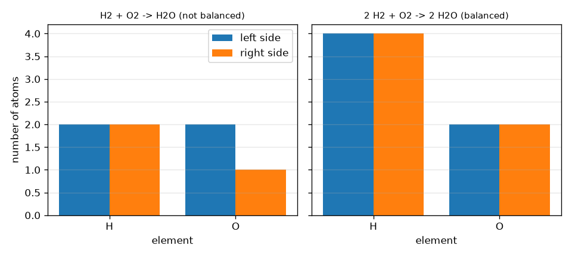
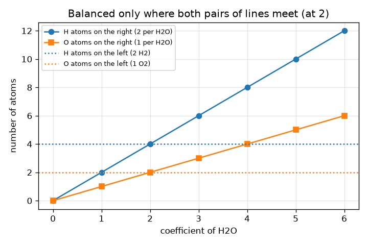

# సెషన్ 1: పరమాణువులు నశించవు: సమతుల్యత ఒక లెక్కల పద్దు

[Session 1 — हिन्दी](README.hi.md) · [Session 1 — മലയാളം](README.ml.md) · [Session 1 — தமிழ்](README.ta.md)

*స్థాయి 1 (భావనాత్మక ఇంటరాక్టివ్ నమూనా) · సుమారు 60 నిమిషాలు · openmole*

> ఇది ఒక సరళీకృత విద్యా నమూనా. ఇది ధృవీకరించబడిన డిజైన్ సాధనం కాదు; నిజమైన నిర్మాణాలు, విద్యుత్ ఇన్‌స్టలేషన్లు, వాహనాలు, పారిశ్రామిక ప్రక్రియలు లేదా వైద్య నిర్ణయాల కోసం దీనిని ఉపయోగించకూడదు.

**ముందస్తు అవసరాలు (Prerequisites)**

- పాఠశాల అంకగణితం: లెక్కించడం మరియు గుణించడం.
- మీరు PRIMER.md చదివి, `python start.py 1` ను ఒకసారి రన్ చేశారు.

**అభ్యసన లక్ష్యాలు (Learning objectives).** ఈ సెషన్ తర్వాత మీరు చేయగలరు:

- రసాయన సూత్రాన్ని (chemical formula) చదివి అందులోని ప్రతి మూలకం యొక్క పరమాణువులను లెక్కించడం.
- గుణకాలను (coefficients) ఉపయోగించి సమీకరణం యొక్క ప్రతి వైపు ఉన్న పరమాణువులను లెక్కించడం.
- సమీకరణం సమతుల్యంగా ఉందా అని నిర్ణయించి, ఏ మూలకం తప్పో చెప్పడం.
- చిన్న సమీకరణం యొక్క అతి చిన్న పూర్ణ సంఖ్య గుణకాలను కనుగొని, ఒక వంటకాన్ని పెంచడం లేదా తగ్గించడం.

## A. వాస్తవ ప్రపంచ సమస్య
2 ముక్కల బ్రెడ్ మరియు 1 ముక్క చీజ్ 1 శాండ్‌విచ్ చేస్తాయని ఒక వంటకం చెబుతుంది. శాండ్‌విచ్‌లను రెట్టింపు చేస్తే ప్రతి పదార్థం రెట్టింపు అవుతుంది, కానీ మీరు ఒక్క ముక్కను కూడా సృష్టించరు లేదా కోల్పోరు. రసాయన చర్య అనేది పదార్థాలు పరమాణువులు అయిన వంటకం: హైడ్రోజన్ ఆక్సిజన్‌లో మండి నీటిని ఇచ్చినప్పుడు ఏ పరమాణువూ కనిపించదు లేదా మాయమవదు, అవి మళ్ళీ సమూహమవుతాయి మాత్రమే. అయితే ఎన్ని హైడ్రోజన్ అణువులు మరియు ఆక్సిజన్ అణువులు కావాలి, ఎన్ని నీటి అణువులు వస్తాయి? ఈ సెషన్ గణితం గురించి సాధారణ విద్య; ఈ చర్యలను ఇంట్లో మీరే ప్రయత్నించకండి.

## B. భావన మరియు సిద్ధాంతం
ఒక అణువులో ప్రతి మూలకం యొక్క ఎన్ని పరమాణువులు ఉన్నాయో సూత్రం చెబుతుంది: H2O లో గుర్తు తర్వాత ఉన్న చిన్న సంఖ్య లెక్క (H2 అంటే 2 పరమాణువులు, సంఖ్య లేకపోతే 1), బ్రాకెట్లు లోపల ఉన్నదాన్ని గుణిస్తాయి, కాబట్టి Ca(OH)2 లో 1 Ca, 2 O మరియు 2 H ఉన్నాయి. సమీకరణంలో, సూత్రం ముందు ఉన్న పెద్ద సంఖ్య (గుణకం, coefficient) ఆ పదార్థం యొక్క ఎన్ని అణువులు పాల్గొంటాయో చెబుతుంది, అది సూత్రంలోని ప్రతి పరమాణువును గుణిస్తుంది. పరమాణువులు మళ్ళీ సమూహమవుతాయి మాత్రమే కాబట్టి, ప్రతి మూలకం యొక్క మొత్తం పరమాణువుల సంఖ్య ఎడమ మరియు కుడి వైపు ఒకేలా ఉండాలి. సమతుల్యం చేయడానికి సూత్రం లోపలి చిన్న సంఖ్యలను ఎప్పుడూ మార్చకండి: అది పదార్థాన్నే మారుస్తుంది (H2O2 నీరు కాదు). గుణకాలను మాత్రమే మార్చవచ్చు. అన్ని గుణకాలను ఒకే సంఖ్యతో గుణిస్తే అదే వంటకాన్ని చాలాసార్లు చేసినట్లు.

| గుర్తు | అర్థం | యూనిట్ |
|---|---|---|
| a, b, c | గుణకాలు (ఎన్ని H2, O2, H2O అణువులు) | యూనిట్ లేదు (ఒక లెక్క) |
| N_X | ఒక వైపు మూలకం X యొక్క మొత్తం పరమాణువుల సంఖ్య | పరమాణువులు (ఒక లెక్క) |
| x_i,X | జాతి i యొక్క ఒక అణువులో X పరమాణువులు (చిన్న సంఖ్య) | పరమాణువులు per అణువు |
| c_i | జాతి i యొక్క గుణకం | అణువులు (ఒక లెక్క) |

**ఊహలు (Assumptions)**

- చర్య రాసినట్లే నిజంగా జరుగుతుంది (మనం లెక్కల పద్దును మాత్రమే తనిఖీ చేస్తాము, చర్య సాధ్యమా సురక్షితమా అని కాదు).
- పరమాణువులు సృష్టించబడవు, నాశనం కావు (అణు చర్యలు లేవు).
- గుణకాలు పూర్ణ సంఖ్యలు మరియు వంటకం అతి చిన్నవాటితో రాయబడుతుంది.

$$ 2\,\mathrm{H_2}+\mathrm{O_2}\;\longrightarrow\;2\,\mathrm{H_2O} $$

$$ N_X^{\text{left}}=\sum_{i\in\text{reactants}}c_i\,x_{i,X}\qquad N_X^{\text{right}}=\sum_{i\in\text{products}}c_i\,x_{i,X} $$

$$ \text{balanced}\iff N_X^{\text{left}}=N_X^{\text{right}}\ \text{for every element }X $$

## C. దృశ్య వివరణ
మొదటి చిత్రం పరమాణువుల లెక్కలను జత బార్లుగా చూపిస్తుంది, సమతుల్యం కాని H2 + O2 -> H2O కు (ఎడమ 2 O, కుడి 1 మాత్రమే) మరియు సమతుల్య వంటకం 2 H2 + O2 -> 2 H2O కు, ఇక్కడ H 4 మరియు 4, O 2 మరియు 2. రెండవ చిత్రం ఎడమ వైపును 2 H2 + O2 గా స్థిరం చేసి కుడివైపు పరమాణువుల లెక్కలను H2O గుణకానికి వ్యతిరేకంగా ప్లాట్ చేస్తుంది: హైడ్రోజన్ రేఖలు గుణకం 2 వద్ద కలుస్తాయి, ఆక్సిజన్ రేఖలు కూడా, అందుకే రెండు మూలకాలను సమతుల్యం చేసే ఏకైక గుణకం 2.

*ఎడమ మరియు కుడి వైపు పరమాణువుల లెక్కలు: నీటికి సమతుల్యం కాని మరియు సమతుల్య వంటకం.*

*H2O గుణకానికి వ్యతిరేకంగా కుడివైపు పరమాణువుల లెక్కలు: 2 వద్ద మాత్రమే రెండు మూలకాలు సరిపోతాయి.*

## D. ఇంటరాక్టివ్ సిమ్యులేషన్
పాఠాన్ని రన్ చేయండి (`python start.py 1`), తర్వాత లైవ్ యాప్‌ను తెరవండి: [సెషన్ 1: నీటి వంటకాన్ని సమతుల్యం చేయండి](https://krunalpanchal1995.github.io/pan-iit-oss/openmole/session-01/) (లేదా ఈ ఫోల్డర్‌లోని `app.html`). మూడు గుణక స్లైడర్లను కదిలించి, మూలకం సమతుల్యమైనప్పుడు జత బార్లు ఎరుపు నుండి ఆకుపచ్చగా మారడం చూడండి, తర్వాత గ్రాఫ్ వీక్షణను తెరిచి కుడివైపు రేఖలు చదునైన ఎడమవైపు రేఖలను ఎక్కడ దాటుతాయో చూడండి.

**సవాలు (Challenge).** అతి చిన్న పూర్ణ సంఖ్యలతో H2 + O2 -> H2O ను సమతుల్యం చేయండి.

## E. సాధించిన ఉదాహరణ మరియు ప్రయోగం
**సమస్య.** అతి చిన్న పూర్ణ సంఖ్యలతో H2 + O2 -> H2O ను సమతుల్యం చేసి పరమాణువుల లెక్కలను చూపండి.

1. ప్రారంభాన్ని లెక్కించండి: ఎడమ 2 H మరియు 2 O; కుడి 2 H మరియు 1 O. హైడ్రోజన్ సరిపోతుంది, ఆక్సిజన్ సరిపోదు (2 కు వ్యతిరేకంగా 1).
2. H2O ముందు 2 ఉంచండి: కుడివైపు ఇప్పుడు 4 H మరియు 2 O. ఆక్సిజన్ సమతుల్యం (2 మరియు 2) కానీ హైడ్రోజన్ కాదు (2 కు వ్యతిరేకంగా 4).
3. H2 ముందు 2 ఉంచండి: ఎడమవైపు ఇప్పుడు 4 H మరియు 2 O.
4. సరిచూపు: ఎడమ 4 H మరియు 2 O, కుడి 4 H మరియు 2 O. గుణకాలు 2, 1, 2 కు ఉమ్మడి కారణాంకం లేదు, కాబట్టి అవి అతి చిన్నవి.

**సమాధానం.** 2 H2 + O2 -> 2 H2O, ప్రతి వైపు 4 H మరియు 2 O.

**ప్రయోగం.** హైడ్రోజన్ మరియు ఆక్సిజన్ పరమాణువులుగా రెండు రంగుల పూసలు లేదా నాణేలను ఉపయోగించండి, బల్లపై H-H మరియు O-O జతలు చేసి, వాటిని H-O-H సమూహాలుగా తిరిగి సమూహపరచండి: ఒక్క పూస కూడా మిగలకుండా 2 నీటి సమూహాలను చేయడానికి మీకు సరిగ్గా 2 H-H జతలు మరియు 1 O-O జత కావాలి. హైడ్రోజన్‌ను మండించడానికి ప్రయత్నించకండి, అది పేలుడు స్వభావం కలది. నమూనా మరియు వాస్తవం: పూసలు లెక్కల పద్దును ఖచ్చితంగా చూపిస్తాయి, కానీ నిజమైన అణువులు చాలా శక్తిని విడుదల చేస్తాయి మరియు ప్రారంభించడానికి ఒక నిప్పురవ్వ కావాలి, పరమాణువుల లెక్కింపు ఇది చెప్పదు.

## F. మూల్యాంకనం మరియు డిజైన్ సవాలు
**ప్రశ్న రకం A: భావనాత్మక.** ఒక విద్యార్థి ఉత్పన్నాన్ని H2O2 గా తిరిగి రాసి (కుడివైపు 2 O ఉండేలా) H2 + O2 -> H2O ను సమతుల్యం చేస్తాడు. ఇది ఎందుకు తప్పు, బదులుగా ఏమి చేయాలి?

సూచన

H2O2 ఏ పదార్థం? సమతుల్యం చేసేటప్పుడు ఏ సంఖ్యలను మార్చవచ్చు?

దశలవారీ పరిష్కారం

H2O2 హైడ్రోజన్ పెరాక్సైడ్, నీటి కంటే భిన్నమైన పదార్థం, కాబట్టి సమీకరణం ఇక అదే చర్యను వివరించదు. సూత్రం లోపలి చిన్న సంఖ్యలు పదార్థాన్ని గుర్తిస్తాయి, ఎప్పుడూ మార్చకూడదు; ముందున్న గుణకాలను మాత్రమే మార్చవచ్చు. సరైన పరిష్కారం H2O ముందు గుణకం 2 (మరియు H2 ముందు 2).

**ప్రశ్న రకం B: సంఖ్యాత్మక.** CH4 + O2 -> CO2 + H2O ను సమతుల్యం చేయండి. ప్రతి వైపు పరమాణువుల లెక్కలు ఇవ్వండి.

సూచన

మొదట కార్బన్‌ను సమతుల్యం చేయండి (1 మరియు 1), తర్వాత హైడ్రోజన్, ఆక్సిజన్ చివరిగా.

దశలవారీ పరిష్కారం

CH4 + 2 O2 -> CO2 + 2 H2O. ఎడమ: 1 C, 4 H, 4 O. కుడి: 1 C, 4 H (2 H2O), మరియు 2 + 2 = 4 O (ఒక CO2 మరియు రెండు H2O). ప్రతి మూలకానికి లెక్కలు సరిపోతాయి. యూనిట్లు: అన్ని లెక్కలు పరమాణువుల సంఖ్యలు.

**ప్రశ్న రకం C: గ్రాఫ్ మరియు సిమ్యులేషన్ వ్యాఖ్యానం.** a = 2 మరియు b = 1 తో గ్రాఫ్ వీక్షణలో, H2O యొక్క ఏ గుణకం వద్ద కుడివైపు H మరియు O రేఖలు చదునైన ఎడమవైపు రేఖలను కలుస్తాయి? c = 1 మరియు c = 3 వద్ద ఏమి జరుగుతుంది?

సూచన

H రేఖ (2c) 4 చేరే చోటు మరియు O రేఖ (c) 2 చేరే చోటు కనుగొనండి.

దశలవారీ పరిష్కారం

అవి c = 2 వద్ద కలుస్తాయి: కుడి H 2c = 4 = ఎడమ H మరియు కుడి O c = 2 = ఎడమ O. c = 1 వద్ద కుడివైపు 2 H మరియు 1 O మాత్రమే, చాలా తక్కువ; c = 3 వద్ద 6 H మరియు 3 O, చాలా ఎక్కువ. రెండు మూలకాలు ఒకే విలువ వద్ద సమతుల్యమవుతాయి, అందుకే ఒక పరిష్కారం ఉంది.

**ప్రశ్న రకం D: డిజైన్ మరియు ఆప్టిమైజేషన్ సవాలు.** డిజైన్: మీకు 12 నీటి అణువులు కావాలి. ఎన్ని H2 మరియు O2 అణువులు అవసరం? మీ దగ్గర 20 H2 మరియు 7 O2 అణువులు మాత్రమే ఉంటే, గరిష్ఠంగా ఎన్ని నీటి అణువులు చేయగలరు, ఏమి మిగులుతుంది?

సూచన

12 నీటి అణువులకు 2 : 1 : 2 వంటకం 6 సార్లు పునరావృతమవుతుంది. రెండవ భాగానికి, ఏ పదార్థం ముందు అయిపోతుందో చూడండి.

దశలవారీ పరిష్కారం

12 నీటి అణువులు వంటకానికి 6 రెట్లు, కాబట్టి 12 H2 మరియు 6 O2. 7 O2 తో గరిష్ఠంగా 14 నీటి అణువులు చేయవచ్చు, దానికి 14 H2 కావాలి. హైడ్రోజన్ (20) సరిపోతుంది, కాబట్టి ఆక్సిజన్ ముందు అయిపోతుంది: 14 H2O తయారవుతాయి మరియు 6 H2 మిగులుతాయి. ఊహ: చర్య పూర్తిగా జరుగుతుంది. ముందు అయిపోయే పదార్థాన్ని పరిమిత కారకం (limiting reagent) అంటారు (సెషన్ 2).

[RUBRIC.md](../../RUBRIC.md) తో మిమ్మల్ని మీరు స్కోర్ చేసుకోండి. కాగితంపై పని చేయడానికి [కార్యాచరణ పత్రాన్ని](activity_sheet.md) ప్రింట్ చేయండి.

## సాధారణ అపోహలు
| సాధారణ అపోహ | నిజానికి సరైనది |
|---|---|
| సమీకరణాన్ని సమతుల్యం చేయడానికి సూత్రాలలోని చిన్న సంఖ్యలను మార్చండి. | చిన్న సంఖ్యలు పదార్థాన్ని నిర్వచిస్తాయి. ముందున్న పెద్ద సంఖ్యలను (గుణకాలను) మాత్రమే మార్చవచ్చు. |
| గుణకం సూత్రంలోని మొదటి పరమాణువును మాత్రమే గుణిస్తుంది. | గుణకం మొత్తం సూత్రాన్ని గుణిస్తుంది: 2 H2O అంటే 4 H మరియు 2 O. |
| రెండు వైపులా అణువుల సంఖ్య ఒకేలా ఉండాలి. | ప్రతి మూలకం యొక్క పరమాణువులు సరిపోవాలి; ఇక్కడ 3 అణువులు (2 H2 + O2) 2 అణువులను (2 H2O) చేస్తాయి. |
| ఒక మూలకం సమతుల్యమైతే సమీకరణం సమతుల్యం. | ప్రతి మూలకం సరిపోవాలి; H2 + O2 -> H2O లో హైడ్రోజన్ బాగుంది కానీ ఆక్సిజన్ కాదు. |

## పదకోశం (Glossary)
- **క్రియాజనకం (reactant)**: చర్యలో వినియోగమయ్యే పదార్థం (బాణానికి ఎడమ)
- **ఉత్పన్నం (product)**: చర్యలో తయారయ్యే పదార్థం (బాణానికి కుడి)
- **గుణకం (coefficient)**: సూత్రం ముందు ఉన్న పెద్ద సంఖ్య; ఎన్ని అణువులు పాల్గొంటాయి
- **అధోలిపి (subscript)**: సూత్రం లోపల గుర్తు తర్వాత ఉన్న చిన్న సంఖ్య; ఒక అణువులో ఆ మూలకం యొక్క పరమాణువులు
- **సమతుల్య సమీకరణం (balanced equation)**: రెండు వైపులా ప్రతి మూలకం యొక్క పరమాణువుల సంఖ్య ఒకేలా ఉన్న సమీకరణం

## ముగించండి
1. [exercises.md](exercises.md) లోని మూడు కోడింగ్ పనులను చేయండి.
2. మీ మార్పుల తర్వాత `python start.py 1` ను మళ్ళీ రన్ చేయండి. ఇది చెక్‌పాయింట్‌తో ముగుస్తుంది; అది `PASS` అని ప్రింట్ చేసినప్పుడు మీరు పూర్తి చేశారు. (చెక్‌పాయింట్ మాత్రమే: `python start.py check 1`.)

తదుపరి: [సెషన్ 2](../session-02/README.md)
