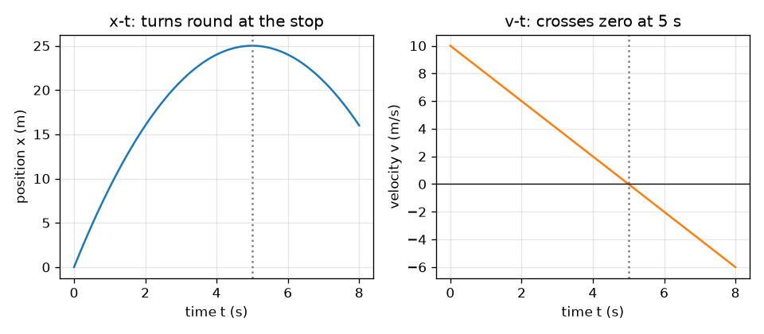
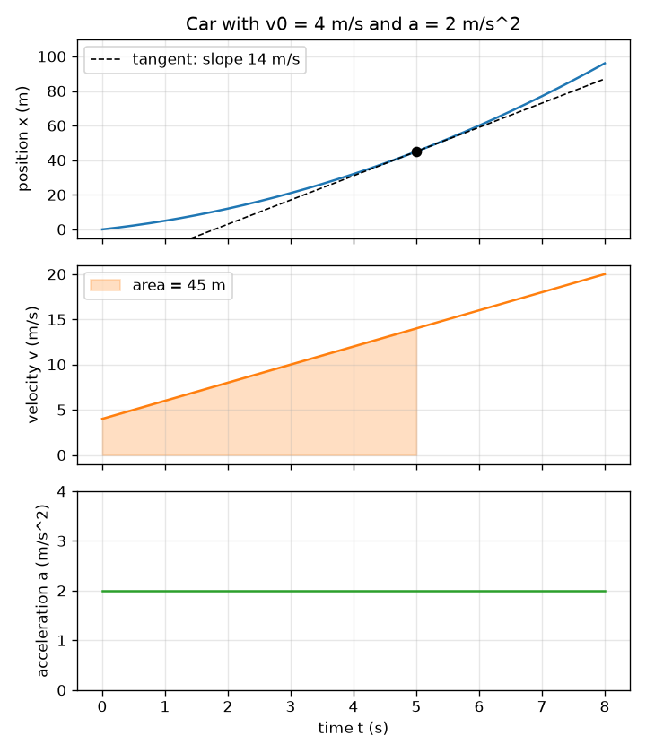

# सत्र 1: एक गति, तीन ग्राफ़: ढाल और क्षेत्रफल

*स्तर 1 (वैचारिक इंटरैक्टिव मॉडल) · लगभग 60 मिनट · openmotion*

> यह एक सरलीकृत शैक्षिक मॉडल है। यह कोई प्रमाणित डिज़ाइन टूल नहीं है और इसका उपयोग वास्तविक संरचनाओं, बिजली की वायरिंग (electrical installations), वाहनों, औद्योगिक प्रक्रियाओं या चिकित्सा निर्णयों के लिए नहीं किया जाना चाहिए।

**पूर्व-आवश्यकताएँ (Prerequisites)**

- ग्राफ़ का विचार और एक सीधी रेखा की ढाल (slope)।
- आपने PRIMER.md पढ़ लिया है और एक बार `python start.py 1` चलाया है।

**सीखने के उद्देश्य (Learning objectives).** इस सत्र के बाद आप:

- स्थिति (position), वेग (velocity) और त्वरण (acceleration) के नाम और उनकी इकाइयाँ बता सकेंगे।
- समझा सकेंगे कि x-t ग्राफ़ की ढाल वेग है और v-t ग्राफ़ की ढाल त्वरण है।
- समझा सकेंगे कि v-t ग्राफ़ के नीचे का क्षेत्रफल तय की गई दूरी (विस्थापन (displacement)) है।
- स्थिर त्वरण के लिए v = v0 + a t और x = x0 + v0 t + (1/2) a t^2 का उपयोग हाथ से और Python में कर सकेंगे।

## A. वास्तविक दुनिया की समस्या
एक कार किसी चौराहे से चल पड़ती है। एक स्पीड कैमरा रिकॉर्ड करता है कि वह कहाँ है, और आप जानना चाहते हैं कि वह कितनी तेज़ जा रही थी और क्या वह तेज़ हो रही थी या धीमी। स्थितियों की सूची में आप चाल नहीं देख सकते, पर ग्राफ़ में देख सकते हैं: तीव्र (steep) स्थिति ग्राफ़ का अर्थ है तेज़। क्यों? और यदि कोई आपको केवल चाल का ग्राफ़ दे, तो क्या आप पता लगा सकते हैं कि कार कितनी दूर गई?

## B. अवधारणा और सिद्धांत
स्थिति x वह जगह है जहाँ पिंड एक रेखा के साथ है (मीटर)। वेग v यह है कि x कितनी तेज़ी से बदलता है, दिशा सहित (मीटर प्रति सेकंड): यह x-t ग्राफ़ की ढाल है। त्वरण a यह है कि v कितनी तेज़ी से बदलता है (मीटर प्रति सेकंड वर्ग): यह v-t ग्राफ़ की ढाल है। दूसरी दिशा में, v-t ग्राफ़ और समय अक्ष के बीच का क्षेत्रफल विस्थापन है, और a-t ग्राफ़ के नीचे का क्षेत्रफल वेग का परिवर्तन है। अक्ष के नीचे का क्षेत्रफल ऋणात्मक गिना जाता है (पीछे की ओर गति)। स्थिर त्वरण के लिए तीनों ग्राफ़ एक परवलय (parabola), एक सीधी रेखा और एक सपाट रेखा हैं।

| प्रतीक | अर्थ | इकाई |
|---|---|---|
| t | समय | s |
| x0 | प्रारंभिक स्थिति (इस सत्र में 0) | m |
| x | समय t पर स्थिति | m |
| v0 | t = 0 पर वेग | m/s |
| v | समय t पर वेग | m/s |
| a | त्वरण (स्थिर) | m/s^2 |

**मान्यताएँ (Assumptions)**

- कार एक सीधी रेखा के साथ चलती है; आगे की दिशा धनात्मक है।
- पूरे समय त्वरण स्थिर है।
- कार को एक बिंदु माना गया है।

$$ a(t)=a,\qquad v(t)=v_0+a\,t,\qquad x(t)=x_0+v_0\,t+\tfrac12 a\,t^2 $$

$$ v=\frac{dx}{dt},\qquad a=\frac{dv}{dt} $$

$$ \Delta x=\int_0^t v\,dt',\qquad \Delta v=\int_0^t a\,dt' $$

## C. दृश्य व्याख्या
पहला चित्र v0 = 4 m/s और a = 2 m/s^2 वाली एक कार के तीनों ग्राफ़ एक ही समय अक्ष पर एक के ऊपर एक रखता है। 5 s पर x-t ग्राफ़ की धराशायी स्पर्शरेखा (tangent) की ढाल 14 m/s है, जो उस क्षण v-t ग्राफ़ की ऊँचाई के बराबर है; 5 s तक v-t के नीचे का छायांकित क्षेत्रफल 45 m है, जो 5 s पर x-t ग्राफ़ की ऊँचाई है। दूसरा चित्र 10 m/s से -2 m/s^2 पर ब्रेक लगाना दिखाता है: v-t रेखा 5 s पर शून्य को पार करती है, और उसी क्षण x-t वक्र 25 m पर मुड़ जाता है।

*10 m/s से -2 m/s^2 पर ब्रेक लगाना: कार 5 s और 25 m पर रुकती है, और फिर उलटी चलेगी।*

*एक कार, तीन जुड़े ग्राफ़: 5 s पर स्पर्शरेखा की ढाल 14 m/s है और छायांकित क्षेत्रफल 45 m है।*

## D. इंटरैक्टिव सिमुलेशन
पाठ चलाइए (`python start.py 1`), फिर लाइव ऐप खोलिए: [सत्र 1: एक कार और उसके तीन ग्राफ़](https://krunalpanchal1995.github.io/pan-iit-oss/openmotion/session-01/) (या इसी फ़ोल्डर में `app.html`)। स्लाइडरों को खिसकाइए और कार को देखिए, फिर स्थिति, वेग और त्वरण व्यू को बदल-बदलकर देखिए। x-t ग्राफ़ पर धराशायी रेखा स्पर्शरेखा है; उसकी ढाल वेग है। v-t व्यू में छायांकित क्षेत्र तय की गई दूरी है।

**चुनौती।** कार को 20 m से अधिक चलने के बाद विरामावस्था में (वेग शून्य के 0.2 m/s के भीतर) समाप्त कराइए।

## E. हल किया गया उदाहरण और प्रयोग
**समस्या।** एक कार x = 0 से v0 = 4 m/s के साथ शुरू होती है और 2 m/s^2 से त्वरित होती है। 5 s के बाद उसका वेग और स्थिति ज्ञात कीजिए, फिर ढाल और क्षेत्रफल से उत्तरों की जाँच कीजिए।

1. वेग: v = v0 + a t = 4 + 2 * 5 = 14 m/s।
2. स्थिति: x = v0 t + (1/2) a t^2 = 4 * 5 + 0.5 * 2 * 25 = 20 + 25 = 45 m।
3. ढाल जाँच: 5 s पर x-t वक्र की ढाल वेग होनी चाहिए। दोनों ओर 0.001 s का एक कदम (x(5.001) - x(4.999)) / 0.002 = 14 m/s देता है।
4. क्षेत्रफल जाँच: 0 से 5 s तक v-t ग्राफ़ एक समलंब (trapezoid) है जिसकी समांतर भुजाएँ 4 और 14 m/s और चौड़ाई 5 s है: क्षेत्रफल = (4 + 14) / 2 * 5 = 45 m। दोनों विधियाँ मेल खाती हैं।

**उत्तर।** 5 s के बाद v = 14 m/s और x = 45 m; x-t की ढाल 14 m/s है और v-t के नीचे का क्षेत्रफल 45 m है।

**प्रयोग।** एक खिलौना कार को मेज़ पर चिपकाए गए पैमाने (ruler) के पास से एक हल्की ढलान पर लुढ़काइए, फ़ोन से 30 फ़्रेम प्रति सेकंड पर उसका वीडियो बनाइए, और हर कुछ फ़्रेम पर कार की स्थिति पढ़िए। x को t के सापेक्ष आलेखित कीजिए और आकार की तुलना परवलय से कीजिए। मॉडल और माप के बीच अंतर घर्षण (friction) से आते हैं (त्वरण ठीक-ठीक स्थिर नहीं है), फ़्रेम पढ़ने से (कुछ मिलीमीटर), और कैमरे की टाइमिंग से: मॉडल में पूर्ण स्थिर त्वरण है, खिलौना कार में नहीं।

## F. मूल्यांकन और डिज़ाइन चुनौती
**प्रश्न प्रकार A: वैचारिक।** स्थिति-समय ग्राफ़ की ढाल क्या दर्शाती है? ऋणात्मक ढाल का क्या अर्थ है, और सपाट भाग का क्या अर्थ है?

संकेत

ढाल ऊर्ध्व परिवर्तन (rise) भाग क्षैतिज परिवर्तन (run) है। ऊर्ध्व परिवर्तन क्या है और क्षैतिज परिवर्तन क्या है?

चरण-दर-चरण हल

ऊर्ध्व परिवर्तन स्थिति का परिवर्तन है और क्षैतिज परिवर्तन समय का परिवर्तन है, इसलिए ढाल प्रति इकाई समय स्थिति का परिवर्तन है: वेग। ऋणात्मक ढाल का अर्थ है कि स्थिति घट रही है, इसलिए पिंड पीछे की ओर (धनात्मक दिशा के विपरीत) चलता है। सपाट भाग की ढाल शून्य है: पिंड विरामावस्था में है।

**प्रश्न प्रकार B: संख्यात्मक।** एक कार के लिए v0 = 3 m/s और a = 2.5 m/s^2 है। 4 s के बाद उसका वेग और तय की गई दूरी ज्ञात कीजिए। इकाइयों की जाँच कीजिए और यह भी कि उत्तर समझदारी भरा है।

संकेत

v = v0 + a t और x = v0 t + (1/2) a t^2 का उपयोग कीजिए।

चरण-दर-चरण हल

v = 3 + 2.5 * 4 = 13 m/s। x = 3 * 4 + 0.5 * 2.5 * 16 = 12 + 20 = 32 m। इकाइयाँ: (m/s)(s) = m और (m/s^2)(s^2) = m। समझदारी जाँच (sanity check): औसत वेग (3 + 13) / 2 = 8 m/s है, और 8 m/s * 4 s = 32 m। संख्याएँ मेल खाती हैं।

**प्रश्न प्रकार C: ग्राफ़ और सिमुलेशन की व्याख्या।** एक v-t ग्राफ़ (0 s, 12 m/s) से नीचे (6 s, 0 m/s) तक एक सीधी रेखा है। त्वरण किस दिशा में है, उसका मान क्या है, और पिंड कितनी दूर गया?

संकेत

ढाल त्वरण देती है; त्रिभुज का क्षेत्रफल दूरी देता है।

चरण-दर-चरण हल

रेखा नीचे जाती है, इसलिए त्वरण ऋणात्मक है (पिंड आगे चलते हुए धीमा हो रहा है): a = (0 - 12) / 6 = -2 m/s^2। क्षेत्रफल एक त्रिभुज है: 0.5 * 6 s * 12 m/s = 36 m। पिंड 36 m आगे गया और रुक गया।

**प्रश्न प्रकार D: डिज़ाइन और अनुकूलन (optimisation) चुनौती।** डिज़ाइन: 10 m/s से चल रही एक कार को 30 m के भीतर रुकना है। कम से कम कितना स्थिर मंदन (deceleration) चाहिए, और रुकने में कितना समय लगता है? अपनी मान्यताएँ बताइए।

संकेत

v-t ग्राफ़ एक त्रिभुज है जिसका क्षेत्रफल रुकने की दूरी के बराबर है।

चरण-दर-चरण हल

त्रिभुज का क्षेत्रफल 0.5 * 10 * T = 30 है, इसलिए T = 6 s और मंदन 10 / 6 = 1.67 m/s^2 है (थोड़ा अधिक सुरक्षित होगा)। जाँच: 'बिना समय' वाला सूत्र v^2 / (2 d) = 100 / 60 = 1.67 m/s^2 देता है। मान्यताएँ: पहले क्षण से स्थिर मंदन, सीधी सड़क, कोई प्रतिक्रिया समय (reaction time) नहीं (सत्र 2 इसे जोड़ता है)।

[RUBRIC.md](../../RUBRIC.md) से स्वयं को अंक दीजिए। काग़ज़ पर काम करने के लिए [गतिविधि पत्रक (activity sheet)](activity_sheet.md) प्रिंट कीजिए।

## आम भ्रांतियाँ (Common misconceptions)
| आम भ्रांति | वास्तव में क्या सही है |
|---|---|
| ऋणात्मक त्वरण का अर्थ हमेशा यह है कि पिंड धीमा हो रहा है। | इसका अर्थ है कि वेग घट रहा है। यदि वेग ऋणात्मक है, तो ऋणात्मक त्वरण पिंड को पीछे की ओर तेज़ करता है। |
| यदि वेग शून्य है, तो त्वरण शून्य होना चाहिए। | ऊपर फेंकी गई गेंद के शिखर पर वेग एक क्षण के लिए शून्य होता है पर त्वरण अब भी 9.8 m/s^2 नीचे की ओर होता है। शून्येतर त्वरण के साथ शून्य वेग एक मोड़ बिंदु (turning point) है। |
| t के सापेक्ष x का ग्राफ़ कार का मार्ग है। | x-t ग्राफ़ दिखाता है कि हर समय पर कार कहाँ है, सड़क का आकार नहीं। सीधी सड़क पर कार तेज़ होने पर वक्रित x-t ग्राफ़ देती है। |

## शब्दावली (Glossary)
- **स्थिति (position)**: एक रेखा के साथ पिंड कहाँ है, किसी प्रारंभिक बिंदु से मापा गया
- **वेग (velocity)**: स्थिति के परिवर्तन की दर, दिशा सहित; x-t ग्राफ़ की ढाल
- **त्वरण (acceleration)**: वेग के परिवर्तन की दर; v-t ग्राफ़ की ढाल
- **विस्थापन (displacement)**: स्थिति का परिवर्तन; v-t ग्राफ़ के नीचे का चिह्नित क्षेत्रफल
- **ढाल (slope)**: किसी ग्राफ़ का ऊर्ध्व परिवर्तन भाग क्षैतिज परिवर्तन

## समापन
1. [exercises.md](exercises.md) में दिए गए तीन कोडिंग कार्य कीजिए।
2. अपने बदलावों के बाद `python start.py 1` फिर से चलाइए। यह चेकपॉइंट (checkpoint) के साथ समाप्त होता है; जब यह `PASS` प्रिंट करे, तो आपका काम पूरा हुआ। (केवल चेकपॉइंट: `python start.py check 1`।)

आगे: [सत्र 2](../session-02/README.md)
