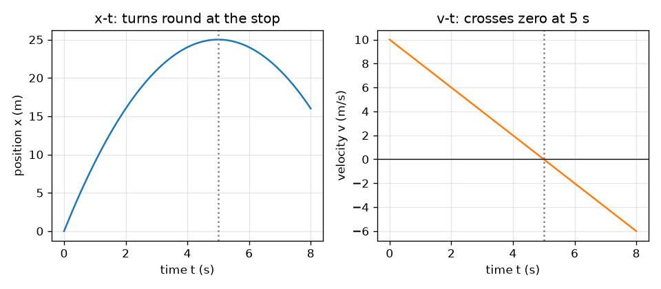
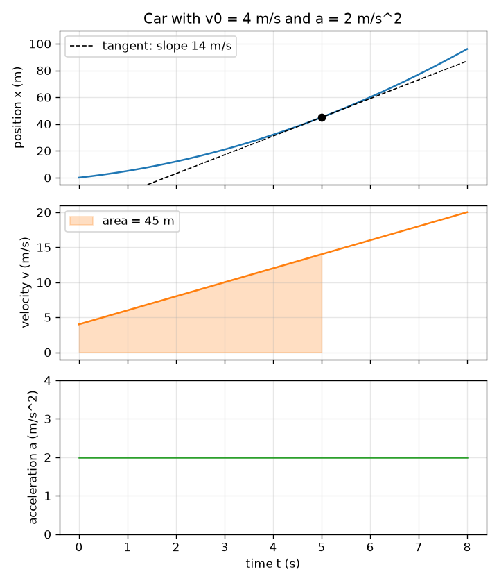

# സെഷൻ 1: ഒരു ചലനം, മൂന്ന് ഗ്രാഫുകൾ: ചരിവും വിസ്തീർണ്ണവും

[Session 1 — हिन्दी](README.hi.md)

*ലെവൽ 1 (ആശയപരമായ ഇന്ററാക്ടീവ് മോഡൽ) · ഏകദേശം 60 മിനിറ്റ് · openmotion*

> ഇത് ലളിതമാക്കിയ ഒരു വിദ്യാഭ്യാസ മോഡൽ (educational model) ആണ്. ഇത് സാധൂകരിക്കപ്പെട്ട ഒരു ഡിസൈൻ ഉപകരണമല്ല; യഥാർത്ഥ നിർമ്മിതികൾ, വൈദ്യുത ഇൻസ്റ്റലേഷനുകൾ, വാഹനങ്ങൾ, വ്യാവസായിക പ്രക്രിയകൾ അല്ലെങ്കിൽ വൈദ്യശാസ്ത്ര തീരുമാനങ്ങൾ എന്നിവയ്ക്ക് ഇത് ഉപയോഗിക്കരുത്.

**മുൻ‌അറിവ് (Prerequisites)**

- ഗ്രാഫ് എന്ന ആശയവും ഒരു നേർരേഖയുടെ ചരിവും (slope).
- നിങ്ങൾ PRIMER.md വായിക്കുകയും `python start.py 1` ഒരിക്കൽ റൺ ചെയ്യുകയും ചെയ്തിട്ടുണ്ട്.

**പഠന ലക്ഷ്യങ്ങൾ (Learning objectives).** ഈ സെഷനു ശേഷം നിങ്ങൾക്ക് കഴിയും:

- സ്ഥാനം (position), പ്രവേഗം (velocity), ത്വരണം (acceleration) എന്നിവയ്ക്ക് പേര് നൽകാനും അവയുടെ യൂണിറ്റുകൾ പറയാനും.
- x-t ഗ്രാഫിന്റെ ചരിവ് പ്രവേഗമാണെന്നും v-t ഗ്രാഫിന്റെ ചരിവ് ത്വരണമാണെന്നും വിശദീകരിക്കാൻ.
- v-t ഗ്രാഫിനു കീഴിലെ വിസ്തീർണ്ണം സഞ്ചരിച്ച ദൂരമാണെന്ന് (സ്ഥാനാന്തരം, displacement) വിശദീകരിക്കാൻ.
- സ്ഥിര ത്വരണത്തിന് v = v0 + a t, x = x0 + v0 t + (1/2) a t^2 എന്നിവ കൈകൊണ്ടും Python-ലും ഉപയോഗിക്കാൻ.

## A. യഥാർത്ഥ ജീവിതത്തിലെ പ്രശ്നം
ഒരു കാർ ഒരു ജംഗ്ഷനിൽ നിന്ന് നീങ്ങിത്തുടങ്ങുന്നു. ഒരു സ്പീഡ് ക്യാമറ അത് എവിടെയാണെന്ന് രേഖപ്പെടുത്തുന്നു, അത് എത്ര വേഗത്തിലായിരുന്നുവെന്നും, വേഗം കൂടുകയായിരുന്നോ കുറയുകയായിരുന്നോ എന്നും നിങ്ങൾക്ക് അറിയണം. സ്ഥാനങ്ങളുടെ പട്ടികയിൽ നിങ്ങൾക്ക് വേഗം കാണാൻ കഴിയില്ല, എന്നാൽ ഒരു ഗ്രാഫിൽ കാണാം: കുത്തനെയുള്ള സ്ഥാന ഗ്രാഫ് എന്നാൽ വേഗത. എന്തുകൊണ്ട്? ആരെങ്കിലും നിങ്ങൾക്ക് വേഗത്തിന്റെ ഗ്രാഫ് മാത്രം തന്നാൽ, കാർ എത്ര ദൂരം പോയി എന്ന് കണ്ടെത്താൻ കഴിയുമോ?

## B. ആശയവും സിദ്ധാന്തവും
സ്ഥാനം x എന്നത് ഒരു രേഖയിലൂടെ വസ്തു എവിടെയാണെന്നാണ് (മീറ്റർ). പ്രവേഗം v എന്നത് x എത്ര വേഗത്തിൽ മാറുന്നു എന്നതാണ്, ദിശ ഉൾപ്പെടെ (മീറ്റർ പെർ സെക്കൻഡ്): അത് x-t ഗ്രാഫിന്റെ ചരിവാണ്. ത്വരണം a എന്നത് v എത്ര വേഗത്തിൽ മാറുന്നു എന്നതാണ് (മീറ്റർ പെർ സെക്കൻഡ് വർഗ്ഗം): അത് v-t ഗ്രാഫിന്റെ ചരിവാണ്. മറുദിശയിൽ, v-t ഗ്രാഫിനും സമയ അക്ഷത്തിനും ഇടയിലുള്ള വിസ്തീർണ്ണം സ്ഥാനാന്തരമാണ്, a-t ഗ്രാഫിനു കീഴിലെ വിസ്തീർണ്ണം പ്രവേഗത്തിലെ മാറ്റമാണ്. അക്ഷത്തിനു താഴെയുള്ള വിസ്തീർണ്ണം നെഗറ്റീവായി കണക്കാക്കുന്നു (പിന്നോട്ടുള്ള ചലനം). സ്ഥിര ത്വരണത്തിന് മൂന്ന് ഗ്രാഫുകളും ഒരു പരാബോള, ഒരു നേർരേഖ, ഒരു പരന്ന രേഖ എന്നിവയാണ്.

| ചിഹ്നം | അർത്ഥം | യൂണിറ്റ് |
|---|---|---|
| t | സമയം | s |
| x0 | ആരംഭ സ്ഥാനം (ഈ സെഷനിൽ 0) | m |
| x | t സമയത്തെ സ്ഥാനം | m |
| v0 | t = 0-ലെ പ്രവേഗം | m/s |
| v | t സമയത്തെ പ്രവേഗം | m/s |
| a | ത്വരണം (സ്ഥിരം) | m/s^2 |

**അനുമാനങ്ങൾ (Assumptions)**

- കാർ ഒരു നേർരേഖയിലൂടെ നീങ്ങുന്നു; മുന്നോട്ടുള്ളത് പോസിറ്റീവ് ആണ്.
- ത്വരണം മുഴുവൻ സമയത്തും സ്ഥിരമാണ്.
- കാറിനെ ഒരൊറ്റ ബിന്ദുവായി കണക്കാക്കുന്നു.

$$ a(t)=a,\qquad v(t)=v_0+a\,t,\qquad x(t)=x_0+v_0\,t+\tfrac12 a\,t^2 $$

$$ v=\frac{dx}{dt},\qquad a=\frac{dv}{dt} $$

$$ \Delta x=\int_0^t v\,dt',\qquad \Delta v=\int_0^t a\,dt' $$

## C. ദൃശ്യ വിശദീകരണം
ആദ്യ ചിത്രം v0 = 4 m/s, a = 2 m/s^2 ഉള്ള ഒരു കാറിന്റെ മൂന്ന് ഗ്രാഫുകൾ ഒരേ സമയ അക്ഷത്തിൽ അടുക്കിവയ്ക്കുന്നു. 5 s-ൽ x-t ഗ്രാഫിലെ ഡാഷ്ഡ് സ്പർശരേഖയുടെ ചരിവ് 14 m/s ആണ്, ആ നിമിഷത്തിൽ v-t ഗ്രാഫിന്റെ ഉയരത്തിന് തുല്യം; 5 s വരെ v-t-യ്ക്ക് കീഴിലെ ഷേഡ് ചെയ്ത വിസ്തീർണ്ണം 45 m ആണ്, 5 s-ൽ x-t ഗ്രാഫിന്റെ ഉയരം. രണ്ടാമത്തെ ചിത്രം 10 m/s-ൽ നിന്ന് -2 m/s^2-ൽ ബ്രേക്ക് ചെയ്യുന്നത് കാണിക്കുന്നു: v-t രേഖ 5 s-ൽ പൂജ്യം കടക്കുന്നു, ആ നിമിഷത്തിൽ x-t വക്രം 25 m-ൽ തിരിയുന്നു.

*10 m/s-ൽ നിന്ന് -2 m/s^2-ൽ ബ്രേക്ക് ചെയ്യുമ്പോൾ: കാർ 5 s-ലും 25 m-ലും നിൽക്കുന്നു, പിന്നെ പിന്നോട്ട് പോകും.*

*ഒരു കാർ, ബന്ധിപ്പിച്ച മൂന്ന് ഗ്രാഫുകൾ: 5 s-ൽ സ്പർശരേഖയുടെ ചരിവ് 14 m/s-ഉം ഷേഡ് ചെയ്ത വിസ്തീർണ്ണം 45 m-ഉം ആണ്.*

## D. ഇന്ററാക്ടീവ് സിമുലേഷൻ
പാഠം റൺ ചെയ്യുക (`python start.py 1`), എന്നിട്ട് ലൈവ് ആപ്പ് തുറക്കുക: [സെഷൻ 1: ഒരു കാറും അതിന്റെ മൂന്ന് ഗ്രാഫുകളും](https://krunalpanchal1995.github.io/pan-iit-oss/openmotion/session-01/) (അല്ലെങ്കിൽ ഈ ഫോൾഡറിലെ `app.html`). സ്ലൈഡറുകൾ നീക്കി കാർ നിരീക്ഷിക്കുക, പിന്നെ സ്ഥാനം, പ്രവേഗം, ത്വരണം വ്യൂകളിലൂടെ മാറിനോക്കുക. x-t ഗ്രാഫിലെ ഡാഷ്ഡ് രേഖ സ്പർശരേഖയാണ്; അതിന്റെ ചരിവ് പ്രവേഗമാണ്. v-t വ്യൂവിലെ ഷേഡ് ചെയ്ത ഭാഗം സഞ്ചരിച്ച ദൂരമാണ്.

**വെല്ലുവിളി.** കാർ 20 m-ൽ കൂടുതൽ നീങ്ങിയ ശേഷം നിശ്ചലാവസ്ഥയിൽ (പ്രവേഗം പൂജ്യത്തിന്റെ 0.2 m/s-നുള്ളിൽ) അവസാനിക്കുന്ന രീതിയിൽ ക്രമീകരിക്കുക.

## E. ഉദാഹരണവും പരീക്ഷണവും
**പ്രശ്നം.** ഒരു കാർ x = 0-ൽ v0 = 4 m/s-ൽ തുടങ്ങി 2 m/s^2-ൽ ത്വരിക്കുന്നു. 5 s കഴിഞ്ഞ് അതിന്റെ പ്രവേഗവും സ്ഥാനവും കണ്ടെത്തുക, പിന്നെ ചരിവും വിസ്തീർണ്ണവും ഉപയോഗിച്ച് ഉത്തരങ്ങൾ പരിശോധിക്കുക.

1. പ്രവേഗം: v = v0 + a t = 4 + 2 * 5 = 14 m/s.
2. സ്ഥാനം: x = v0 t + (1/2) a t^2 = 4 * 5 + 0.5 * 2 * 25 = 20 + 25 = 45 m.
3. ചരിവ് പരിശോധന: 5 s-ൽ x-t വക്രത്തിന്റെ ചരിവ് പ്രവേഗമായിരിക്കണം. ഇരുവശത്തും 0.001 s ചുവട് (x(5.001) - x(4.999)) / 0.002 = 14 m/s നൽകുന്നു.
4. വിസ്തീർണ്ണ പരിശോധന: 0 മുതൽ 5 s വരെ v-t ഗ്രാഫ് സമാന്തര വശങ്ങൾ 4, 14 m/s-ഉം വീതി 5 s-ഉം ഉള്ള ഒരു ട്രപ്പീസിയമാണ്: വിസ്തീർണ്ണം = (4 + 14) / 2 * 5 = 45 m. രണ്ട് രീതികളും യോജിക്കുന്നു.

**ഉത്തരം.** 5 s കഴിഞ്ഞ് v = 14 m/s, x = 45 m; x-t-യുടെ ചരിവ് 14 m/s, v-t-യ്ക്ക് കീഴിലെ വിസ്തീർണ്ണം 45 m.

**പരീക്ഷണം.** മേശയിൽ ഒട്ടിച്ച ഒരു സ്കെയിലിനരികിലൂടെ ഒരു കളിപ്പാട്ട കാർ ചെറിയ ചരിവിലൂടെ ഉരുട്ടി, ഫോണിൽ സെക്കൻഡിൽ 30 ഫ്രെയിമിൽ ചിത്രീകരിക്കുക, ഏതാനും ഫ്രെയിമുകൾക്കിടയിൽ കാറിന്റെ സ്ഥാനം വായിക്കുക. x-നെ t-യ്ക്കെതിരെ വരച്ച് ആകൃതി ഒരു പരാബോളയുമായി താരതമ്യം ചെയ്യുക. മോഡലും അളവും തമ്മിലുള്ള വ്യത്യാസങ്ങൾ ഘർഷണം (ത്വരണം കൃത്യമായി സ്ഥിരമല്ല), ഫ്രെയിമുകൾ വായിക്കുന്നതിലെ പിഴവ് (ഏതാനും മില്ലിമീറ്റർ), ക്യാമറയുടെ സമയക്രമം എന്നിവയിൽ നിന്നാണ്: മോഡലിന് പൂർണ്ണമായ സ്ഥിര ത്വരണമുണ്ട്, കളിപ്പാട്ട കാറിന് ഇല്ല.

## F. വിലയിരുത്തലും ഡിസൈൻ വെല്ലുവിളിയും
**ചോദ്യ തരം A: ആശയപരം.** ഒരു സ്ഥാനം-സമയം ഗ്രാഫിന്റെ ചരിവ് എന്തിനെ പ്രതിനിധീകരിക്കുന്നു? നെഗറ്റീവ് ചരിവ് എന്താണ് അർത്ഥമാക്കുന്നത്, പരന്ന ഭാഗം എന്താണ്?

സൂചന

ചരിവ് എന്നാൽ ഉയർച്ച ഹരണം ദൂരം. ഉയർച്ച എന്താണ്, ദൂരം (run) എന്താണ്?

ഘട്ടം ഘട്ടമായുള്ള പരിഹാരം

ഉയർച്ച സ്ഥാനത്തിലെ മാറ്റവും റൺ സമയത്തിലെ മാറ്റവുമാണ്, അതിനാൽ ചരിവ് ഏകകസമയത്തിലെ സ്ഥാനമാറ്റമാണ്: പ്രവേഗം. നെഗറ്റീവ് ചരിവ് എന്നാൽ സ്ഥാനം കുറയുന്നു, അതിനാൽ വസ്തു പിന്നോട്ട് നീങ്ങുന്നു (പോസിറ്റീവ് ദിശയ്ക്ക് എതിരെ). പരന്ന ഭാഗത്തിന് ചരിവ് പൂജ്യമാണ്: വസ്തു നിശ്ചലമാണ്.

**ചോദ്യ തരം B: സംഖ്യാപരം.** ഒരു കാറിന് v0 = 3 m/s, a = 2.5 m/s^2. 4 s കഴിഞ്ഞ് അതിന്റെ പ്രവേഗവും സഞ്ചരിച്ച ദൂരവും കണ്ടെത്തുക. യൂണിറ്റുകളും ഉത്തരം യുക്തിസഹമാണോ എന്നും പരിശോധിക്കുക.

സൂചന

v = v0 + a t, x = v0 t + (1/2) a t^2 ഉപയോഗിക്കുക.

ഘട്ടം ഘട്ടമായുള്ള പരിഹാരം

v = 3 + 2.5 * 4 = 13 m/s. x = 3 * 4 + 0.5 * 2.5 * 16 = 12 + 20 = 32 m. യൂണിറ്റുകൾ: (m/s)(s) = m, (m/s^2)(s^2) = m. യുക്തി പരിശോധന: ശരാശരി പ്രവേഗം (3 + 13) / 2 = 8 m/s ആണ്, 8 m/s * 4 s = 32 m. സംഖ്യകൾ യോജിക്കുന്നു.

**ചോദ്യ തരം C: ഗ്രാഫും സിമുലേഷനും വ്യാഖ്യാനിക്കൽ.** ഒരു v-t ഗ്രാഫ് (0 s, 12 m/s) മുതൽ (6 s, 0 m/s) വരെ താഴേക്കുള്ള ഒരു നേർരേഖയാണ്. ത്വരണത്തിന്റെ ദിശ ഏതാണ്, അതിന്റെ വില എത്ര, വസ്തു എത്ര ദൂരം നീങ്ങി?

സൂചന

ചരിവ് ത്വരണം നൽകുന്നു; ത്രികോണത്തിന്റെ വിസ്തീർണ്ണം ദൂരം നൽകുന്നു.

ഘട്ടം ഘട്ടമായുള്ള പരിഹാരം

രേഖ താഴേക്ക് പോകുന്നു, അതിനാൽ ത്വരണം നെഗറ്റീവാണ് (വസ്തു മുന്നോട്ട് നീങ്ങിക്കൊണ്ട് വേഗം കുറയ്ക്കുന്നു): a = (0 - 12) / 6 = -2 m/s^2. വിസ്തീർണ്ണം ഒരു ത്രികോണമാണ്: 0.5 * 6 s * 12 m/s = 36 m. വസ്തു 36 m മുന്നോട്ട് നീങ്ങി നിന്നു.

**ചോദ്യ തരം D: ഡിസൈനും ഒപ്റ്റിമൈസേഷൻ (optimisation) വെല്ലുവിളിയും.** ഡിസൈൻ: 10 m/s-ൽ സഞ്ചരിക്കുന്ന ഒരു കാർ 30 m-നുള്ളിൽ നിൽക്കണം. കുറഞ്ഞത് എത്ര സ്ഥിര മന്ദനം (deceleration) വേണം, നിൽക്കാൻ എത്ര സമയമെടുക്കും? നിങ്ങളുടെ അനുമാനങ്ങൾ പറയുക.

സൂചന

v-t ഗ്രാഫ് ഒരു ത്രികോണമാണ്, അതിന്റെ വിസ്തീർണ്ണം നിൽക്കാനുള്ള ദൂരത്തിന് തുല്യം.

ഘട്ടം ഘട്ടമായുള്ള പരിഹാരം

ത്രികോണത്തിന്റെ വിസ്തീർണ്ണം 0.5 * 10 * T = 30, അതിനാൽ T = 6 s, മന്ദനം 10 / 6 = 1.67 m/s^2 (അല്പം കൂടുതലായാൽ കൂടുതൽ സുരക്ഷിതം). പരിശോധന: 'സമയമില്ലാത്ത' സൂത്രവാക്യം v^2 / (2 d) = 100 / 60 = 1.67 m/s^2 നൽകുന്നു. അനുമാനങ്ങൾ: ആദ്യ നിമിഷം മുതൽ സ്ഥിര മന്ദനം, നേരായ റോഡ്, പ്രതികരണ സമയം ഇല്ല (സെഷൻ 2 അത് ചേർക്കും).

[RUBRIC.md](../../RUBRIC.md) ഉപയോഗിച്ച് സ്വയം സ്കോർ ചെയ്യുക. പേപ്പറിൽ ചെയ്യാൻ [ആക്ടിവിറ്റി ഷീറ്റ്](activity_sheet.md) പ്രിന്റ് ചെയ്യുക.

## സാധാരണ തെറ്റിദ്ധാരണകൾ
| സാധാരണ തെറ്റിദ്ധാരണ | യഥാർത്ഥത്തിൽ ശരിയായത് |
|---|---|
| നെഗറ്റീവ് ത്വരണം എപ്പോഴും വസ്തു വേഗം കുറയ്ക്കുന്നു എന്നാണ്. | പ്രവേഗം കുറയുന്നു എന്നാണ് അർത്ഥം. പ്രവേഗം നെഗറ്റീവ് ആണെങ്കിൽ, നെഗറ്റീവ് ത്വരണം വസ്തുവിനെ പിന്നോട്ട് വേഗം കൂട്ടുന്നു. |
| പ്രവേഗം പൂജ്യമാണെങ്കിൽ ത്വരണവും പൂജ്യമായിരിക്കണം. | എറിഞ്ഞ പന്തിന്റെ ഏറ്റവും മുകളിൽ പ്രവേഗം ഒരു നിമിഷം പൂജ്യമാണ്, പക്ഷേ ത്വരണം ഇപ്പോഴും താഴേക്ക് 9.8 m/s^2 ആണ്. പൂജ്യമല്ലാത്ത ത്വരണത്തോടെയുള്ള പൂജ്യം പ്രവേഗം ഒരു തിരിവ് ബിന്ദുവാണ്. |
| x-നെതിരെ t-യുടെ ഗ്രാഫ് കാറിന്റെ പാതയാണ്. | x-t ഗ്രാഫ് ഓരോ സമയത്തും കാർ എവിടെയാണെന്ന് കാണിക്കുന്നു, റോഡിന്റെ ആകൃതിയല്ല. നേരായ റോഡിലെ കാർ വേഗം കൂട്ടുമ്പോൾ വളഞ്ഞ x-t ഗ്രാഫ് നൽകുന്നു. |

## പദാവലി (Glossary)
- **സ്ഥാനം (position)**: ഒരു ആരംഭ ബിന്ദുവിൽ നിന്ന് അളക്കുന്ന, ഒരു രേഖയിലൂടെ വസ്തു എവിടെയാണ്
- **പ്രവേഗം (velocity)**: ദിശ സഹിതം സ്ഥാനത്തിന്റെ മാറ്റനിരക്ക്; x-t ഗ്രാഫിന്റെ ചരിവ്
- **ത്വരണം (acceleration)**: പ്രവേഗത്തിന്റെ മാറ്റനിരക്ക്; v-t ഗ്രാഫിന്റെ ചരിവ്
- **സ്ഥാനാന്തരം (displacement)**: സ്ഥാനത്തിലെ മാറ്റം; v-t ഗ്രാഫിനു കീഴിലെ ചിഹ്നമുള്ള വിസ്തീർണ്ണം
- **ചരിവ് (slope)**: ഒരു ഗ്രാഫിന്റെ ഉയർച്ചയെ ദൂരം കൊണ്ട് ഹരിച്ചത്

## പൂർത്തിയാക്കുക
1. [exercises.md](exercises.md)-ലെ മൂന്ന് കോഡിംഗ് ടാസ്കുകൾ ചെയ്യുക.
2. മാറ്റങ്ങൾക്കു ശേഷം `python start.py 1` വീണ്ടും റൺ ചെയ്യുക. അത് ചെക്ക്‌പോയിന്റോടെ (checkpoint) അവസാനിക്കുന്നു; അത് `PASS` എന്ന് പ്രിന്റ് ചെയ്യുമ്പോൾ നിങ്ങൾ പൂർത്തിയാക്കി. (ചെക്ക്‌പോയിന്റ് മാത്രം: `python start.py check 1`.)

അടുത്തത്: [സെഷൻ 2](../session-02/README.md)
