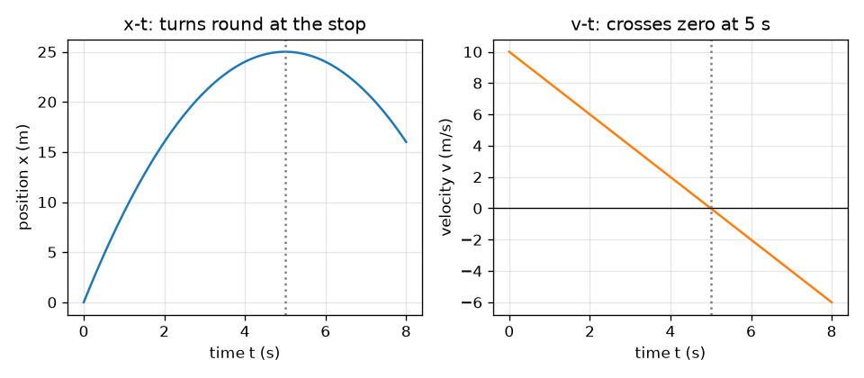
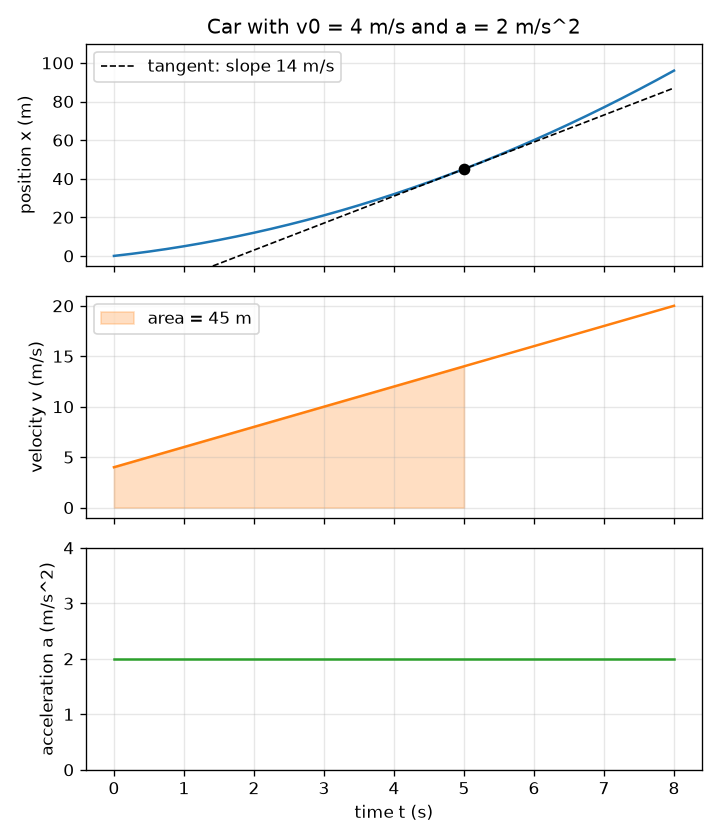

# அமர்வு 1: ஒரு இயக்கம், மூன்று வரைபடங்கள்: சாய்வும் பரப்பளவும்

[Session 1 — हिन्दी](README.hi.md)

*நிலை 1 (கருத்தியல் ஊடாடும் மாதிரி) · சுமார் 60 நிமிடங்கள் · openmotion*

> இது எளிமைப்படுத்தப்பட்ட ஒரு கல்வி மாதிரி (educational model). இது சரிபார்க்கப்பட்ட வடிவமைப்புக் கருவி அல்ல; உண்மையான கட்டமைப்புகள், மின் நிறுவல்கள், வாகனங்கள், தொழில்துறை செயல்முறைகள் அல்லது மருத்துவ முடிவுகளுக்கு இதைப் பயன்படுத்தக் கூடாது.

**முன்தேவைகள் (Prerequisites)**

- வரைபடம் என்ற கருத்தும் ஒரு நேர்கோட்டின் சாய்வும் (slope).
- நீங்கள் PRIMER.md படித்து `python start.py 1` ஒருமுறை இயக்கியிருக்கிறீர்கள்.

**கற்றல் நோக்கங்கள் (Learning objectives).** இந்த அமர்வுக்குப் பிறகு உங்களால் முடியும்:

- இடம் (position), திசைவேகம் (velocity), முடுக்கம் (acceleration) ஆகியவற்றைப் பெயரிட்டு அவற்றின் அலகுகளைக் கூற.
- x-t வரைபடத்தின் சாய்வு திசைவேகம் என்றும் v-t வரைபடத்தின் சாய்வு முடுக்கம் என்றும் விளக்க.
- v-t வரைபடத்தின் கீழுள்ள பரப்பளவு கடந்த தூரம் (இடப்பெயர்ச்சி, displacement) என்று விளக்க.
- மாறா முடுக்கத்துக்கு v = v0 + a t, x = x0 + v0 t + (1/2) a t^2 ஆகியவற்றைக் கையால் மற்றும் Python-இல் பயன்படுத்த.

## A. நிஜ உலகப் பிரச்சினை
ஒரு கார் சந்திப்பிலிருந்து புறப்படுகிறது. ஒரு வேகக் கேமரா அது எங்கே இருக்கிறது என்று பதிவு செய்கிறது, அது எவ்வளவு வேகமாகச் சென்றது, வேகம் கூடுகிறதா குறைகிறதா என்று நீங்கள் அறிய விரும்புகிறீர்கள். இடங்களின் பட்டியலில் வேகத்தைப் பார்க்க முடியாது, ஆனால் வரைபடத்தில் பார்க்கலாம்: செங்குத்தான இட வரைபடம் என்றால் வேகம். ஏன்? யாராவது வேக வரைபடத்தை மட்டும் தந்தால், கார் எவ்வளவு தூரம் சென்றது என்று கண்டறிய முடியுமா?

## B. கருத்தும் கோட்பாடும்
இடம் x என்பது ஒரு கோட்டில் பொருள் எங்கே உள்ளது (மீட்டர்). திசைவேகம் v என்பது x எவ்வளவு வேகமாக மாறுகிறது, திசையுடன் (மீட்டர் பெர் வினாடி): அது x-t வரைபடத்தின் சாய்வு. முடுக்கம் a என்பது v எவ்வளவு வேகமாக மாறுகிறது (மீட்டர் பெர் வினாடி வர்க்கம்): அது v-t வரைபடத்தின் சாய்வு. எதிர்த் திசையில், v-t வரைபடத்துக்கும் நேர அச்சுக்கும் இடையிலான பரப்பளவு இடப்பெயர்ச்சி, a-t வரைபடத்தின் கீழுள்ள பரப்பளவு திசைவேக மாற்றம். அச்சுக்குக் கீழுள்ள பரப்பளவு எதிர்மறையாகக் கணக்கிடப்படும் (பின்னோக்கிய இயக்கம்). மாறா முடுக்கத்துக்கு மூன்று வரைபடங்களும் ஒரு பரவளையம், ஒரு நேர்கோடு, ஒரு தட்டையான கோடு.

| குறியீடு | பொருள் | அலகு |
|---|---|---|
| t | நேரம் | s |
| x0 | தொடக்க இடம் (இந்த அமர்வில் 0) | m |
| x | t நேரத்தில் இடம் | m |
| v0 | t = 0-இல் திசைவேகம் | m/s |
| v | t நேரத்தில் திசைவேகம் | m/s |
| a | முடுக்கம் (மாறாதது) | m/s^2 |

**அனுமானங்கள் (Assumptions)**

- கார் ஒரு நேர்கோட்டில் நகர்கிறது; முன்னோக்கியது நேர்மறை.
- முடுக்கம் முழு நேரத்திலும் மாறாதது.
- காரை ஒரே ஒரு புள்ளியாகக் கருதுகிறோம்.

$$ a(t)=a,\qquad v(t)=v_0+a\,t,\qquad x(t)=x_0+v_0\,t+\tfrac12 a\,t^2 $$

$$ v=\frac{dx}{dt},\qquad a=\frac{dv}{dt} $$

$$ \Delta x=\int_0^t v\,dt',\qquad \Delta v=\int_0^t a\,dt' $$

## C. காட்சி விளக்கம்
முதல் படம் v0 = 4 m/s, a = 2 m/s^2 கொண்ட ஒரு காரின் மூன்று வரைபடங்களை ஒரே நேர அச்சில் அடுக்குகிறது. 5 s-இல் x-t வரைபடத்தில் உள்ள கோடிட்ட தொடுகோட்டின் சாய்வு 14 m/s, அந்த நேரத்தில் v-t வரைபடத்தின் உயரத்துக்குச் சமம்; 5 s வரை v-t-இன் கீழ் நிழலிடப்பட்ட பரப்பளவு 45 m, 5 s-இல் x-t வரைபடத்தின் உயரம். இரண்டாவது படம் 10 m/s-இல் இருந்து -2 m/s^2-இல் பிரேக் போடுவதைக் காட்டுகிறது: v-t கோடு 5 s-இல் பூஜ்ஜியத்தைக் கடக்கிறது, அந்த நேரத்தில் x-t வளைவு 25 m-இல் திரும்புகிறது.

*10 m/s-இல் இருந்து -2 m/s^2-இல் பிரேக் போடுதல்: கார் 5 s-இலும் 25 m-இலும் நிற்கிறது, பிறகு பின்னோக்கிச் செல்லும்.*

*ஒரு கார், இணைக்கப்பட்ட மூன்று வரைபடங்கள்: 5 s-இல் தொடுகோட்டின் சாய்வு 14 m/s, நிழலிடப்பட்ட பரப்பளவு 45 m.*

## D. ஊடாடும் உருவகப்படுத்தல் (Interactive simulation)
பாடத்தை இயக்குங்கள் (`python start.py 1`), பிறகு நேரடிச் செயலியைத் திறக்கவும்: [அமர்வு 1: ஒரு காரும் அதன் மூன்று வரைபடங்களும்](https://krunalpanchal1995.github.io/pan-iit-oss/openmotion/session-01/) (அல்லது இந்தக் கோப்புறையில் உள்ள `app.html`). ஸ்லைடர்களை நகர்த்திக் காரைக் கவனியுங்கள், பிறகு இடம், திசைவேகம், முடுக்கம் காட்சிகளுக்கு மாறிப் பாருங்கள். x-t வரைபடத்தில் உள்ள கோடிட்ட கோடு தொடுகோடு; அதன் சாய்வு திசைவேகம். v-t காட்சியில் நிழலிடப்பட்ட பகுதி கடந்த தூரம்.

**சவால்.** கார் 20 m-க்கு மேல் நகர்ந்த பிறகு ஓய்வில் (திசைவேகம் பூஜ்ஜியத்தின் 0.2 m/s-க்குள்) முடியும்படி செய்யுங்கள்.

## E. தீர்க்கப்பட்ட எடுத்துக்காட்டும் சோதனையும்
**கணக்கு.** ஒரு கார் x = 0-இல் v0 = 4 m/s-உடன் தொடங்கி 2 m/s^2-இல் முடுக்கம் அடைகிறது. 5 s-க்குப் பிறகு அதன் திசைவேகத்தையும் இடத்தையும் கண்டறியுங்கள், பிறகு சாய்வு மற்றும் பரப்பளவு கொண்டு விடைகளைச் சரிபாருங்கள்.

1. திசைவேகம்: v = v0 + a t = 4 + 2 * 5 = 14 m/s.
2. இடம்: x = v0 t + (1/2) a t^2 = 4 * 5 + 0.5 * 2 * 25 = 20 + 25 = 45 m.
3. சாய்வு சரிபார்ப்பு: 5 s-இல் x-t வளைவின் சாய்வு திசைவேகமாக இருக்க வேண்டும். இரு பக்கமும் 0.001 s படி (x(5.001) - x(4.999)) / 0.002 = 14 m/s தருகிறது.
4. பரப்பளவு சரிபார்ப்பு: 0 முதல் 5 s வரை v-t வரைபடம் இணைப் பக்கங்கள் 4 மற்றும் 14 m/s, அகலம் 5 s கொண்ட சரிவகம்: பரப்பளவு = (4 + 14) / 2 * 5 = 45 m. இரண்டு முறைகளும் ஒத்துப்போகின்றன.

**விடை.** 5 s-க்குப் பிறகு v = 14 m/s, x = 45 m; x-t-இன் சாய்வு 14 m/s, v-t-இன் கீழுள்ள பரப்பளவு 45 m.

**சோதனை.** மேசையில் ஒட்டிய அளவுகோலை ஒட்டி ஒரு பொம்மைக் காரை மெல்லிய சரிவில் உருட்டி, தொலைபேசியில் வினாடிக்கு 30 சட்டகங்களில் படம்பிடித்து, சில சட்டகங்களுக்கு ஒருமுறை காரின் இடத்தைப் படியுங்கள். x-ஐ t-க்கு எதிராக வரைந்து வடிவத்தைப் பரவளையத்துடன் ஒப்பிடுங்கள். மாதிரிக்கும் அளவீட்டுக்கும் இடையிலான வேறுபாடுகள் உராய்விலிருந்து (முடுக்கம் சரியாக மாறாதது அல்ல), சட்டகங்களைப் படிப்பதிலிருந்து (சில மில்லிமீட்டர்), கேமராவின் நேரக் கணக்கிலிருந்து வருகின்றன: மாதிரிக்கு முழுமையான மாறா முடுக்கம் உண்டு, பொம்மைக் காருக்கு இல்லை.

## F. மதிப்பீடும் வடிவமைப்புச் சவாலும்
**கேள்வி வகை A: கருத்தியல்.** இடம்-நேர வரைபடத்தின் சாய்வு எதைக் குறிக்கிறது? எதிர்மறைச் சாய்வு என்றால் என்ன, தட்டையான பகுதி என்றால் என்ன?

குறிப்பு

சாய்வு என்றால் ஏற்றம் வகுத்தல் ஓட்டம். ஏற்றம் என்ன, ஓட்டம் (run) என்ன?

படிப்படியான தீர்வு

ஏற்றம் இடத்தின் மாற்றம், ஓட்டம் நேரத்தின் மாற்றம், எனவே சாய்வு ஓரலகு நேரத்துக்கான இட மாற்றம்: திசைவேகம். எதிர்மறைச் சாய்வு என்றால் இடம் குறைகிறது, எனவே பொருள் பின்னோக்கி (நேர்மறைத் திசைக்கு எதிராக) நகர்கிறது. தட்டையான பகுதிக்குச் சாய்வு பூஜ்ஜியம்: பொருள் ஓய்வில் உள்ளது.

**கேள்வி வகை B: எண்ணியல்.** ஒரு காருக்கு v0 = 3 m/s, a = 2.5 m/s^2. 4 s-க்குப் பிறகு அதன் திசைவேகத்தையும் கடந்த தூரத்தையும் கண்டறியுங்கள். அலகுகளையும் விடை பொருத்தமானதா என்பதையும் சரிபாருங்கள்.

குறிப்பு

v = v0 + a t மற்றும் x = v0 t + (1/2) a t^2 பயன்படுத்துங்கள்.

படிப்படியான தீர்வு

v = 3 + 2.5 * 4 = 13 m/s. x = 3 * 4 + 0.5 * 2.5 * 16 = 12 + 20 = 32 m. அலகுகள்: (m/s)(s) = m மற்றும் (m/s^2)(s^2) = m. பொருத்தச் சரிபார்ப்பு: சராசரித் திசைவேகம் (3 + 13) / 2 = 8 m/s, 8 m/s * 4 s = 32 m. எண்கள் ஒத்துப்போகின்றன.

**கேள்வி வகை C: வரைபடம் மற்றும் உருவகப்படுத்தல் விளக்கம்.** ஒரு v-t வரைபடம் (0 s, 12 m/s) முதல் (6 s, 0 m/s) வரை கீழ்நோக்கிய நேர்கோடு. முடுக்கத்தின் திசை எது, அதன் மதிப்பு என்ன, பொருள் எவ்வளவு தூரம் நகர்ந்தது?

குறிப்பு

சாய்வு முடுக்கத்தைத் தருகிறது; முக்கோணத்தின் பரப்பளவு தூரத்தைத் தருகிறது.

படிப்படியான தீர்வு

கோடு கீழே செல்கிறது, எனவே முடுக்கம் எதிர்மறை (பொருள் முன்னோக்கி நகர்ந்தபடி வேகம் குறைகிறது): a = (0 - 12) / 6 = -2 m/s^2. பரப்பளவு ஒரு முக்கோணம்: 0.5 * 6 s * 12 m/s = 36 m. பொருள் 36 m முன்னோக்கி நகர்ந்து நின்றது.

**கேள்வி வகை D: வடிவமைப்பு மற்றும் உகப்பாக்கம் (optimisation) சவால்.** வடிவமைப்பு: 10 m/s-இல் செல்லும் ஒரு கார் 30 m-க்குள் நிற்க வேண்டும். குறைந்தபட்சம் எவ்வளவு மாறா எதிர் முடுக்கம் (deceleration) தேவை, நிற்க எவ்வளவு நேரம் ஆகும்? உங்கள் அனுமானங்களைக் கூறுங்கள்.

குறிப்பு

v-t வரைபடம் ஒரு முக்கோணம், அதன் பரப்பளவு நிற்கும் தூரத்துக்குச் சமம்.

படிப்படியான தீர்வு

முக்கோணத்தின் பரப்பளவு 0.5 * 10 * T = 30, எனவே T = 6 s, எதிர் முடுக்கம் 10 / 6 = 1.67 m/s^2 (சற்றுக் கூடுதலாக இருந்தால் பாதுகாப்பானது). சரிபார்ப்பு: 'நேரம் இல்லாத' சூத்திரம் v^2 / (2 d) = 100 / 60 = 1.67 m/s^2 தருகிறது. அனுமானங்கள்: முதல் கணத்திலிருந்து மாறா எதிர் முடுக்கம், நேரான சாலை, எதிர்வினை நேரம் இல்லை (அமர்வு 2 அதைச் சேர்க்கும்).

[RUBRIC.md](../../RUBRIC.md) கொண்டு உங்களை மதிப்பிடுங்கள். தாளில் செய்ய [செயல்பாட்டுத் தாள்](activity_sheet.md)-ஐ அச்சிடுங்கள்.

## பொதுவான தவறான கருத்துகள்
| பொதுவான தவறான கருத்து | உண்மையில் சரியானது |
|---|---|
| எதிர்மறை முடுக்கம் எப்போதும் பொருள் வேகம் குறைகிறது என்று பொருள். | திசைவேகம் குறைகிறது என்று பொருள். திசைவேகம் எதிர்மறையாக இருந்தால், எதிர்மறை முடுக்கம் பொருளைப் பின்னோக்கி வேகப்படுத்தும். |
| திசைவேகம் பூஜ்ஜியம் என்றால் முடுக்கமும் பூஜ்ஜியமாக இருக்க வேண்டும். | எறிந்த பந்தின் உச்சியில் திசைவேகம் ஒரு கணம் பூஜ்ஜியம், ஆனால் முடுக்கம் இன்னும் கீழ்நோக்கி 9.8 m/s^2. பூஜ்ஜியமற்ற முடுக்கத்துடன் பூஜ்ஜியத் திசைவேகம் ஒரு திருப்பு புள்ளி. |
| x-க்கு எதிரான t வரைபடம் காரின் பாதை. | x-t வரைபடம் ஒவ்வொரு நேரத்திலும் கார் எங்கே இருக்கிறது என்று காட்டுகிறது, சாலையின் வடிவத்தை அல்ல. நேரான சாலையில் வேகம் கூடும் கார் வளைந்த x-t வரைபடத்தைத் தரும். |

## சொற்களஞ்சியம் (Glossary)
- **இடம் (position)**: ஒரு தொடக்கப் புள்ளியிலிருந்து அளக்கப்படும், ஒரு கோட்டில் பொருள் எங்கே உள்ளது
- **திசைவேகம் (velocity)**: திசையுடன் இடத்தின் மாற்ற வீதம்; x-t வரைபடத்தின் சாய்வு
- **முடுக்கம் (acceleration)**: திசைவேகத்தின் மாற்ற வீதம்; v-t வரைபடத்தின் சாய்வு
- **இடப்பெயர்ச்சி (displacement)**: இடத்தின் மாற்றம்; v-t வரைபடத்தின் கீழுள்ள குறியுடன் கூடிய பரப்பளவு
- **சாய்வு (slope)**: ஒரு வரைபடத்தின் ஏற்றத்தை ஓட்டத்தால் வகுத்தது

## முடிவு
1. [exercises.md](exercises.md)-இல் உள்ள மூன்று நிரலாக்கப் பணிகளைச் செய்யுங்கள்.
2. உங்கள் மாற்றங்களுக்குப் பிறகு `python start.py 1` மீண்டும் இயக்குங்கள். அது சோதனைச் சாவடியுடன் (checkpoint) முடிகிறது; அது `PASS` என்று அச்சிடும்போது நீங்கள் முடித்துவிட்டீர்கள். (சோதனைச் சாவடி மட்டும்: `python start.py check 1`.)

அடுத்து: [அமர்வு 2](../session-02/README.md)
