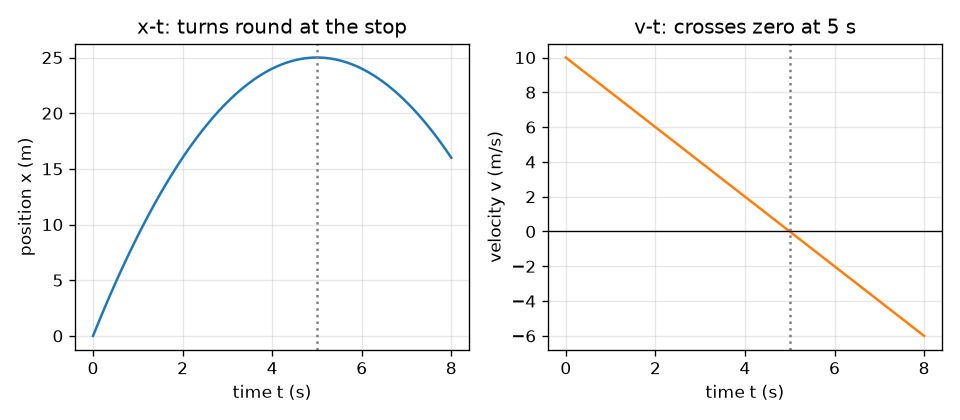
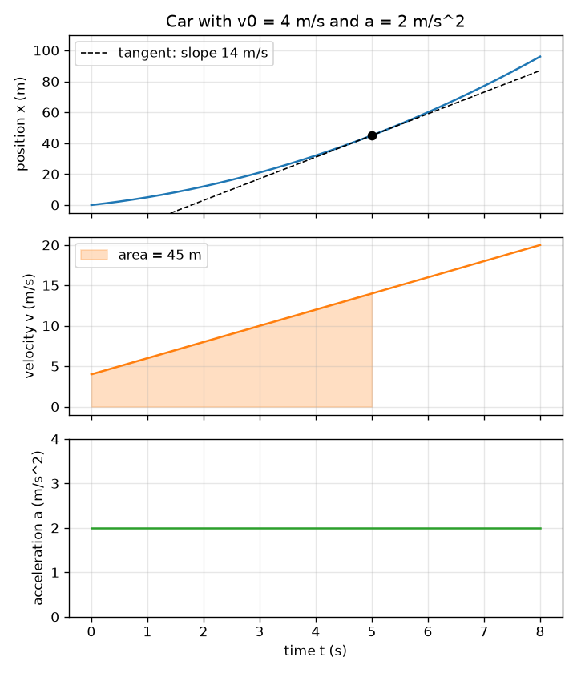

# సెషన్ 1: ఒక చలనం, మూడు గ్రాఫ్‌లు: వాలు మరియు వైశాల్యం

[Session 1 — हिन्दी](README.hi.md)

*స్థాయి 1 (భావనాత్మక ఇంటరాక్టివ్ నమూనా) · సుమారు 60 నిమిషాలు · openmotion*

> ఇది సరళీకరించిన ఒక విద్యా నమూనా (educational model). ఇది ధృవీకరించబడిన డిజైన్ సాధనం కాదు; నిజమైన నిర్మాణాలు, విద్యుత్ ఇన్‌స్టాలేషన్‌లు, వాహనాలు, పారిశ్రామిక ప్రక్రియలు లేదా వైద్య నిర్ణయాల కోసం దీనిని ఉపయోగించకూడదు.

**ముందస్తు జ్ఞానం (Prerequisites)**

- గ్రాఫ్ అనే భావన మరియు సరళ రేఖ వాలు (slope).
- మీరు PRIMER.md చదివి `python start.py 1` ఒకసారి రన్ చేశారు.

**అభ్యాస లక్ష్యాలు (Learning objectives).** ఈ సెషన్ తర్వాత మీరు చేయగలరు:

- స్థానం (position), వేగం (velocity), త్వరణం (acceleration) లకు పేరు పెట్టి వాటి యూనిట్‌లు చెప్పడం.
- x-t గ్రాఫ్ వాలు వేగమని, v-t గ్రాఫ్ వాలు త్వరణమని వివరించడం.
- v-t గ్రాఫ్ కింది వైశాల్యం కదిలిన దూరం (స్థానభ్రంశం, displacement) అని వివరించడం.
- స్థిర త్వరణానికి v = v0 + a t మరియు x = x0 + v0 t + (1/2) a t^2 లను చేతితో మరియు Pythonలో ఉపయోగించడం.

## A. వాస్తవ ప్రపంచ సమస్య
ఒక కారు కూడలి నుండి బయలుదేరుతుంది. ఒక స్పీడ్ కెమెరా అది ఎక్కడ ఉందో రికార్డ్ చేస్తుంది, అది ఎంత వేగంగా వెళ్ళిందో, వేగం పెరుగుతోందో తగ్గుతోందో మీరు తెలుసుకోవాలి. స్థానాల జాబితాలో వేగాన్ని చూడలేరు, కానీ గ్రాఫ్‌లో చూడవచ్చు: నిటారుగా ఉన్న స్థాన గ్రాఫ్ అంటే వేగంగా. ఎందుకు? ఎవరైనా వేగం గ్రాఫ్ మాత్రమే ఇస్తే, కారు ఎంత దూరం వెళ్ళిందో కనుగొనగలరా?

## B. భావన మరియు సిద్ధాంతం
స్థానం x అంటే ఒక రేఖపై వస్తువు ఎక్కడ ఉందో (మీటర్లు). వేగం v అంటే x ఎంత వేగంగా మారుతుందో, దిశతో సహా (మీటర్ పర్ సెకను): అది x-t గ్రాఫ్ వాలు. త్వరణం a అంటే v ఎంత వేగంగా మారుతుందో (మీటర్ పర్ సెకను వర్గం): అది v-t గ్రాఫ్ వాలు. వ్యతిరేక దిశలో, v-t గ్రాఫ్‌కు మరియు కాల అక్షానికి మధ్య ఉన్న వైశాల్యం స్థానభ్రంశం, a-t గ్రాఫ్ కింది వైశాల్యం వేగంలో మార్పు. అక్షం కింది వైశాల్యం ఋణాత్మకంగా లెక్కించబడుతుంది (వెనుకకు చలనం). స్థిర త్వరణానికి మూడు గ్రాఫ్‌లు ఒక పరావలయం, ఒక సరళ రేఖ, ఒక చదునైన రేఖ.

| చిహ్నం | అర్థం | యూనిట్ |
|---|---|---|
| t | సమయం | s |
| x0 | ప్రారంభ స్థానం (ఈ సెషన్‌లో 0) | m |
| x | t సమయంలో స్థానం | m |
| v0 | t = 0 వద్ద వేగం | m/s |
| v | t సమయంలో వేగం | m/s |
| a | త్వరణం (స్థిరం) | m/s^2 |

**ఊహలు (Assumptions)**

- కారు ఒక సరళ రేఖ వెంబడి కదులుతుంది; ముందుకు ధనాత్మకం.
- త్వరణం మొత్తం సమయం స్థిరంగా ఉంటుంది.
- కారును ఒకే బిందువుగా పరిగణిస్తాం.

$$ a(t)=a,\qquad v(t)=v_0+a\,t,\qquad x(t)=x_0+v_0\,t+\tfrac12 a\,t^2 $$

$$ v=\frac{dx}{dt},\qquad a=\frac{dv}{dt} $$

$$ \Delta x=\int_0^t v\,dt',\qquad \Delta v=\int_0^t a\,dt' $$

## C. దృశ్య వివరణ
మొదటి చిత్రం v0 = 4 m/s, a = 2 m/s^2 ఉన్న కారు యొక్క మూడు గ్రాఫ్‌లను ఒకే కాల అక్షంపై పేర్చుతుంది. 5 s వద్ద x-t గ్రాఫ్‌పై చుక్కల స్పర్శరేఖ వాలు 14 m/s, ఆ క్షణంలో v-t గ్రాఫ్ ఎత్తుకు సమానం; 5 s వరకు v-t కింద నీడ వేసిన వైశాల్యం 45 m, 5 s వద్ద x-t గ్రాఫ్ ఎత్తు. రెండవ చిత్రం 10 m/s నుండి -2 m/s^2 తో బ్రేక్ వేయడాన్ని చూపిస్తుంది: v-t రేఖ 5 s వద్ద సున్నాను దాటుతుంది, ఆ క్షణంలో x-t వక్రం 25 m వద్ద తిరుగుతుంది.

*10 m/s నుండి -2 m/s^2 తో బ్రేక్ వేయడం: కారు 5 s వద్ద, 25 m వద్ద ఆగుతుంది, తర్వాత వెనక్కి వెళ్తుంది.*

*ఒక కారు, అనుసంధానించిన మూడు గ్రాఫ్‌లు: 5 s వద్ద స్పర్శరేఖ వాలు 14 m/s, నీడ వేసిన వైశాల్యం 45 m.*

## D. ఇంటరాక్టివ్ సిమ్యులేషన్
పాఠాన్ని రన్ చేయండి (`python start.py 1`), తర్వాత లైవ్ యాప్‌ను తెరవండి: [సెషన్ 1: ఒక కారు మరియు దాని మూడు గ్రాఫ్‌లు](https://krunalpanchal1995.github.io/pan-iit-oss/openmotion/session-01/) (లేదా ఈ ఫోల్డర్‌లోని `app.html`). స్లైడర్‌లను కదిలించి కారును గమనించండి, తర్వాత స్థానం, వేగం, త్వరణం వ్యూలను మార్చి చూడండి. x-t గ్రాఫ్‌పై చుక్కల రేఖ స్పర్శరేఖ; దాని వాలు వేగం. v-t వ్యూలో నీడ వేసిన ప్రాంతం కదిలిన దూరం.

**సవాలు.** కారు 20 m కంటే ఎక్కువ కదిలిన తర్వాత విశ్రాంతిలో (వేగం సున్నాకు 0.2 m/s లోపు) ముగిసేలా చేయండి.

## E. సాధించిన ఉదాహరణ మరియు ప్రయోగం
**సమస్య.** ఒక కారు x = 0 వద్ద v0 = 4 m/s తో మొదలై 2 m/s^2 తో త్వరణం చెందుతుంది. 5 s తర్వాత దాని వేగాన్ని, స్థానాన్ని కనుగొనండి, తర్వాత వాలు మరియు వైశాల్యంతో సమాధానాలను సరిచూడండి.

1. వేగం: v = v0 + a t = 4 + 2 * 5 = 14 m/s.
2. స్థానం: x = v0 t + (1/2) a t^2 = 4 * 5 + 0.5 * 2 * 25 = 20 + 25 = 45 m.
3. వాలు సరిచూపు: 5 s వద్ద x-t వక్రం వాలు వేగమే అయి ఉండాలి. ఇరువైపులా 0.001 s అడుగు (x(5.001) - x(4.999)) / 0.002 = 14 m/s ఇస్తుంది.
4. వైశాల్య సరిచూపు: 0 నుండి 5 s వరకు v-t గ్రాఫ్ సమాంతర భుజాలు 4 మరియు 14 m/s, వెడల్పు 5 s ఉన్న ట్రాపెజియం: వైశాల్యం = (4 + 14) / 2 * 5 = 45 m. రెండు పద్ధతులు ఏకీభవిస్తాయి.

**సమాధానం.** 5 s తర్వాత v = 14 m/s మరియు x = 45 m; x-t వాలు 14 m/s మరియు v-t కింది వైశాల్యం 45 m.

**ప్రయోగం.** బల్లపై అంటించిన స్కేల్ పక్కన ఒక బొమ్మ కారును కొద్దిపాటి వాలుపై దొర్లించి, ఫోన్‌లో సెకనుకు 30 ఫ్రేమ్‌ల వద్ద చిత్రీకరించి, కొన్ని ఫ్రేమ్‌లకు ఒకసారి కారు స్థానాన్ని చదవండి. x ను t కు వ్యతిరేకంగా గీసి ఆకారాన్ని పరావలయంతో పోల్చండి. నమూనాకు మరియు కొలతకు మధ్య తేడాలు ఘర్షణ (త్వరణం ఖచ్చితంగా స్థిరం కాదు), ఫ్రేమ్‌లను చదవడం (కొన్ని మిల్లీమీటర్లు), కెమెరా సమయ గణన నుండి వస్తాయి: నమూనాకు పరిపూర్ణ స్థిర త్వరణం ఉంది, బొమ్మ కారుకు లేదు.

## F. మూల్యాంకనం మరియు డిజైన్ సవాలు
**ప్రశ్న రకం A: భావనాత్మక.** స్థానం-సమయం గ్రాఫ్ వాలు దేనిని సూచిస్తుంది? ఋణాత్మక వాలు అంటే ఏమిటి, చదునైన భాగం అంటే ఏమిటి?

సూచన

వాలు అంటే ఎత్తు భాగహారం దూరం. ఎత్తు ఏమిటి, దూరం (run) ఏమిటి?

దశలవారీ పరిష్కారం

ఎత్తు స్థానంలో మార్పు, దూరం సమయంలో మార్పు, కాబట్టి వాలు ప్రమాణ సమయానికి స్థాన మార్పు: వేగం. ఋణాత్మక వాలు అంటే స్థానం తగ్గుతోంది, కాబట్టి వస్తువు వెనుకకు (ధనాత్మక దిశకు వ్యతిరేకంగా) కదులుతోంది. చదునైన భాగానికి వాలు సున్నా: వస్తువు విశ్రాంతిలో ఉంది.

**ప్రశ్న రకం B: సంఖ్యాత్మక.** ఒక కారుకు v0 = 3 m/s, a = 2.5 m/s^2. 4 s తర్వాత దాని వేగాన్ని, కదిలిన దూరాన్ని కనుగొనండి. యూనిట్‌లను, సమాధానం సహేతుకమో సరిచూడండి.

సూచన

v = v0 + a t మరియు x = v0 t + (1/2) a t^2 ఉపయోగించండి.

దశలవారీ పరిష్కారం

v = 3 + 2.5 * 4 = 13 m/s. x = 3 * 4 + 0.5 * 2.5 * 16 = 12 + 20 = 32 m. యూనిట్‌లు: (m/s)(s) = m మరియు (m/s^2)(s^2) = m. సహేతుక పరిశీలన: సగటు వేగం (3 + 13) / 2 = 8 m/s, 8 m/s * 4 s = 32 m. సంఖ్యలు ఏకీభవిస్తాయి.

**ప్రశ్న రకం C: గ్రాఫ్ మరియు సిమ్యులేషన్ వ్యాఖ్యానం.** ఒక v-t గ్రాఫ్ (0 s, 12 m/s) నుండి (6 s, 0 m/s) వరకు కిందికి వెళ్ళే సరళ రేఖ. త్వరణం దిశ ఏది, దాని విలువ ఎంత, వస్తువు ఎంత దూరం కదిలింది?

సూచన

వాలు త్వరణాన్ని ఇస్తుంది; త్రిభుజం వైశాల్యం దూరాన్ని ఇస్తుంది.

దశలవారీ పరిష్కారం

రేఖ కిందికి వెళ్తుంది, కాబట్టి త్వరణం ఋణాత్మకం (వస్తువు ముందుకు కదులుతూ వేగం తగ్గుతోంది): a = (0 - 12) / 6 = -2 m/s^2. వైశాల్యం ఒక త్రిభుజం: 0.5 * 6 s * 12 m/s = 36 m. వస్తువు 36 m ముందుకు కదిలి ఆగింది.

**ప్రశ్న రకం D: డిజైన్ మరియు ఆప్టిమైజేషన్ (optimisation) సవాలు.** డిజైన్: 10 m/s వద్ద ప్రయాణిస్తున్న కారు 30 m లోపు ఆగాలి. కనీసం ఎంత స్థిర మందగమనం (deceleration) కావాలి, ఆగడానికి ఎంత సమయం పడుతుంది? మీ ఊహలను చెప్పండి.

సూచన

v-t గ్రాఫ్ ఒక త్రిభుజం, దాని వైశాల్యం ఆగే దూరానికి సమానం.

దశలవారీ పరిష్కారం

త్రిభుజం వైశాల్యం 0.5 * 10 * T = 30, కాబట్టి T = 6 s, మందగమనం 10 / 6 = 1.67 m/s^2 (కొంచెం ఎక్కువ ఉంటే సురక్షితం). సరిచూపు: 'సమయం లేని' సూత్రం v^2 / (2 d) = 100 / 60 = 1.67 m/s^2 ఇస్తుంది. ఊహలు: మొదటి క్షణం నుండి స్థిర మందగమనం, సరళ రోడ్డు, ప్రతిచర్య సమయం లేదు (సెషన్ 2 దానిని చేరుస్తుంది).

[RUBRIC.md](../../RUBRIC.md)తో మిమ్మల్ని మీరు స్కోర్ చేసుకోండి. కాగితంపై చేయడానికి [కార్యాచరణ పత్రం](activity_sheet.md) ప్రింట్ చేయండి.

## సాధారణ అపోహలు
| సాధారణ అపోహ | నిజానికి సరైనది |
|---|---|
| ఋణాత్మక త్వరణం ఎల్లప్పుడూ వస్తువు వేగం తగ్గుతోందని అర్థం. | వేగం తగ్గుతోందని అర్థం. వేగం ఋణాత్మకంగా ఉంటే, ఋణాత్మక త్వరణం వస్తువును వెనుకకు వేగవంతం చేస్తుంది. |
| వేగం సున్నా అయితే త్వరణం కూడా సున్నా అయి ఉండాలి. | విసిరిన బంతి శిఖరం వద్ద వేగం ఒక క్షణం సున్నా, కానీ త్వరణం ఇంకా కిందికి 9.8 m/s^2. సున్నా కాని త్వరణంతో సున్నా వేగం ఒక మలుపు బిందువు. |
| x కు వ్యతిరేకంగా t గ్రాఫ్ కారు మార్గం. | x-t గ్రాఫ్ ప్రతి సమయంలో కారు ఎక్కడ ఉందో చూపిస్తుంది, రోడ్డు ఆకారాన్ని కాదు. సరళ రోడ్డుపై వేగం పెంచే కారు వంపు తిరిగిన x-t గ్రాఫ్ ఇస్తుంది. |

## పదకోశం (Glossary)
- **స్థానం (position)**: ప్రారంభ బిందువు నుండి కొలిచే, రేఖపై వస్తువు ఎక్కడ ఉందో
- **వేగం (velocity)**: దిశతో స్థానం మార్పు రేటు; x-t గ్రాఫ్ వాలు
- **త్వరణం (acceleration)**: వేగం మార్పు రేటు; v-t గ్రాఫ్ వాలు
- **స్థానభ్రంశం (displacement)**: స్థానంలో మార్పు; v-t గ్రాఫ్ కింది గుర్తుతో కూడిన వైశాల్యం
- **వాలు (slope)**: గ్రాఫ్ ఎత్తును దూరంతో భాగించినది

## ముగింపు
1. [exercises.md](exercises.md)లోని మూడు కోడింగ్ పనులు చేయండి.
2. మీ మార్పుల తర్వాత `python start.py 1` మళ్ళీ రన్ చేయండి. అది చెక్‌పాయింట్‌తో (checkpoint) ముగుస్తుంది; అది `PASS` అని ప్రింట్ చేసినప్పుడు మీరు పూర్తి చేశారు. (చెక్‌పాయింట్ మాత్రమే: `python start.py check 1`.)

తర్వాత: [సెషన్ 2](../session-02/README.md)
