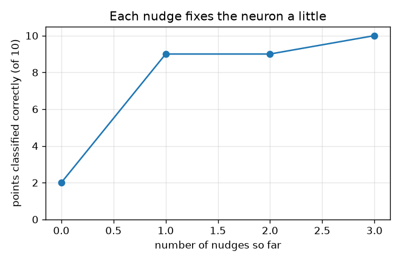
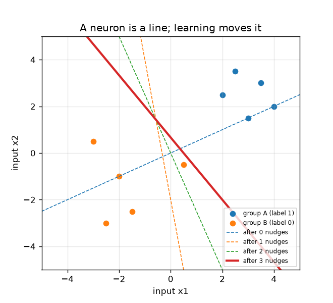

# सत्र 1: एक न्यूरॉन, एक रेखा और एक धक्का

*स्तर 1 (वैचारिक इंटरैक्टिव मॉडल) · लगभग 60 मिनट · openneuralnet*

> यह एक सरलीकृत शैक्षिक मॉडल है। यह कोई प्रमाणित डिज़ाइन उपकरण नहीं है और इसका उपयोग वास्तविक संरचनाओं, विद्युत स्थापनाओं, वाहनों, औद्योगिक प्रक्रियाओं या चिकित्सा संबंधी निर्णयों के लिए नहीं किया जाना चाहिए।

**पूर्वापेक्षाएँ (Prerequisites)**

- स्कूली बीजगणित: गुणा करना, जोड़ना और रेखा y = m x + c खींचना।
- आपने PRIMER.md पढ़ लिया है और `python start.py 1` एक बार चला लिया है।

**सीखने के उद्देश्य (Learning objectives)।** इस सत्र के बाद आप:

- मशीन लर्निंग (machine learning) को नियम टाइप करने के बजाय उदाहरणों से नियम की सेटिंग्स खोजने के रूप में समझा सकेंगे।
- गणना कर सकेंगे कि एक न्यूरॉन (neuron) क्या करता है: इनपुटों का भारित योग (weighted sum) और एक बायस (bias), फिर यदि वह शून्य से ऊपर हो तो सक्रिय होना (fire)।
- दिखा सकेंगे कि एक न्यूरॉन बिंदुओं के दो समूहों के बीच एक सीधी रेखा खींचता है।
- परसेप्ट्रॉन नियम (perceptron rule) हाथ से लागू कर सकेंगे और रेखा को तब तक खिसकते देख सकेंगे जब तक वह समूहों को अलग न कर दे।

## A. वास्तविक दुनिया की समस्या
एक पारंपरिक प्रोग्राम किसी व्यक्ति द्वारा लिखे गए नियमों की सूची है: यदि ईमेल में यह शब्द है, तो उसे स्पैम चिह्नित करो। मशीन लर्निंग इसे उलट देती है: आप कंप्यूटर को सही उत्तरों के साथ कई उदाहरण दिखाते हैं और वह स्वयं नियम खोजता है। सबसे छोटी सीखने वाली मशीन एक अकेला कृत्रिम न्यूरॉन है। किसी बिंदु के बारे में दो संख्याएँ दी जाने पर (मान लीजिए एक फूल के दो माप), उसे बताना होता है समूह A या समूह B। क्या वह केवल उदाहरणों से ऐसा नियम खोज सकता है जो सभी दस उदाहरण सही बताए?

## B. अवधारणा और सिद्धांत
एक न्यूरॉन के इनपुट x1 और x2, भार (weights) w1 और w2 और एक बायस b होते हैं। वह पहले भारित योग z = w1 x1 + w2 x2 + b की गणना करता है, फिर यदि z > 0 हो तो सक्रिय होता है (आउटपुट 1) और अन्यथा शांत रहता है (आउटपुट 0)। जिस स्थान पर वह अपना निर्णय बदलता है वह z = 0 है, जो (x1, x2) समतल में एक सीधी रेखा है; एक तरफ़ के बिंदु सक्रिय होते हैं, दूसरी तरफ़ के नहीं। परसेप्ट्रॉन नियम द्वारा सीखना: एक समय में एक उदाहरण देखिए। यदि न्यूरॉन सही है, तो कुछ मत बदलिए। यदि वह गलत है, तो धक्का दीजिए (nudge): भारों में (label - output) गुणा बिंदु जोड़िए और बायस में (label - output) जोड़िए। छूटा हुआ समूह A बिंदु (लेबल 1, आउटपुट 0) बिंदु को जोड़ता है, रेखा को उसकी ओर खींचता है। गलत तरीके से सक्रिय हुआ समूह B बिंदु (लेबल 0, आउटपुट 1) बिंदु को घटाता है, रेखा को दूर धकेलता है। यह इस बारे में सामान्य शिक्षा है कि सीखने वाली मशीनें कैसे काम करती हैं।

| प्रतीक | अर्थ | इकाई |
|---|---|---|
| x1, x2 | किसी बिंदु के दो इनपुट (माप) | कोई इकाई नहीं (कोई भी सुसंगत इकाई) |
| w1, w2 | भार: हर इनपुट कितना मायने रखता है | कोई इकाई नहीं |
| b | बायस: एक बढ़त या बाधा | कोई इकाई नहीं |
| z | भारित योग w1 x1 + w2 x2 + b | कोई इकाई नहीं |
| t | लेबल: सही उत्तर, 1 (समूह A) या 0 (समूह B) | कोई इकाई नहीं |

**मान्यताएँ (Assumptions)**

- केवल दो इनपुट और दो समूह, ताकि सब कुछ खींचा जा सके।
- न्यूरॉन तब सक्रिय होता है जब z कड़ाई से 0 से ऊपर हो; ठीक रेखा पर स्थित बिंदु सक्रिय नहीं होता।
- दस उदाहरण बिंदु ही पूरी दुनिया हैं; लेबलों में कोई गलती नहीं है।

$$ z = w_1 x_1 + w_2 x_2 + b,\qquad \text{output} = \begin{cases}1 & z > 0\\ 0 & z \le 0\end{cases} $$

$$ \text{decision line: } w_1 x_1 + w_2 x_2 + b = 0 \;\Rightarrow\; x_2 = -\frac{w_1 x_1 + b}{w_2} $$

$$ \mathbf w \leftarrow \mathbf w + (t - \text{output})\,\mathbf x,\qquad b \leftarrow b + (t - \text{output}) $$

## C. दृश्य व्याख्या
पहला चित्र दस बिंदु (नीला समूह A, नारंगी समूह B) और हर धक्के के बाद विभाजक रेखा दिखाता है: धराशायी रेखाएँ पहले के अनुमान हैं और ठोस रेखा अंतिम है, जिसमें सभी दस बिंदु सही तरफ़ हैं। दूसरा चित्र हर धक्के के बाद सही वर्गीकृत बिंदुओं की गिनती करता है: शुरुआत में 2, फिर 9, 9 और 10। ध्यान दीजिए कि एक धक्का गिनती को अपरिवर्तित छोड़ सकता है जबकि फिर भी रेखा को सही दिशा में खिसकाता है।

*हर धक्के के बाद सही वर्गीकृत बिंदु: 2, 9, 9, 10।*

*दस बिंदु और हर धक्के के बाद विभाजक रेखा (धराशायी: पहले के अनुमान, ठोस: अंतिम)।*

## D. इंटरैक्टिव सिमुलेशन
पाठ चलाइए (`python start.py 1`), फिर लाइव ऐप खोलिए: [सत्र 1: एक न्यूरॉन, एक रेखा](https://krunalpanchal1995.github.io/pan-iit-oss/openneuralnet/session-01/) (या इसी फ़ोल्डर में `app.html`)। भार और बायस के स्लाइडर खींचिए और हरी रेखा को खिसकते तथा छल्लों से चिह्नित (गलत) बिंदुओं को बदलते देखिए। बायस दृश्य पर जाइए और देखिए कि केवल बायस बदलने पर सही बिंदुओं की संख्या कैसे बदलती है।

**चुनौती।** ऐसे भार और बायस खोजिए जो सभी 10 बिंदुओं को सही वर्गीकृत करें।

## E. हल किया गया उदाहरण और प्रयोग
**समस्या।** w = (1, -2), b = 0 से शुरू कीजिए और परसेप्ट्रॉन नियम लागू कीजिए, बिंदुओं को तालिका के क्रम में देखते हुए, जब तक हर बिंदु सही न हो जाए।

1. बिंदु 1, (2, 2.5) है जिसका लेबल 1 है। इसका योग z = 1*2 + (-2)*2.5 + 0 = -3 है, इसलिए न्यूरॉन शांत है: गलत। शुरुआत में 10 में से 2 बिंदु सही हैं।
2. धक्का 1: आउटपुट 0, लेबल 1, इसलिए w = (1, -2) + (1 - 0)*(2, 2.5) = (3, 0.5) और b = 0 + 1 = 1। अब 10 में से 9 सही हैं।
3. बिंदु 2 से 7 सही हैं। बिंदु 8, (0.5, -0.5) है जिसका लेबल 0 है पर z = 3*0.5 + 0.5*(-0.5) + 1 = 2.25 > 0, इसलिए यह गलत तरीके से सक्रिय होता है।
4. धक्का 2: आउटपुट 1, लेबल 0, इसलिए w = (3, 0.5) - (0.5, -0.5) = (2.5, 1) और b = 1 - 1 = 0। बिंदु 8 का अब z = 0.75 है, अभी भी गलत; गिनती 9 पर रहती है।
5. अगले चक्कर में बिंदु 8 धक्का 3 देता है: w = (2.5, 1) - (0.5, -0.5) = (2, 1.5) और b = -1। अब सभी 10 बिंदु सही हैं और आगे कुछ नहीं बदलता।

**उत्तर।** 3 धक्कों के बाद न्यूरॉन का w = (2, 1.5), b = -1 है और वह 10 में से 10 बिंदु सही वर्गीकृत करता है (धक्कों 0, 1, 2, 3 के बाद 2, 9, 9, 10 बिंदु सही)। विभाजक रेखा 2 x1 + 1.5 x2 = 1 है।

**प्रयोग।** दस बिंदुओं को वर्गांकित कागज़ पर खींचिए, कार्ड की एक सीधी पट्टी काटिए और उसे विभाजक रेखा के रूप में रखिए। उसे तब तक खिसकाइए और घुमाइए जब तक हर समूह अपनी तरफ़ न हो, और गिनिए कि पट्टी के कितने धक्के लगते हैं। वास्तविक डेटा सेट में माप का शोर (noise) होता है, इसलिए कोई रेखा पूर्ण नहीं होती और बिंदु गलत वर्गीकृत होते हैं; मॉडल मानता है कि समूहों को ठीक-ठीक अलग किया जा सकता है, जो वास्तविक डेटा में आमतौर पर संभव नहीं होता।

## F. मूल्यांकन और डिज़ाइन चुनौती
**प्रश्न प्रकार A: वैचारिक।** पारंपरिक प्रोग्राम और मशीन लर्निंग मॉडल में क्या अंतर है, और न्यूरॉन को भारों के अतिरिक्त बायस b की आवश्यकता क्यों होती है?

संकेत

संख्याएँ कौन लिखता है? और b = 0 होने पर रेखा का क्या होता है?

चरण-दर-चरण हल

पारंपरिक प्रोग्राम में एक व्यक्ति नियम लिखता है। मशीन लर्निंग में व्यक्ति केवल नियम का रूप लिखता है (यहाँ: भारित योग और देहली (threshold)) और उसमें की संख्याएँ (भार, बायस) लेबल किए गए उदाहरणों से खोजी जाती हैं। बायस के बिना रेखा w1 x1 + w2 x2 = 0 हमेशा मूल बिंदु से होकर गुज़रती है, इसलिए वह ऐसे दो समूहों को अलग नहीं कर सकती जो दोनों मूल बिंदु की एक ही तरफ़ हों। बायस रेखा को घुमाए बिना खिसकाता है।

**प्रश्न प्रकार B: संख्यात्मक।** सीखे गए न्यूरॉन का w = (2, 1.5) और b = -1 है। नए बिंदु (-0.5, -1.5) के लिए z और आउटपुट क्या हैं? यदि यह बिंदु समूह B का है तो क्या यह सही है?

संकेत

z = w1 x1 + w2 x2 + b की गणना कीजिए और केवल z > 0 होने पर सक्रिय कीजिए।

चरण-दर-चरण हल

z = 2*(-0.5) + 1.5*(-1.5) + (-1) = -1 - 2.25 - 1 = -4.25, जो 0 से ऊपर नहीं है, इसलिए न्यूरॉन शांत है (आउटपुट 0): समूह B के लिए सही। संख्या की कोई इकाई नहीं है क्योंकि इनपुट केवल संख्याएँ हैं।

**प्रश्न प्रकार C: ग्राफ़ और सिमुलेशन की व्याख्या।** w = (1, 1) के साथ 'सही बिंदु बनाम बायस' ग्राफ़ में, b की किस परास पर सभी 10 बिंदु सही हैं, और वक्र में सपाट सीढ़ियाँ क्यों हैं?

संकेत

w = (1, 1) के लिए योग z, x1 + x2 + b है। समूह A के योग कम से कम 4.5 हैं और समूह B के योग अधिकतम 0 हैं।

चरण-दर-चरण हल

समूह A को सबसे छोटे समूह A योग (4.5) के लिए x1 + x2 + b > 0 चाहिए, इसलिए b > -4.5। समूह B को सबसे बड़े समूह B योग (0) के लिए x1 + x2 + b <= 0 चाहिए, इसलिए b <= 0। -4.5 < b <= 0 के लिए सभी दस सही हैं (उदाहरण के लिए b = -2)। वक्र एक सीढ़ी है क्योंकि गिनती एक पूर्ण संख्या है जो केवल तभी बदलती है जब रेखा किसी बिंदु के ऊपर से गुज़रती है।

**प्रश्न प्रकार D: डिज़ाइन और अनुकूलन चुनौती।** डिज़ाइन: w = (1, 1) रखिए और ऐसा बायस चुनिए जो सभी दस बिंदुओं को सही वर्गीकृत करे और दोनों समूहों से यथासंभव दूर रहे। कौन सा b, और क्यों?

संकेत

प्रश्न C से अनुमत परास -4.5 < b <= 0 है; समूह रेखा के सबसे पास उसके दोनों सिरों पर होते हैं।

चरण-दर-चरण हल

अनुमत परास -4.5 < b <= 0 है, इसलिए मध्य मान b = -2.25 दोनों तरफ़ समान स्थान (2.25) छोड़ता है। दोनों समूहों से दूर की रेखा तब अधिक सुरक्षित है जब नए बिंदु थोड़े शोर के साथ आते हैं। समझौता (trade-off): इतने चौड़े अंतर (margin) के साथ नियम अधिक मज़बूत है, पर इस डेटा में कुछ भी हमें नहीं बताता कि वास्तविक सीमा कहाँ है; परास में कोई भी b दस उदाहरणों में समान रूप से फ़िट बैठता है। मैंने b = -2 लिया, जो भी काम करता है (चेकपॉइंट में जाँचा गया)।

[RUBRIC.md](../../RUBRIC.md) से स्वयं को अंक दीजिए। कागज़ पर काम करने के लिए [गतिविधि पत्रक](activity_sheet.md) प्रिंट कीजिए।

## आम भ्रांतियाँ
| आम भ्रांति | वास्तव में क्या सच है |
|---|---|
| न्यूरॉन एक छोटा मस्तिष्क है जो सोचता है। | इस पाठ्यक्रम में न्यूरॉन केवल एक भारित योग और उसके बाद एक देहली है; नेटवर्क की बुद्धिमत्ता उनमें से कई से और सीखने के नियम से आती है। |
| सीखने का अर्थ है कि कंप्यूटर उदाहरणों को रट लेता है। | भार एक संक्षिप्त नियम हैं (यहाँ तीन संख्याएँ)। एक अच्छा नियम नए बिंदुओं पर भी काम करता है; रटना नहीं करता, जैसा सत्र 3 दिखाता है। |
| रेखा केवल भारों से निर्धारित होती है। | बायस रेखा को बगल में खिसकाता है; भार उसकी दिशा तय करते हैं। दोनों सीखे जाते हैं। |
| हर धक्का हमेशा सही बिंदुओं की संख्या बढ़ाता है। | एक धक्का उस बिंदु को ठीक करता है जिसे उसने देखा, पर गिनती समान रह सकती है या एक क्षण के लिए घट भी सकती है; अलग करने योग्य डेटा के लिए नियम फिर भी एक पूर्ण रेखा पर समाप्त होता है (सत्र 2)। |

## शब्दावली
- **न्यूरॉन (neuron)**: एक नियम जो भारित इनपुटों और एक बायस को जोड़ता है और कुल शून्य से ऊपर होने पर सक्रिय होता है
- **भार (weight)**: एक संख्या जो बताती है कि एक इनपुट कितना मायने रखता है
- **बायस (bias)**: भारित योग में जोड़ी गई एक संख्या जो विभाजक रेखा को खिसकाती है
- **लेबल (label)**: किसी उदाहरण का सही उत्तर, 0 या 1
- **परसेप्ट्रॉन नियम (perceptron rule)**: यदि न्यूरॉन गलत है, तो भारों में (label - output) गुणा बिंदु जोड़िए
- **मशीन लर्निंग (machine learning)**: लेबल किए गए उदाहरणों से किसी नियम की संख्याएँ खोजना

## समापन
1. [exercises.md](exercises.md) में दिए तीन कोडिंग कार्य कीजिए।
2. अपने बदलावों के बाद `python start.py 1` फिर से चलाइए। यह चेकपॉइंट (checkpoint) पर समाप्त होता है; जब यह `PASS` छापे, तो आपका काम पूरा है। (केवल चेकपॉइंट: `python start.py check 1`।)

अगला: [सत्र 2](../session-02/README.md)
