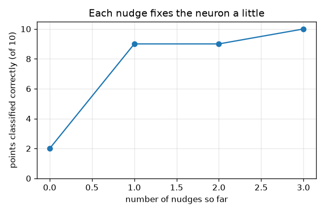
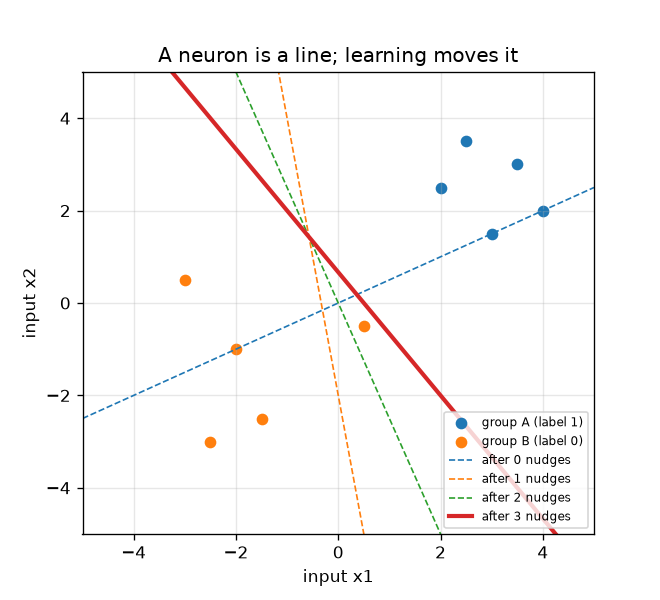

# സെഷൻ 1: ഒരു ന്യൂറോൺ, ഒരു വര, ഒരു തള്ളൽ

[Session 1 — हिन्दी](README.hi.md)

*ലെവൽ 1 (ആശയപരമായ ഇന്ററാക്ടീവ് മോഡൽ) · ഏകദേശം 60 മിനിറ്റ് · openneuralnet*

> ഇത് പഠനാവശ്യത്തിനുള്ള ലളിതമാക്കിയ ഒരു മോഡലാണ്. ഇത് സാധൂകരിക്കപ്പെട്ട ഒരു ഡിസൈൻ ഉപകരണമല്ല; യഥാർത്ഥ ഘടനകൾ, വൈദ്യുത ഇൻസ്റ്റലേഷനുകൾ, വാഹനങ്ങൾ, വ്യാവസായിക പ്രക്രിയകൾ അല്ലെങ്കിൽ വൈദ്യശാസ്ത്ര തീരുമാനങ്ങൾ എന്നിവയ്ക്കായി ഇത് ഉപയോഗിക്കരുത്.

**മുൻ‌അറിവ് (Prerequisites)**

- സ്കൂൾ ബീജഗണിതം: ഗുണിക്കൽ, കൂട്ടൽ, വര y = m x + c വരയ്ക്കൽ.
- നിങ്ങൾ PRIMER.md വായിച്ചിട്ടുണ്ട്, `python start.py 1` ഒരിക്കൽ റൺ ചെയ്തിട്ടുണ്ട്.

**പഠന ലക്ഷ്യങ്ങൾ (Learning objectives).** ഈ സെഷനു ശേഷം നിങ്ങൾക്ക് കഴിയും:

- മെഷീൻ ലേണിംഗിനെ (machine learning) നിയമം ടൈപ്പ് ചെയ്യുന്നതിന് പകരം ഉദാഹരണങ്ങളിൽ നിന്ന് ഒരു നിയമത്തിന്റെ ക്രമീകരണങ്ങൾ കണ്ടെത്തലായി വിശദീകരിക്കാൻ.
- ഒരു ന്യൂറോൺ എന്ത് ചെയ്യുന്നുവെന്ന് കണക്കാക്കാൻ: ഇൻപുട്ടുകളുടെ ഭാരിത തുക (weighted sum) പ്ലസ് ഒരു ബയസ്, പിന്നെ പൂജ്യത്തിന് മുകളിലാണെങ്കിൽ ഫയർ ചെയ്യുക.
- ഒരു ന്യൂറോൺ രണ്ട് കൂട്ടം ബിന്ദുക്കൾക്കിടയിൽ ഒരു നേർരേഖ വരയ്ക്കുന്നുവെന്ന് കാണിക്കാൻ.
- പെർസെപ്ട്രോൺ നിയമം (perceptron rule) കൈകൊണ്ട് പ്രയോഗിച്ച് കൂട്ടങ്ങളെ വേർതിരിക്കുന്നതുവരെ വര നീങ്ങുന്നത് കാണാൻ.

## A. യഥാർത്ഥ ലോക പ്രശ്നം
ഒരു പരമ്പരാഗത പ്രോഗ്രാം ഒരാൾ എഴുതിയ നിയമങ്ങളുടെ പട്ടികയാണ്: ഇമെയിലിൽ ഈ വാക്ക് ഉണ്ടെങ്കിൽ അത് സ്പാം ആയി അടയാളപ്പെടുത്തുക. മെഷീൻ ലേണിംഗ് ഇത് തിരിച്ചിടുന്നു: ശരിയായ ഉത്തരങ്ങളുള്ള നിരവധി ഉദാഹരണങ്ങൾ നിങ്ങൾ കമ്പ്യൂട്ടറിനെ കാണിക്കുന്നു, അത് സ്വയം നിയമങ്ങൾ കണ്ടെത്തുന്നു. ഏറ്റവും ചെറിയ പഠന യന്ത്രം ഒരൊറ്റ കൃത്രിമ ന്യൂറോൺ ആണ്. ഒരു ബിന്ദുവിനെക്കുറിച്ചുള്ള രണ്ട് സംഖ്യകൾ നൽകിയാൽ (ഒരു പൂവിന്റെ രണ്ട് അളവുകൾ എന്ന് കരുതുക), അത് ഗ്രൂപ്പ് A അല്ലെങ്കിൽ ഗ്രൂപ്പ് B എന്ന് പറയണം. ഉദാഹരണങ്ങളിൽ നിന്ന് മാത്രം, പത്ത് ഉദാഹരണങ്ങളും ശരിയാക്കുന്ന ഒരു നിയമം അതിന് കണ്ടെത്താൻ കഴിയുമോ?

## B. ആശയവും സിദ്ധാന്തവും
ഒരു ന്യൂറോണിന് ഇൻപുട്ടുകൾ x1, x2, ഭാരങ്ങൾ (weights) w1, w2, ഒരു ബയസ് (bias) b എന്നിവയുണ്ട്. അത് ആദ്യം ഭാരിത തുക z = w1 x1 + w2 x2 + b കണക്കാക്കുന്നു, പിന്നെ z > 0 ആണെങ്കിൽ ഫയർ ചെയ്യുന്നു (ഔട്ട്പുട്ട് 1), അല്ലെങ്കിൽ നിശബ്ദമായിരിക്കുന്നു (ഔട്ട്പുട്ട് 0). അത് മനസ്സ് മാറ്റുന്ന സ്ഥാനം z = 0 ആണ്, ഇത് (x1, x2) തലത്തിലെ ഒരു നേർരേഖയാണ്; ഒരു വശത്തെ ബിന്ദുക്കൾ ഫയർ ചെയ്യുന്നു, മറുവശത്തെ ബിന്ദുക്കൾ ചെയ്യുന്നില്ല. പെർസെപ്ട്രോൺ നിയമം വഴിയുള്ള പഠനം: ഒരു സമയം ഒരു ഉദാഹരണം നോക്കുക. ന്യൂറോൺ ശരിയാണെങ്കിൽ ഒന്നും മാറ്റരുത്. തെറ്റാണെങ്കിൽ ഒരു തള്ളൽ (nudge) നൽകുക: ഭാരങ്ങളിലേക്ക് (ലേബൽ - ഔട്ട്പുട്ട്) ഗുണം ബിന്ദുവും ബയസിലേക്ക് (ലേബൽ - ഔട്ട്പുട്ട്)ഉം ചേർക്കുക. നഷ്ടപ്പെട്ട ഗ്രൂപ്പ് A ബിന്ദു (ലേബൽ 1, ഔട്ട്പുട്ട് 0) ബിന്ദുവിനെ കൂട്ടുന്നു, വരയെ അതിലേക്ക് വലിക്കുന്നു. തെറ്റായി ഫയർ ചെയ്ത ഗ്രൂപ്പ് B ബിന്ദു (ലേബൽ 0, ഔട്ട്പുട്ട് 1) ബിന്ദുവിനെ കുറയ്ക്കുന്നു, വരയെ അകറ്റുന്നു. ഇത് പഠന യന്ത്രങ്ങൾ എങ്ങനെ പ്രവർത്തിക്കുന്നു എന്നതിനെക്കുറിച്ചുള്ള പൊതുവിദ്യാഭ്യാസമാണ്.

| ചിഹ്നം | അർത്ഥം | യൂണിറ്റ് |
|---|---|---|
| x1, x2 | ഒരു ബിന്ദുവിന്റെ രണ്ട് ഇൻപുട്ടുകൾ (അളവുകൾ) | യൂണിറ്റില്ല (ഏത് സ്ഥിരതയുള്ള യൂണിറ്റും) |
| w1, w2 | ഭാരങ്ങൾ: ഓരോ ഇൻപുട്ടിനും എത്ര പ്രാധാന്യം | യൂണിറ്റില്ല |
| b | ബയസ്: ഒരു മുൻതൂക്കം അല്ലെങ്കിൽ പിന്നോക്കാവസ്ഥ | യൂണിറ്റില്ല |
| z | ഭാരിത തുക w1 x1 + w2 x2 + b | യൂണിറ്റില്ല |
| t | ലേബൽ: ശരിയായ ഉത്തരം, 1 (ഗ്രൂപ്പ് A) അല്ലെങ്കിൽ 0 (ഗ്രൂപ്പ് B) | യൂണിറ്റില്ല |

**അനുമാനങ്ങൾ (Assumptions)**

- രണ്ട് ഇൻപുട്ടുകളും രണ്ട് ഗ്രൂപ്പുകളും മാത്രം, അതിനാൽ എല്ലാം വരയ്ക്കാൻ കഴിയും.
- z കർശനമായി 0-ന് മുകളിലാകുമ്പോൾ ന്യൂറോൺ ഫയർ ചെയ്യുന്നു; കൃത്യമായി വരയിലുള്ള ബിന്ദു ഫയർ ചെയ്യുന്നില്ല.
- പത്ത് ഉദാഹരണ ബിന്ദുക്കളാണ് ലോകം മുഴുവൻ; ലേബലുകളിൽ തെറ്റുകളില്ല.

$$ z = w_1 x_1 + w_2 x_2 + b,\qquad \text{output} = \begin{cases}1 & z > 0\\ 0 & z \le 0\end{cases} $$

$$ \text{decision line: } w_1 x_1 + w_2 x_2 + b = 0 \;\Rightarrow\; x_2 = -\frac{w_1 x_1 + b}{w_2} $$

$$ \mathbf w \leftarrow \mathbf w + (t - \text{output})\,\mathbf x,\qquad b \leftarrow b + (t - \text{output}) $$

## C. ദൃശ്യ വിശദീകരണം
ആദ്യത്തെ ചിത്രം പത്ത് ബിന്ദുക്കളെയും (നീല ഗ്രൂപ്പ് A, ഓറഞ്ച് ഗ്രൂപ്പ് B) ഓരോ തള്ളലിനും ശേഷമുള്ള വേർതിരിക്കുന്ന വരയെയും കാണിക്കുന്നു: ഡാഷ്ഡ് വരകൾ മുമ്പത്തെ ഊഹങ്ങളും സോളിഡ് വര അവസാനത്തേതുമാണ്, അതിൽ പത്ത് ബിന്ദുക്കളും ശരിയായ വശത്താണ്. രണ്ടാമത്തെ ചിത്രം ഓരോ തള്ളലിനും ശേഷം ശരിയായി തരംതിരിച്ച ബിന്ദുക്കൾ എണ്ണുന്നു: തുടക്കത്തിൽ 2, പിന്നെ 9, 9, 10. ഒരു തള്ളൽ എണ്ണം മാറ്റാതെ വിടുമ്പോഴും വരയെ ശരിയായ ദിശയിൽ നീക്കിയേക്കാം എന്നത് ശ്രദ്ധിക്കുക.

*ഓരോ തള്ളലിനും ശേഷം ശരിയായി തരംതിരിച്ച ബിന്ദുക്കൾ: 2, 9, 9, 10.*

*പത്ത് ബിന്ദുക്കളും ഓരോ തള്ളലിനും ശേഷമുള്ള വേർതിരിക്കുന്ന വരയും (ഡാഷ്ഡ്: മുമ്പത്തെ ഊഹങ്ങൾ, സോളിഡ്: അവസാനത്തേത്).*

## D. ഇന്ററാക്ടീവ് സിമുലേഷൻ
പാഠം റൺ ചെയ്യുക (`python start.py 1`), എന്നിട്ട് ലൈവ് ആപ്പ് തുറക്കുക: [സെഷൻ 1: ഒരു ന്യൂറോൺ, ഒരു വര](https://krunalpanchal1995.github.io/pan-iit-oss/openneuralnet/session-01/) (അല്ലെങ്കിൽ ഈ ഫോൾഡറിലെ `app.html`). ഭാര, ബയസ് സ്ലൈഡറുകൾ വലിച്ച് പച്ച വര നീങ്ങുന്നതും വളയമിട്ട (തെറ്റായ) ബിന്ദുക്കൾ മാറുന്നതും കാണുക. ബയസ് വ്യൂവിലേക്ക് മാറി ബയസ് മാത്രം നീങ്ങുമ്പോൾ ശരിയായ ബിന്ദുക്കളുടെ എണ്ണം എങ്ങനെ മാറുന്നുവെന്ന് കാണുക.

**വെല്ലുവിളി.** 10 ബിന്ദുക്കളെയും ശരിയായി തരംതിരിക്കുന്ന ഭാരങ്ങളും ഒരു ബയസും കണ്ടെത്തുക.

## E. ചെയ്തുകാണിച്ച ഉദാഹരണവും പരീക്ഷണവും
**പ്രശ്നം.** w = (1, -2), b = 0 എന്നിവയിൽ തുടങ്ങി, ഓരോ ബിന്ദുവും ശരിയാകുന്നതുവരെ പട്ടികയിലെ ക്രമത്തിൽ ബിന്ദുക്കൾ സന്ദർശിച്ച് പെർസെപ്ട്രോൺ നിയമം പ്രയോഗിക്കുക.

1. ബിന്ദു 1 (2, 2.5) ആണ്, ലേബൽ 1. അതിന്റെ തുക z = 1*2 + (-2)*2.5 + 0 = -3, അതിനാൽ ന്യൂറോൺ നിശബ്ദമാണ്: തെറ്റ്. തുടക്കത്തിൽ 10-ൽ 2 ബിന്ദുക്കൾ ശരിയാണ്.
2. തള്ളൽ 1: ഔട്ട്പുട്ട് 0, ലേബൽ 1, അതിനാൽ w = (1, -2) + (1 - 0)*(2, 2.5) = (3, 0.5), b = 0 + 1 = 1. ഇപ്പോൾ 10-ൽ 9 ശരിയാണ്.
3. ബിന്ദുക്കൾ 2 മുതൽ 7 വരെ ശരിയാണ്. ബിന്ദു 8 (0.5, -0.5) ആണ്, ലേബൽ 0, പക്ഷേ z = 3*0.5 + 0.5*(-0.5) + 1 = 2.25 > 0, അതിനാൽ അത് തെറ്റായി ഫയർ ചെയ്യുന്നു.
4. തള്ളൽ 2: ഔട്ട്പുട്ട് 1, ലേബൽ 0, അതിനാൽ w = (3, 0.5) - (0.5, -0.5) = (2.5, 1), b = 1 - 1 = 0. ബിന്ദു 8-ന് ഇപ്പോൾ z = 0.75, ഇപ്പോഴും തെറ്റ്; എണ്ണം 9-ൽ തന്നെ നിൽക്കുന്നു.
5. അടുത്ത പാസിൽ ബിന്ദു 8 തള്ളൽ 3 നൽകുന്നു: w = (2.5, 1) - (0.5, -0.5) = (2, 1.5), b = -1. ഇപ്പോൾ 10 ബിന്ദുക്കളും ശരിയാണ്, ഇനി ഒന്നും മാറുന്നില്ല.

**ഉത്തരം.** 3 തള്ളലുകൾക്ക് ശേഷം ന്യൂറോണിന് w = (2, 1.5), b = -1 ഉണ്ട്, 10-ൽ 10 ബിന്ദുക്കളും ശരിയായി തരംതിരിക്കുന്നു (തള്ളൽ 0, 1, 2, 3 എന്നിവയ്ക്ക് ശേഷം 2, 9, 9, 10 ബിന്ദുക്കൾ ശരി). വേർതിരിക്കുന്ന വര 2 x1 + 1.5 x2 = 1 ആണ്.

**പരീക്ഷണം.** പത്ത് ബിന്ദുക്കളും ഗ്രാഫ് പേപ്പറിൽ വരയ്ക്കുക, ഒരു നേരായ കാർഡ് സ്ട്രിപ്പ് മുറിച്ച് വേർതിരിക്കുന്ന വരയായി വയ്ക്കുക. ഓരോ കൂട്ടവും അതിന്റേതായ വശത്താകുന്നതുവരെ അത് നീക്കുകയും തിരിക്കുകയും ചെയ്യുക, സ്ട്രിപ്പിന് എത്ര തള്ളലുകൾ വേണ്ടിവന്നുവെന്ന് എണ്ണുക. ഒരു യഥാർത്ഥ ഡാറ്റാ സെറ്റിൽ അളവിലെ നോയ്സ് ഉണ്ട്, അതിനാൽ ഒരു വരയും തികഞ്ഞതല്ല, ബിന്ദുക്കൾ തെറ്റായി തരംതിരിക്കപ്പെടുന്നു; കൂട്ടങ്ങളെ കൃത്യമായി വേർതിരിക്കാൻ കഴിയുമെന്ന് മോഡൽ അനുമാനിക്കുന്നു, യഥാർത്ഥ ഡാറ്റയ്ക്ക് സാധാരണയായി അത് കഴിയില്ല.

## F. മൂല്യനിർണ്ണയവും ഡിസൈൻ വെല്ലുവിളിയും
**ചോദ്യ തരം A: ആശയപരം.** ഒരു പരമ്പരാഗത പ്രോഗ്രാമും മെഷീൻ ലേണിംഗ് മോഡലും തമ്മിലുള്ള വ്യത്യാസം എന്താണ്, ഭാരങ്ങൾക്ക് പുറമെ ന്യൂറോണിന് ഒരു ബയസ് b ആവശ്യമുള്ളത് എന്തുകൊണ്ട്?

സൂചന

സംഖ്യകൾ ആര് എഴുതുന്നു? b = 0 ആകുമ്പോൾ വരയ്ക്ക് എന്ത് സംഭവിക്കുന്നു?

പടിപടിയായുള്ള പരിഹാരം

ഒരു പരമ്പരാഗത പ്രോഗ്രാമിൽ ഒരാൾ നിയമങ്ങൾ എഴുതുന്നു. മെഷീൻ ലേണിംഗിൽ ഒരാൾ നിയമത്തിന്റെ രൂപം മാത്രം എഴുതുന്നു (ഇവിടെ: ഭാരിത തുകയും ത്രെഷോൾഡും), അതിലെ സംഖ്യകൾ (ഭാരങ്ങൾ, ബയസ്) ലേബൽ ചെയ്ത ഉദാഹരണങ്ങളിൽ നിന്ന് കണ്ടെത്തുന്നു. ബയസ് ഇല്ലെങ്കിൽ വര w1 x1 + w2 x2 = 0 എപ്പോഴും മൂലബിന്ദുവിലൂടെ കടന്നുപോകുന്നു, അതിനാൽ മൂലബിന്ദുവിന്റെ ഒരേ വശത്തുള്ള രണ്ട് കൂട്ടങ്ങളെ അതിന് വേർതിരിക്കാൻ കഴിയില്ല. ബയസ് വരയെ തിരിക്കാതെ നീക്കുന്നു.

**ചോദ്യ തരം B: സംഖ്യാപരം.** പഠിച്ച ന്യൂറോണിന് w = (2, 1.5), b = -1 ആണ്. പുതിയ ബിന്ദു (-0.5, -1.5)-ന് z-ഉം ഔട്ട്പുട്ടും എന്താണ്? ഈ ബിന്ദു ഗ്രൂപ്പ് B-യിൽ നിന്നാണെങ്കിൽ ഇത് ശരിയാണോ?

സൂചന

z = w1 x1 + w2 x2 + b കണക്കാക്കുക, z > 0 ആണെങ്കിൽ മാത്രം ഫയർ ചെയ്യുക.

പടിപടിയായുള്ള പരിഹാരം

z = 2*(-0.5) + 1.5*(-1.5) + (-1) = -1 - 2.25 - 1 = -4.25, ഇത് 0-ന് മുകളിലല്ല, അതിനാൽ ന്യൂറോൺ നിശബ്ദമാണ് (ഔട്ട്പുട്ട് 0): ഗ്രൂപ്പ് B-ക്ക് ശരി. ഇൻപുട്ടുകൾ വെറും സംഖ്യകളായതിനാൽ ഈ സംഖ്യയ്ക്ക് യൂണിറ്റില്ല.

**ചോദ്യ തരം C: ഗ്രാഫ്, സിമുലേഷൻ വ്യാഖ്യാനം.** w = (1, 1) ഉള്ള 'ശരിയായ ബിന്ദുക്കൾ എതിരെ ബയസ്' ഗ്രാഫിൽ, b-യുടെ ഏത് പരിധിയിൽ 10 ബിന്ദുക്കളും ശരിയാണ്, വക്രത്തിന് പരന്ന പടികൾ ഉള്ളത് എന്തുകൊണ്ട്?

സൂചന

w = (1, 1)-ന് തുക z എന്നത് x1 + x2 + b ആണ്. ഗ്രൂപ്പ് A തുകകൾ കുറഞ്ഞത് 4.5 ഉം ഗ്രൂപ്പ് B തുകകൾ പരമാവധി 0 ഉം ആണ്.

പടിപടിയായുള്ള പരിഹാരം

ഗ്രൂപ്പ് A-യ്ക്ക് ഏറ്റവും ചെറിയ ഗ്രൂപ്പ് A തുകയ്ക്ക് (4.5) x1 + x2 + b > 0 വേണം, അതിനാൽ b > -4.5. ഗ്രൂപ്പ് B-യ്ക്ക് ഏറ്റവും വലിയ ഗ്രൂപ്പ് B തുകയ്ക്ക് (0) x1 + x2 + b <= 0 വേണം, അതിനാൽ b <= 0. -4.5 < b <= 0-ന് (ഉദാഹരണത്തിന് b = -2) പത്തും ശരിയാണ്. എണ്ണം ഒരു പൂർണ്ണസംഖ്യയായതിനാലും വര ഒരു ബിന്ദുവിനെ കടക്കുമ്പോൾ മാത്രം മാറുന്നതിനാലും വക്രം ഒരു പടിക്കെട്ടാണ്.

**ചോദ്യ തരം D: ഡിസൈൻ, ഒപ്റ്റിമൈസേഷൻ വെല്ലുവിളി.** ഡിസൈൻ: w = (1, 1) നിലനിർത്തി, പത്ത് ബിന്ദുക്കളെയും ശരിയായി തരംതിരിക്കുന്നതും രണ്ട് കൂട്ടങ്ങളിൽ നിന്നും കഴിയുന്നത്ര അകലെയുള്ളതുമായ ഒരു ബയസ് തിരഞ്ഞെടുക്കുക. ഏത് b, എന്തുകൊണ്ട്?

സൂചന

ചോദ്യം C-യിൽ നിന്നുള്ള അനുവദനീയ പരിധി -4.5 < b <= 0 ആണ്; കൂട്ടങ്ങൾ വരയോട് ഏറ്റവും അടുത്ത് അതിന്റെ രണ്ട് അറ്റങ്ങളിലാണ്.

പടിപടിയായുള്ള പരിഹാരം

അനുവദനീയ പരിധി -4.5 < b <= 0 ആണ്, അതിനാൽ മധ്യ മൂല്യം b = -2.25 രണ്ട് വശത്തും ഒരേ ഇടം (2.25) വിടുന്നു. പുതിയ ബിന്ദുക്കൾ അല്പം നോയ്സോടെ വരുമ്പോൾ രണ്ട് കൂട്ടങ്ങളിൽ നിന്നും അകലെയുള്ള വര കൂടുതൽ സുരക്ഷിതമാണ്. വിട്ടുവീഴ്ച (trade-off): ഇത്രയും വീതിയുള്ള മാർജിൻ ഉള്ളപ്പോൾ നിയമം കൂടുതൽ ദൃഢമാണ്, പക്ഷേ യഥാർത്ഥ അതിര് എവിടെയാണെന്ന് ഈ ഡാറ്റയിൽ ഒന്നും പറയുന്നില്ല; പരിധിയിലെ ഏത് b-യും പത്ത് ഉദാഹരണങ്ങൾക്കും ഒരുപോലെ യോജിക്കുന്നു. ഞാൻ b = -2 എടുത്തു, അതും പ്രവർത്തിക്കുന്നു (ചെക്ക്‌പോയിന്റിൽ പരിശോധിച്ചത്).

[RUBRIC.md](../../RUBRIC.md) ഉപയോഗിച്ച് സ്വയം സ്കോർ ചെയ്യുക. കടലാസിൽ പ്രവർത്തിക്കാൻ [ആക്ടിവിറ്റി ഷീറ്റ്](activity_sheet.md) പ്രിന്റ് ചെയ്യുക.

## സാധാരണ തെറ്റിദ്ധാരണകൾ
| സാധാരണ തെറ്റിദ്ധാരണ | യഥാർത്ഥത്തിൽ ശരിയായത് |
|---|---|
| ഒരു ന്യൂറോൺ ചിന്തിക്കുന്ന ഒരു ചെറിയ തലച്ചോറാണ്. | ഈ കോഴ്സിൽ ഒരു ന്യൂറോൺ ഭാരിത തുകയും തുടർന്ന് ഒരു ത്രെഷോൾഡും മാത്രമാണ്; ഒരു നെറ്റ്‌വർക്കിന്റെ ബുദ്ധി വരുന്നത് അവയിൽ പലതിൽ നിന്നും പഠന നിയമത്തിൽ നിന്നുമാണ്. |
| പഠനം എന്നാൽ കമ്പ്യൂട്ടർ ഉദാഹരണങ്ങൾ മനഃപാഠമാക്കുന്നു എന്നാണ്. | ഭാരങ്ങൾ ഒരു സംക്ഷിപ്ത നിയമമാണ് (ഇവിടെ മൂന്ന് സംഖ്യകൾ). ഒരു നല്ല നിയമം പുതിയ ബിന്ദുക്കളിലും പ്രവർത്തിക്കുന്നു; മനഃപാഠമാക്കൽ പ്രവർത്തിക്കില്ല, സെഷൻ 3 കാണിക്കുന്നതുപോലെ. |
| വര ഭാരങ്ങൾ കൊണ്ട് മാത്രം നിശ്ചയിക്കപ്പെടുന്നു. | ബയസ് വരയെ വശത്തേക്ക് നീക്കുന്നു; ഭാരങ്ങൾ അതിന്റെ ദിശ നിശ്ചയിക്കുന്നു. രണ്ടും പഠിക്കപ്പെടുന്നു. |
| ഓരോ തള്ളലും എപ്പോഴും ശരിയായ ബിന്ദുക്കളുടെ എണ്ണം കൂട്ടുന്നു. | ഒരു തള്ളൽ അത് നോക്കിയ ബിന്ദുവിനെ ശരിയാക്കുന്നു, പക്ഷേ എണ്ണം അതേപടി നിൽക്കുകയോ ഒരു നിമിഷം കുറയുകയോ ചെയ്യാം; വേർതിരിക്കാവുന്ന ഡാറ്റയ്ക്ക് നിയമം ഒടുവിൽ തികഞ്ഞ വരയിൽ അവസാനിക്കുന്നു (സെഷൻ 2). |

## പദാവലി
- **ന്യൂറോൺ (neuron)**: ഭാരിത ഇൻപുട്ടുകളും ഒരു ബയസും കൂട്ടി ആകെത്തുക പൂജ്യത്തിന് മുകളിലാണെങ്കിൽ ഫയർ ചെയ്യുന്ന നിയമം
- **ഭാരം (weight)**: ഒരു ഇൻപുട്ടിന് എത്ര പ്രാധാന്യം എന്ന് പറയുന്ന സംഖ്യ
- **ബയസ് (bias)**: വേർതിരിക്കുന്ന വരയെ നീക്കുന്ന, ഭാരിത തുകയിൽ ചേർക്കുന്ന സംഖ്യ
- **ലേബൽ (label)**: ഒരു ഉദാഹരണത്തിന്റെ ശരിയായ ഉത്തരം, 0 അല്ലെങ്കിൽ 1
- **പെർസെപ്ട്രോൺ നിയമം (perceptron rule)**: ന്യൂറോൺ തെറ്റാണെങ്കിൽ, ഭാരങ്ങളിലേക്ക് (ലേബൽ - ഔട്ട്പുട്ട്) ഗുണം ബിന്ദു ചേർക്കുക
- **മെഷീൻ ലേണിംഗ് (machine learning)**: ലേബൽ ചെയ്ത ഉദാഹരണങ്ങളിൽ നിന്ന് ഒരു നിയമത്തിന്റെ സംഖ്യകൾ കണ്ടെത്തൽ

## പൂർത്തിയാക്കുക
1. [exercises.md](exercises.md)-ലെ മൂന്ന് കോഡിംഗ് ജോലികൾ ചെയ്യുക.
2. നിങ്ങളുടെ മാറ്റങ്ങൾക്ക് ശേഷം `python start.py 1` വീണ്ടും റൺ ചെയ്യുക. അത് ചെക്ക്‌പോയിന്റോടെ അവസാനിക്കുന്നു; അത് `PASS` എന്ന് പ്രിന്റ് ചെയ്യുമ്പോൾ നിങ്ങൾ പൂർത്തിയാക്കി. (ചെക്ക്‌പോയിന്റ് മാത്രം: `python start.py check 1`.)

അടുത്തത്: [സെഷൻ 2](../session-02/README.md)
