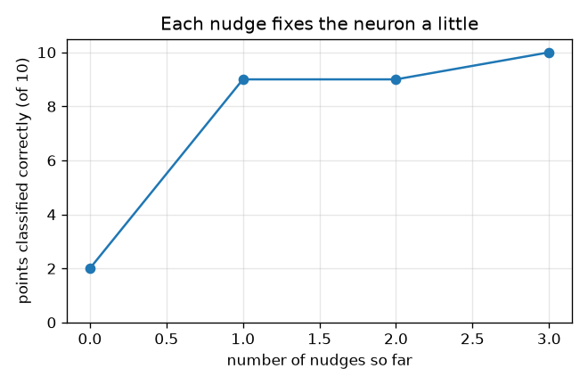
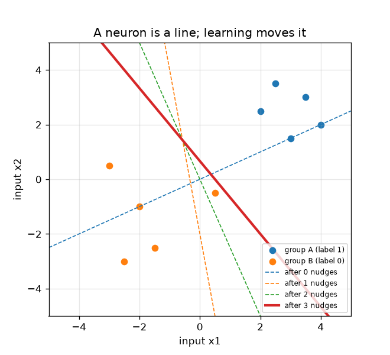

# அமர்வு 1: ஒரு நியூரான், ஒரு கோடு, ஒரு தள்ளு

[Session 1 — हिन्दी](README.hi.md) · [Session 1 — മലയാളം](README.ml.md)

*நிலை 1 (கருத்தியல் ஊடாடும் மாதிரி) · சுமார் 60 நிமிடங்கள் · openneuralnet*

> இது கல்விக்கான எளிமைப்படுத்தப்பட்ட மாதிரி. இது சரிபார்க்கப்பட்ட வடிவமைப்புக் கருவி அல்ல; உண்மையான கட்டமைப்புகள், மின் நிறுவல்கள், வாகனங்கள், தொழில்துறை செயல்முறைகள் அல்லது மருத்துவ முடிவுகளுக்கு இதைப் பயன்படுத்தக் கூடாது.

**முன்தேவைகள் (Prerequisites)**

- பள்ளி இயற்கணிதம்: பெருக்குதல், கூட்டுதல், y = m x + c கோடு வரைதல்.
- நீங்கள் PRIMER.md படித்து, `python start.py 1` ஒருமுறை இயக்கியுள்ளீர்கள்.

**கற்றல் நோக்கங்கள் (Learning objectives).** இந்த அமர்வுக்குப் பிறகு நீங்கள்:

- இயந்திரக் கற்றலை (machine learning) விதியைத் தட்டச்சு செய்வதற்குப் பதிலாக எடுத்துக்காட்டுகளிலிருந்து ஒரு விதியின் அமைப்புகளைக் கண்டறிதலாக விளக்க முடியும்.
- ஒரு நியூரான் என்ன செய்கிறது என்று கணக்கிட முடியும்: உள்ளீடுகளின் எடையிட்ட கூட்டுத்தொகை (weighted sum) கூடுதல் ஒரு சார்பு (bias), பிறகு பூஜ்ஜியத்துக்கு மேல் இருந்தால் தூண்டுதல்.
- ஒரு நியூரான் இரண்டு புள்ளிக் குழுக்களுக்கு இடையே ஒரு நேர்கோடு வரைகிறது என்று காட்ட முடியும்.
- பெர்செப்ட்ரான் விதியைக் (perceptron rule) கையால் பயன்படுத்தி, குழுக்களைப் பிரிக்கும் வரை கோடு நகர்வதைக் காண முடியும்.

## A. நிஜ உலகப் பிரச்சினை
ஒரு பாரம்பரிய நிரல் ஒருவர் எழுதிய விதிகளின் பட்டியல்: மின்னஞ்சலில் இந்தச் சொல் இருந்தால் அதை ஸ்பேம் எனக் குறிக்கவும். இயந்திரக் கற்றல் இதைத் தலைகீழாக்குகிறது: சரியான விடைகளுடன் பல எடுத்துக்காட்டுகளைக் கணினிக்குக் காட்டுகிறீர்கள், அது விதிகளைத் தானே கண்டறிகிறது. மிகச் சிறிய கற்கும் இயந்திரம் ஒரே ஒரு செயற்கை நியூரான். ஒரு புள்ளியைப் பற்றிய இரண்டு எண்கள் கொடுக்கப்பட்டால் (ஒரு பூவின் இரண்டு அளவீடுகள் என்று கொள்ளுங்கள்), அது குழு A அல்லது குழு B என்று சொல்ல வேண்டும். எடுத்துக்காட்டுகளிலிருந்து மட்டுமே, பத்து எடுத்துக்காட்டுகளையும் சரியாகச் சொல்லும் விதியை அதனால் கண்டறிய முடியுமா?

## B. கருத்தும் கோட்பாடும்
ஒரு நியூரானுக்கு உள்ளீடுகள் x1, x2, எடைகள் (weights) w1, w2 மற்றும் ஒரு சார்பு (bias) b உள்ளன. அது முதலில் எடையிட்ட கூட்டுத்தொகை z = w1 x1 + w2 x2 + b கணக்கிடுகிறது, பிறகு z > 0 எனில் தூண்டப்படுகிறது (வெளியீடு 1), இல்லையெனில் அமைதியாக இருக்கிறது (வெளியீடு 0). அது மனம் மாற்றும் இடம் z = 0, இது (x1, x2) தளத்தில் ஒரு நேர்கோடு; ஒரு பக்கத்தின் புள்ளிகள் தூண்டப்படுகின்றன, மறுபக்கத்தின் புள்ளிகள் தூண்டப்படுவதில்லை. பெர்செப்ட்ரான் விதியால் கற்றல்: ஒரு நேரத்தில் ஒரு எடுத்துக்காட்டைப் பாருங்கள். நியூரான் சரியாக இருந்தால் எதுவும் மாற்றாதீர்கள். தவறாக இருந்தால் தள்ளுங்கள் (nudge): எடைகளுடன் (லேபிள் - வெளியீடு) மடங்கு புள்ளியையும், சார்புடன் (லேபிள் - வெளியீடு)-ஐயும் கூட்டுங்கள். தவறவிடப்பட்ட குழு A புள்ளி (லேபிள் 1, வெளியீடு 0) புள்ளியைக் கூட்டுகிறது, கோட்டை அதை நோக்கி இழுக்கிறது. தவறாகத் தூண்டப்பட்ட குழு B புள்ளி (லேபிள் 0, வெளியீடு 1) புள்ளியைக் கழிக்கிறது, கோட்டை அதிலிருந்து விலக்குகிறது. இது கற்கும் இயந்திரங்கள் எப்படி வேலை செய்கின்றன என்பது பற்றிய பொதுக் கல்வி.

| குறியீடு | பொருள் | அலகு |
|---|---|---|
| x1, x2 | ஒரு புள்ளியின் இரண்டு உள்ளீடுகள் (அளவீடுகள்) | அலகு இல்லை (ஏதேனும் ஒரே சீரான அலகு) |
| w1, w2 | எடைகள்: ஒவ்வொரு உள்ளீடும் எவ்வளவு முக்கியம் | அலகு இல்லை |
| b | சார்பு: ஒரு முன்னிலை அல்லது பின்னடைவு | அலகு இல்லை |
| z | எடையிட்ட கூட்டுத்தொகை w1 x1 + w2 x2 + b | அலகு இல்லை |
| t | லேபிள்: சரியான விடை, 1 (குழு A) அல்லது 0 (குழு B) | அலகு இல்லை |

**அனுமானங்கள் (Assumptions)**

- இரண்டு உள்ளீடுகளும் இரண்டு குழுக்களும் மட்டும், எனவே எல்லாவற்றையும் வரைய முடியும்.
- z கண்டிப்பாக 0-க்கு மேல் இருக்கும்போது நியூரான் தூண்டப்படுகிறது; சரியாகக் கோட்டின் மேலுள்ள புள்ளி தூண்டப்படுவதில்லை.
- பத்து எடுத்துக்காட்டுப் புள்ளிகளே முழு உலகம்; லேபிள்களில் தவறுகள் இல்லை.

$$ z = w_1 x_1 + w_2 x_2 + b,\qquad \text{output} = \begin{cases}1 & z > 0\\ 0 & z \le 0\end{cases} $$

$$ \text{decision line: } w_1 x_1 + w_2 x_2 + b = 0 \;\Rightarrow\; x_2 = -\frac{w_1 x_1 + b}{w_2} $$

$$ \mathbf w \leftarrow \mathbf w + (t - \text{output})\,\mathbf x,\qquad b \leftarrow b + (t - \text{output}) $$

## C. காட்சி விளக்கம்
முதல் படம் பத்துப் புள்ளிகளையும் (நீலம் குழு A, ஆரஞ்சு குழு B) ஒவ்வொரு தள்ளுக்குப் பிறகும் பிரிக்கும் கோட்டையும் காட்டுகிறது: கோடிட்ட கோடுகள் முந்தைய ஊகங்கள், திடக்கோடு இறுதியானது, அதில் பத்துப் புள்ளிகளும் சரியான பக்கத்தில் உள்ளன. இரண்டாவது படம் ஒவ்வொரு தள்ளுக்குப் பிறகும் சரியாக வகைப்படுத்தப்பட்ட புள்ளிகளை எண்ணுகிறது: தொடக்கத்தில் 2, பிறகு 9, 9, 10. ஒரு தள்ளு எண்ணிக்கையை மாற்றாமல் விட்டாலும் கோட்டைச் சரியான திசையில் நகர்த்தலாம் என்பதைக் கவனியுங்கள்.

*ஒவ்வொரு தள்ளுக்குப் பிறகும் சரியாக வகைப்படுத்தப்பட்ட புள்ளிகள்: 2, 9, 9, 10.*

*பத்துப் புள்ளிகளும் ஒவ்வொரு தள்ளுக்குப் பிறகும் பிரிக்கும் கோடும் (கோடிட்டவை: முந்தைய ஊகங்கள், திடக்கோடு: இறுதி).*

## D. ஊடாடும் உருவகப்படுத்தல்
பாடத்தை இயக்குங்கள் (`python start.py 1`), பிறகு நேரடிச் செயலியைத் திறங்கள்: [அமர்வு 1: ஒரு நியூரான், ஒரு கோடு](https://krunalpanchal1995.github.io/pan-iit-oss/openneuralnet/session-01/) (அல்லது இந்தக் கோப்புறையிலுள்ள `app.html`). எடை மற்றும் சார்பு ஸ்லைடர்களை இழுத்துப் பச்சைக் கோடு நகர்வதையும் வளையமிட்ட (தவறான) புள்ளிகள் மாறுவதையும் பாருங்கள். சார்புக் காட்சிக்கு மாறி, சார்பு மட்டும் நகரும்போது சரியான புள்ளிகளின் எண்ணிக்கை எப்படி மாறுகிறது என்று பாருங்கள்.

**சவால்.** 10 புள்ளிகளையும் சரியாக வகைப்படுத்தும் எடைகளையும் ஒரு சார்பையும் கண்டறியுங்கள்.

## E. தீர்க்கப்பட்ட எடுத்துக்காட்டும் பரிசோதனையும்
**பிரச்சினை.** w = (1, -2), b = 0 உடன் தொடங்கி, ஒவ்வொரு புள்ளியும் சரியாகும் வரை அட்டவணையின் வரிசையில் புள்ளிகளைப் பார்வையிட்டுப் பெர்செப்ட்ரான் விதியைப் பயன்படுத்துங்கள்.

1. புள்ளி 1 (2, 2.5), லேபிள் 1. அதன் கூட்டுத்தொகை z = 1*2 + (-2)*2.5 + 0 = -3, எனவே நியூரான் அமைதியாக உள்ளது: தவறு. தொடக்கத்தில் 10-இல் 2 புள்ளிகள் சரி.
2. தள்ளு 1: வெளியீடு 0, லேபிள் 1, எனவே w = (1, -2) + (1 - 0)*(2, 2.5) = (3, 0.5), b = 0 + 1 = 1. இப்போது 10-இல் 9 சரி.
3. புள்ளிகள் 2 முதல் 7 வரை சரி. புள்ளி 8 (0.5, -0.5), லேபிள் 0, ஆனால் z = 3*0.5 + 0.5*(-0.5) + 1 = 2.25 > 0, எனவே அது தவறாகத் தூண்டப்படுகிறது.
4. தள்ளு 2: வெளியீடு 1, லேபிள் 0, எனவே w = (3, 0.5) - (0.5, -0.5) = (2.5, 1), b = 1 - 1 = 0. புள்ளி 8-க்கு இப்போது z = 0.75, இன்னும் தவறு; எண்ணிக்கை 9-இலேயே இருக்கிறது.
5. அடுத்த சுற்றில் புள்ளி 8 தள்ளு 3-ஐத் தருகிறது: w = (2.5, 1) - (0.5, -0.5) = (2, 1.5), b = -1. இப்போது 10 புள்ளிகளும் சரி, இனி எதுவும் மாறாது.

**விடை.** 3 தள்ளுகளுக்குப் பிறகு நியூரானுக்கு w = (2, 1.5), b = -1 உள்ளது, 10-இல் 10 புள்ளிகளையும் சரியாக வகைப்படுத்துகிறது (தள்ளு 0, 1, 2, 3-க்குப் பிறகு 2, 9, 9, 10 புள்ளிகள் சரி). பிரிக்கும் கோடு 2 x1 + 1.5 x2 = 1.

**பரிசோதனை.** பத்துப் புள்ளிகளையும் வரைபடத் தாளில் வரையுங்கள், ஒரு நேரான அட்டைத் துண்டை வெட்டிப் பிரிக்கும் கோடாக வையுங்கள். ஒவ்வொரு குழுவும் தன் பக்கத்தில் வரும் வரை அதை நகர்த்தித் திருப்புங்கள், துண்டுக்கு எத்தனை தள்ளுகள் தேவைப்பட்டன என்று எண்ணுங்கள். ஒரு உண்மைத் தரவுத் தொகுப்பில் அளவீட்டு இரைச்சல் உள்ளது, எனவே எந்தக் கோடும் சரியானதல்ல, புள்ளிகள் தவறாக வகைப்படுத்தப்படுகின்றன; குழுக்களைச் சரியாகப் பிரிக்க முடியும் என்று மாதிரி அனுமானிக்கிறது, உண்மைத் தரவால் பொதுவாக அது முடியாது.

## F. மதிப்பீடும் வடிவமைப்புச் சவாலும்
**கேள்வி வகை A: கருத்தியல்.** ஒரு பாரம்பரிய நிரலுக்கும் இயந்திரக் கற்றல் மாதிரிக்கும் என்ன வேறுபாடு, எடைகளுடன் கூடுதலாக நியூரானுக்கு ஒரு சார்பு b ஏன் தேவை?

குறிப்பு

எண்களை யார் எழுதுகிறார்கள்? b = 0 ஆக இருக்கும்போது கோட்டுக்கு என்ன ஆகும்?

படிப்படியான தீர்வு

பாரம்பரிய நிரலில் ஒருவர் விதிகளை எழுதுகிறார். இயந்திரக் கற்றலில் ஒருவர் விதியின் வடிவத்தை மட்டும் எழுதுகிறார் (இங்கே: எடையிட்ட கூட்டுத்தொகையும் வாசலும்), அதிலுள்ள எண்கள் (எடைகள், சார்பு) லேபிளிடப்பட்ட எடுத்துக்காட்டுகளிலிருந்து கண்டறியப்படுகின்றன. சார்பு இல்லாமல் கோடு w1 x1 + w2 x2 = 0 எப்போதும் ஆதிப்புள்ளி வழியாகச் செல்கிறது, எனவே ஆதிப்புள்ளியின் ஒரே பக்கத்தில் இருக்கும் இரண்டு குழுக்களை அதனால் பிரிக்க முடியாது. சார்பு கோட்டைத் திருப்பாமல் நகர்த்துகிறது.

**கேள்வி வகை B: எண்ணியல்.** கற்ற நியூரானுக்கு w = (2, 1.5), b = -1. புதிய புள்ளி (-0.5, -1.5)-க்கு z-உம் வெளியீடும் என்ன? இந்தப் புள்ளி குழு B-யைச் சேர்ந்தது எனில் இது சரியா?

குறிப்பு

z = w1 x1 + w2 x2 + b கணக்கிடுங்கள், z > 0 எனில் மட்டும் தூண்டப்படும்.

படிப்படியான தீர்வு

z = 2*(-0.5) + 1.5*(-1.5) + (-1) = -1 - 2.25 - 1 = -4.25, இது 0-க்கு மேல் இல்லை, எனவே நியூரான் அமைதியாக உள்ளது (வெளியீடு 0): குழு B-க்குச் சரி. உள்ளீடுகள் வெறும் எண்கள் என்பதால் இந்த எண்ணுக்கு அலகு இல்லை.

**கேள்வி வகை C: வரைபடம் மற்றும் உருவகப்படுத்தல் விளக்கம்.** w = (1, 1) கொண்ட 'சரியான புள்ளிகள் எதிர் சார்பு' வரைபடத்தில், b-இன் எந்த வரம்பில் 10 புள்ளிகளும் சரி, வளைவுக்குத் தட்டையான படிகள் ஏன் உள்ளன?

குறிப்பு

w = (1, 1)-க்குக் கூட்டுத்தொகை z என்பது x1 + x2 + b. குழு A கூட்டுத்தொகைகள் குறைந்தது 4.5, குழு B கூட்டுத்தொகைகள் அதிகபட்சம் 0.

படிப்படியான தீர்வு

குழு A-க்கு மிகச் சிறிய குழு A கூட்டுத்தொகைக்கு (4.5) x1 + x2 + b > 0 தேவை, எனவே b > -4.5. குழு B-க்கு மிகப் பெரிய குழு B கூட்டுத்தொகைக்கு (0) x1 + x2 + b <= 0 தேவை, எனவே b <= 0. -4.5 < b <= 0-க்கு (உதாரணமாக b = -2) பத்தும் சரி. எண்ணிக்கை முழு எண் என்பதாலும் கோடு ஒரு புள்ளியைக் கடக்கும்போது மட்டுமே மாறுவதாலும் வளைவு ஒரு படிக்கட்டு.

**கேள்வி வகை D: வடிவமைப்பு மற்றும் உகப்பாக்கச் சவால்.** வடிவமைப்பு: w = (1, 1) வைத்துக்கொண்டு, பத்துப் புள்ளிகளையும் சரியாக வகைப்படுத்தி, இரண்டு குழுக்களிலிருந்தும் முடிந்தவரை தொலைவில் இருக்கும் ஒரு சார்பைத் தேர்ந்தெடுங்கள். எந்த b, ஏன்?

குறிப்பு

கேள்வி C-இலிருந்து அனுமதிக்கப்பட்ட வரம்பு -4.5 < b <= 0; குழுக்கள் கோட்டுக்கு மிக அருகில் அதன் இரு முனைகளில் உள்ளன.

படிப்படியான தீர்வு

அனுமதிக்கப்பட்ட வரம்பு -4.5 < b <= 0, எனவே நடு மதிப்பு b = -2.25 இரு பக்கங்களிலும் அதே இடத்தை (2.25) விடுகிறது. புதிய புள்ளிகள் சிறிது இரைச்சலுடன் வரும்போது இரு குழுக்களிலிருந்தும் தொலைவிலுள்ள கோடு பாதுகாப்பானது. சமரசம் (trade-off): இவ்வளவு அகலமான விளிம்புடன் விதி வலுவானது, ஆனால் உண்மையான எல்லை எங்கே என்று இந்தத் தரவில் எதுவும் சொல்லவில்லை; வரம்பிலுள்ள எந்த b-யும் பத்து எடுத்துக்காட்டுகளுக்கும் சமமாகப் பொருந்துகிறது. நான் b = -2 எடுத்தேன், அதுவும் வேலை செய்கிறது (சோதனைச் சாவடியில் சரிபார்க்கப்பட்டது).

[RUBRIC.md](../../RUBRIC.md) மூலம் உங்களை மதிப்பிடுங்கள். தாளில் வேலை செய்ய [செயல்பாட்டுத் தாளை](activity_sheet.md) அச்சிடுங்கள்.

## பொதுவான தவறான கருத்துகள்
| பொதுவான தவறான கருத்து | உண்மையில் சரியானது |
|---|---|
| நியூரான் என்பது சிந்திக்கும் ஒரு சிறிய மூளை. | இந்தப் பாடத்தில் நியூரான் என்பது எடையிட்ட கூட்டுத்தொகையும் அதைத் தொடர்ந்த ஒரு வாசலும் மட்டுமே; ஒரு வலையமைப்பின் அறிவு அவற்றில் பலவற்றிலிருந்தும் கற்றல் விதியிலிருந்தும் வருகிறது. |
| கற்றல் என்றால் கணினி எடுத்துக்காட்டுகளை மனப்பாடம் செய்கிறது. | எடைகள் ஒரு சுருக்கமான விதி (இங்கே மூன்று எண்கள்). நல்ல விதி புதிய புள்ளிகளிலும் வேலை செய்யும்; மனப்பாடம் செய்யாது, அமர்வு 3 காட்டுவது போல. |
| கோடு எடைகளால் மட்டுமே தீர்மானிக்கப்படுகிறது. | சார்பு கோட்டைப் பக்கவாட்டில் நகர்த்துகிறது; எடைகள் அதன் திசையை அமைக்கின்றன. இரண்டும் கற்கப்படுகின்றன. |
| ஒவ்வொரு தள்ளும் எப்போதும் சரியான புள்ளிகளின் எண்ணிக்கையைக் கூட்டும். | ஒரு தள்ளு அது பார்த்த புள்ளியைச் சரிசெய்கிறது, ஆனால் எண்ணிக்கை அப்படியே இருக்கலாம் அல்லது ஒரு கணம் குறையலாம்; பிரிக்கக்கூடிய தரவுக்கு விதி இறுதியில் சரியான கோட்டில் முடிகிறது (அமர்வு 2). |

## சொற்களஞ்சியம்
- **நியூரான் (neuron)**: எடையிட்ட உள்ளீடுகளையும் ஒரு சார்பையும் கூட்டி, மொத்தம் பூஜ்ஜியத்துக்கு மேல் இருந்தால் தூண்டப்படும் விதி
- **எடை (weight)**: ஒரு உள்ளீடு எவ்வளவு முக்கியம் என்று சொல்லும் எண்
- **சார்பு (bias)**: பிரிக்கும் கோட்டை நகர்த்தும், எடையிட்ட கூட்டுத்தொகையுடன் சேர்க்கப்படும் எண்
- **லேபிள் (label)**: ஒரு எடுத்துக்காட்டின் சரியான விடை, 0 அல்லது 1
- **பெர்செப்ட்ரான் விதி (perceptron rule)**: நியூரான் தவறாக இருந்தால், எடைகளுடன் (லேபிள் - வெளியீடு) மடங்கு புள்ளியைக் கூட்டுங்கள்
- **இயந்திரக் கற்றல் (machine learning)**: லேபிளிடப்பட்ட எடுத்துக்காட்டுகளிலிருந்து ஒரு விதியின் எண்களைக் கண்டறிதல்

## முடிவு
1. [exercises.md](exercises.md)-இல் உள்ள மூன்று நிரலாக்கப் பணிகளைச் செய்யுங்கள்.
2. உங்கள் மாற்றங்களுக்குப் பிறகு `python start.py 1` மீண்டும் இயக்குங்கள். அது சோதனைச் சாவடியுடன் முடிகிறது; அது `PASS` என்று அச்சிடும்போது நீங்கள் முடித்துவிட்டீர்கள். (சோதனைச் சாவடி மட்டும்: `python start.py check 1`.)

அடுத்து: [அமர்வு 2](../session-02/README.md)
