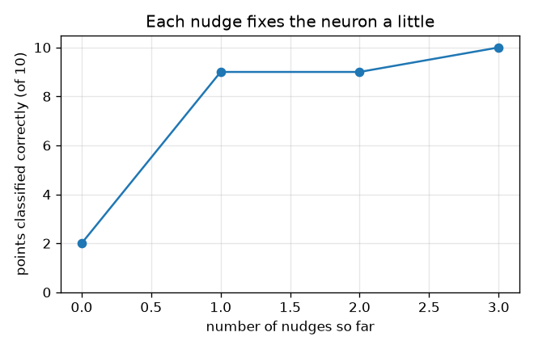
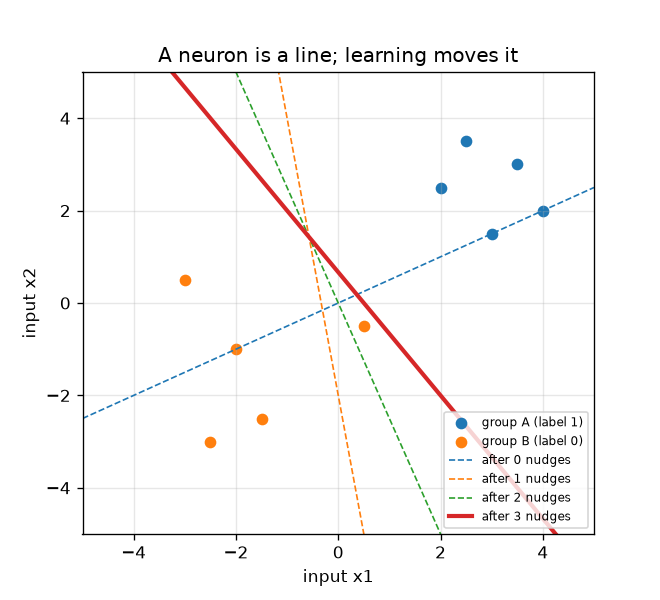

# సెషన్ 1: ఒక న్యూరాన్, ఒక రేఖ, ఒక తోపు

[Session 1 — हिन्दी](README.hi.md) · [Session 1 — മലയാളം](README.ml.md) · [Session 1 — தமிழ்](README.ta.md)

*స్థాయి 1 (భావనాత్మక ఇంటరాక్టివ్ నమూనా) · సుమారు 60 నిమిషాలు · openneuralnet*

> ఇది విద్య కోసం సరళీకరించిన నమూనా. ఇది ధ్రువీకరించబడిన డిజైన్ సాధనం కాదు; నిజమైన నిర్మాణాలు, విద్యుత్ ఇన్‌స్టలేషన్లు, వాహనాలు, పారిశ్రామిక ప్రక్రియలు లేదా వైద్య నిర్ణయాల కోసం దీనిని ఉపయోగించకూడదు.

**ముందస్తు అవసరాలు (Prerequisites)**

- పాఠశాల బీజగణితం: గుణించడం, కూడటం, రేఖ y = m x + c గీయడం.
- మీరు PRIMER.md చదివి, `python start.py 1` ఒకసారి రన్ చేశారు.

**అభ్యసన లక్ష్యాలు (Learning objectives).** ఈ సెషన్ తర్వాత మీరు:

- మెషిన్ లెర్నింగ్‌ను (machine learning) నియమాన్ని టైప్ చేయడానికి బదులు ఉదాహరణల నుండి ఒక నియమం యొక్క సెట్టింగ్‌లను కనుగొనడంగా వివరించగలరు.
- ఒక న్యూరాన్ ఏమి చేస్తుందో లెక్కించగలరు: ఇన్‌పుట్‌ల భారిత మొత్తం (weighted sum) ప్లస్ ఒక బయాస్, తర్వాత సున్నా కంటే ఎక్కువైతే ఫైర్ అవ్వడం.
- ఒక న్యూరాన్ రెండు బిందు సమూహాల మధ్య ఒక సరళ రేఖను గీస్తుందని చూపగలరు.
- పెర్సెప్ట్రాన్ నియమాన్ని (perceptron rule) చేతితో వర్తింపజేసి సమూహాలను విభజించే వరకు రేఖ కదలడం చూడగలరు.

## A. నిజ జీవిత సమస్య
సాంప్రదాయ ప్రోగ్రామ్ అంటే ఒక వ్యక్తి రాసిన నియమాల జాబితా: ఇమెయిల్‌లో ఈ పదం ఉంటే దానిని స్పామ్‌గా గుర్తించు. మెషిన్ లెర్నింగ్ దీనిని తిప్పేస్తుంది: సరైన సమాధానాలతో అనేక ఉదాహరణలను కంప్యూటర్‌కు చూపిస్తారు, అది నియమాలను స్వయంగా కనుగొంటుంది. అతి చిన్న నేర్చుకునే యంత్రం ఒకే ఒక కృత్రిమ న్యూరాన్. ఒక బిందువు గురించి రెండు సంఖ్యలు ఇస్తే (ఒక పువ్వు యొక్క రెండు కొలతలు అనుకోండి), అది గ్రూప్ A లేదా గ్రూప్ B అని చెప్పాలి. ఉదాహరణల నుండి మాత్రమే, పది ఉదాహరణలనూ సరిగ్గా చెప్పే నియమాన్ని అది కనుగొనగలదా?

## B. భావన మరియు సిద్ధాంతం
ఒక న్యూరాన్‌కు ఇన్‌పుట్‌లు x1, x2, భారాలు (weights) w1, w2 మరియు ఒక బయాస్ (bias) b ఉంటాయి. అది మొదట భారిత మొత్తం z = w1 x1 + w2 x2 + b లెక్కిస్తుంది, తర్వాత z > 0 అయితే ఫైర్ అవుతుంది (అవుట్‌పుట్ 1), లేకపోతే నిశ్శబ్దంగా ఉంటుంది (అవుట్‌పుట్ 0). అది మనసు మార్చుకునే చోటు z = 0, ఇది (x1, x2) తలంలో ఒక సరళ రేఖ; ఒక వైపు బిందువులు ఫైర్ అవుతాయి, మరో వైపు బిందువులు కావు. పెర్సెప్ట్రాన్ నియమం ద్వారా నేర్చుకోవడం: ఒకసారి ఒక ఉదాహరణను చూడండి. న్యూరాన్ సరైనదైతే ఏమీ మార్చకండి. తప్పయితే తోపు (nudge) ఇవ్వండి: భారాలకు (లేబుల్ - అవుట్‌పుట్) రెట్లు బిందువును, బయాస్‌కు (లేబుల్ - అవుట్‌పుట్) ను కలపండి. తప్పిపోయిన గ్రూప్ A బిందువు (లేబుల్ 1, అవుట్‌పుట్ 0) బిందువును కలుపుతుంది, రేఖను దాని వైపు లాగుతుంది. తప్పుగా ఫైర్ అయిన గ్రూప్ B బిందువు (లేబుల్ 0, అవుట్‌పుట్ 1) బిందువును తీసివేస్తుంది, రేఖను దాని నుండి దూరంగా నెడుతుంది. ఇది నేర్చుకునే యంత్రాలు ఎలా పనిచేస్తాయనే దాని గురించి సాధారణ విద్య.

| గుర్తు | అర్థం | యూనిట్ |
|---|---|---|
| x1, x2 | ఒక బిందువు యొక్క రెండు ఇన్‌పుట్‌లు (కొలతలు) | యూనిట్ లేదు (ఏదైనా స్థిరమైన యూనిట్) |
| w1, w2 | భారాలు: ప్రతి ఇన్‌పుట్‌కు ఎంత ప్రాధాన్యం | యూనిట్ లేదు |
| b | బయాస్: ఒక ముందంజ లేదా వెనుకబాటు | యూనిట్ లేదు |
| z | భారిత మొత్తం w1 x1 + w2 x2 + b | యూనిట్ లేదు |
| t | లేబుల్: సరైన సమాధానం, 1 (గ్రూప్ A) లేదా 0 (గ్రూప్ B) | యూనిట్ లేదు |

**ఊహలు (Assumptions)**

- రెండు ఇన్‌పుట్‌లు మరియు రెండు గ్రూపులు మాత్రమే, కాబట్టి అన్నింటినీ గీయవచ్చు.
- z ఖచ్చితంగా 0 కంటే ఎక్కువైనప్పుడు న్యూరాన్ ఫైర్ అవుతుంది; సరిగ్గా రేఖపై ఉన్న బిందువు ఫైర్ అవ్వదు.
- పది ఉదాహరణ బిందువులే ప్రపంచం మొత్తం; లేబుల్స్‌లో తప్పులు లేవు.

$$ z = w_1 x_1 + w_2 x_2 + b,\qquad \text{output} = \begin{cases}1 & z > 0\\ 0 & z \le 0\end{cases} $$

$$ \text{decision line: } w_1 x_1 + w_2 x_2 + b = 0 \;\Rightarrow\; x_2 = -\frac{w_1 x_1 + b}{w_2} $$

$$ \mathbf w \leftarrow \mathbf w + (t - \text{output})\,\mathbf x,\qquad b \leftarrow b + (t - \text{output}) $$

## C. దృశ్య వివరణ
మొదటి చిత్రం పది బిందువులను (నీలం గ్రూప్ A, నారింజ గ్రూప్ B) మరియు ప్రతి తోపు తర్వాత విభజన రేఖను చూపిస్తుంది: డ్యాష్డ్ రేఖలు మునుపటి అంచనాలు, ఘన రేఖ చివరిది, అందులో పది బిందువులూ సరైన వైపున ఉన్నాయి. రెండవ చిత్రం ప్రతి తోపు తర్వాత సరిగ్గా వర్గీకరించబడిన బిందువులను లెక్కిస్తుంది: ప్రారంభంలో 2, తర్వాత 9, 9, 10. ఒక తోపు లెక్కను మార్చకపోయినా రేఖను సరైన దిశలో కదిలించవచ్చని గమనించండి.

*ప్రతి తోపు తర్వాత సరిగ్గా వర్గీకరించబడిన బిందువులు: 2, 9, 9, 10.*

*పది బిందువులు మరియు ప్రతి తోపు తర్వాత విభజన రేఖ (డ్యాష్డ్: మునుపటి అంచనాలు, ఘనం: చివరిది).*

## D. ఇంటరాక్టివ్ సిమ్యులేషన్
పాఠాన్ని రన్ చేయండి (`python start.py 1`), తర్వాత లైవ్ యాప్ తెరవండి: [సెషన్ 1: ఒక న్యూరాన్, ఒక రేఖ](https://krunalpanchal1995.github.io/pan-iit-oss/openneuralnet/session-01/) (లేదా ఈ ఫోల్డర్‌లోని `app.html`). భారం మరియు బయాస్ స్లైడర్లను లాగి ఆకుపచ్చ రేఖ కదలడం మరియు వలయం గీసిన (తప్పు) బిందువులు మారడం చూడండి. బయాస్ వ్యూకు మారి బయాస్ మాత్రమే కదులుతున్నప్పుడు సరైన బిందువుల సంఖ్య ఎలా మారుతుందో చూడండి.

**సవాలు.** 10 బిందువులనూ సరిగ్గా వర్గీకరించే భారాలను మరియు ఒక బయాస్‌ను కనుగొనండి.

## E. సాధించిన ఉదాహరణ మరియు ప్రయోగం
**సమస్య.** w = (1, -2), b = 0 తో మొదలుపెట్టి, ప్రతి బిందువూ సరిగ్గా అయ్యే వరకు పట్టికలోని క్రమంలో బిందువులను సందర్శిస్తూ పెర్సెప్ట్రాన్ నియమాన్ని వర్తింపజేయండి.

1. బిందువు 1 (2, 2.5), లేబుల్ 1. దాని మొత్తం z = 1*2 + (-2)*2.5 + 0 = -3, కాబట్టి న్యూరాన్ నిశ్శబ్దంగా ఉంది: తప్పు. ప్రారంభంలో 10 లో 2 బిందువులు సరైనవి.
2. తోపు 1: అవుట్‌పుట్ 0, లేబుల్ 1, కాబట్టి w = (1, -2) + (1 - 0)*(2, 2.5) = (3, 0.5), b = 0 + 1 = 1. ఇప్పుడు 10 లో 9 సరైనవి.
3. బిందువులు 2 నుండి 7 సరైనవి. బిందువు 8 (0.5, -0.5), లేబుల్ 0, కానీ z = 3*0.5 + 0.5*(-0.5) + 1 = 2.25 > 0, కాబట్టి అది తప్పుగా ఫైర్ అవుతుంది.
4. తోపు 2: అవుట్‌పుట్ 1, లేబుల్ 0, కాబట్టి w = (3, 0.5) - (0.5, -0.5) = (2.5, 1), b = 1 - 1 = 0. బిందువు 8 కు ఇప్పుడు z = 0.75, ఇంకా తప్పు; లెక్క 9 వద్దే ఉంటుంది.
5. తదుపరి పాస్‌లో బిందువు 8 తోపు 3 ఇస్తుంది: w = (2.5, 1) - (0.5, -0.5) = (2, 1.5), b = -1. ఇప్పుడు 10 బిందువులూ సరైనవి, ఇక ఏదీ మారదు.

**సమాధానం.** 3 తోపుల తర్వాత న్యూరాన్‌కు w = (2, 1.5), b = -1 ఉంది, 10 లో 10 బిందువులనూ సరిగ్గా వర్గీకరిస్తుంది (తోపు 0, 1, 2, 3 తర్వాత 2, 9, 9, 10 బిందువులు సరైనవి). విభజన రేఖ 2 x1 + 1.5 x2 = 1.

**ప్రయోగం.** పది బిందువులను గ్రాఫ్ కాగితంపై గీయండి, ఒక నిటారైన కార్డ్ పట్టీని కత్తిరించి విభజన రేఖగా ఉంచండి. ప్రతి గ్రూప్ తన వైపున ఉండే వరకు దానిని జరపండి, తిప్పండి, పట్టీకి ఎన్ని తోపులు పట్టాయో లెక్కించండి. నిజమైన డేటా సెట్‌లో కొలత శబ్దం (noise) ఉంటుంది, కాబట్టి ఏ రేఖా పరిపూర్ణం కాదు, బిందువులు తప్పుగా వర్గీకరించబడతాయి; గ్రూపులను ఖచ్చితంగా విభజించవచ్చని నమూనా ఊహిస్తుంది, నిజమైన డేటాకు సాధారణంగా అది సాధ్యం కాదు.

## F. మూల్యాంకనం మరియు డిజైన్ సవాలు
**ప్రశ్న రకం A: భావనాత్మక.** సాంప్రదాయ ప్రోగ్రామ్‌కు మరియు మెషిన్ లెర్నింగ్ మోడల్‌కు తేడా ఏమిటి, భారాలతో పాటు న్యూరాన్‌కు బయాస్ b ఎందుకు కావాలి?

సూచన

సంఖ్యలను ఎవరు రాస్తారు? b = 0 అయినప్పుడు రేఖకు ఏమవుతుంది?

దశలవారీ పరిష్కారం

సాంప్రదాయ ప్రోగ్రామ్‌లో ఒక వ్యక్తి నియమాలు రాస్తారు. మెషిన్ లెర్నింగ్‌లో ఒక వ్యక్తి నియమం యొక్క రూపాన్ని మాత్రమే రాస్తారు (ఇక్కడ: భారిత మొత్తం మరియు థ్రెషోల్డ్), దానిలోని సంఖ్యలు (భారాలు, బయాస్) లేబుల్ చేసిన ఉదాహరణల నుండి కనుగొనబడతాయి. బయాస్ లేకపోతే రేఖ w1 x1 + w2 x2 = 0 ఎప్పుడూ మూలబిందువు గుండా వెళ్తుంది, కాబట్టి మూలబిందువుకు ఒకే వైపున ఉన్న రెండు గ్రూపులను అది విభజించలేదు. బయాస్ రేఖను తిప్పకుండా జరుపుతుంది.

**ప్రశ్న రకం B: సంఖ్యాత్మక.** నేర్చుకున్న న్యూరాన్‌కు w = (2, 1.5) మరియు b = -1. కొత్త బిందువు (-0.5, -1.5) కు z మరియు అవుట్‌పుట్ ఏమిటి? ఈ బిందువు గ్రూప్ B కి చెందినదైతే ఇది సరైనదేనా?

సూచన

z = w1 x1 + w2 x2 + b లెక్కించండి, z > 0 అయితేనే ఫైర్ అవ్వండి.

దశలవారీ పరిష్కారం

z = 2*(-0.5) + 1.5*(-1.5) + (-1) = -1 - 2.25 - 1 = -4.25, ఇది 0 కంటే ఎక్కువ కాదు, కాబట్టి న్యూరాన్ నిశ్శబ్దంగా ఉంది (అవుట్‌పుట్ 0): గ్రూప్ B కి సరైనది. ఇన్‌పుట్‌లు కేవలం సంఖ్యలు కాబట్టి ఈ సంఖ్యకు యూనిట్ లేదు.

**ప్రశ్న రకం C: గ్రాఫ్ మరియు సిమ్యులేషన్ వ్యాఖ్యానం.** w = (1, 1) తో 'సరైన బిందువులు వర్సెస్ బయాస్' గ్రాఫ్‌లో, b యొక్క ఏ పరిధిలో 10 బిందువులూ సరైనవి, వక్రానికి చదునైన మెట్లు ఎందుకు ఉన్నాయి?

సూచన

w = (1, 1) కు మొత్తం z అనేది x1 + x2 + b. గ్రూప్ A మొత్తాలు కనీసం 4.5, గ్రూప్ B మొత్తాలు గరిష్టంగా 0.

దశలవారీ పరిష్కారం

గ్రూప్ A కి అతి చిన్న గ్రూప్ A మొత్తానికి (4.5) x1 + x2 + b > 0 కావాలి, కాబట్టి b > -4.5. గ్రూప్ B కి అతి పెద్ద గ్రూప్ B మొత్తానికి (0) x1 + x2 + b <= 0 కావాలి, కాబట్టి b <= 0. -4.5 < b <= 0 కు (ఉదాహరణకు b = -2) పదీ సరైనవి. లెక్క పూర్ణ సంఖ్య కాబట్టి మరియు రేఖ ఒక బిందువును దాటినప్పుడు మాత్రమే మారుతుంది కాబట్టి వక్రం ఒక మెట్ల వరుస.

**ప్రశ్న రకం D: డిజైన్ మరియు ఆప్టిమైజేషన్ సవాలు.** డిజైన్: w = (1, 1) ఉంచి, పది బిందువులనూ సరిగ్గా వర్గీకరించి రెండు గ్రూపుల నుండి వీలైనంత దూరంగా ఉండే బయాస్‌ను ఎంచుకోండి. ఏ b, ఎందుకు?

సూచన

ప్రశ్న C నుండి అనుమతించబడిన పరిధి -4.5 < b <= 0; గ్రూపులు రేఖకు అతి దగ్గరగా దాని రెండు చివరల వద్ద ఉంటాయి.

దశలవారీ పరిష్కారం

అనుమతించబడిన పరిధి -4.5 < b <= 0, కాబట్టి మధ్య విలువ b = -2.25 రెండు వైపులా అదే ఖాళీని (2.25) వదులుతుంది. కొత్త బిందువులు కొంచెం శబ్దంతో వచ్చినప్పుడు రెండు గ్రూపుల నుండి దూరంగా ఉన్న రేఖ సురక్షితం. రాజీ (trade-off): ఇంత వెడల్పు మార్జిన్‌తో నియమం మరింత దృఢంగా ఉంటుంది, కానీ నిజమైన సరిహద్దు ఎక్కడ ఉందో ఈ డేటాలో ఏదీ చెప్పదు; పరిధిలోని ఏ b అయినా పది ఉదాహరణలకూ సమానంగా సరిపోతుంది. నేను b = -2 తీసుకున్నాను, అదీ పనిచేస్తుంది (చెక్‌పాయింట్‌లో పరిశీలించబడింది).

[RUBRIC.md](../../RUBRIC.md) తో మిమ్మల్ని మీరు స్కోర్ చేసుకోండి. కాగితంపై పని చేయడానికి [కార్యాచరణ పత్రం](activity_sheet.md) ప్రింట్ చేయండి.

## సాధారణ అపోహలు
| సాధారణ అపోహ | నిజానికి ఏది సరైనది |
|---|---|
| న్యూరాన్ అంటే ఆలోచించే చిన్న మెదడు. | ఈ కోర్సులో న్యూరాన్ అంటే భారిత మొత్తం మరియు దాని తర్వాత ఒక థ్రెషోల్డ్ మాత్రమే; నెట్‌వర్క్ తెలివి వాటిలో అనేకం నుండి మరియు నేర్చుకునే నియమం నుండి వస్తుంది. |
| నేర్చుకోవడం అంటే కంప్యూటర్ ఉదాహరణలను బట్టీ పడుతుంది. | భారాలు ఒక సంక్షిప్త నియమం (ఇక్కడ మూడు సంఖ్యలు). మంచి నియమం కొత్త బిందువులపై కూడా పనిచేస్తుంది; బట్టీ పట్టడం పనిచేయదు, సెషన్ 3 చూపినట్లు. |
| రేఖ భారాల ద్వారా మాత్రమే నిర్ణయించబడుతుంది. | బయాస్ రేఖను పక్కకు జరుపుతుంది; భారాలు దాని దిశను నిర్ణయిస్తాయి. రెండూ నేర్చుకోబడతాయి. |
| ప్రతి తోపు ఎల్లప్పుడూ సరైన బిందువుల సంఖ్యను పెంచుతుంది. | ఒక తోపు అది చూసిన బిందువును సరిచేస్తుంది, కానీ లెక్క అలాగే ఉండవచ్చు లేదా క్షణకాలం తగ్గవచ్చు; విభజించగల డేటాకు నియమం చివరికి పరిపూర్ణ రేఖతో ముగుస్తుంది (సెషన్ 2). |

## పదకోశం
- **న్యూరాన్ (neuron)**: భారిత ఇన్‌పుట్‌లను మరియు బయాస్‌ను కూడి, మొత్తం సున్నా కంటే ఎక్కువైతే ఫైర్ అయ్యే నియమం
- **భారం (weight)**: ఒక ఇన్‌పుట్‌కు ఎంత ప్రాధాన్యమో చెప్పే సంఖ్య
- **బయాస్ (bias)**: విభజన రేఖను జరిపే, భారిత మొత్తానికి కలిపే సంఖ్య
- **లేబుల్ (label)**: ఒక ఉదాహరణ యొక్క సరైన సమాధానం, 0 లేదా 1
- **పెర్సెప్ట్రాన్ నియమం (perceptron rule)**: న్యూరాన్ తప్పయితే, భారాలకు (లేబుల్ - అవుట్‌పుట్) రెట్లు బిందువును కలపండి
- **మెషిన్ లెర్నింగ్ (machine learning)**: లేబుల్ చేసిన ఉదాహరణల నుండి ఒక నియమం యొక్క సంఖ్యలను కనుగొనడం

## ముగింపు
1. [exercises.md](exercises.md) లోని మూడు కోడింగ్ పనులు చేయండి.
2. మీ మార్పుల తర్వాత `python start.py 1` మళ్లీ రన్ చేయండి. అది చెక్‌పాయింట్‌తో ముగుస్తుంది; అది `PASS` అని ప్రింట్ చేసినప్పుడు మీరు పూర్తి చేశారు. (చెక్‌పాయింట్ మాత్రమే: `python start.py check 1`.)

తర్వాత: [సెషన్ 2](../session-02/README.md)
