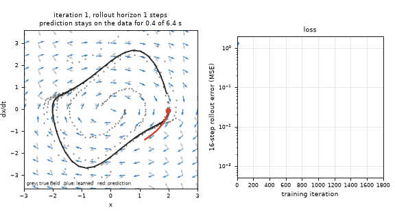
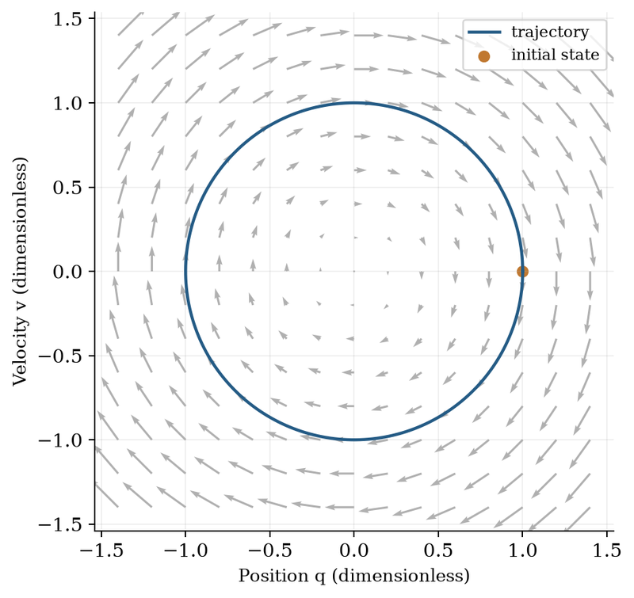
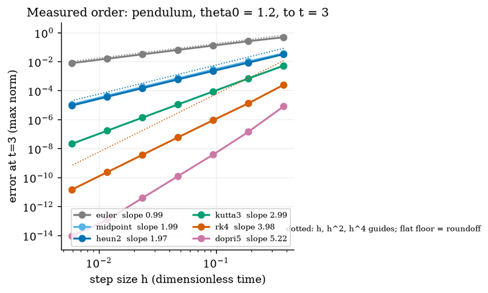
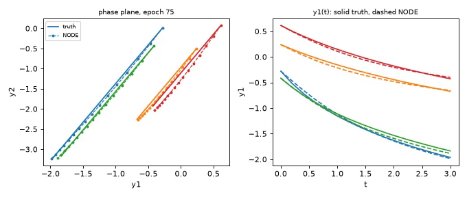

# openneuralode

[](https://github.com/KrunalPanchal1995/pan-iit-oss/actions/workflows/tests.yml)   [](https://colab.research.google.com/github/KrunalPanchal1995/pan-iit-oss/blob/main/openneuralode/sessions/session-01/lesson.ipynb) [](https://krunalpanchal1995.github.io/pan-iit-oss/openneuralode/)

**Learn how things change from data: neural ODEs in three sessions.**

openneuralode teaches how a small neural network can learn the rule dx/dt = f(x) from noisy trajectories, using only Python and a browser.

- **Start from zero.** Session 1 needs only the idea of speed and a picture of arrows; every symbol is explained.
- **See it move.** Every session ships a slider app that runs in the browser, with labelled graphs.
- **Know you got it right.** Each session ends with a checkpoint that prints PASS or FAIL against hand calculations and a known system.
- **Build the missing half.** The repo stops at Session 3 on purpose; the roadmap shows the path to the Target.

[Target](#the-target) · [Who is this for](#who-is-this-for) · [Quick start](#quick-start) · [Sessions](#sessions) · [Roadmap](#roadmap) · [Contribute](#contribute) · [Explainer PDF](docs/explainer.pdf)

> **This repo is incomplete on purpose.** Sessions 1 to 3 are here and fully working. The finished Target below is a preview of what the community can build next. We show you the path, not the code. Sessions 4 and up are yours.

## The Target

A small neural network learns the Van der Pol oscillator, a system that settles onto a closed loop, from noisy recorded paths. Left: the arrows the network has learned (blue) start out wrong and slide onto the true arrows (grey) as training goes on, while the red predicted path follows the recorded data further and further. Right: the loss curve falls. This is possible because the rollout length is increased during training. Your goal over the coming sessions: build that yourself, starting from the one-hidden-layer network of Session 3.



*Target: a Neural ODE learns the Van der Pol oscillator; the learned arrows slide onto the true ones*



*Neural ODE course: a vector field (arrows) and the trajectory it produces in the position-velocity plane*



*Neural ODE course: measured order of accuracy of Euler, RK4 and other solvers on log-log axes*



*Neural ODE course: a trained Neural ODE (dashed) against the true trajectories (solid), in the phase plane and against time*

Try it live:

- [Math Visual Studio: ordinary differential equations (Atlas S16)](https://krunalpanchal1995.github.io/studio/#atlas?ch=S16&ex=1)
- [Math Visual Studio: matrices as transformations (Atlas S20)](https://krunalpanchal1995.github.io/studio/#atlas?ch=S20&ex=1)

How the Target was made is shown only as a path in [promo/roadmap.md](promo/roadmap.md).

## Who is this for
**higher secondary to advanced undergraduate (levels 4-6).** Topic area: Artificial Intelligence, Data Science and Robotics.

Prerequisites:

- What a derivative means as a speed (rate of change); sine and cosine are not needed.
- Python 3.10 or newer; if `python --version` works, you are ready. PRIMER.md explains the rest.
- No prior machine learning, GitHub or differential equations experience is needed; matrices are used lightly from Session 2.

New to Python? Read [PRIMER.md](PRIMER.md) first (10 minutes).

## Quick start

No installation knowledge needed. You need [Git](https://git-scm.com/downloads) and [Python 3.10+](https://www.python.org/downloads/) (Windows: tick "Add Python to PATH"). On Mac and Linux type `python3` wherever this page says `python`.

```bash
git clone https://github.com/KrunalPanchal1995/pan-iit-oss.git
cd pan-iit-oss/openneuralode
python start.py 1
```

`start.py` creates a private environment, installs what is needed and runs Session 1 with its checkpoint. Next: `python start.py 2`, `python start.py 3`, or `python start.py test` to check everything. Only a checkpoint: `python start.py check 1`.

<!-- friendly-help -->
<details>
<summary><b>Not working? Common fixes (no Git, "python not found", no internet)</b></summary>

- **No Git?** You do not need it. On the main page of this collection click the green **Code** button, then **Download ZIP**, unzip it, open a terminal inside the folder `pan-iit-oss-main/openneuralode` and run `python start.py 1`. The ZIP holds every project, so it is large; the live apps need no download at all.
- **"python is not recognized" or "command not found".** On Windows try `py start.py 1`. On Mac and Linux try `python3 start.py 1`. If neither works, install Python from [python.org](https://www.python.org/downloads/) and tick "Add Python to PATH".
- **Needs internet once.** The first run downloads NumPy and Matplotlib into a private folder (`.venv`); after that it works offline.
- **Rather not install anything?** Open the [live apps](https://krunalpanchal1995.github.io/pan-iit-oss/openneuralode/) in your browser, or use the Colab badge at the top of this page.
- **Still stuck?** [Open an issue](https://github.com/KrunalPanchal1995/pan-iit-oss/issues/new?title=%5Bopenneuralode%5D%20) with your operating system and the message you see. Questions from beginners are welcome.

</details>

Four lines turn the idea of Session 1 into a result (they work as they are): Save it as `try.py` and run it with `python start.py run try.py` (this uses the private environment, where NumPy is installed):

```python
import numpy as np
A = np.array([[0.0, 1.0], [-4.0, -0.4]])      # x' = v,  v' = -4 x - 0.4 v  (a mass on a spring)
x = np.array([1.0, 0.0])                       # start 1 m from rest, not moving
for _ in range(10): x = x + 0.1 * (A @ x)      # follow the arrows: ten Euler steps of 0.1 s
print(np.round(x, 3))                          # -> [-0.328 -1.825]  position and velocity after 1 s
```

Every session also opens in your browser with sliders (no install): [live apps](https://krunalpanchal1995.github.io/pan-iit-oss/openneuralode/). Or use the Colab badge above for the notebook.

## Sessions

| # | Session | Model level | Time | Live app |
|---|---|---|---|---|
| 1 | [A rule for change: dx/dt = f(x)](sessions/session-01/README.md) | Level 1: conceptual interactive model | 60 min | [open](https://krunalpanchal1995.github.io/pan-iit-oss/openneuralode/session-01/) |
| 2 | [Solvers, least squares and a first neural network](sessions/session-02/README.md) | Level 2: mathematical engineering model | 75 min | [open](https://krunalpanchal1995.github.io/pan-iit-oss/openneuralode/session-02/) |
| 3 | [A Neural ODE trained through the solver](sessions/session-03/README.md) | Level 3: simulation and validation | 90 min | [open](https://krunalpanchal1995.github.io/pan-iit-oss/openneuralode/session-03/) |

Each session follows the same six steps: A real-world problem, B concept and theory, C visual explanation, D interactive simulation, E worked example and experiment, F assessment and design challenge. Each ends with `checkpoint.py`, which prints `PASS` or `FAIL` against reference numbers. Session 3 also contains the real-world mini-project: **Learn a damped pendulum from noisy data and predict forward**.

## Architecture

```mermaid
flowchart LR
  S1[Session 1<br/>A rule for change: dx/dt = f(x)]
  S2[Session 2<br/>Solvers, least squares and a first neural network]
  S3[Session 3<br/>A Neural ODE trained through the solver]
  R[Roadmap S4+<br/>YOU build this]
  T((Target))
  S1 --> S2 --> S3 --> R --> T
```

| Folder or file | What is inside |
|---|---|
| `sessions/` | three sessions: README (A-F), `lesson.py`, notebook, live app, exercises, activity sheet, checkpoint |
| `promo/` | the Target: media, live links, and the roadmap (path only) |
| `docs/` | `explainer.tex` and the built `explainer.pdf` |
| `tests/` | runs every lesson and checkpoint headless |
| `start.py` | one command to set up and run anything |
| `QUALITY.md`, `RUBRIC.md` | the quality checklist and the scoring rubric |
| `.github/` | CI, PDF build, Pages deploy, issue and PR templates |

## Roadmap

| Milestone | What you will build | Difficulty |
|---|---|---|
| Session 4: The adjoint method | A gradient routine that integrates the adjoint equations backwards instead of storing the RK4 stages. | advanced |
| Session 5: A limit cycle: Van der Pol | A Neural ODE for the Van der Pol oscillator with a curriculum on the rollout length. | intermediate |
| Session 6: Stiff dynamics with an implicit solver | Backward Euler or an adaptive solver inside the rollout. | advanced |
| Session 7: Learning under heavy noise | A training recipe that stays accurate at noise 0.1 with only 6 runs. | intermediate |
| Session 8: Hidden velocity: partial observation | A model that sees only the position of the oscillator and learns the velocity as a hidden state. | advanced |

Full detail with a checkpoint per milestone: [promo/roadmap.md](promo/roadmap.md).

## Contribute
New to GitHub? Read [CONTRIBUTING.md](CONTRIBUTING.md); it starts from zero. Pick an issue labelled `good first issue`. Translations into Hindi, Telugu, Tamil and Malayalam are welcome.

<details>
<summary>Development</summary>

```bash
python start.py test        # runs every lesson and checkpoint
```
Lessons use `# %%` cell markers so they open as notebooks in VS Code. See [QUALITY.md](QUALITY.md) for the standard every session meets.
</details>

## License
MIT. See [LICENSE](LICENSE). Media in `promo/media` is (c) Krunal Panchal, CC BY 4.0.

## Acknowledgments
Part of the [PAN IIT OSS](https://hellofoss.tech-iitb.org/projects) open-source teaching collection, modelled on the structure of [openspline](https://github.com/openspline/openspline). Built on ideas from the Math Visual Studio at https://krunalpanchal1995.github.io/studio/.
