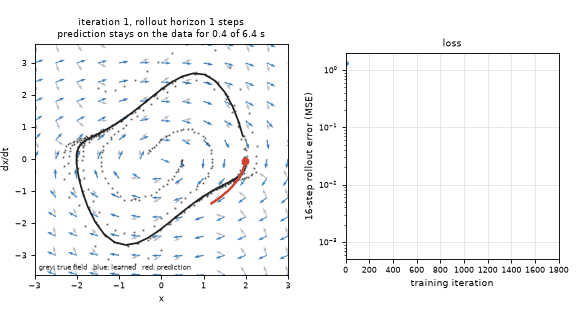
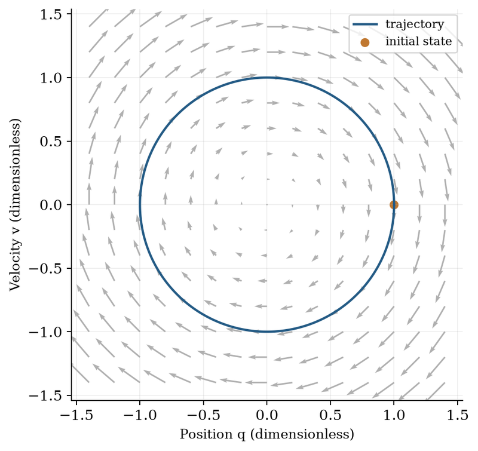
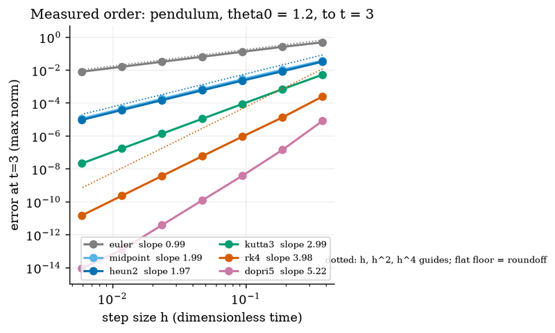
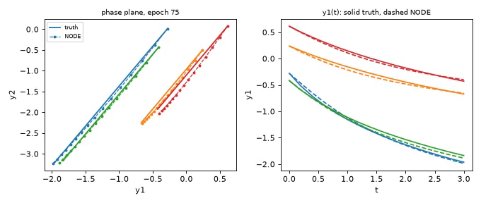

# What you are building toward

A small neural network learns the Van der Pol oscillator, a system that settles onto a closed loop, from noisy recorded paths. Left: the arrows the network has learned (blue) start out wrong and slide onto the true arrows (grey) as training goes on, while the red predicted path follows the recorded data further and further. Right: the loss curve falls. This is possible because the rollout length is increased during training. Your goal over the coming sessions: build that yourself, starting from the one-hidden-layer network of Session 3.

*Target: a Neural ODE learns the Van der Pol oscillator; the learned arrows slide onto the true ones*

*Neural ODE course: a vector field (arrows) and the trajectory it produces in the position-velocity plane*

*Neural ODE course: measured order of accuracy of Euler, RK4 and other solvers on log-log axes*

*Neural ODE course: a trained Neural ODE (dashed) against the true trajectories (solid), in the phase plane and against time*

These results come from a private reference build. The code is not published; the roadmap shows the path so you can build your own.

Live links:

- [Math Visual Studio: ordinary differential equations (Atlas S16)](https://krunalpanchal1995.github.io/studio/#atlas?ch=S16&ex=1)
- [Math Visual Studio: matrices as transformations (Atlas S20)](https://krunalpanchal1995.github.io/studio/#atlas?ch=S20&ex=1)
