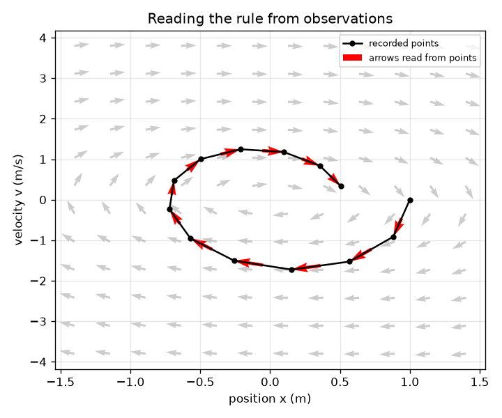
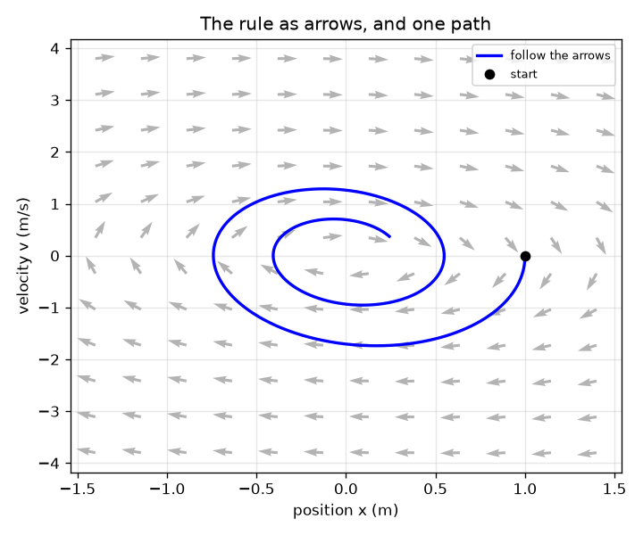

# सत्र 1: परिवर्तन का एक नियम: dx/dt = f(x)

*स्तर 1 (वैचारिक इंटरैक्टिव मॉडल) · लगभग 60 मिनट · openneuralode*

> यह एक सरलीकृत शैक्षिक मॉडल है। यह कोई प्रमाणित डिज़ाइन उपकरण नहीं है और इसका उपयोग वास्तविक संरचनाओं, विद्युत संस्थापनों, वाहनों, औद्योगिक प्रक्रियाओं या चिकित्सा निर्णयों के लिए नहीं किया जाना चाहिए।

**पूर्वापेक्षाएँ (Prerequisites)**

- परिवर्तन की दर (rate of change) का विचार: चाल बताती है कि स्थिति कितनी तेज़ी से बदलती है।
- आपने PRIMER.md पढ़ लिया है और एक बार `python start.py 1` चला लिया है।

**सीखने के उद्देश्य (Learning objectives)।** इस सत्र के बाद आप:

- समझा सकेंगे कि नियम dx/dt = f(x) क्या कहता है और उसे तीरों के क्षेत्र (field of arrows) के रूप में बना सकेंगे।
- एक पथ पाने के लिए तीरों का चरण-दर-चरण अनुसरण कर सकेंगे।
- दर्ज किए गए बिंदुओं से तीरों को वापस पढ़ सकेंगे, जो आँकड़ों से f सीखने के पीछे का विचार है।
- स्थिति-वेग तल (position-velocity plane) में एक सर्पिल (spiral) को घर्षण (friction) से ऊर्जा खोते द्रव्यमान के रूप में पढ़ सकेंगे।

## A. वास्तविक दुनिया की समस्या
एक द्रव्यमान (mass) स्प्रिंग पर लटका है और डोलते-डोलते रुक जाता है। आप पूरे पथ को एक सूत्र के रूप में लिखने की कोशिश कर सकते हैं, या आप एक छोटा प्रश्न पूछ सकते हैं जो हर क्षण सही है: यदि द्रव्यमान यहाँ है और इतनी तेज़ी से चल रहा है, तो वह अभी कैसे बदल रहा है? उत्तर एक नियम dx/dt = f(x) है। एक बार नियम मिल जाए, तो कंप्यूटर किसी भी शुरुआत से पथ का पूर्वानुमान लगा सकता है। एक न्यूरल नेटवर्क (neural network) दर्ज की गई स्थितियों से नियम f सीख सकता है, तब भी जब आप भौतिकी नहीं जानते। हम ऐसे नियम की कल्पना कैसे करें, और इसे आँकड़ों से कैसे पाएँ?

## B. अवधारणा और सिद्धांत
तंत्र की अवस्था (state) संख्याओं की एक सूची है; स्प्रिंग के लिए यह जोड़ा (x, v) है: स्थिति और वेग (velocity)। नियम f हर अवस्था के लिए एक तीर देता है जो दिखाता है कि अवस्था कैसे बदल रही है: उसकी पहली संख्या dx/dt है और दूसरी dv/dt। तीरों का अनुसरण करने का अर्थ है: कहीं से शुरू करें, तीर के साथ थोड़े समय dt तक चलें, नए तीर को देखें, दोहराएँ। जो पथ मिलते हैं वे कभी एक-दूसरे को नहीं काटते, क्योंकि नियम केवल इस पर निर्भर करता है कि आप कहाँ हैं। घर्षण वाली स्प्रिंग के लिए नियम है dx/dt = v और dv/dt = -k x - c v: स्प्रिंग खिंचाव के अनुपात में वापस खींचती है और घर्षण गति को धीमा करता है। k = 4 और c = 0.4 के साथ पथ एक सर्पिल है: द्रव्यमान कोणीय आवृत्ति (angular frequency) sqrt(k - c^2/4), लगभग 1.99 rad/s, के साथ आगे-पीछे झूलता है, और झूले का आकार exp(-c t / 2) की तरह सिकुड़ता है। प्रेक्षणों से नियम पढ़ने के लिए, दो पड़ोसी स्नैपशॉट (snapshots) लें और परिवर्तन को उनके बीच के समय से भाग दें।

| प्रतीक | अर्थ | इकाई |
|---|---|---|
| x | विराम बिंदु से द्रव्यमान की स्थिति | m |
| v | द्रव्यमान का वेग | m/s |
| k | स्प्रिंग की कठोरता (stiffness) भाग द्रव्यमान | 1/s^2 |
| c | घर्षण भाग द्रव्यमान | 1/s |
| f(x, v) | तीर: किसी अवस्था पर (dx/dt, dv/dt) | m/s और m/s^2 |
| dt | दर्ज किए गए स्नैपशॉट के बीच या सॉल्वर (solver) के चरणों के बीच का समय | s |

**मान्यताएँ (Assumptions)**

- स्प्रिंग रैखिक (linear) है और घर्षण चाल के समानुपाती है (एक सरलीकृत मॉडल)।
- गति एक-विमीय (one-dimensional) है और द्रव्यमान 1 इकाई है (k और c पहले ही उससे भाग दिए गए हैं)।
- इस सत्र में सेंसर स्थिति और वेग को बिना शोर (noise) के दर्ज करता है; शोर सत्र 2 में आता है।

$$ \frac{dx}{dt}=v,\qquad \frac{dv}{dt}=-k\,x-c\,v $$

$$ \mathbf s_{\text{next}}=\mathbf s+\Delta t\,f(\mathbf s)\quad\text{(one step along the arrow)} $$

$$ f_{\text{estimated}}\approx\frac{\mathbf s_{i+1}-\mathbf s_i}{\Delta t} $$

$$ x(t)=e^{-ct/2}\Big(\cos\omega_d t+\frac{c}{2\omega_d}\sin\omega_d t\Big),\qquad \omega_d=\sqrt{k-c^2/4} $$

## C. दृश्य व्याख्या
पहला चित्र स्थिति-वेग तल में नियम को धूसर तीरों (केवल उनकी दिशाएँ) के रूप में दिखाता है, और (1 m, 0) से उनका अनुसरण करके बना पथ एक नीली वक्र के रूप में। पथ अंदर की ओर सर्पिल बनाता है: हर चक्कर छोटा होता है क्योंकि घर्षण ऊर्जा हटाता है। दूसरा चित्र दर्ज किए गए बिंदु (काले) और उनसे अनुमानित तीर (लाल) वास्तविक तीरों के ऊपर दिखाता है: लाल तीर धूसर तीरों के साथ-साथ पड़ते हैं, जो ठीक वही है जिसके लिए एक नेटवर्क को प्रशिक्षित किया जाता है, बहुत अधिक बिंदुओं के साथ।

*दर्ज किए गए बिंदु (काले) और उनसे पढ़े गए तीर (लाल) वास्तविक तीरों (धूसर) के साथ-साथ पड़ते हैं।*

*तीरों के रूप में नियम (केवल दिशाएँ, धूसर) और (1 m, 0) से उनका अनुसरण करके मिला पथ (नीला)।*

## D. इंटरैक्टिव सिमुलेशन
पाठ चलाएँ (`python start.py 1`), फिर लाइव ऐप खोलें: [सत्र 1: तीरों के रूप में नियम](https://krunalpanchal1995.github.io/pan-iit-oss/openneuralode/session-01/) (या इस फ़ोल्डर में `app.html`)। कठोरता और घर्षण वाले स्लाइडरों को खिसकाएँ और फ़ेज़ दृश्य (phase view) में सर्पिल को बदलते देखें; घर्षण को 0 करें और एक बंद लूप देखें। समय के सापेक्ष स्थिति और वेग देखने के लिए समय दृश्य पर जाएँ, और समय स्लाइडर T को खिसकाकर स्प्रिंग चित्र में देखें कि T पर द्रव्यमान कहाँ है।

**चुनौती।** चुने गए समय T पर डोलने के आवरण (envelope) exp(-c T / 2) को 0.1 से नीचे ले आएँ।

## E. हल किया गया उदाहरण और प्रयोग
**समस्या।** k = 4 और c = 0.4 के लिए, अवस्था (x, v) = (1 m, 0) पर और (0, 2 m/s) पर तीर ज्ञात करें, और पहले तीर के साथ 0.1 s का एक चरण लें।

1. (1, 0) पर: dx/dt = v = 0 और dv/dt = -4 * 1 - 0.4 * 0 = -4 m/s^2। तीर (0, -4) है: द्रव्यमान क्षण भर के लिए विराम में है और विराम बिंदु की ओर गति पकड़ने लगता है।
2. (0, 2) पर: dx/dt = 2 m/s और dv/dt = -4 * 0 - 0.4 * 2 = -0.8 m/s^2। तीर (2, -0.8) है: द्रव्यमान आगे बढ़ता है और घर्षण उसे थोड़ा धीमा करता है।
3. (1, 0) से 0.1 s का एक चरण: नई अवस्था = (1, 0) + 0.1 * (0, -4) = (1.0, -0.4)।
4. विचार से जाँच: 0.1 s के बाद द्रव्यमान मुश्किल से हिला है (अभी भी लगभग 1 m) और उसने लगभग -0.4 m/s का वेग पकड़ लिया है। यह उचित है।

**उत्तर।** (1, 0) पर तीर (0, -4) है और (0, 2) पर तीर (2, -0.8) है। (1, 0) से 0.1 s का एक चरण (1.0, -0.4) पर पहुँचता है।

**प्रयोग।** चावल की एक छोटी थैली को स्प्रिंग या लंबे रबर बैंड पर लटकाएँ और 30 फ़्रेम प्रति सेकंड पर बगल से उसका वीडियो बनाएँ। उसके बगल में एक स्केल रखें, हर फ़्रेम में स्थिति पढ़ें, और वेग पाने के लिए पड़ोसी फ़्रेमों के बीच के परिवर्तन को 1/30 s से भाग दें। स्थिति के सापेक्ष वेग प्लॉट करें: आपको एक सर्पिल दिखना चाहिए। मॉडल बनाम वास्तविकता: रबर बैंड रैखिक स्प्रिंग नहीं हैं और घर्षण ठीक-ठीक चाल के समानुपाती नहीं है, इसलिए सर्पिल सूत्र से बिल्कुल मेल नहीं खाएगा, और छोटे समय-चरण से भाग देने पर हर पठन त्रुटि 30 से गुणा हो जाती है, इसलिए वेग शोरयुक्त दिखते हैं।

## F. मूल्यांकन और डिज़ाइन चुनौती
**प्रश्न प्रकार A: वैचारिक।** अवस्था (1 m, 0) पर तीर (0, -4) है। पहली संख्या शून्य क्यों है, जबकि द्रव्यमान चलने ही वाला है?

संकेत

पहली संख्या dx/dt है, यानी चाल। इस अवस्था पर चाल क्या है?

चरण-दर-चरण हल

पहली संख्या dx/dt = v है, और इस अवस्था पर v = 0: द्रव्यमान अपने झूले के अंत में क्षण भर के लिए विराम में है। दूसरी संख्या, dv/dt = -4, बताती है कि वेग बदलने वाला है। तीर बताता है कि अवस्था अभी कैसे बदल रही है, यह नहीं कि द्रव्यमान कहाँ होगा; स्थिति केवल वेग बदलने के बाद ही बदलती है।

**प्रश्न प्रकार B: संख्यात्मक।** k = 4 और c = 0.4 के लिए, (0, 2 m/s) पर तीर और उसके साथ 0.1 s के एक चरण के बाद की अवस्था ज्ञात करें। इकाइयाँ दें और जाँचें कि उत्तर उचित है।

संकेत

dx/dt = v और dv/dt = -k x - c v। नई अवस्था = पुरानी अवस्था + 0.1 * तीर।

चरण-दर-चरण हल

तीर = (2 m/s, -0.8 m/s^2)। नई अवस्था = (0, 2) + 0.1 * (2, -0.8) = (0.2 m, 1.92 m/s)। सामान्य जाँच (sanity check): लगभग 2 m/s पर 0.1 s में द्रव्यमान लगभग 0.2 m चलता है, और घर्षण चाल से लगभग 0.08 m/s घटाता है। दोनों मेल खाते हैं।

**प्रश्न प्रकार C: ग्राफ़ और सिमुलेशन की व्याख्या।** फ़ेज़ दृश्य में, जब घर्षण c 0 से ऊपर है तो पथ अंदर की ओर सर्पिल क्यों बनाता है और c = 0 पर एक बंद लूप क्यों बनाता है? पथ कहाँ समाप्त होगा?

संकेत

प्रति इकाई द्रव्यमान ऊर्जा 0.5 (v^2 + k x^2) है। घर्षण उसके साथ क्या करता है?

चरण-दर-चरण हल

घर्षण ऊर्जा हटाता है, इसलिए हर चक्कर छोटा होता है: c = 0.4 के साथ 6 s के बाद ऊर्जा अपनी शुरुआत के पाँचवें हिस्से से नीचे गिर चुकी होती है। c = 0 के साथ कुछ भी ऊर्जा नहीं हटाता, इसलिए पथ हमेशा वही लूप दोहराता है (शुरुआत (1, 0) के लिए ऊर्जा 2.0 बनी रहती है)। घर्षण के साथ पथ केंद्र (0, 0) पर समाप्त होता है: विराम बिंदु पर विराम में द्रव्यमान।

**प्रश्न प्रकार D: डिज़ाइन और अनुकूलन (optimisation) चुनौती।** डिज़ाइन: आप द्रव्यमान को एक ऐसे सेंसर से दर्ज करते हैं जो हर dt सेकंड पर एक स्नैपशॉट देता है, और आप चाहते हैं कि पड़ोसी स्नैपशॉट से पढ़े गए तीर वास्तविक नियम के 1 प्रतिशत के भीतर हों। क्या dt = 0.25 s पर्याप्त है? क्या 0.1 s है?

संकेत

पाठ में arrow_error(dt) का उपयोग करें: अनुमानित और वास्तविक तीरों के बीच सबसे बड़ा सापेक्ष अंतर।

चरण-दर-चरण हल

dt = 0.25 s पर अंतर 1 और 3 प्रतिशत के बीच है, इसलिए यह 1 प्रतिशत की आवश्यकता पर विफल होता है; dt = 0.1 s पर अंतर 1 प्रतिशत से नीचे है, इसलिए यह सफल होता है। समझौता (trade-off): तेज़ सेंसर बेहतर तीर देता है, लेकिन वास्तविक सेंसर के साथ शोर 1/dt से गुणा हो जाता है, इसलिए आप dt को मनमाने ढंग से छोटा नहीं कर सकते (सत्र 2 यह दिखाता है)।

[RUBRIC.md](../../RUBRIC.md) से स्वयं को अंक दें। काग़ज़ पर काम करने के लिए [गतिविधि पत्रक](activity_sheet.md) प्रिंट करें।

## सामान्य भ्रांतियाँ (Common misconceptions)
| सामान्य भ्रांति | वास्तव में क्या सही है |
|---|---|
| तीर मुझे बताता है कि द्रव्यमान कहाँ होगा। | तीर बताता है कि अवस्था अभी कैसे बदल रही है। पथ एक के बाद एक कई तीरों का अनुसरण करने से बनता है। |
| फ़ेज़ तल में दो अलग पथ एक-दूसरे को काट सकते हैं। | नियम केवल अवस्था पर निर्भर करता है, इसलिए हर बिंदु पर एक तीर है और पथ एक-दूसरे को नहीं काट सकते (वे एक ही अंतिम बिंदु के पास पहुँच सकते हैं)। |
| घर्षण स्थिति को घटाता है। | घर्षण ऊर्जा हटाता है, इसलिए झूला सिकुड़ता है; स्थिति अब भी ऊपर-नीचे होती है। केवल झूले का आकार क्षीण (decay) होता है। |
| गति का पूर्वानुमान लगाने के लिए न्यूरल नेटवर्क को भौतिकी जाननी चाहिए। | नेटवर्क केवल दर्ज की गई अवस्थाएँ देखता है और उनसे तीर सीखता है। यह केवल वहीं काम करता है जहाँ आँकड़े हों। |

## शब्दावली (Glossary)
- **अवस्था (state)**: संख्याओं की वह सूची जो किसी क्षण पर तंत्र का वर्णन करती है; यहाँ स्थिति और वेग
- **सदिश क्षेत्र (vector field)**: एक नियम जो हर अवस्था से एक तीर जोड़ता है
- **फ़ेज़ तल (phase plane)**: वह चित्र जिसके अक्ष अवस्था चर (state variables) हैं, यहाँ स्थिति और वेग
- **प्रक्षेप-पथ (trajectory)**: समय के साथ अवस्था का पथ
- **ऑयलर चरण (Euler step)**: थोड़े समय dt के लिए तीर के साथ चलना
- **आवरण (envelope)**: वह वक्र जो झूले के आकार को सीमित करता है, यहाँ exp(-c t / 2)

## समापन
1. [exercises.md](exercises.md) में दिए तीन कोडिंग कार्य करें।
2. अपने बदलावों के बाद `python start.py 1` फिर से चलाएँ। यह चेकपॉइंट (checkpoint) के साथ समाप्त होता है; जब यह `PASS` प्रिंट करे, तो आपका काम पूरा है। (केवल चेकपॉइंट: `python start.py check 1`।)

आगे: [सत्र 2](../session-02/README.md)
