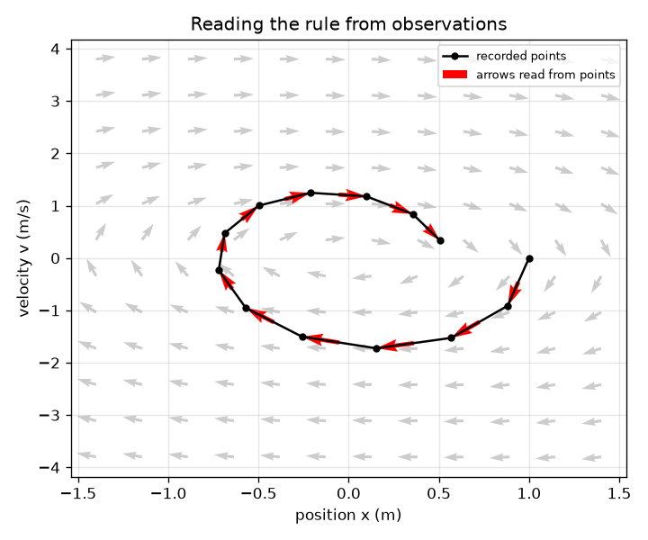
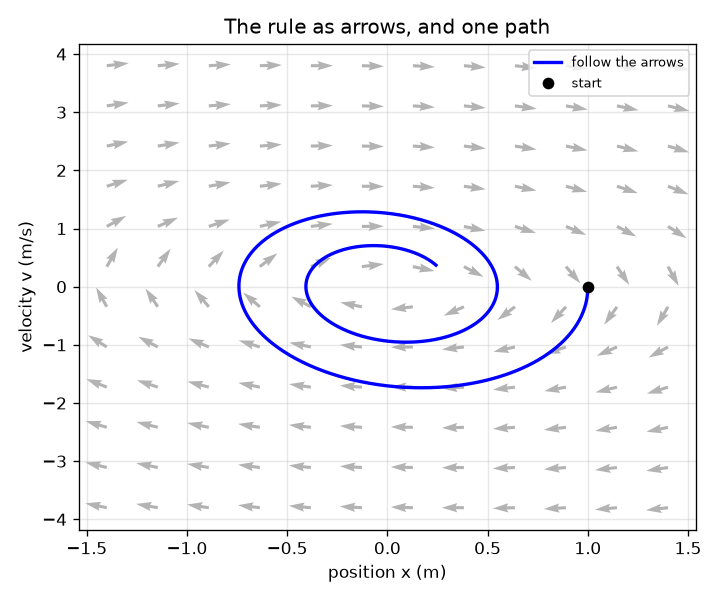

# Session 1: A rule for change: dx/dt = f(x)

[Session 1 — हिन्दी](README.hi.md)

*Level 1 (conceptual interactive model) · about 60 minutes · openneuralode*

> This is a simplified educational model. It is not a validated design tool and must not be used for real structures, electrical installations, vehicles, industrial processes or medical decisions.

**Prerequisites**

- The idea of a rate of change: speed is how fast position changes.
- You have read PRIMER.md and run `python start.py 1` once.

**Learning objectives.** After this session you can:

- Explain what the rule dx/dt = f(x) says and draw it as a field of arrows.
- Follow the arrows step by step to get a path.
- Read the arrows back from recorded points, which is the idea behind learning f from data.
- Read a spiral in the position-velocity plane as a mass that loses energy to friction.

## A. Real-world problem
A mass hangs on a spring and wobbles to a stop. You could try to write the whole path as a formula, or you could ask a smaller question that is true at every instant: if the mass is HERE and moving THIS fast, how is it changing right now? The answer is a rule dx/dt = f(x). Once you have the rule, a computer can predict the path from any start. A neural network can learn the rule f from recorded positions, even when you do not know the physics. How do we picture such a rule, and how do we get it from data?

## B. Concept and theory
The state of the system is a list of numbers; for the spring it is the pair (x, v): position and velocity. The rule f gives, for every state, an arrow showing how the state is changing: its first number is dx/dt and its second is dv/dt. Following the arrows means: start somewhere, move a short time dt along the arrow, look at the new arrow, repeat. The paths you get never cross, because the rule depends only on where you are. For the spring with friction the rule is dx/dt = v and dv/dt = -k x - c v: the spring pulls back in proportion to the stretch and friction slows the motion. With k = 4 and c = 0.4 the path is a spiral: the mass swings back and forth with angular frequency sqrt(k - c^2/4), about 1.99 rad/s, and the size of the swing shrinks like exp(-c t / 2). To read the rule from observations, take two neighbouring snapshots and divide the change by the time between them.

| Symbol | Meaning | Unit |
|---|---|---|
| x | position of the mass from its rest point | m |
| v | velocity of the mass | m/s |
| k | spring stiffness divided by mass | 1/s^2 |
| c | friction divided by mass | 1/s |
| f(x, v) | the arrow: (dx/dt, dv/dt) at a state | m/s and m/s^2 |
| dt | time between recorded snapshots or between solver steps | s |

**Assumptions**

- The spring is linear and the friction is proportional to the speed (a simplified model).
- The motion is one-dimensional and the mass is 1 unit (k and c are already divided by it).
- The sensor records position and velocity without noise in this session; noise comes in Session 2.

$$ \frac{dx}{dt}=v,\qquad \frac{dv}{dt}=-k\,x-c\,v $$

$$ \mathbf s_{\text{next}}=\mathbf s+\Delta t\,f(\mathbf s)\quad\text{(one step along the arrow)} $$

$$ f_{\text{estimated}}\approx\frac{\mathbf s_{i+1}-\mathbf s_i}{\Delta t} $$

$$ x(t)=e^{-ct/2}\Big(\cos\omega_d t+\frac{c}{2\omega_d}\sin\omega_d t\Big),\qquad \omega_d=\sqrt{k-c^2/4} $$

## C. Visual explanation
The first figure draws the rule as grey arrows (only their directions) in the position-velocity plane, with the path made by following them from (1 m, 0) as a blue curve. The path spirals inwards: each loop is smaller because friction removes energy. The second figure shows recorded points (black) and the arrows estimated from them (red) on top of the true arrows: the red arrows lie along the grey ones, which is exactly what a network is trained to do, with many more points.

*Recorded points (black) and the arrows read from them (red) lie along the true arrows (grey).*

*The rule as arrows (directions only, grey) and the path obtained by following them from (1 m, 0) (blue).*

## D. Interactive simulation
Run the lesson (`python start.py 1`), then open the live app: [Session 1: the rule as arrows](https://krunalpanchal1995.github.io/pan-iit-oss/openneuralode/session-01/) (or `app.html` in this folder). Move the stiffness and friction sliders and watch the spiral in the phase view change; set friction to 0 and see a closed loop. Switch to the time view to see position and velocity against time, and move the time slider T to see where the mass is at T in the spring picture.

**Challenge.** Make the wobble envelope exp(-c T / 2) fall below 0.1 at the chosen time T.

## E. Worked example and experiment
**Problem.** For k = 4 and c = 0.4, find the arrow at the state (x, v) = (1 m, 0) and at (0, 2 m/s), and take one step of 0.1 s along the first arrow.

1. At (1, 0): dx/dt = v = 0 and dv/dt = -4 * 1 - 0.4 * 0 = -4 m/s^2. The arrow is (0, -4): the mass is momentarily at rest and starts to speed up towards the rest point.
2. At (0, 2): dx/dt = 2 m/s and dv/dt = -4 * 0 - 0.4 * 2 = -0.8 m/s^2. The arrow is (2, -0.8): the mass moves forward and friction slows it slightly.
3. One step of 0.1 s from (1, 0): new state = (1, 0) + 0.1 * (0, -4) = (1.0, -0.4).
4. Check by thought: after 0.1 s the mass has barely moved (still about 1 m) and has picked up a velocity of about -0.4 m/s. That is reasonable.

**Answer.** The arrow at (1, 0) is (0, -4) and the arrow at (0, 2) is (2, -0.8). One step of 0.1 s from (1, 0) lands at (1.0, -0.4).

**Experiment.** Hang a small bag of rice on a spring or a long rubber band and film it from the side at 30 frames per second. Put a ruler beside it, read the position in every frame, and divide the change between neighbouring frames by 1/30 s to get the velocity. Plot position against velocity: you should see a spiral. Model versus reality: rubber bands are not linear springs and friction is not exactly proportional to the speed, so the spiral will not match the formula exactly, and dividing by a small time step multiplies every reading error by 30, so the velocities look noisy.

## F. Assessment and design challenge
**Question type A: Conceptual.** At the state (1 m, 0) the arrow is (0, -4). Why is the first number zero even though the mass is about to move?

Hint

The first number is dx/dt, the speed. What is the speed at this state?

Step-by-step solution

The first number is dx/dt = v, and at this state v = 0: the mass is momentarily at rest at the end of its swing. It is the second number, dv/dt = -4, that says the velocity is about to change. The arrow tells how the state is changing now, not where the mass will be; position changes only after the velocity has changed.

**Question type B: Numerical.** For k = 4 and c = 0.4, find the arrow at (0, 2 m/s) and the state after one step of 0.1 s along it. Give units and check that the answer is reasonable.

Hint

dx/dt = v and dv/dt = -k x - c v. New state = old state + 0.1 * arrow.

Step-by-step solution

Arrow = (2 m/s, -0.8 m/s^2). New state = (0, 2) + 0.1 * (2, -0.8) = (0.2 m, 1.92 m/s). Sanity check: in 0.1 s at about 2 m/s the mass moves about 0.2 m, and friction takes about 0.08 m/s off the speed. Both match.

**Question type C: Graph and simulation interpretation.** In the phase view, why does the path spiral inwards when friction c is above 0 and form a closed loop when c = 0? Where would the path end?

Hint

Energy per unit mass is 0.5 (v^2 + k x^2). What does friction do to it?

Step-by-step solution

Friction removes energy, so each loop is smaller: with c = 0.4 the energy has fallen to below a fifth of its start after 6 s. With c = 0 nothing removes energy, so the path repeats the same loop forever (the energy stays 2.0 for the start (1, 0)). With friction the path ends at the centre (0, 0): the mass at rest at the rest point.

**Question type D: Design and optimisation challenge.** Design: you record the mass with a sensor that gives a snapshot every dt seconds, and you want the arrows read from neighbouring snapshots to be within 1 percent of the true rule. Is dt = 0.25 s good enough? Is 0.1 s?

Hint

Use arrow_error(dt) in the lesson: the largest relative gap between estimated and true arrows.

Step-by-step solution

At dt = 0.25 s the gap is between 1 and 3 percent, so it fails the 1 percent requirement; at dt = 0.1 s the gap is below 1 percent, so it passes. Trade-off: a faster sensor gives better arrows, but with a real sensor noise is multiplied by 1/dt, so you cannot make dt arbitrarily small (Session 2 shows this).

Score yourself with [RUBRIC.md](../../RUBRIC.md). Print the [activity sheet](activity_sheet.md) to work on paper.

## Common misconceptions
| Common misconception | What is actually true |
|---|---|
| The arrow tells me where the mass will be. | The arrow tells how the state is changing right now. The path comes from following many arrows one after another. |
| Two different paths can cross in the phase plane. | The rule depends only on the state, so there is one arrow at each point and paths cannot cross (they may approach the same end point). |
| Friction makes the position decrease. | Friction removes energy, so the swing shrinks; the position still goes up and down. Only the size of the swing decays. |
| A neural network must know the physics to predict the motion. | The network only sees the recorded states and learns arrows from them. It works only where there is data. |

## Glossary
- **state**: the list of numbers that describes the system at an instant; here position and velocity
- **vector field**: a rule that attaches an arrow to every state
- **phase plane**: the picture whose axes are the state variables, here position and velocity
- **trajectory**: the path of the state through time
- **Euler step**: moving along the arrow for a short time dt
- **envelope**: the curve that bounds the size of the swing, here exp(-c t / 2)

## Finish
1. Do the three coding tasks in [exercises.md](exercises.md).
2. Run `python start.py 1` again after your changes. It ends with the checkpoint; when it prints `PASS`, you are done. (Checkpoint only: `python start.py check 1`.)

Next: [Session 2](../session-02/README.md)
