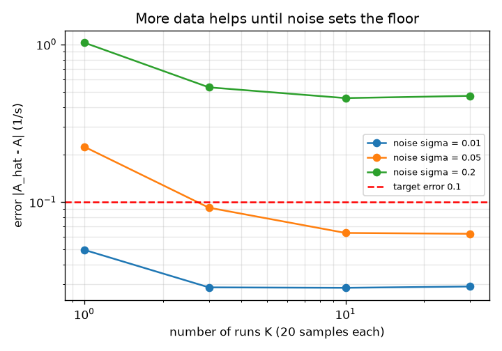
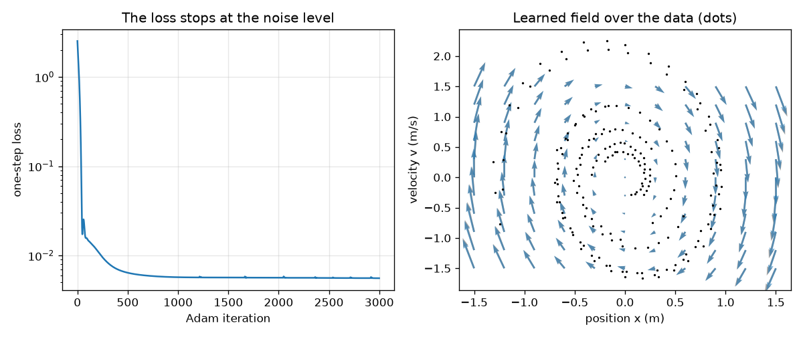
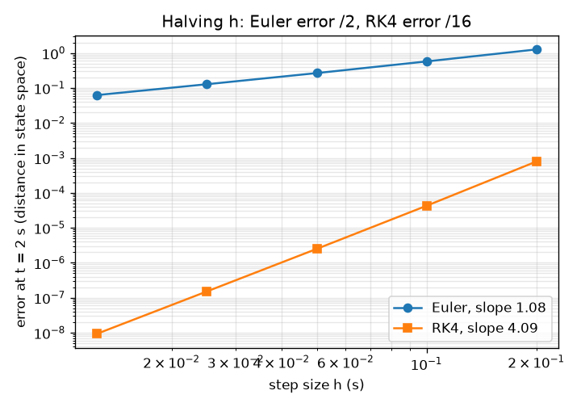

# Session 2: Solvers, least squares and a first neural network

*Level 2 (mathematical engineering model) · about 75 minutes · openneuralode*

> This is a simplified educational model. It is not a validated design tool and must not be used for real structures, electrical installations, vehicles, industrial processes or medical decisions.

**Prerequisites**

- Session 1: the rule dx/dt = f(x), arrows and Euler steps.
- Reading a straight line on a log-log graph (slope = exponent); explained in Section B.

**Learning objectives.** After this session you can:

- Measure the order of accuracy of Euler (1) and RK4 (4) from an error against step size graph.
- Fit a linear rule from noisy data with least squares, using derivatives estimated from the data.
- Train a one-hidden-layer tanh network on one-step differences with hand-written backpropagation and Adam.
- Answer a design question: how many runs and how little noise give an accurate fit?

## A. Real-world problem
A noisy sensor watches the mass on a spring. We want a rule that predicts where the mass will be 3 seconds from now. Two things decide whether this works: how we integrate the rule (a crude solver adds its own error) and how we get the rule from noisy data (a fit can be hurt by noise, and extra data only helps up to a point). How accurate are the solvers, how well can a simple fit and a small network recover the rule, and how much data and how little noise do we need?

## B. Concept and theory
A solver replaces the exact path by steps of size h. Euler follows the arrow once per step; RK4 samples the arrow four times (start, two midpoints, end) and blends them with weights 1, 2, 2, 1 over 6. The error at a fixed time T behaves like C h^p; taking logarithms gives log(error) = log C + p log h, a straight line of slope p: the order. Euler has p = 1 and RK4 has p = 4, so halving h divides the error by about 2 for Euler and by about 16 for RK4. To learn the rule from data, first estimate derivatives at each sample from its two neighbours, (x_{i+1} - x_{i-1}) / (2 dt) (a central difference). If we believe the rule is linear, f(x) = A x, the best A minimises the sum of squared differences between the estimated derivatives and A x: linear least squares. A neural network f(x) = W2 tanh(W1 x + b1) + b2 can represent rules that are not linear. With 16 hidden units it has 82 numbers, found by gradient descent on the mean squared difference between its output and the estimated derivatives (the one-step loss). Gradients are computed by hand with the chain rule (backpropagation) and the numbers are updated with Adam, which scales each step by a running average of recent gradients. Noise in the data is multiplied by 1/dt when we form derivatives, and noise in the inputs biases a least-squares fit, so more data helps only until this floor is reached.

| Symbol | Meaning | Unit |
|---|---|---|
| h | solver step size | s |
| p | order of accuracy (slope on log-log axes) | no unit |
| A | 2x2 matrix of the linear rule f(x) = A x | 1/s |
| sigma | size of the sensor noise on positions and velocities | m and m/s |
| K | number of recorded runs (each 20 samples) | no unit |
| W1, b1, W2, b2 | network weights: 16x2, 16, 2x16 and 2 numbers | no unit |

**Assumptions**

- The truth is the spring with k = 4 per s^2 and c = 0.4 per s; we pretend not to know it.
- Noise is independent Gaussian noise on every recorded number.
- The network is trained only inside the box |x| and |v| up to 1.5; outside, nothing is claimed.

$$ x_{n+1}=x_n+h\,f(x_n)\quad\text{(Euler)} $$

$$ x_{n+1}=x_n+\frac h6\,(k_1+2k_2+2k_3+k_4),\; k_1=f(x_n),\; k_2=f(x_n+\tfrac h2k_1),\; k_3=f(x_n+\tfrac h2k_2),\; k_4=f(x_n+hk_3) $$

$$ \text{error}(h)\approx C\,h^{p}\;\Rightarrow\;\log(\text{error})=\log C+p\,\log h $$

$$ \hat A=\arg\min_A\sum_i\|\dot x_i-A x_i\|^2,\qquad \dot x_i\approx\frac{x_{i+1}-x_{i-1}}{2\,\Delta t} $$

$$ f_\theta(x)=W_2\tanh(W_1x+b_1)+b_2,\qquad L=\operatorname{mean}\|f_\theta(x_i)-\dot x_i\|^2 $$

## C. Visual explanation
The first figure plots the error of Euler and RK4 at t = 2 s against the step size on log-log axes: two straight lines, one with slope close to 1 and one with slope close to 4. The second figure shows how well least squares recovers the rule as we add runs, for three noise levels. The curves fall and then go flat: with noise 0.2 the floor is far above the target error of 0.1. The third figure shows the one-step loss of the network falling and then stopping at the noise level, and the learned arrows lying over the true arrows where the data are.

*Least-squares fit error against the number of runs for three noise levels; the red line is the target error 0.1.*

*Left: one-step loss of the network. Right: learned arrows (blue) over true arrows (grey) with the data (dots).*

*Error at 2 s against step size on log-log axes: slope close to 1 for Euler and close to 4 for RK4.*

## D. Interactive simulation
Run the lesson (`python start.py 2`), then open the live app: [Session 2: Euler against RK4](https://krunalpanchal1995.github.io/pan-iit-oss/openneuralode/session-02/) (or `app.html` in this folder). Change the step size and watch the Euler and RK4 paths against the exact one in the path view; then open the error view and see the error drop with slopes 1 and 4 as you move h, and change the time T and the friction c.

**Challenge.** Find a step h of at least 0.1 s for which RK4 is accurate to better than 1e-4 while Euler is still off by more than 0.1.

## E. Worked example and experiment
**Problem.** From the state (1 m, 0) with k = 4 and c = 0.4, take one step of h = 0.1 s with Euler and with RK4, and compare with the exact state.

1. Euler: the arrow at (1, 0) is (0, -4), so the new state is (1, 0) + 0.1 * (0, -4) = (1.0, -0.4).
2. RK4 stage 1: k1 = (0, -4). Stage 2 at (1, 0) + 0.05 * k1 = (1, -0.2): k2 = (-0.2, -3.92). Stage 3 at (1, 0) + 0.05 * k2 = (0.99, -0.196): k3 = (-0.196, -3.8816).
3. RK4 stage 4 at (1, 0) + 0.1 * k3 = (0.9804, -0.38816): k4 = (-0.38816, -3.766336).
4. Blend: (0.1 / 6) * (k1 + 2 k2 + 2 k3 + k4) = (0.1 / 6) * (-1.18016, -23.369536) = (-0.01967, -0.38949), so the new state is (0.98033, -0.38949).
5. The exact state at t = 0.1 s is (0.9803, -0.3895). Euler is off by about 0.022 in state distance; RK4 is within 1e-5.

**Answer.** Euler gives (1.0, -0.4), RK4 gives (0.9803, -0.3895) (equal to the exact state to 1e-5). Euler's error for this one step is about 0.022.

**Experiment.** Record a real oscillation with a phone camera (a mass on a spring or a long pendulum), read positions every 0.1 s, and fit a 2x2 matrix by least squares on the central-difference derivatives. Predict the next 3 s with RK4 and compare with the film. The prediction will drift: the real system has friction that is not exactly linear, the reading error is multiplied by 1/dt in the derivatives, and a real spring is not perfectly linear for large stretches. The model is exact for the simulated spring and only approximate for the real one.

## F. Assessment and design challenge
**Question type A: Conceptual.** With noise 0.2 the fit error stays above 0.3 even with 30 runs, while with noise 0.01 a handful of runs is enough. Why does more data not fix the noisy case?

Hint

Where does the noise end up when you form derivatives and when you use noisy positions as inputs?

Step-by-step solution

Two effects do not average away. Derivative estimates divide noise by 2 dt, so each derivative is very noisy. And the noisy positions are also the inputs of the fit, which biases a least-squares line (it pulls the fitted rule towards zero). Averaging more runs reduces the random part but not this bias, so the error flattens at a floor set by the noise level. Only less noise (a better sensor) or a better method lowers it.

**Question type B: Numerical.** The Euler error at 2 s is 0.575 for h = 0.1. Predict the error for h = 0.025 using the order p = 1, then compare with the measured value 0.128. What would an order-4 method predict from its error 4.3e-5 at h = 0.1?

Hint

Error scales like h^p: dividing h by 4 divides the error by 4^p.

Step-by-step solution

Euler: 0.575 / 4 = 0.144, measured 0.128; the guess is close but not exact because the step is still coarse. RK4: 4.3e-5 / 4^4 = 4.3e-5 / 256 = 1.7e-7. Units: distance in state space (m and m/s mixed, as one number). Sanity check: RK4 needs 4 arrow evaluations per step but a 4 times smaller step is not needed, so it is far cheaper for the same accuracy.

**Question type C: Graph and simulation interpretation.** In the error graph, how do you read the order of a method, and what would a slope of 2 mean? What happens to RK4 if h becomes extremely small?

Hint

Slope on log-log axes is the exponent of h. At some point other errors take over.

Step-by-step solution

The slope of the straight line is the exponent p in error = C h^p: a slope of 2 would mean that halving h divides the error by 4. For extremely small h, rounding errors of the computer (about 1e-16 relative) dominate and the curve flattens, so decreasing h further no longer helps.

**Question type D: Design and optimisation challenge.** Design: the sensor noise can be 0.01, 0.05 or 0.2 and you can record K = 1, 3, 10 or 30 runs of 20 samples. You need a fit error (|A_hat - A|) below 0.1. Which combinations work, and which sensor and how many runs would you choose?

Hint

Use mean_fit_error(K, sigma) from the lesson; remember that extra runs cost time.

Step-by-step solution

Noise 0.01 passes with a single run (below 0.1). Noise 0.05 fails with 1 run (above 0.1), just passes on average with 3 runs (between 0.08 and 0.1, so with little margin) and passes safely with 10 runs. Noise 0.2 fails for every K (above 0.3 even with 30 runs). Choice: the 0.05 sensor with 10 runs is a safe passing design; a sensor with noise 0.2 cannot be rescued by more data. Trade-off: a 0.01 sensor costs more but needs one run.

Score yourself with [RUBRIC.md](../../RUBRIC.md). Print the [activity sheet](activity_sheet.md) to work on paper.

## Common misconceptions
| Common misconception | What is actually true |
|---|---|
| A smaller step is always better. | Smaller steps reduce the solver error until the computer's rounding error takes over; and each step costs time. |
| A neural network always beats a simple fit. | If the truth is linear, a 4-number least-squares fit is more accurate than an 82-number network; the network pays off when the rule is not linear. |
| More data always fixes noise. | Averaging removes random scatter but not the bias caused by noisy inputs and amplified derivatives; below the noise floor only better data helps. |
| Low training loss means a good rule. | The one-step loss only says the arrows match at the data points; it says nothing about the path made by thousands of steps (Session 3). |

## Glossary
- **order of accuracy**: the exponent p in error = C h^p; Euler 1, RK4 4
- **least squares**: choosing the numbers that make the sum of squared mismatches smallest
- **central difference**: estimating a derivative from the neighbours on both sides
- **backpropagation**: the chain rule used to get the gradient of the loss with respect to every weight
- **Adam**: gradient descent that scales each step by running averages of the gradient and its square
- **noise floor**: the error that remains however much data you add

## Finish
1. Do the three coding tasks in [exercises.md](exercises.md).
2. Run `python start.py 2` again after your changes. It ends with the checkpoint; when it prints `PASS`, you are done. (Checkpoint only: `python start.py check 2`.)

Next: [Session 3](../session-03/README.md)
