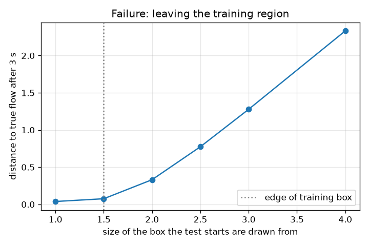
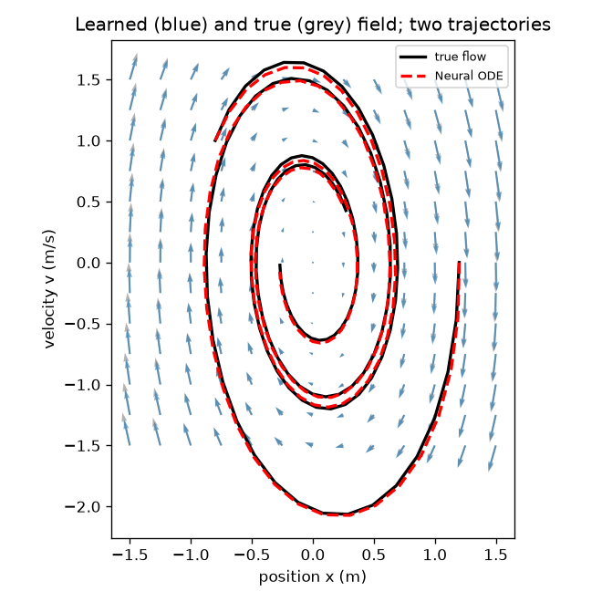
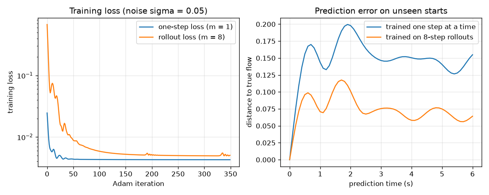

# Session 3: A Neural ODE trained through the solver

*Level 3 (simulation and validation) · about 90 minutes · openneuralode*

> This is a simplified educational model. It is not a validated design tool and must not be used for real structures, electrical installations, vehicles, industrial processes or medical decisions.

**Prerequisites**

- Session 1: the rule dx/dt = f(x).
- Session 2: RK4, the one-hidden-layer network, backpropagation and Adam.

**Learning objectives.** After this session you can:

- Train a network as the right-hand side of an ODE with a rollout loss, using hand-coded backpropagation through RK4.
- Compare one-step training and rollout training and show the error growth with prediction time.
- Validate the result against a known linear system: eigenvalues and trajectories.
- Explain and reproduce three failure cases (stiffness, extrapolation, overfitting) and the effect of noise and horizon.

## A. Real-world problem
In Session 2 the network was trained on single steps. When the sensor is noisy, the noise leaks into the learned rule, and small mistakes in the rule pile up when we predict many steps ahead. A Neural ODE changes what we train: the network is the right-hand side of an ODE, the ODE is solved with RK4, and the loss is measured on the solver's output several steps later. Does that give better long predictions? How do we know the learned flow is right? And where does the whole idea break?

## B. Concept and theory
The model is dx/dt = f_theta(x) with f_theta(x) = W2 tanh(W1 x + b1) + b2 (width 12: 62 numbers). Starting from every observed state we run m RK4 steps of size 0.1 s and compare each step with the next observation; the loss is the mean squared difference. m = 1 is the one-step loss through the solver, m = 8 the rollout loss. To minimise it we need the gradient of the loss with respect to the 62 numbers. We compute it by hand-coded backpropagation through the RK4 steps (discretise then optimise): the sensitivity of the loss to the state after a step is pushed back through the four stages in reverse order, each stage using the network's vector-Jacobian product. This gives the exact gradient of the discrete loss, which we check against finite differences in the checkpoint. The adjoint method, described here only as a concept, instead solves a second ODE backwards in time for the sensitivities; its benefit is that memory does not grow with the number of solver steps, while backpropagation through the solver stores every step. To validate, we use a system with a known answer: the damped oscillator is linear, so its flow is governed by the eigenvalues of A, here -0.2 plus or minus 1.99 i. The learned network has a Jacobian at the origin, W2 diag(1 - tanh(b1)^2) W1, whose eigenvalues should match. Explicit RK4 multiplies the state by R(z) = 1 + z + z^2/2 + z^3/6 + z^4/24 per step with z = lambda h; it is stable only if |R(z)| is at most 1, which on the negative real axis means z above -2.785. A stiff rule (large negative lambda) therefore forces tiny steps.

| Symbol | Meaning | Unit |
|---|---|---|
| f_theta | the neural network, the right-hand side of the ODE | 1/s times state |
| theta | the 62 network numbers | no unit |
| m | rollout horizon: number of RK4 steps in the loss | no unit |
| h | RK4 step, equal to the time between observations (0.1 s) | s |
| sigma | noise on observed states | state units |
| lambda | eigenvalue of the rule; z = lambda h | 1/s and no unit |
| R(z) | factor by which explicit RK4 multiplies the state per step | no unit |

**Assumptions**

- The truth is the linear damped oscillator (k = 4 per s^2, c = 0.4 per s) for validation; a damped pendulum for the mini-project.
- Noise is independent Gaussian noise on every observed number; the full state is observed.
- Training uses 6 runs of 25 samples (0.1 s apart) in the box up to 1.5; tests use 20 unseen starts.

$$ \dot x=f_\theta(x),\qquad f_\theta(x)=W_2\tanh(W_1x+b_1)+b_2 $$

$$ L(\theta)=\frac1{|S|}\sum_{\text{starts}}\sum_{j=1}^{m}\big\|\Phi_h^{\,j}(x_i;\theta)-x_{i+j}\big\|^2,\quad \Phi_h=\text{one RK4 step} $$

$$ \bar x_{n}=\bar x_{n+1}+\sum_{s=1}^{4}J_s^{\mathsf T}\bar k_s,\qquad \bar k_{1,2,3,4}=\tfrac h6,\tfrac h3,\tfrac h3,\tfrac h6\ \text{times}\ \bar x_{n+1}\ \text{plus the corrections of later stages} $$

$$ R(z)=1+z+\frac{z^2}2+\frac{z^3}6+\frac{z^4}{24},\qquad |R(z)|\le1\iff z\ge-2.785\ \ (\text{real axis}) $$

$$ A_{\text{learned}}=\frac{\partial f_\theta}{\partial x}\Big|_{0}=W_2\,\mathrm{diag}\big(1-\tanh^2 b_1\big)\,W_1 $$

## C. Visual explanation
The first figure has two panels. On the left the training loss of the one-step model and of the rollout model (log scale); on the right the distance between the learned and the true flow against prediction time on 20 unseen starts: the rollout-trained model stays well below the one-step model, which settles at a higher plateau (the true flow decays to rest, so errors cannot grow without limit). The second figure overlays the learned arrows (blue) on the true arrows (grey) and shows two predicted paths (red dashed) lying on the true paths (black). The third figure shows the failure case: the error after 3 s is small inside the training box and rises sharply for starts outside it.

*Failure case: the error after 3 s against the size of the box the test starts are drawn from; the dotted line is the training box.*

*Learned arrows (blue) over true arrows (grey), with two predicted paths (red dashed) on top of the true paths (black).*

*Left: training loss for one-step and rollout training. Right: error of the learned flow against prediction time on unseen starts.*

## D. Interactive simulation
Run the lesson (`python start.py 3`), then open the live app: [Session 3: rollout training and stiffness](https://krunalpanchal1995.github.io/pan-iit-oss/openneuralode/session-03/) (or `app.html` in this folder). In the error view move the noise and the horizon sliders and watch the blue curve (rollout-trained) against the red curve (one-step trained). Then open the stiffness view and move lambda and h to see the factor per step |R(z)| cross 1 at z = -2.785.

**Challenge.** Make explicit RK4 blow up on the stiff problem: choose lambda and h so that the factor per step |R(z)| is above 1.

## E. Worked example and experiment
**Problem.** A stiff system has x' = -1000 x. With RK4 and h = 0.01 s, what happens? What is the largest stable step, and what happens at h = 0.002 s?

1. z = lambda h = -1000 * 0.01 = -10.
2. R(-10) = 1 - 10 + 50 - 166.67 + 416.67 = 291. Each step multiplies the state by 291, while the true solution decays: the numerical solution explodes.
3. The stability limit on the negative real axis is z = -2.785, so h must be at most 2.785 / 1000 = 0.0028 s (more exactly 0.002785 s).
4. At h = 0.002: z = -2 and R(-2) = 1 - 2 + 2 - 1.3333 + 0.6667 = 1/3. The state shrinks by a third each step: stable.

**Answer.** At h = 0.01 the factor is 291 per step (blow-up); the largest stable step is about 0.0028 s; at h = 0.002 s the factor is 1/3 (stable).

**Experiment.** Hands-on: take a stiff test problem, for example a fast cooling coffee cup model with a very short time constant, and integrate it with explicit RK4 at increasing step sizes; plot the result and note the step where it starts to oscillate and grow. Then train the Neural ODE of this session on a damped oscillator with noise 0.1 and compare its prediction with a 3 second measurement. Model versus reality: a real sensor adds errors that are not Gaussian, a real system is not exactly linear, and the stiff limit depends on the fastest process in the system, which you may not have measured.

## Real-world application and mini-project: Learn a damped pendulum from noisy data and predict forward
A lab records a damped pendulum with a noisy angle sensor: 8 runs of 31 samples, 0.1 s apart, starting at random angles and speeds between -2 and 2 (rad, rad/s), noise sigma = 0.03. The rule is theta' = omega and omega' = -4 sin(theta) - 0.3 omega, but pretend you do not know it. Use `pendulum_model` from Session 3 (a 16-unit Neural ODE trained on 8-step rollouts) and predict 6 s ahead from 20 unseen starting states between -1.8 and 1.8. Compare with the small-angle model that replaces sin(theta) by theta.

**Deliverable:** A script that trains the model, prints the angle error after 1, 3 and 6 s for the Neural ODE and for the small-angle model, and saves a picture of two predicted swings against the true ones.

**Success looks like:** The Neural ODE angle error after 6 s is below 0.1 rad, and the small-angle model is more than three times worse. Then raise sigma and report where your model stops being usable.

## F. Assessment and design challenge
**Question type A: Conceptual.** Why does rollout training give better long predictions than one-step training when the data are noisy?

Hint

In one-step training what is the target of each step, and what does the model see about the later steps?

Step-by-step solution

In one-step training each target is a single noisy next point close to the input, so the noise in it is as large as the change the model must learn, and noise in the input is treated as truth. Errors are never compounded during training, so small mistakes in the arrows that pile up over many steps are not penalised. In rollout training the loss is measured after 8 steps, where the signal (the true motion) is larger relative to the noise and the compounding of errors is part of the loss. The model is therefore pushed to be right over the horizon we care about. In the lesson, one-step training is more than twice as bad after 6 s.

**Question type B: Numerical.** For lambda = -500 per s, find the largest stable RK4 step. Does h = 0.01 s work? Give R(z) for h = 0.004 s and state the units.

Hint

The stability limit is z = lambda h = -2.785.

Step-by-step solution

h_max = 2.785 / 500 = 0.00557 s. For h = 0.01: z = -5, which is beyond the limit, so it is unstable (|R(-5)| is above 1). For h = 0.004: z = -2, R = 1/3, stable. R has no unit; h is in seconds. Sanity check: a faster process (larger |lambda|) needs a smaller step.

**Question type C: Graph and simulation interpretation.** In the error view, set the horizon to 8 and the noise to 0.0, 0.05 and 0.1. What happens to the error after 6 s, and why does the curve not grow without bound over time?

Hint

Compare the blue curve at 6 s for the three noise levels. What does the true system do at long times?

Step-by-step solution

The error rises with noise: it is several times larger at noise 0.1 than with no noise. It does not grow without bound because the true system is damped: both the true and the learned flow decay towards rest, so the distance between them is bounded by their own sizes. (For an unstable or chaotic system the error would grow.)

**Question type D: Design and optimisation challenge.** Design: the sensor noise is 0.1 and you need an error below 0.1 after 6 s. You can record 6 or 18 runs with the same 25 samples each. Which would you choose, and what are the trade-offs?

Hint

Use design_error(n_traj, sigma) in the lesson (worst error over two random data sets).

Step-by-step solution

With 6 runs the worst error over two data sets is above 0.1 so it fails; with 18 runs the worst error is below 0.1, so it passes. So choose 18 runs (3 times the data and about 3 times the training time), or, if recording is costly, buy a better sensor (noise 0.05 with 6 runs also passes). Trade-offs: more data costs recording time and training time, and it does not remove the risk when the noise is much larger.

Score yourself with [RUBRIC.md](../../RUBRIC.md). Print the [activity sheet](activity_sheet.md) to work on paper.

## Common misconceptions
| Common misconception | What is actually true |
|---|---|
| A Neural ODE is a different kind of network. | It is an ordinary network used as the right-hand side of an ODE. What is new is that the training loss is measured after the solver has run. |
| The learned eigenvalues will match the truth exactly. | They match approximately (here within 0.1), and with heavy noise they can be further off (try noise 0.1 and print them); the learned flow is only trusted where there is data. |
| A model that fits the training data better is better. | An over-large network on few noisy points reaches a lower loss than the true system itself, which means it is fitting the noise, and its predictions are worse. |
| The adjoint method is just a faster way to get the same gradient. | It saves memory (no stored steps), but it recomputes the trajectory backwards and can be inaccurate for unstable or stiff dynamics. |
| RK4 is stable for any step size because it is accurate. | Accuracy and stability are different: for stiff rules explicit RK4 blows up unless h is small enough that \|lambda\| h is at most 2.785. |

## Glossary
- **Neural ODE**: an ODE whose right-hand side is a neural network, trained through the solver
- **rollout**: running the solver for several steps from a starting state
- **vector-Jacobian product**: the product of a vector with the derivative matrix of a function; what backpropagation needs
- **adjoint method**: computing gradients by solving a second ODE backwards in time, to save memory
- **stiff**: a rule with a very fast decaying part, which forces tiny steps for explicit solvers
- **extrapolation**: predicting outside the region where the model saw data
- **overfitting**: fitting the noise in the data instead of the rule

## Finish
1. Do the three coding tasks in [exercises.md](exercises.md).
2. Run `python start.py 3` again after your changes. It ends with the checkpoint; when it prints `PASS`, you are done. (Checkpoint only: `python start.py check 3`.)

Next: the [roadmap](../../promo/roadmap.md). Session 4 is yours to build.
