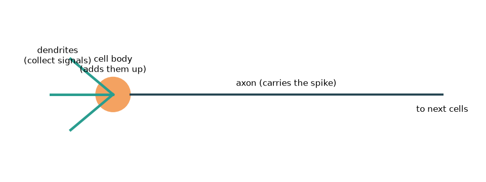
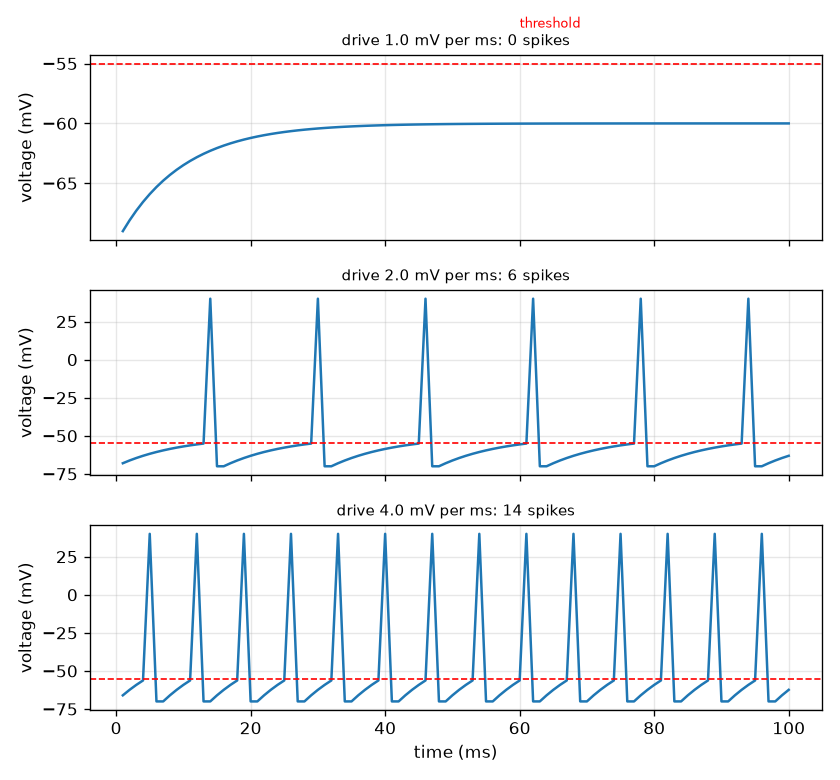

# सत्र 1: एक न्यूरॉन संकेतों को जोड़ता है और एक स्पाइक दागता है

*स्तर 1 (संकल्पनात्मक इंटरैक्टिव मॉडल) · लगभग 60 मिनट · openneuron*

> यह एक सरलीकृत शैक्षिक मॉडल है। यह कोई प्रमाणित डिज़ाइन टूल नहीं है और इसका उपयोग वास्तविक संरचनाओं, विद्युत स्थापनाओं, वाहनों, औद्योगिक प्रक्रियाओं या चिकित्सा निर्णयों के लिए नहीं किया जाना चाहिए।

**पूर्व-आवश्यकताएँ (Prerequisites)**

- स्कूल अंकगणित और वोल्टेज (voltage) का विचार (विद्युत आवेश पर एक धक्का)।
- आपने PRIMER.md पढ़ लिया है और `python start.py 1` एक बार चला लिया है।

**सीखने के उद्देश्य (Learning objectives)।** इस सत्र के बाद आप:

- वर्णन कर सकेंगे कि एक न्यूरॉन (neuron) संकेत कैसे इकट्ठा करता है, उन्हें जोड़ता है और एक सीमा-मान (threshold) पर सब-या-कुछ-नहीं (all-or-nothing) वाला स्पाइक (spike) दागता है।
- उठान-और-रिसाव (rise-and-leak) अद्यतन का उपयोग करके अनुमान लगा सकेंगे कि क्या एक स्थिर निवेश कभी न्यूरॉन को दाग सकता है।
- वोल्टेज-बनाम-समय अनुरेख (trace) पढ़ सकेंगे और स्पाइक को सीमा-मान से नीचे की हलचल से अलग पहचान सकेंगे।
- किसी अक्षतंतु (axon) के साथ स्पाइक की देरी उसकी लंबाई और चाल से निकाल सकेंगे।

## A. वास्तविक दुनिया की समस्या
हर विचार, स्पर्श और गति तंत्रिका कोशिकाओं द्वारा ले जाई जाती है जो स्पाइक कहलाने वाली संक्षिप्त विद्युत स्पंदों (pulses) से बात करती हैं। एक न्यूरॉन अपनी शाखाओं (द्रुमिकाएँ, dendrites) पर अन्य कोशिकाओं से संकेत प्राप्त करता है, उन्हें अपने कोशिका काय (cell body) में जोड़ता है, और, यदि कुल वोल्टेज एक सीमा-मान को पार करता है, तो एक स्पाइक दागता है जो उसके लंबे तार (अक्षतंतु) के साथ दौड़ता है। एक हल्का स्पर्श कम स्पाइक बनाता है और एक ज़ोरदार धक्का कई, पर हर स्पाइक एक जैसा दिखता है। एक कोशिका एक सहज निवेश को इस चालू-बंद संकेत में कैसे बदल सकती है? यह repo केवल सामान्य शिक्षा है: यह एक सरलीकृत मॉडल दिखाता है, चिकित्सा जानकारी नहीं।

## B. संकल्पना और सिद्धांत
हम कोशिका के भीतर बाहर के सापेक्ष वोल्टेज V को मिलीवोल्ट (mV) में मॉडल करते हैं। विराम पर यह V_rest = -70 mV (एक सामान्य पाठ्यपुस्तक मान) पर रहता है। हर मिलीसेकंड निवेश V को चालन (drive) d (mV प्रति ms) से ऊपर धकेलता है और एक रिसाव (leak) इसे दूरी के k = 0.1 अंश से विराम की ओर वापस खींचता है। यदि चालन स्थिर है, तो V, V_rest + d / k पर स्थिर हो जाता है। एक सीमा-मान V_th = -55 mV दागने का निर्णय करता है: जब V उस तक पहुँचता है, न्यूरॉन निश्चित ऊँचाई का एक स्पाइक दागता है, V विराम पर रीसेट होता है, और 2 ms का दुर्दम्य समय (refractory time) आता है जिसके दौरान यह फिर से नहीं दाग सकता। एक स्थिर चालन न्यूरॉन को तभी दाग सकता है जब स्थिर होने का स्तर सीमा-मान से ऊपर हो, जिसका अर्थ है d > k (V_th - V_rest) = 1.5 mV प्रति ms। स्पाइक शुरू होने के बाद, यह अक्षतंतु के साथ लगभग स्थिर चाल v से चलता है, इसलिए लंबाई L पर देरी L / v है।

| प्रतीक | अर्थ | इकाई |
|---|---|---|
| V | झिल्ली वोल्टेज (भीतर घटा बाहर) | mV |
| V_rest | विराम वोल्टेज, सामान्यतः -70 | mV |
| V_th | सीमा-मान वोल्टेज, सामान्यतः -55 | mV |
| d | चालन: हर मिलीसेकंड V में जोड़ा गया धक्का | mV per ms |
| k | प्रति मिलीसेकंड रिसाव अंश (0.1) | per ms |
| L, v | अक्षतंतु की लंबाई और स्पाइक की चाल | m, m per s |

**मान्यताएँ (Assumptions)**

- समय 1 ms के चरणों में चलता है।
- निवेश एक स्थिर चालन या धक्कों की एक सूची है, हर चरण में एक।
- हर स्पाइक की खींची गई ऊँचाई समान है (+40 mV) चाहे निवेश कुछ भी हो: सब या कुछ नहीं।
- सभी संख्याएँ सामान्य पाठ्यपुस्तक मान हैं; यह एक सरलीकृत शैक्षिक मॉडल है, चिकित्सा उपकरण नहीं।

$$ V_{n+1}=V_n+d-k\,(V_n-V_{\mathrm{rest}}) $$

$$ V_\infty=V_{\mathrm{rest}}+\frac{d}{k},\qquad d_{\min}=k\,(V_{\mathrm{th}}-V_{\mathrm{rest}}) $$

$$ \Delta t=\frac{L}{v} $$

## C. दृश्य व्याख्या
पहला चित्र एक न्यूरॉन का चित्र है: द्रुमिकाएँ संकेत इकट्ठा करती हैं, कोशिका काय उन्हें जोड़ता है, और अक्षतंतु स्पाइक को अगली कोशिकाओं तक ले जाता है। दूसरा चित्र कमज़ोर, मध्यम और प्रबल चालन के लिए तीन वोल्टेज अनुरेख दिखाता है। कमज़ोर चालन के साथ वोल्टेज धीरे-धीरे ऊपर सरकता है और लाल सीमा-मान रेखा के नीचे समतल हो जाता है: कोई स्पाइक नहीं। मध्यम और प्रबल चालन के साथ वोल्टेज बार-बार सीमा-मान तक पहुँचता है; हर स्पाइक की ऊँचाई समान है, पर प्रबल चालन अधिक बार दागता है (चालन 2.0 और 4.0 के लिए 100 ms में 6 बनाम 14 स्पाइक)।

*एक न्यूरॉन: द्रुमिकाएँ संकेत इकट्ठा करती हैं, कोशिका काय उन्हें जोड़ता है, अक्षतंतु स्पाइक ले जाता है।*

*कमज़ोर, मध्यम और प्रबल चालन के लिए वोल्टेज अनुरेख: स्पाइक की ऊँचाई समान, दर अलग।*

## D. इंटरैक्टिव सिमुलेशन
पाठ चलाइए (`python start.py 1`), फिर लाइव ऐप खोलिए: [सत्र 1: एक न्यूरॉन दागता है](https://krunalpanchal1995.github.io/pan-iit-oss/openneuron/session-01/) (या इसी फ़ोल्डर में `app.html`)। चालन को खिसकाइए और स्थिर-स्तर पट्टी को सीमा-मान चिह्न पार करते और वोल्टेज अनुरेख में स्पाइक शुरू होते देखिए; फिर अक्षतंतु की चाल खिसकाइए और लाल बिंदु तथा देरी को बदलते देखिए।

**चुनौती।** न्यूरॉन को दगवाइए (चालन 1.5 mV प्रति ms से ऊपर) और स्पाइक को 0.5 m अक्षतंतु को 5 ms से कम में पार करने दीजिए।

## E. हल किया गया उदाहरण और प्रयोग
**समस्या।** विराम से 2.0 mV प्रति ms का स्थिर चालन लगाया जाता है। क्या न्यूरॉन दागेगा, और कितने मिलीसेकंड बाद?

1. स्थिर स्तर: V_inf = -70 + 2.0 / 0.1 = -50 mV। यह -55 mV के सीमा-मान से ऊपर है, इसलिए यह दागेगा।
2. स्थिर चालन के साथ चढ़ाई V(n) = -70 + 20 (1 - 0.9^n) है। हमें V(n) = -55 चाहिए, जिसका अर्थ है 20 (1 - 0.9^n) = 15 और इसलिए 0.9^n = 0.25।
3. n = ln 0.25 / ln 0.9 = 13.16 चरण, इसलिए 13 चरण पर्याप्त नहीं हैं और 14 हैं।
4. जाँच: V(13) = -55.08 mV (सीमा-मान से ठीक नीचे) और V(14) = -54.58 mV (उससे ऊपर), इसलिए पहला स्पाइक चरण 14 पर, यानी 14 ms पर आता है।
5. सिमुलेशन सहमत है: पहला स्पाइक 14 ms पर है और 100 ms में 6 स्पाइक हैं।

**उत्तर।** हाँ। पहला स्पाइक 14 ms पर आता है (13.16 चरण, ऊपर की ओर पूर्णांकित), और न्यूरॉन 100 ms में 6 बार दागता है।

**प्रयोग।** एक वास्तविक न्यूरॉन को एक पतले काँच के इलेक्ट्रोड से रिकॉर्ड किया जा सकता है जबकि एक छोटी स्थिर धारा प्रविष्ट की जाती है: एक निश्चित धारा से नीचे वोल्टेज बस एक नए स्तर पर खिसक जाता है, उसके ऊपर स्पाइक दिखते हैं, और बड़ी धारा समान स्पाइकों की तेज़ श्रृंखला देती है। मॉडल उस गुणात्मक चित्र को दोहराता है। यह वास्तविक कोशिका से इस बात में भिन्न है कि वास्तविक स्पाइकों का आकार आयन चैनलों (ion channels) द्वारा तय होता है (सत्र 3), वास्तविक सीमा-मान हाल की गतिविधि के साथ खिसकते हैं, और वास्तविक निवेश एक स्थिर धक्का होने के बजाय शोर भरे होते हैं।

## F. मूल्यांकन और डिज़ाइन चुनौती
**प्रश्न प्रकार A: संकल्पनात्मक।** एक प्रबल उद्दीपन (stimulus) बड़ा स्पाइक नहीं बनाता। तो एक तंत्रिका मस्तिष्क को कैसे बताती है कि एक स्पर्श अधिक प्रबल है?

संकेत

कमज़ोर, मध्यम और प्रबल चालन के अनुरेखों की तुलना कीजिए: क्या बदला, और क्या वही रहा?

चरण-दर-चरण हल

स्पाइक की ऊँचाई निश्चित है (सब या कुछ नहीं), पर एक प्रबल निवेश हर स्पाइक के बाद वोल्टेज को जल्दी सीमा-मान तक वापस धकेलता है, इसलिए न्यूरॉन अधिक बार दागता है। प्रबलता दर (और कितने न्यूरॉन दागते हैं) द्वारा ले जाई जाती है, स्पाइक के आकार द्वारा नहीं। मॉडल में चालन 2.0, 100 ms में 6 स्पाइक देता है और चालन 4.0, 14 देता है, सभी समान ऊँचाई के।

**प्रश्न प्रकार B: संख्यात्मक।** 3.0 mV प्रति ms के स्थिर चालन के लिए वह स्तर ज्ञात कीजिए जिस पर वोल्टेज स्थिर होगा, और वह चरण जिस पर पहला स्पाइक होता है (हाथ से गणना, फिर कोड से जाँच)।

संकेत

स्थिर स्तर = -70 + d / 0.1। पहले स्पाइक के लिए 0.9^n = 1 - 15 (0.1) / d चाहिए।

चरण-दर-चरण हल

स्थिर स्तर = -70 + 3.0 / 0.1 = -40 mV, सीमा-मान से ऊपर। फिर 0.9^n = 1 - 1.5 / 3.0 = 0.5, इसलिए n = ln 0.5 / ln 0.9 = 6.58, ऊपर की ओर चरण 7 तक पूर्णांकित। कोड पहला स्पाइक 7 ms पर देता है। इकाई जाँच: चालन mV प्रति ms में है, इसलिए d / k, mV में है।

**प्रश्न प्रकार C: ग्राफ़ और सिमुलेशन की व्याख्या।** 1.0 mV प्रति ms चालन के अनुरेख में वोल्टेज उठता है और फिर सीमा-मान रेखा के नीचे समतल हो जाता है। यह किस स्तर पर समतल होता है, और कोई स्पाइक क्यों नहीं है?

संकेत

स्थिर स्तर -70 + d / 0.1 का उपयोग कीजिए और उसकी तुलना -55 से कीजिए।

चरण-दर-चरण हल

यह -70 + 1.0 / 0.1 = -60 mV पर समतल होता है, -55 mV के सीमा-मान से 5 mV नीचे। V के -60 तक पहुँचने पर रिसाव आवेश को उतनी ही तेज़ी से हटाता है जितनी तेज़ी से चालन उसे जोड़ता है, इसलिए वोल्टेज कभी -55 तक नहीं पहुँचता और कोई स्पाइक नहीं होता। चालन को 1.5 mV प्रति ms से ऊपर बढ़ाने से स्थिर स्तर सीमा-मान से ऊपर चला जाता है।

**प्रश्न प्रकार D: डिज़ाइन और इष्टतमीकरण (optimisation) चुनौती।** डिज़ाइन: एक मॉडल न्यूरॉन को 100 ms में कम से कम 10 बार दागना चाहिए, और एक स्पाइक को 0.5 m अक्षतंतु 5 ms से कम में पार करना चाहिए। एक चालन (0.5 mV प्रति ms के चरणों में) और एक अक्षतंतु चाल चुनिए, और बताइए कि आप कौन-सा समझौता (trade-off) देखते हैं।

संकेत

कोड से चालन 2.5, 3.0 और 3.5 के लिए स्पाइक गिनिए; देरी ms में 1000 L / v है।

चरण-दर-चरण हल

चालन 2.5 से 9 स्पाइक मिलते हैं (बहुत कम), चालन 3.0 से 11 स्पाइक और चालन 3.5 से 12, इसलिए 0.5 के चरणों में काम करने वाला सबसे छोटा चालन 3.0 mV प्रति ms है। देरी 1000 (0.5) / v < 5 ms है, इसलिए v को 100 m/s से अधिक होना चाहिए (100 m/s पर ठीक 5 ms)। समझौता: बड़ा चालन अधिक निवेश लेता है पर तेज़ी से दागता है; तेज़ अक्षतंतु को मोटे (या रोधित, insulated) तंतु की आवश्यकता होती है, जो अधिक जगह और सामग्री लेता है। मान्यता: स्थिर चालन और स्थिर चाल।

[RUBRIC.md](../../RUBRIC.md) से स्वयं को अंक दीजिए। कागज़ पर काम करने के लिए [गतिविधि पत्रक](activity_sheet.md) प्रिंट कीजिए।

## सामान्य भ्रांतियाँ (Common misconceptions)
| सामान्य भ्रांति | वास्तव में क्या सच है |
|---|---|
| एक प्रबल उद्दीपन बड़ा स्पाइक बनाता है। | स्पाइक सब-या-कुछ-नहीं होते हैं: ऊँचाई निश्चित है। एक प्रबल उद्दीपन अधिक बार स्पाइक बनाता है। |
| कोई भी निवेश, चाहे कितना भी कमज़ोर, प्रतीक्षा करने पर अंततः न्यूरॉन को दाग देता है। | रिसाव आवेश को उतनी ही तेज़ी से हटाता है जितनी तेज़ी से कमज़ोर निवेश उसे जोड़ता है, इसलिए वोल्टेज सीमा-मान से नीचे स्थिर हो जाता है और कभी नहीं दागता। |
| स्पाइक अक्षतंतु के साथ बहने वाली धारा है, जैसे ताँबे के तार में बिजली। | स्पाइक झिल्ली वोल्टेज का एक चलता हुआ परिवर्तन है जो रास्ते में पुनर्जनित (regenerated) होता है; यह तार में बिजली से बहुत धीमा है (मीटर प्रति सेकंड, हज़ारों किलोमीटर प्रति सेकंड नहीं)। |
| न्यूरॉन उतनी बार दाग सकता है जितना निवेश अनुमति दे। | हर स्पाइक के बाद एक दुर्दम्य समय होता है, इसलिए दर की एक ऊपरी सीमा है (इस खिलौना मॉडल में हर 3 ms में एक स्पाइक)। |

## शब्दावली (Glossary)
- **न्यूरॉन (neuron)**: एक तंत्रिका कोशिका जो विद्युत संकेत प्राप्त करती है, जोड़ती है और आगे भेजती है
- **स्पाइक (क्रिया विभव, action potential)**: झिल्ली वोल्टेज का एक संक्षिप्त, निश्चित आकार का स्पंद जो न्यूरॉन दागता है
- **सीमा-मान (threshold)**: वह वोल्टेज जिस पर न्यूरॉन दागता है
- **अक्षतंतु (axon)**: न्यूरॉन का लंबा तार जो स्पाइक को कोशिका काय से दूर ले जाता है
- **दुर्दम्य अवधि (refractory period)**: स्पाइक के बाद का छोटा समय जिसके दौरान न्यूरॉन फिर से नहीं दाग सकता
- **मिलीवोल्ट (mV)**: एक वोल्ट का हज़ारवाँ भाग, झिल्ली वोल्टेज की स्वाभाविक इकाई

## समापन
1. [exercises.md](exercises.md) में दिए गए तीन कोडिंग कार्य कीजिए।
2. अपने बदलावों के बाद `python start.py 1` फिर से चलाइए। यह checkpoint के साथ समाप्त होता है; जब यह `PASS` छापे, तो आपका काम पूरा है। (केवल checkpoint: `python start.py check 1`।)

अगला: [सत्र 2](../session-02/README.md)
