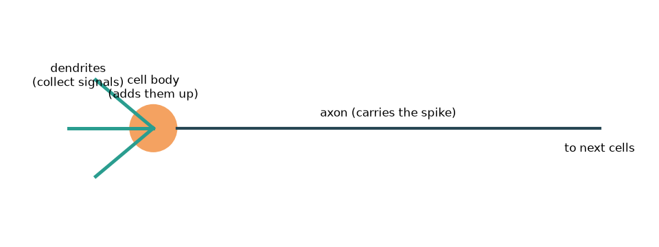
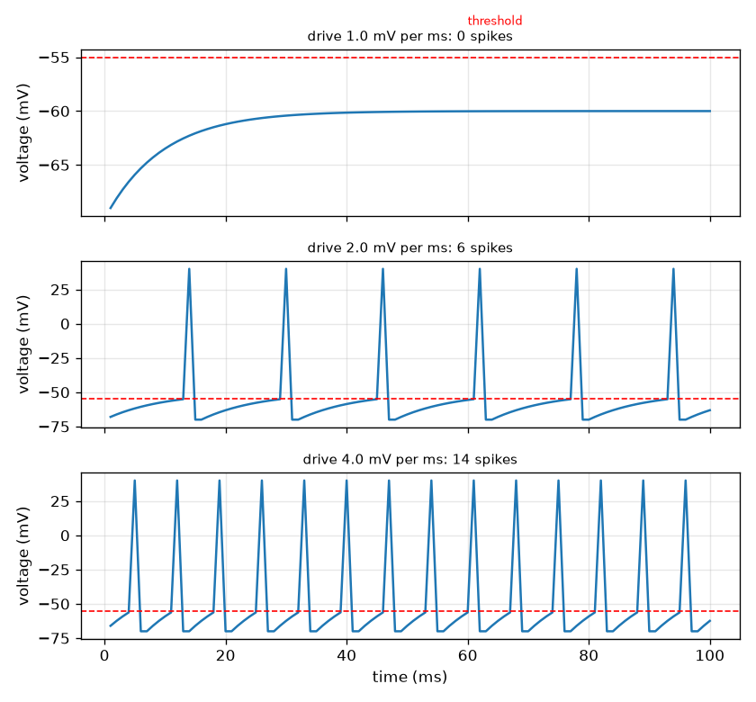

# സെഷൻ 1: ഒരു ന്യൂറോൺ സിഗ്നലുകൾ കൂട്ടിച്ചേർത്ത് ഒരു സ്പൈക്ക് ഉണ്ടാക്കുന്നു

[Session 1 — हिन्दी](README.hi.md)

*ലെവൽ 1 (ആശയപരമായ ഇന്ററാക്ടീവ് മോഡൽ) · ഏകദേശം 60 മിനിറ്റ് · openneuron*

> ഇത് ലളിതമാക്കിയ ഒരു വിദ്യാഭ്യാസ മോഡലാണ്. ഇത് സാധൂകരിക്കപ്പെട്ട ഒരു ഡിസൈൻ ഉപകരണമല്ല; യഥാർത്ഥ നിർമ്മിതികൾ, വൈദ്യുത ഇൻസ്റ്റലേഷനുകൾ, വാഹനങ്ങൾ, വ്യാവസായിക പ്രക്രിയകൾ അല്ലെങ്കിൽ വൈദ്യശാസ്ത്രപരമായ തീരുമാനങ്ങൾ എന്നിവയ്ക്ക് ഇത് ഉപയോഗിക്കരുത്.

**മുൻ‌അറിവ് (Prerequisites)**

- സ്കൂൾ അങ്കഗണിതവും വോൾട്ടേജ് (വൈദ്യുത ചാർജിന്മേലുള്ള ഒരു തള്ളൽ) എന്ന ആശയവും.
- നിങ്ങൾ PRIMER.md വായിക്കുകയും `python start.py 1` ഒരു തവണ റൺ ചെയ്യുകയും ചെയ്തിട്ടുണ്ട്.

**പഠന ലക്ഷ്യങ്ങൾ (Learning objectives).** ഈ സെഷനു ശേഷം നിങ്ങൾക്ക് കഴിയും:

- ഒരു ന്യൂറോൺ സിഗ്നലുകൾ ശേഖരിക്കുകയും കൂട്ടുകയും ത്രെഷോൾഡിൽ (threshold) എല്ലാം-അല്ലെങ്കിൽ-ഒന്നുമില്ല (all-or-nothing) സ്പൈക്ക് ഉണ്ടാക്കുകയും ചെയ്യുന്നത് വിവരിക്കാൻ.
- ഒരു സ്ഥിര ഇൻപുട്ടിന് ന്യൂറോണിനെ ഒരിക്കലെങ്കിലും ഉത്തേജിപ്പിക്കാൻ കഴിയുമോ എന്ന് പ്രവചിക്കാൻ ഉയർച്ച-ചോർച്ച (rise-and-leak) അപ്ഡേറ്റ് ഉപയോഗിക്കാൻ.
- വോൾട്ടേജ്-സമയ രേഖ വായിച്ച് സ്പൈക്കിനെ ത്രെഷോൾഡിന് താഴെയുള്ള ചാഞ്ചാട്ടത്തിൽ നിന്ന് വേർതിരിച്ചറിയാൻ.
- ഒരു ആക്സോണിലൂടെയുള്ള സ്പൈക്കിന്റെ കാലതാമസം അതിന്റെ നീളത്തിൽ നിന്നും വേഗതയിൽ നിന്നും കണക്കാക്കാൻ.

## A. യഥാർത്ഥ ലോക പ്രശ്നം
ഓരോ ചിന്തയും സ്പർശവും ചലനവും വഹിക്കുന്നത് സ്പൈക്കുകൾ എന്ന് വിളിക്കുന്ന ഹ്രസ്വ വൈദ്യുത സ്പന്ദനങ്ങളിലൂടെ സംസാരിക്കുന്ന നാഡീകോശങ്ങളാണ്. ഒരു ന്യൂറോൺ അതിന്റെ ശാഖകളിൽ (ഡെൻഡ്രൈറ്റുകൾ) മറ്റ് കോശങ്ങളിൽ നിന്ന് സിഗ്നലുകൾ സ്വീകരിക്കുന്നു, കോശശരീരത്തിൽ അവ കൂട്ടുന്നു, ആകെ വോൾട്ടേജ് ഒരു ത്രെഷോൾഡ് കടന്നാൽ, അതിന്റെ നീണ്ട വയറിലൂടെ (ആക്സോൺ) ഒഴുകുന്ന ഒരു സ്പൈക്ക് ഉണ്ടാക്കുന്നു. നേരിയ സ്പർശം കുറച്ച് സ്പൈക്കുകൾ ഉണ്ടാക്കുന്നു, ശക്തമായ തള്ളൽ ഒട്ടേറെ ഉണ്ടാക്കുന്നു, പക്ഷേ ഓരോ സ്പൈക്കും ഒരുപോലെയാണ്. ഒരു കോശത്തിന് സുഗമമായ ഇൻപുട്ടിനെ ഈ ഓൺ-ഓഫ് സിഗ്നലാക്കി മാറ്റാൻ എങ്ങനെ കഴിയും? ഈ റിപ്പോ പൊതു വിദ്യാഭ്യാസത്തിന് മാത്രമുള്ളതാണ്: ഇത് ലളിതമാക്കിയ ഒരു മോഡൽ കാണിക്കുന്നു, വൈദ്യശാസ്ത്ര വിവരമല്ല.

## B. ആശയവും സിദ്ധാന്തവും
നാം കോശത്തിനുള്ളിലെ വോൾട്ടേജ് V പുറത്തെ അപേക്ഷിച്ച് മില്ലിവോൾട്ടിൽ (mV) മാതൃകയാക്കുന്നു. വിശ്രമത്തിൽ അത് V_rest = -70 mV-ൽ ഇരിക്കുന്നു (ഒരു സാധാരണ പാഠപുസ്തക മൂല്യം). ഓരോ മില്ലിസെക്കൻഡിലും ഇൻപുട്ട് V-യെ ഡ്രൈവ് d (mV per ms) കൊണ്ട് മുകളിലേക്ക് തള്ളുന്നു, ചോർച്ച (leak) അതിനെ ദൂരത്തിന്റെ k = 0.1 അംശം കൊണ്ട് വിശ്രമത്തിലേക്ക് തിരികെ വലിക്കുന്നു. ഡ്രൈവ് സ്ഥിരമാണെങ്കിൽ, V, V_rest + d / k-ൽ സ്ഥിരമാകുന്നു. ഒരു ത്രെഷോൾഡ് V_th = -55 mV ഉത്തേജനം നിശ്ചയിക്കുന്നു: V അതിൽ എത്തുമ്പോൾ ന്യൂറോൺ നിശ്ചിത ഉയരമുള്ള സ്പൈക്ക് ഉണ്ടാക്കുന്നു, V വിശ്രമത്തിലേക്ക് റീസെറ്റ് ആകുന്നു, 2 ms റിഫ്രാക്റ്ററി സമയം (refractory time) പിന്തുടരുന്നു, അതിൽ വീണ്ടും ഉത്തേജിപ്പിക്കാൻ കഴിയില്ല. സ്ഥിരമാകുന്ന നില ത്രെഷോൾഡിന് മുകളിലാണെങ്കിൽ മാത്രമേ സ്ഥിര ഡ്രൈവ് ന്യൂറോണിനെ ഉത്തേജിപ്പിക്കാൻ കഴിയൂ, അതായത് d > k (V_th - V_rest) = ഓരോ ms-നും 1.5 mV. സ്പൈക്ക് തുടങ്ങിയ ശേഷം, അത് ഏകദേശം സ്ഥിര വേഗത v-യിൽ ആക്സോണിലൂടെ സഞ്ചരിക്കുന്നു, അതിനാൽ നീളം L-ന് മേലുള്ള കാലതാമസം L / v ആണ്.

| ചിഹ്നം | അർത്ഥം | യൂണിറ്റ് |
|---|---|---|
| V | മെംബ്രേൻ വോൾട്ടേജ് (അകം മൈനസ് പുറം) | mV |
| V_rest | വിശ്രമ വോൾട്ടേജ്, സാധാരണ -70 | mV |
| V_th | ത്രെഷോൾഡ് വോൾട്ടേജ്, സാധാരണ -55 | mV |
| d | ഡ്രൈവ്: ഓരോ മില്ലിസെക്കൻഡിലും V-യോട് ചേർക്കുന്ന തള്ളൽ | mV per ms |
| k | ഓരോ മില്ലിസെക്കൻഡിലെയും ചോർച്ച അംശം (0.1) | per ms |
| L, v | ആക്സോൺ നീളവും സ്പൈക്ക് വേഗതയും | m, m per s |

**അനുമാനങ്ങൾ (Assumptions)**

- സമയം 1 ms ചുവടുകളിൽ നീങ്ങുന്നു.
- ഇൻപുട്ട് ഒരു സ്ഥിര ഡ്രൈവോ ഓരോ ചുവടിനും ഒന്നുവീതമുള്ള തള്ളലുകളുടെ പട്ടികയോ ആണ്.
- ഇൻപുട്ട് എന്തായാലും ഓരോ സ്പൈക്കിനും വരച്ച ഉയരം (+40 mV) ഒന്നുതന്നെ: എല്ലാം അല്ലെങ്കിൽ ഒന്നുമില്ല.
- എല്ലാ സംഖ്യകളും സാധാരണ പാഠപുസ്തക മൂല്യങ്ങളാണ്; ഇത് ലളിതമാക്കിയ വിദ്യാഭ്യാസ മോഡലാണ്, വൈദ്യശാസ്ത്ര ഉപകരണമല്ല.

$$ V_{n+1}=V_n+d-k\,(V_n-V_{\mathrm{rest}}) $$

$$ V_\infty=V_{\mathrm{rest}}+\frac{d}{k},\qquad d_{\min}=k\,(V_{\mathrm{th}}-V_{\mathrm{rest}}) $$

$$ \Delta t=\frac{L}{v} $$

## C. ദൃശ്യ വിശദീകരണം
ആദ്യ ചിത്രം ഒരു ന്യൂറോണിന്റെ ചിത്രമാണ്: ഡെൻഡ്രൈറ്റുകൾ സിഗ്നലുകൾ ശേഖരിക്കുന്നു, കോശശരീരം അവ കൂട്ടുന്നു, ആക്സോൺ സ്പൈക്കിനെ അടുത്ത കോശങ്ങളിലേക്ക് കൊണ്ടുപോകുന്നു. രണ്ടാമത്തെ ചിത്രം ദുർബല, ഇടത്തരം, ശക്തമായ ഡ്രൈവിനുള്ള മൂന്ന് വോൾട്ടേജ് രേഖകൾ കാണിക്കുന്നു. ദുർബല ഡ്രൈവിൽ വോൾട്ടേജ് ഇഴഞ്ഞുകയറി ചുവന്ന ത്രെഷോൾഡ് വരയ്ക്ക് താഴെ നിരപ്പാകുന്നു: സ്പൈക്ക് ഇല്ല. ഇടത്തരം, ശക്തമായ ഡ്രൈവുകളിൽ വോൾട്ടേജ് ത്രെഷോൾഡിൽ വീണ്ടും വീണ്ടും എത്തുന്നു; ഓരോ സ്പൈക്കിനും ഒരേ ഉയരമാണ്, പക്ഷേ ശക്തമായ ഡ്രൈവ് കൂടുതൽ തവണ ഉത്തേജിപ്പിക്കുന്നു (ഡ്രൈവ് 2.0, 4.0 എന്നിവയ്ക്ക് 100 ms-ൽ യഥാക്രമം 6, 14 സ്പൈക്കുകൾ).

*ഒരു ന്യൂറോൺ: ഡെൻഡ്രൈറ്റുകൾ സിഗ്നലുകൾ ശേഖരിക്കുന്നു, കോശശരീരം അവ കൂട്ടുന്നു, ആക്സോൺ സ്പൈക്കിനെ വഹിക്കുന്നു.*

*ദുർബല, ഇടത്തരം, ശക്തമായ ഡ്രൈവിനുള്ള വോൾട്ടേജ് രേഖകൾ: ഒരേ സ്പൈക്ക് ഉയരം, വ്യത്യസ്ത നിരക്ക്.*

## D. ഇന്ററാക്ടീവ് സിമുലേഷൻ
പാഠം റൺ ചെയ്യുക (`python start.py 1`), തുടർന്ന് ലൈവ് ആപ്പ് തുറക്കുക: [സെഷൻ 1: ഒരു ന്യൂറോൺ ഉത്തേജിക്കുന്നു](https://krunalpanchal1995.github.io/pan-iit-oss/openneuron/session-01/) (അല്ലെങ്കിൽ ഈ ഫോൾഡറിലെ `app.html`). ഡ്രൈവ് സ്ലൈഡ് ചെയ്ത് സെറ്റിലിംഗ് ബാർ ത്രെഷോൾഡ് അടയാളം കടക്കുന്നതും വോൾട്ടേജ് രേഖ സ്പൈക്ക് ചെയ്യാൻ തുടങ്ങുന്നതും കാണുക; തുടർന്ന് ആക്സോൺ വേഗത സ്ലൈഡ് ചെയ്ത് ചുവന്ന കുത്തും കാലതാമസവും മാറുന്നത് കാണുക.

**വെല്ലുവിളി.** ന്യൂറോണിനെ ഉത്തേജിപ്പിക്കുക (ഡ്രൈവ് ഓരോ ms-നും 1.5 mV-ന് മുകളിൽ) 0.5 m ആക്സോൺ സ്പൈക്ക് 5 ms-ൽ താഴെ കടക്കട്ടെ.

## E. പ്രവർത്തിച്ച ഉദാഹരണവും പരീക്ഷണവും
**പ്രശ്നം.** വിശ്രമത്തിൽ നിന്ന് ഓരോ ms-നും 2.0 mV സ്ഥിര ഡ്രൈവ് പ്രയോഗിക്കുന്നു. ന്യൂറോൺ ഉത്തേജിക്കുമോ, എത്ര മില്ലിസെക്കൻഡിന് ശേഷം?

1. സെറ്റിലിംഗ് നില: V_inf = -70 + 2.0 / 0.1 = -50 mV. അത് -55 mV ത്രെഷോൾഡിന് മുകളിലാണ്, അതിനാൽ ഉത്തേജിക്കും.
2. ഡ്രൈവ് സ്ഥിരമായിരിക്കുമ്പോൾ കയറ്റം V(n) = -70 + 20 (1 - 0.9^n) ആണ്. നമുക്ക് V(n) = -55 വേണം, അതായത് 20 (1 - 0.9^n) = 15, അതിനാൽ 0.9^n = 0.25.
3. n = ln 0.25 / ln 0.9 = 13.16 ചുവടുകൾ, അതിനാൽ 13 ചുവടുകൾ പോരാ, 14 മതി.
4. പരിശോധന: V(13) = -55.08 mV (ത്രെഷോൾഡിന് തൊട്ടുതാഴെ), V(14) = -54.58 mV (അതിന് മുകളിൽ), അതിനാൽ ആദ്യ സ്പൈക്ക് ചുവട് 14-ൽ വരുന്നു, അതായത് 14 ms.
5. സിമുലേഷൻ യോജിക്കുന്നു: ആദ്യ സ്പൈക്ക് 14 ms-ലാണ്, 100 ms-ൽ 6 സ്പൈക്കുകൾ.

**ഉത്തരം.** അതെ. ആദ്യ സ്പൈക്ക് 14 ms-ൽ വരുന്നു (13.16 ചുവടുകൾ മുകളിലേക്ക് റൗണ്ട് ചെയ്തത്), ന്യൂറോൺ 100 ms-ൽ 6 തവണ ഉത്തേജിക്കുന്നു.

**പരീക്ഷണം.** ഒരു യഥാർത്ഥ ന്യൂറോണിനെ ചെറിയ സ്ഥിര വൈദ്യുതി കടത്തിവിടുമ്പോൾ നേർത്ത ഗ്ലാസ് ഇലക്ട്രോഡ് ഉപയോഗിച്ച് രേഖപ്പെടുത്താം: ഒരു നിശ്ചിത വൈദ്യുതിക്ക് താഴെ വോൾട്ടേജ് ഒരു പുതിയ നിലയിലേക്ക് ഒഴുകുന്നു, അതിന് മുകളിൽ സ്പൈക്കുകൾ പ്രത്യക്ഷപ്പെടുന്നു, വലിയ വൈദ്യുതി ഒരേപോലുള്ള സ്പൈക്കുകളുടെ വേഗമേറിയ നിര നൽകുന്നു. മോഡൽ ആ ഗുണപരമായ ചിത്രം പുനർനിർമ്മിക്കുന്നു. യഥാർത്ഥ കോശത്തിൽ നിന്ന് ഇത് വ്യത്യസ്തമാണ്: യഥാർത്ഥ സ്പൈക്കുകളുടെ ആകൃതി അയോൺ ചാനലുകളാണ് നിശ്ചയിക്കുന്നത് (സെഷൻ 3), യഥാർത്ഥ ത്രെഷോൾഡുകൾ സമീപകാല പ്രവർത്തനത്തിനനുസരിച്ച് മാറുന്നു, യഥാർത്ഥ ഇൻപുട്ടുകൾ സ്ഥിര തള്ളലല്ല, ശബ്ദമുള്ളതാണ്.

## F. മൂല്യനിർണ്ണയവും ഡിസൈൻ വെല്ലുവിളിയും
**ചോദ്യ തരം A: ആശയപരം.** ശക്തമായ ഉത്തേജനം വലിയ സ്പൈക്ക് ഉണ്ടാക്കുന്നില്ല. അപ്പോൾ ഒരു സ്പർശം കൂടുതൽ ശക്തമാണെന്ന് ഒരു നാഡി തലച്ചോറിനോട് എങ്ങനെ പറയുന്നു?

സൂചന

ദുർബല, ഇടത്തരം, ശക്തമായ ഡ്രൈവിനുള്ള രേഖകൾ താരതമ്യം ചെയ്യുക: എന്ത് മാറി, എന്ത് അതേപടി തുടർന്നു?

ഘട്ടം ഘട്ടമായുള്ള പരിഹാരം

സ്പൈക്കിന്റെ ഉയരം നിശ്ചിതമാണ് (എല്ലാം അല്ലെങ്കിൽ ഒന്നുമില്ല), പക്ഷേ ശക്തമായ ഇൻപുട്ട് ഓരോ സ്പൈക്കിനും ശേഷം വോൾട്ടേജിനെ വേഗത്തിൽ ത്രെഷോൾഡിലേക്ക് തിരികെ തള്ളുന്നു, അതിനാൽ ന്യൂറോൺ കൂടുതൽ തവണ ഉത്തേജിക്കുന്നു. ശക്തി വഹിക്കുന്നത് നിരക്കാണ് (കൂടാതെ എത്ര ന്യൂറോണുകൾ ഉത്തേജിക്കുന്നു എന്നതും), സ്പൈക്കിന്റെ വലിപ്പമല്ല. മോഡലിൽ ഡ്രൈവ് 2.0 100 ms-ൽ 6 സ്പൈക്കുകൾ നൽകുന്നു, ഡ്രൈവ് 4.0 14 നൽകുന്നു, എല്ലാം ഒരേ ഉയരത്തിൽ.

**ചോദ്യ തരം B: സംഖ്യാപരം.** ഓരോ ms-നും 3.0 mV സ്ഥിര ഡ്രൈവിന്, വോൾട്ടേജ് സ്ഥിരമാകുന്ന നിലയും ആദ്യ സ്പൈക്ക് സംഭവിക്കുന്ന ചുവടും കണ്ടെത്തുക (കൈകൊണ്ട് കണക്കാക്കുക, തുടർന്ന് കോഡ് ഉപയോഗിച്ച് പരിശോധിക്കുക).

സൂചന

സെറ്റിലിംഗ് നില = -70 + d / 0.1. ആദ്യ സ്പൈക്കിന് 0.9^n = 1 - 15 (0.1) / d വേണം.

ഘട്ടം ഘട്ടമായുള്ള പരിഹാരം

സെറ്റിലിംഗ് നില = -70 + 3.0 / 0.1 = -40 mV, ത്രെഷോൾഡിന് മുകളിൽ. തുടർന്ന് 0.9^n = 1 - 1.5 / 3.0 = 0.5, അതിനാൽ n = ln 0.5 / ln 0.9 = 6.58, മുകളിലേക്ക് റൗണ്ട് ചെയ്താൽ ചുവട് 7. കോഡ് ആദ്യ സ്പൈക്ക് 7 ms-ൽ നൽകുന്നു. യൂണിറ്റ് പരിശോധന: ഡ്രൈവ് mV per ms-ലാണ്, അതിനാൽ d / k mV-ലാണ്.

**ചോദ്യ തരം C: ഗ്രാഫും സിമുലേഷനും വ്യാഖ്യാനിക്കൽ.** ഓരോ ms-നും 1.0 mV ഡ്രൈവിനുള്ള രേഖയിൽ വോൾട്ടേജ് ഉയർന്ന് ത്രെഷോൾഡ് വരയ്ക്ക് താഴെ നിരപ്പാകുന്നു. അത് ഏത് നിലയിൽ നിരപ്പാകുന്നു, സ്പൈക്ക് ഇല്ലാത്തത് എന്തുകൊണ്ട്?

സൂചന

സെറ്റിലിംഗ് നില -70 + d / 0.1 ഉപയോഗിച്ച് -55-മായി താരതമ്യം ചെയ്യുക.

ഘട്ടം ഘട്ടമായുള്ള പരിഹാരം

അത് -70 + 1.0 / 0.1 = -60 mV-ൽ നിരപ്പാകുന്നു, -55 mV ത്രെഷോൾഡിന് 5 mV താഴെ. V -60-ൽ എത്തിക്കഴിഞ്ഞാൽ ഡ്രൈവ് ചേർക്കുന്നത്ര വേഗത്തിൽ ചോർച്ച ചാർജ് നീക്കം ചെയ്യുന്നു, അതിനാൽ വോൾട്ടേജ് ഒരിക്കലും -55-ൽ എത്തുന്നില്ല, സ്പൈക്ക് ഇല്ല. ഡ്രൈവ് ഓരോ ms-നും 1.5 mV-ന് മുകളിലേക്ക് ഉയർത്തുന്നത് സെറ്റിലിംഗ് നിലയെ ത്രെഷോൾഡിന് മുകളിലേക്ക് നീക്കുന്നു.

**ചോദ്യ തരം D: ഡിസൈനും ഒപ്റ്റിമൈസേഷൻ വെല്ലുവിളിയും.** ഡിസൈൻ: ഒരു മോഡൽ ന്യൂറോൺ 100 ms-ൽ കുറഞ്ഞത് 10 തവണ ഉത്തേജിക്കണം, ഒരു സ്പൈക്ക് 0.5 m ആക്സോൺ 5 ms-ൽ താഴെ കടക്കണം. ഒരു ഡ്രൈവും (ഓരോ ms-നും 0.5 mV ചുവടുകളിൽ) ആക്സോൺ വേഗതയും തിരഞ്ഞെടുത്ത് നിങ്ങൾ കാണുന്ന വിട്ടുവീഴ്ച (trade-off) പറയുക.

സൂചന

കോഡ് ഉപയോഗിച്ച് ഡ്രൈവ് 2.5, 3.0, 3.5 എന്നിവയ്ക്ക് സ്പൈക്കുകൾ എണ്ണുക; കാലതാമസം ms-ൽ 1000 L / v ആണ്.

ഘട്ടം ഘട്ടമായുള്ള പരിഹാരം

ഡ്രൈവ് 2.5 9 സ്പൈക്കുകൾ നൽകുന്നു (കുറവ്), ഡ്രൈവ് 3.0 11 സ്പൈക്കുകൾ നൽകുന്നു, ഡ്രൈവ് 3.5 12 നൽകുന്നു, അതിനാൽ 0.5 ചുവടുകളിൽ പ്രവർത്തിക്കുന്ന ഏറ്റവും ചെറിയ ഡ്രൈവ് ഓരോ ms-നും 3.0 mV ആണ്. കാലതാമസം 1000 (0.5) / v < 5 ms, അതിനാൽ v 100 m/s-ൽ കൂടുതലായിരിക്കണം (100 m/s-ൽ കൃത്യമായി 5 ms). വിട്ടുവീഴ്ച: വലിയ ഡ്രൈവിന് കൂടുതൽ ഇൻപുട്ട് ചെലവാകുന്നു പക്ഷേ വേഗത്തിൽ ഉത്തേജിക്കുന്നു; വേഗമേറിയ ആക്സോണിന് കട്ടിയുള്ള (അല്ലെങ്കിൽ ഇൻസുലേറ്റ് ചെയ്ത) നാര് വേണം, അത് കൂടുതൽ സ്ഥലവും വസ്തുവും എടുക്കുന്നു. അനുമാനം: സ്ഥിര ഡ്രൈവും സ്ഥിര വേഗതയും.

[RUBRIC.md](../../RUBRIC.md) ഉപയോഗിച്ച് സ്വയം സ്കോർ ചെയ്യുക. പേപ്പറിൽ ചെയ്യാൻ [പ്രവർത്തന ഷീറ്റ്](activity_sheet.md) പ്രിന്റ് ചെയ്യുക.

## സാധാരണ തെറ്റിദ്ധാരണകൾ
| സാധാരണ തെറ്റിദ്ധാരണ | യഥാർത്ഥത്തിൽ ശരിയായത് |
|---|---|
| ശക്തമായ ഉത്തേജനം വലിയ സ്പൈക്ക് ഉണ്ടാക്കുന്നു. | സ്പൈക്കുകൾ എല്ലാം അല്ലെങ്കിൽ ഒന്നുമില്ല: ഉയരം നിശ്ചിതമാണ്. ശക്തമായ ഉത്തേജനം സ്പൈക്കുകൾ കൂടുതൽ തവണ ഉണ്ടാക്കുന്നു. |
| എത്ര ദുർബലമായ ഇൻപുട്ടും, കാത്തിരുന്നാൽ, ഒടുവിൽ ന്യൂറോണിനെ ഉത്തേജിപ്പിക്കും. | ദുർബല ഇൻപുട്ട് ചേർക്കുന്നത്ര വേഗത്തിൽ ചോർച്ച ചാർജ് നീക്കം ചെയ്യുന്നു, അതിനാൽ വോൾട്ടേജ് ത്രെഷോൾഡിന് താഴെ സ്ഥിരമാകുന്നു, ഒരിക്കലും ഉത്തേജിക്കുന്നില്ല. |
| ഒരു സ്പൈക്ക് ചെമ്പ് കമ്പിയിലെ വൈദ്യുതി പോലെ ആക്സോണിലൂടെ ഒഴുകുന്ന വൈദ്യുതിയാണ്. | സ്പൈക്ക് മെംബ്രേൻ വോൾട്ടേജിന്റെ സഞ്ചരിക്കുന്ന മാറ്റമാണ്, അത് വഴിയിൽ പുനർജനിക്കുന്നു; കമ്പിയിലെ വൈദ്യുതിയേക്കാൾ വളരെ മന്ദഗതിയിലാണ് (സെക്കൻഡിൽ മീറ്ററുകൾ, ആയിരക്കണക്കിന് കിലോമീറ്ററുകളല്ല). |
| ഇൻപുട്ട് അനുവദിക്കുന്നത്ര തവണ ന്യൂറോണിന് ഉത്തേജിക്കാം. | ഓരോ സ്പൈക്കിനും ശേഷം റിഫ്രാക്റ്ററി സമയമുണ്ട്, അതിനാൽ നിരക്കിന് ഉയർന്ന പരിധിയുണ്ട് (ഈ കളിപ്പാട്ട മോഡലിൽ 3 ms-ൽ ഒരു സ്പൈക്ക്). |

## പദാവലി (Glossary)
- **ന്യൂറോൺ (neuron)**: വൈദ്യുത സിഗ്നലുകൾ സ്വീകരിക്കുകയും കൂട്ടുകയും കൈമാറുകയും ചെയ്യുന്ന നാഡീകോശം
- **സ്പൈക്ക് (ആക്ഷൻ പൊട്ടൻഷ്യൽ) (spike, action potential)**: ന്യൂറോൺ ഉണ്ടാക്കുന്ന മെംബ്രേൻ വോൾട്ടേജിന്റെ ഹ്രസ്വ, നിശ്ചിത വലിപ്പമുള്ള സ്പന്ദനം
- **ത്രെഷോൾഡ് (threshold)**: ന്യൂറോൺ ഉത്തേജിക്കുന്ന വോൾട്ടേജ്
- **ആക്സോൺ (axon)**: കോശശരീരത്തിൽ നിന്ന് സ്പൈക്കിനെ അകറ്റി കൊണ്ടുപോകുന്ന ന്യൂറോണിന്റെ നീണ്ട വയർ
- **റിഫ്രാക്റ്ററി പീരിയഡ് (refractory period)**: സ്പൈക്കിന് ശേഷം ന്യൂറോണിന് വീണ്ടും ഉത്തേജിക്കാൻ കഴിയാത്ത ഹ്രസ്വ സമയം
- **മില്ലിവോൾട്ട് (mV) (millivolt)**: വോൾട്ടിന്റെ ആയിരത്തിലൊന്ന്, മെംബ്രേൻ വോൾട്ടേജുകൾക്ക് സ്വാഭാവിക യൂണിറ്റ്

## പൂർത്തിയാക്കുക
1. [exercises.md](exercises.md)-ലെ മൂന്ന് കോഡിംഗ് ടാസ്കുകൾ ചെയ്യുക.
2. നിങ്ങളുടെ മാറ്റങ്ങൾക്ക് ശേഷം `python start.py 1` വീണ്ടും റൺ ചെയ്യുക. അത് ചെക്ക്‌പോയിന്റോടെ അവസാനിക്കുന്നു; അത് `PASS` പ്രിന്റ് ചെയ്യുമ്പോൾ, നിങ്ങൾ പൂർത്തിയാക്കി. (ചെക്ക്‌പോയിന്റ് മാത്രം: `python start.py check 1`.)

അടുത്തത്: [സെഷൻ 2](../session-02/README.md)
