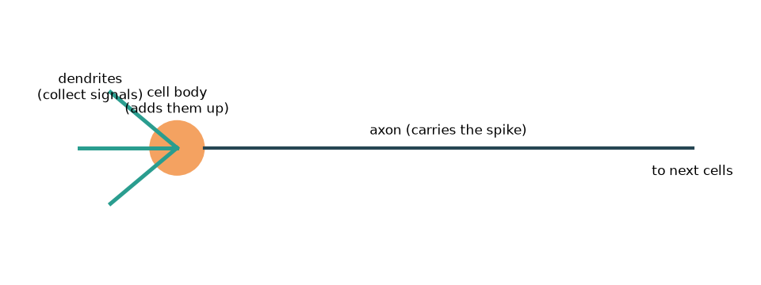
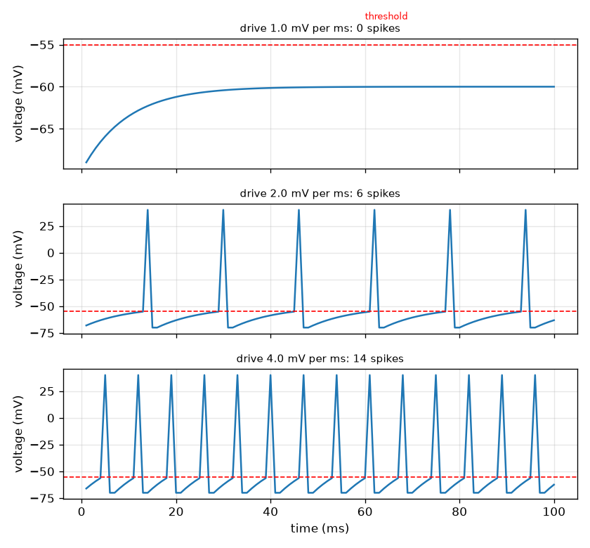

# அமர்வு 1: ஒரு நியூரான் சமிக்ஞைகளைக் கூட்டி ஒரு ஸ்பைக்கை உருவாக்குகிறது

[Session 1 — हिन्दी](README.hi.md)

*நிலை 1 (கருத்தியல் ஊடாடும் மாதிரி) · சுமார் 60 நிமிடங்கள் · openneuron*

> இது எளிமைப்படுத்தப்பட்ட ஒரு கல்வி மாதிரி. இது சரிபார்க்கப்பட்ட வடிவமைப்புக் கருவி அல்ல; உண்மையான கட்டமைப்புகள், மின் நிறுவல்கள், வாகனங்கள், தொழில்துறை செயல்முறைகள் அல்லது மருத்துவ முடிவுகளுக்கு இதைப் பயன்படுத்தக் கூடாது.

**முன்தேவைகள் (Prerequisites)**

- பள்ளி எண்கணிதமும் மின்னழுத்தம் (மின்னூட்டத்தின் மீதான ஒரு தள்ளு) என்ற கருத்தும்.
- நீங்கள் PRIMER.md படித்து, `python start.py 1` ஐ ஒரு முறை இயக்கியிருக்க வேண்டும்.

**கற்றல் நோக்கங்கள் (Learning objectives).** இந்த அமர்வுக்குப் பிறகு நீங்கள்:

- ஒரு நியூரான் சமிக்ஞைகளைச் சேகரித்து, கூட்டி, வாசலில் (threshold) எல்லாம்-அல்லது-ஒன்றுமில்லை (all-or-nothing) ஸ்பைக்கைத் தூண்டுவதை விவரிக்க முடியும்.
- ஒரு மாறா உள்ளீடு நியூரானைத் தூண்ட முடியுமா என்று கணிக்க உயர்வு-கசிவு (rise-and-leak) புதுப்பிப்பைப் பயன்படுத்த முடியும்.
- மின்னழுத்தம்-நேர வரைவைப் படித்து ஸ்பைக்கை வாசலுக்குக் கீழுள்ள அலைவிலிருந்து வேறுபடுத்த முடியும்.
- ஒரு ஆக்சானில் ஸ்பைக்கின் தாமதத்தை அதன் நீளம் மற்றும் வேகத்திலிருந்து கணக்கிட முடியும்.

## A. நிஜ உலகப் பிரச்சனை
ஒவ்வொரு சிந்தனையும் தொடுதலும் இயக்கமும் ஸ்பைக்குகள் எனப்படும் குறுகிய மின் துடிப்புகளால் பேசும் நரம்புச் செல்களால் சுமக்கப்படுகிறது. ஒரு நியூரான் தன் கிளைகளில் (டென்ட்ரைட்டுகள்) மற்றச் செல்களிலிருந்து சமிக்ஞைகளைப் பெற்று, செல் உடலில் கூட்டி, மொத்த மின்னழுத்தம் வாசலைக் கடந்தால், அதன் நீண்ட கம்பியில் (ஆக்சான்) ஓடும் ஒரு ஸ்பைக்கைத் தூண்டுகிறது. மென்மையான தொடுதல் சில ஸ்பைக்குகளையும் கடுமையான அழுத்தம் பல ஸ்பைக்குகளையும் உண்டாக்குகிறது, ஆனால் ஒவ்வொரு ஸ்பைக்கும் ஒரே மாதிரியானது. ஒரு செல் மென்மையான உள்ளீட்டை இந்த ஆன்-ஆஃப் சமிக்ஞையாக எப்படி மாற்றுகிறது? இந்த ரெப்போ பொதுக் கல்விக்கு மட்டுமே: இது எளிமைப்படுத்தப்பட்ட மாதிரியைக் காட்டுகிறது, மருத்துவத் தகவல் அல்ல.

## B. கருத்தும் கோட்பாடும்
செல்லுக்குள் இருக்கும் மின்னழுத்தம் V-ஐ வெளிப்புறத்துடன் ஒப்பிட்டு மில்லிவோல்ட்டில் (mV) மாதிரியாக்குகிறோம். ஓய்வில் அது V_rest = -70 mV-ல் இருக்கிறது (வழக்கமான பாடநூல் மதிப்பு). ஒவ்வொரு மில்லிவினாடியும் உள்ளீடு V-ஐ உந்துதல் d (mV per ms) அளவு மேலே தள்ளுகிறது, கசிவு (leak) அதை தூரத்தின் k = 0.1 பின்னத்தால் ஓய்வை நோக்கி இழுக்கிறது. உந்துதல் மாறிலி என்றால், V ஆனது V_rest + d / k-ல் நிலைபெறுகிறது. ஒரு வாசல் V_th = -55 mV தூண்டலைத் தீர்மானிக்கிறது: V அதை அடையும்போது, நியூரான் நிலையான உயரமுள்ள ஒரு ஸ்பைக்கைத் தூண்டுகிறது, V ஓய்வுக்கு மீட்டமைகிறது, 2 ms மறுதூண்டாக் காலம் (refractory time) தொடர்கிறது, அப்போது மீண்டும் தூண்ட முடியாது. நிலைபெறும் நிலை வாசலுக்கு மேலே இருந்தால் மட்டுமே மாறா உந்துதல் நியூரானைத் தூண்ட முடியும், அதாவது d > k (V_th - V_rest) = ஒவ்வொரு ms-க்கும் 1.5 mV. ஸ்பைக் தொடங்கிய பிறகு, அது ஏறத்தாழ மாறா வேகம் v-ல் ஆக்சான் வழியாகப் பயணிக்கிறது, எனவே நீளம் L மீதான தாமதம் L / v.

| குறியீடு | பொருள் | அலகு |
|---|---|---|
| V | சவ்வு மின்னழுத்தம் (உள்ளே கழித்தல் வெளியே) | mV |
| V_rest | ஓய்வு மின்னழுத்தம், வழக்கமாக -70 | mV |
| V_th | வாசல் மின்னழுத்தம், வழக்கமாக -55 | mV |
| d | உந்துதல்: ஒவ்வொரு மில்லிவினாடியும் V-உடன் சேர்க்கப்படும் தள்ளு | mV per ms |
| k | ஒவ்வொரு மில்லிவினாடிக்குமான கசிவுப் பின்னம் (0.1) | per ms |
| L, v | ஆக்சான் நீளம் மற்றும் ஸ்பைக் வேகம் | m, m per s |

**அனுமானங்கள் (Assumptions)**

- நேரம் 1 ms படிகளில் நகர்கிறது.
- உள்ளீடு ஒரு மாறா உந்துதல் அல்லது ஒவ்வொரு படிக்கும் ஒன்றாகத் தள்ளுகளின் பட்டியல்.
- உள்ளீடு எதுவாக இருந்தாலும் ஒவ்வொரு ஸ்பைக்கிற்கும் வரையப்பட்ட உயரம் (+40 mV) ஒன்றே: எல்லாம் அல்லது ஒன்றுமில்லை.
- எல்லா எண்களும் வழக்கமான பாடநூல் மதிப்புகள்; இது எளிமைப்படுத்தப்பட்ட கல்வி மாதிரி, மருத்துவக் கருவி அல்ல.

$$ V_{n+1}=V_n+d-k\,(V_n-V_{\mathrm{rest}}) $$

$$ V_\infty=V_{\mathrm{rest}}+\frac{d}{k},\qquad d_{\min}=k\,(V_{\mathrm{th}}-V_{\mathrm{rest}}) $$

$$ \Delta t=\frac{L}{v} $$

## C. காட்சி விளக்கம்
முதல் படம் ஒரு நியூரானின் படம்: டென்ட்ரைட்டுகள் சமிக்ஞைகளைச் சேகரிக்கின்றன, செல் உடல் அவற்றைக் கூட்டுகிறது, ஆக்சான் ஸ்பைக்கை அடுத்த செல்களுக்குக் கொண்டு செல்கிறது. இரண்டாவது படம் மெல்லிய, நடுத்தர, வலுவான உந்துதலுக்கான மூன்று மின்னழுத்த வரைவுகளைக் காட்டுகிறது. மெல்லிய உந்துதலில் மின்னழுத்தம் ஊர்ந்து ஏறி சிவப்பு வாசல் கோட்டிற்குக் கீழே சமநிலை அடைகிறது: ஸ்பைக் இல்லை. நடுத்தர மற்றும் வலுவான உந்துதலில் மின்னழுத்தம் மீண்டும் மீண்டும் வாசலை அடைகிறது; ஒவ்வொரு ஸ்பைக்கிற்கும் ஒரே உயரம், ஆனால் வலுவான உந்துதல் அடிக்கடி தூண்டுகிறது (உந்துதல் 2.0, 4.0-க்கு 100 ms-ல் முறையே 6, 14 ஸ்பைக்குகள்).

*ஒரு நியூரான்: டென்ட்ரைட்டுகள் சமிக்ஞைகளைச் சேகரிக்கின்றன, செல் உடல் அவற்றைக் கூட்டுகிறது, ஆக்சான் ஸ்பைக்கைச் சுமக்கிறது.*

*மெல்லிய, நடுத்தர, வலுவான உந்துதலுக்கான மின்னழுத்த வரைவுகள்: ஒரே ஸ்பைக் உயரம், வேறுபட்ட விகிதம்.*

## D. ஊடாடும் உருவகப்படுத்தல்
பாடத்தை இயக்கவும் (`python start.py 1`), பிறகு நேரடிச் செயலியைத் திறக்கவும்: [அமர்வு 1: ஒரு நியூரான் தூண்டப்படுகிறது](https://krunalpanchal1995.github.io/pan-iit-oss/openneuron/session-01/) (அல்லது இந்தக் கோப்புறையில் உள்ள `app.html`). உந்துதலை நகர்த்தி, நிலைபெறும் பட்டை வாசல் குறியைக் கடப்பதையும் மின்னழுத்த வரைவு ஸ்பைக் செய்யத் தொடங்குவதையும் பாருங்கள்; பிறகு ஆக்சான் வேகத்தை நகர்த்தி சிவப்புப் புள்ளியும் தாமதமும் மாறுவதைப் பாருங்கள்.

**சவால்.** நியூரானைத் தூண்டுங்கள் (உந்துதல் ஒவ்வொரு ms-க்கும் 1.5 mV-ஐ விட அதிகம்) மற்றும் ஸ்பைக் 0.5 m ஆக்சானை 5 ms-க்குள் கடக்கட்டும்.

## E. தீர்க்கப்பட்ட உதாரணமும் சோதனையும்
**பிரச்சனை.** ஓய்விலிருந்து ஒவ்வொரு ms-க்கும் 2.0 mV மாறா உந்துதல் செலுத்தப்படுகிறது. நியூரான் தூண்டப்படுமா, எத்தனை மில்லிவினாடிகளுக்குப் பிறகு?

1. நிலைபெறும் நிலை: V_inf = -70 + 2.0 / 0.1 = -50 mV. அது -55 mV வாசலுக்கு மேலே உள்ளது, எனவே தூண்டப்படும்.
2. உந்துதல் மாறிலியாக இருக்கும்போது ஏற்றம் V(n) = -70 + 20 (1 - 0.9^n). நமக்கு V(n) = -55 வேண்டும், அதாவது 20 (1 - 0.9^n) = 15, எனவே 0.9^n = 0.25.
3. n = ln 0.25 / ln 0.9 = 13.16 படிகள், எனவே 13 படிகள் போதாது, 14 போதும்.
4. சரிபார்ப்பு: V(13) = -55.08 mV (வாசலுக்குச் சற்றுக் கீழே) மற்றும் V(14) = -54.58 mV (அதற்கு மேலே), எனவே முதல் ஸ்பைக் படி 14-ல் வருகிறது, அதாவது 14 ms.
5. உருவகப்படுத்தல் ஒத்துப்போகிறது: முதல் ஸ்பைக் 14 ms-ல், 100 ms-ல் 6 ஸ்பைக்குகள்.

**விடை.** ஆம். முதல் ஸ்பைக் 14 ms-ல் வருகிறது (13.16 படிகள் மேல்நோக்கி முழுமையாக்கப்பட்டது), நியூரான் 100 ms-ல் 6 முறை தூண்டப்படுகிறது.

**சோதனை.** ஒரு உண்மையான நியூரானை, சிறிய நிலையான மின்னோட்டம் செலுத்தும்போது மெல்லிய கண்ணாடி மின்முனையால் பதிவு செய்யலாம்: ஒரு குறிப்பிட்ட மின்னோட்டத்திற்குக் கீழே மின்னழுத்தம் ஒரு புதிய நிலைக்கு நகர்கிறது, அதற்கு மேல் ஸ்பைக்குகள் தோன்றுகின்றன, பெரிய மின்னோட்டம் ஒரே மாதிரியான ஸ்பைக்குகளின் வேகமான தொடரைத் தருகிறது. மாதிரி அந்தத் தரமான படத்தை மீளுருவாக்குகிறது. உண்மையான செல்லிலிருந்து இது வேறுபடுகிறது: உண்மையான ஸ்பைக்குகளின் வடிவத்தை அயனி வழிகள் அமைக்கின்றன (அமர்வு 3), உண்மையான வாசல்கள் சமீபத்திய செயல்பாட்டுடன் மாறுகின்றன, உண்மையான உள்ளீடுகள் மாறாத தள்ளு அல்ல, இரைச்சல் உடையவை.

## F. மதிப்பீடும் வடிவமைப்புச் சவாலும்
**கேள்வி வகை A: கருத்தியல்.** வலுவான தூண்டுதல் பெரிய ஸ்பைக்கை உண்டாக்குவதில்லை. அப்படியானால் ஒரு தொடுதல் வலுவானது என்று நரம்பு மூளைக்கு எப்படிச் சொல்கிறது?

குறிப்பு

மெல்லிய, நடுத்தர, வலுவான உந்துதலுக்கான வரைவுகளை ஒப்பிடுங்கள்: என்ன மாறியது, என்ன அப்படியே இருந்தது?

படிப்படியான தீர்வு

ஸ்பைக்கின் உயரம் நிலையானது (எல்லாம் அல்லது ஒன்றுமில்லை), ஆனால் வலுவான உள்ளீடு ஒவ்வொரு ஸ்பைக்கிற்குப் பிறகும் மின்னழுத்தத்தை விரைவில் வாசலுக்குத் தள்ளுகிறது, எனவே நியூரான் அடிக்கடி தூண்டப்படுகிறது. வலிமையை விகிதம் (மற்றும் எத்தனை நியூரான்கள் தூண்டப்படுகின்றன என்பதும்) சுமக்கிறது, ஸ்பைக்கின் அளவு அல்ல. மாதிரியில் உந்துதல் 2.0 100 ms-ல் 6 ஸ்பைக்குகளையும், உந்துதல் 4.0 14-ஐயும் தருகிறது, அனைத்தும் ஒரே உயரத்தில்.

**கேள்வி வகை B: எண்ணியல்.** ஒவ்வொரு ms-க்கும் 3.0 mV மாறா உந்துதலுக்கு, மின்னழுத்தம் நிலைபெறும் நிலையையும் முதல் ஸ்பைக் நிகழும் படியையும் கண்டறியுங்கள் (கையால் கணக்கிட்டு, பிறகு குறியீட்டால் சரிபாருங்கள்).

குறிப்பு

நிலைபெறும் நிலை = -70 + d / 0.1. முதல் ஸ்பைக்கிற்கு 0.9^n = 1 - 15 (0.1) / d தேவை.

படிப்படியான தீர்வு

நிலைபெறும் நிலை = -70 + 3.0 / 0.1 = -40 mV, வாசலுக்கு மேலே. பிறகு 0.9^n = 1 - 1.5 / 3.0 = 0.5, எனவே n = ln 0.5 / ln 0.9 = 6.58, மேல்நோக்கி முழுமையாக்கினால் படி 7. குறியீடு முதல் ஸ்பைக்கை 7 ms-ல் தருகிறது. அலகுச் சரிபார்ப்பு: உந்துதல் mV per ms-ல் உள்ளது, எனவே d / k mV-ல் உள்ளது.

**கேள்வி வகை C: வரைபடம் மற்றும் உருவகப்படுத்தல் விளக்கம்.** ஒவ்வொரு ms-க்கும் 1.0 mV உந்துதலுக்கான வரைவில் மின்னழுத்தம் உயர்ந்து வாசல் கோட்டிற்குக் கீழே சமநிலை அடைகிறது. அது எந்த நிலையில் சமநிலை அடைகிறது, ஸ்பைக் இல்லாதது ஏன்?

குறிப்பு

நிலைபெறும் நிலை -70 + d / 0.1 ஐப் பயன்படுத்தி -55 உடன் ஒப்பிடுங்கள்.

படிப்படியான தீர்வு

அது -70 + 1.0 / 0.1 = -60 mV-ல் சமநிலை அடைகிறது, -55 mV வாசலுக்கு 5 mV கீழே. V ஆனது -60-ஐ அடைந்ததும் உந்துதல் சேர்ப்பதற்கு இணையாகக் கசிவு மின்னூட்டத்தை அகற்றுகிறது, எனவே மின்னழுத்தம் ஒருபோதும் -55-ஐ எட்டுவதில்லை, ஸ்பைக் இல்லை. உந்துதலை ஒவ்வொரு ms-க்கும் 1.5 mV-க்கு மேல் உயர்த்தினால் நிலைபெறும் நிலை வாசலுக்கு மேலே நகர்கிறது.

**கேள்வி வகை D: வடிவமைப்பு மற்றும் உகப்பாக்கச் சவால்.** வடிவமைப்பு: ஒரு மாதிரி நியூரான் 100 ms-ல் குறைந்தது 10 முறை தூண்டப்பட வேண்டும், ஒரு ஸ்பைக் 0.5 m ஆக்சானை 5 ms-க்குள் கடக்க வேண்டும். ஒரு உந்துதலையும் (ஒவ்வொரு ms-க்கும் 0.5 mV படிகளில்) ஆக்சான் வேகத்தையும் தேர்ந்தெடுத்து, நீங்கள் காணும் சமரசத்தை (trade-off) கூறுங்கள்.

குறிப்பு

குறியீட்டால் உந்துதல் 2.5, 3.0, 3.5-க்கு ஸ்பைக்குகளை எண்ணுங்கள்; தாமதம் ms-ல் 1000 L / v.

படிப்படியான தீர்வு

உந்துதல் 2.5 9 ஸ்பைக்குகளைத் தருகிறது (குறைவு), உந்துதல் 3.0 11 ஸ்பைக்குகளையும், உந்துதல் 3.5 12-ஐயும் தருகின்றன, எனவே 0.5 படிகளில் வேலை செய்யும் மிகச் சிறிய உந்துதல் ஒவ்வொரு ms-க்கும் 3.0 mV. தாமதம் 1000 (0.5) / v < 5 ms, எனவே v 100 m/s-ஐ விட அதிகமாக இருக்க வேண்டும் (100 m/s-ல் சரியாக 5 ms). சமரசம்: பெரிய உந்துதலுக்கு அதிக உள்ளீடு செலவாகும் ஆனால் வேகமாகத் தூண்டும்; வேகமான ஆக்சானுக்கு தடிமனான (அல்லது காப்பிடப்பட்ட) இழை தேவை, அது அதிக இடத்தையும் பொருளையும் எடுக்கும். அனுமானம்: மாறா உந்துதலும் மாறா வேகமும்.

[RUBRIC.md](../../RUBRIC.md) மூலம் உங்களை மதிப்பிட்டுக் கொள்ளுங்கள். காகிதத்தில் செய்ய [செயல்பாட்டுத் தாள்](activity_sheet.md) அச்சிடுங்கள்.

## பொதுவான தவறான கருத்துகள்
| பொதுவான தவறான கருத்து | உண்மையில் சரியானது |
|---|---|
| வலுவான தூண்டுதல் பெரிய ஸ்பைக்கை உண்டாக்கும். | ஸ்பைக்குகள் எல்லாம் அல்லது ஒன்றுமில்லை: உயரம் நிலையானது. வலுவான தூண்டுதல் ஸ்பைக்குகளை அடிக்கடி உண்டாக்கும். |
| எவ்வளவு மெல்லிய உள்ளீடாக இருந்தாலும், காத்திருந்தால் இறுதியில் நியூரானைத் தூண்டும். | மெல்லிய உள்ளீடு சேர்ப்பதற்கு இணையாகக் கசிவு மின்னூட்டத்தை அகற்றுகிறது, எனவே மின்னழுத்தம் வாசலுக்குக் கீழே நிலைபெறுகிறது, ஒருபோதும் தூண்டுவதில்லை. |
| ஸ்பைக் என்பது செப்புக் கம்பியில் மின்சாரம் போல ஆக்சான் வழியாக ஓடும் மின்னோட்டம். | ஸ்பைக் என்பது சவ்வு மின்னழுத்தத்தின் பயணிக்கும் மாற்றம், வழியில் மீளுருவாக்கப்படுகிறது; கம்பியில் மின்சாரத்தை விட மிக மெதுவானது (வினாடிக்கு மீட்டர்கள், ஆயிரக்கணக்கான கிலோமீட்டர்கள் அல்ல). |
| உள்ளீடு அனுமதிக்கும் அளவுக்கு அடிக்கடி நியூரான் தூண்டலாம். | ஒவ்வொரு ஸ்பைக்கிற்குப் பிறகும் மறுதூண்டாக் காலம் உள்ளது, எனவே விகிதத்திற்கு மேல் வரம்பு உண்டு (இந்தப் பொம்மை மாதிரியில் 3 ms-க்கு ஒரு ஸ்பைக்). |

## சொற்களஞ்சியம் (Glossary)
- **நியூரான் (neuron)**: மின் சமிக்ஞைகளைப் பெற்று, கூட்டி, கடத்தும் நரம்புச் செல்
- **ஸ்பைக் (செயல்நிலை மின்னழுத்தம்) (spike, action potential)**: நியூரான் தூண்டும் சவ்வு மின்னழுத்தத்தின் குறுகிய, நிலையான அளவுள்ள துடிப்பு
- **வாசல் (threshold)**: நியூரான் தூண்டப்படும் மின்னழுத்தம்
- **ஆக்சான் (axon)**: செல் உடலிலிருந்து ஸ்பைக்கை எடுத்துச் செல்லும் நியூரானின் நீண்ட கம்பி
- **மறுதூண்டாக் காலம் (refractory period)**: ஸ்பைக்கிற்குப் பிறகு நியூரான் மீண்டும் தூண்ட முடியாத குறுகிய நேரம்
- **மில்லிவோல்ட் (mV) (millivolt)**: வோல்ட்டின் ஆயிரத்தில் ஒரு பங்கு, சவ்வு மின்னழுத்தங்களுக்கான இயல்பான அலகு

## நிறைவு
1. [exercises.md](exercises.md) இல் உள்ள மூன்று நிரலாக்கப் பணிகளைச் செய்யுங்கள்.
2. உங்கள் மாற்றங்களுக்குப் பிறகு `python start.py 1` ஐ மீண்டும் இயக்குங்கள். அது சோதனைச் சாவடியுடன் (checkpoint) முடிகிறது; அது `PASS` என அச்சிடும்போது, நீங்கள் முடித்துவிட்டீர்கள். (சோதனைச் சாவடி மட்டும்: `python start.py check 1`.)

அடுத்து: [அமர்வு 2](../session-02/README.md)
