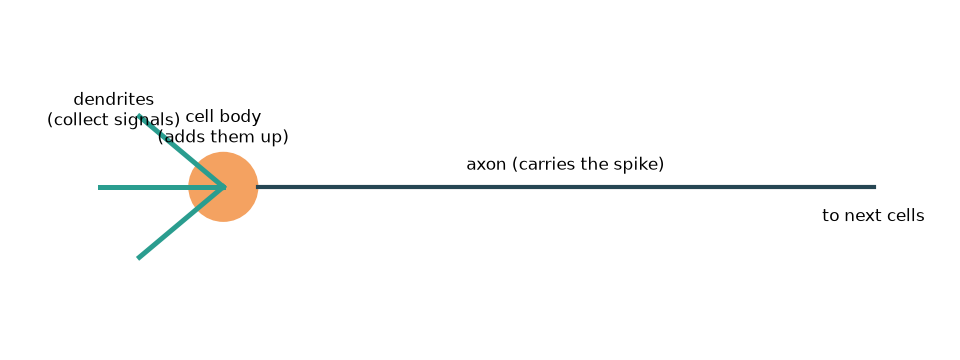
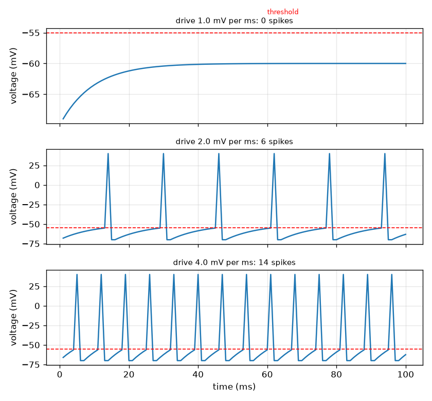

# సెషన్ 1: ఒక న్యూరాన్ సంకేతాలను కూడి ఒక స్పైక్‌ను పంపుతుంది

[Session 1 — हिन्दी](README.hi.md)

*స్థాయి 1 (భావనాత్మక ఇంటరాక్టివ్ మోడల్) · సుమారు 60 నిమిషాలు · openneuron*

> ఇది సరళీకరించిన విద్యా మోడల్. ఇది ధృవీకరించబడిన డిజైన్ సాధనం కాదు; నిజమైన నిర్మాణాలు, విద్యుత్ ఇన్‌స్టాలేషన్‌లు, వాహనాలు, పారిశ్రామిక ప్రక్రియలు లేదా వైద్య నిర్ణయాల కోసం దీనిని ఉపయోగించకూడదు.

**ముందస్తు అవసరాలు (Prerequisites)**

- పాఠశాల అంకగణితం మరియు వోల్టేజ్ (విద్యుత్ ఆవేశంపై ఒక నెట్టు) అనే భావన.
- మీరు PRIMER.md చదివి, `python start.py 1` ను ఒకసారి రన్ చేసి ఉండాలి.

**అభ్యాస లక్ష్యాలు (Learning objectives).** ఈ సెషన్ తర్వాత మీరు:

- ఒక న్యూరాన్ సంకేతాలను సేకరించి, కూడి, థ్రెషోల్డ్ (threshold) వద్ద అన్నీ-లేదా-ఏమీలేదు (all-or-nothing) స్పైక్‌ను పంపడాన్ని వివరించగలరు.
- స్థిరమైన ఇన్‌పుట్ ఎప్పుడైనా న్యూరాన్‌ను ఉత్తేజపరచగలదా అని అంచనా వేయడానికి పెరుగుదల-లీక్ (rise-and-leak) నవీకరణను ఉపయోగించగలరు.
- వోల్టేజ్-కాలం రేఖను చదివి స్పైక్‌ను థ్రెషోల్డ్ కింద ఉన్న ఊగిసలాట నుండి వేరు చేయగలరు.
- ఆక్సాన్ వెంబడి స్పైక్ ఆలస్యాన్ని దాని పొడవు మరియు వేగం నుండి లెక్కించగలరు.

## A. నిజ జీవిత సమస్య
ప్రతి ఆలోచన, స్పర్శ, కదలిక స్పైక్‌లు అనే క్లుప్త విద్యుత్ స్పందనలతో మాట్లాడే నాడీ కణాల ద్వారా మోయబడుతుంది. ఒక న్యూరాన్ తన కొమ్మలపై (డెండ్రైట్లు) ఇతర కణాల నుండి సంకేతాలను అందుకుని, కణ దేహంలో కూడి, మొత్తం వోల్టేజ్ థ్రెషోల్డ్‌ను దాటితే, తన పొడవైన తీగ (ఆక్సాన్) వెంట పరిగెత్తే ఒక స్పైక్‌ను పంపుతుంది. మృదువైన స్పర్శ కొన్ని స్పైక్‌లను, గట్టి నెట్టు చాలా స్పైక్‌లను చేస్తుంది, కానీ ప్రతి స్పైక్ ఒకేలా ఉంటుంది. ఒక కణం మృదువైన ఇన్‌పుట్‌ను ఈ ఆన్-ఆఫ్ సంకేతంగా ఎలా మార్చగలదు? ఈ రెపో సాధారణ విద్యకు మాత్రమే: ఇది సరళీకరించిన మోడల్‌ను చూపుతుంది, వైద్య సమాచారం కాదు.

## B. భావన మరియు సిద్ధాంతం
కణం లోపలి వోల్టేజ్ V ను బయటితో పోలిస్తే మిల్లీవోల్ట్లలో (mV) మోడల్ చేస్తాము. విశ్రాంతిలో అది V_rest = -70 mV వద్ద ఉంటుంది (సాధారణ పాఠ్యపుస్తక విలువ). ప్రతి మిల్లీసెకనూ ఇన్‌పుట్ V ను డ్రైవ్ d (mV per ms) మేర పైకి నెడుతుంది, లీక్ (leak) దూరంలో k = 0.1 భాగం మేర దానిని విశ్రాంతి వైపు వెనక్కి లాగుతుంది. డ్రైవ్ స్థిరమైతే, V ఆగే స్థాయి V_rest + d / k. ఒక థ్రెషోల్డ్ V_th = -55 mV ఉత్తేజాన్ని నిర్ణయిస్తుంది: V దానిని చేరినప్పుడు, న్యూరాన్ స్థిర ఎత్తు గల స్పైక్‌ను పంపుతుంది, V విశ్రాంతికి రీసెట్ అవుతుంది, 2 ms రిఫ్రాక్టరీ సమయం (refractory time) వస్తుంది, అప్పుడు మళ్ళీ ఉత్తేజం కాలేదు. ఆగే స్థాయి థ్రెషోల్డ్ పైన ఉంటేనే స్థిర డ్రైవ్ న్యూరాన్‌ను ఉత్తేజపరచగలదు, అంటే d > k (V_th - V_rest) = ప్రతి ms కు 1.5 mV. స్పైక్ మొదలైన తర్వాత, అది సుమారు స్థిర వేగం v తో ఆక్సాన్ వెంట ప్రయాణిస్తుంది, కాబట్టి పొడవు L పై ఆలస్యం L / v.

| చిహ్నం | అర్థం | యూనిట్ |
|---|---|---|
| V | త్వచ వోల్టేజ్ (లోపల మైనస్ బయట) | mV |
| V_rest | విశ్రాంతి వోల్టేజ్, సాధారణంగా -70 | mV |
| V_th | థ్రెషోల్డ్ వోల్టేజ్, సాధారణంగా -55 | mV |
| d | డ్రైవ్: ప్రతి మిల్లీసెకనూ V కు కలిపే నెట్టు | mV per ms |
| k | ప్రతి మిల్లీసెకనుకు లీక్ భాగం (0.1) | per ms |
| L, v | ఆక్సాన్ పొడవు మరియు స్పైక్ వేగం | m, m per s |

**ఊహలు (Assumptions)**

- కాలం 1 ms అడుగుల్లో కదులుతుంది.
- ఇన్‌పుట్ స్థిర డ్రైవ్ లేదా ప్రతి అడుగుకు ఒకటి చొప్పున నెట్టుల జాబితా.
- ఇన్‌పుట్ ఏదైనా ప్రతి స్పైక్ గీసిన ఎత్తు (+40 mV) ఒకటే: అన్నీ లేదా ఏమీలేదు.
- అన్ని సంఖ్యలు సాధారణ పాఠ్యపుస్తక విలువలు; ఇది సరళీకరించిన విద్యా మోడల్, వైద్య సాధనం కాదు.

$$ V_{n+1}=V_n+d-k\,(V_n-V_{\mathrm{rest}}) $$

$$ V_\infty=V_{\mathrm{rest}}+\frac{d}{k},\qquad d_{\min}=k\,(V_{\mathrm{th}}-V_{\mathrm{rest}}) $$

$$ \Delta t=\frac{L}{v} $$

## C. దృశ్య వివరణ
మొదటి చిత్రం ఒక న్యూరాన్ చిత్రం: డెండ్రైట్లు సంకేతాలను సేకరిస్తాయి, కణ దేహం వాటిని కూడుతుంది, ఆక్సాన్ స్పైక్‌ను తదుపరి కణాలకు చేరవేస్తుంది. రెండవ చిత్రం బలహీన, మధ్యస్థ, బలమైన డ్రైవ్‌కు మూడు వోల్టేజ్ రేఖలను చూపుతుంది. బలహీన డ్రైవ్‌తో వోల్టేజ్ పాకుతూ పెరిగి ఎరుపు థ్రెషోల్డ్ గీత కింద సమం అవుతుంది: స్పైక్ లేదు. మధ్యస్థ, బలమైన డ్రైవ్‌తో వోల్టేజ్ మళ్ళీ మళ్ళీ థ్రెషోల్డ్‌ను చేరుతుంది; ప్రతి స్పైక్‌కు ఒకే ఎత్తు, కానీ బలమైన డ్రైవ్ తరచుగా ఉత్తేజపరుస్తుంది (డ్రైవ్ 2.0, 4.0 లకు 100 ms లో వరుసగా 6, 14 స్పైక్‌లు).

*ఒక న్యూరాన్: డెండ్రైట్లు సంకేతాలను సేకరిస్తాయి, కణ దేహం వాటిని కూడుతుంది, ఆక్సాన్ స్పైక్‌ను మోస్తుంది.*

*బలహీన, మధ్యస్థ, బలమైన డ్రైవ్‌కు వోల్టేజ్ రేఖలు: ఒకే స్పైక్ ఎత్తు, వేర్వేరు రేటు.*

## D. ఇంటరాక్టివ్ సిమ్యులేషన్
పాఠాన్ని రన్ చేయండి (`python start.py 1`), తర్వాత లైవ్ యాప్‌ను తెరవండి: [సెషన్ 1: ఒక న్యూరాన్ ఉత్తేజితమవుతుంది](https://krunalpanchal1995.github.io/pan-iit-oss/openneuron/session-01/) (లేదా ఈ ఫోల్డర్‌లోని `app.html`). డ్రైవ్‌ను జరిపి, ఆగే స్థాయి బార్ థ్రెషోల్డ్ గుర్తును దాటడం, వోల్టేజ్ రేఖ స్పైక్ చేయడం మొదలుపెట్టడం చూడండి; తర్వాత ఆక్సాన్ వేగాన్ని జరిపి ఎరుపు చుక్క మరియు ఆలస్యం మారడం చూడండి.

**సవాలు.** న్యూరాన్‌ను ఉత్తేజపరచండి (డ్రైవ్ ప్రతి ms కు 1.5 mV కంటే ఎక్కువ) మరియు స్పైక్ 0.5 m ఆక్సాన్‌ను 5 ms లోపు దాటనివ్వండి.

## E. సాధించిన ఉదాహరణ మరియు ప్రయోగం
**సమస్య.** విశ్రాంతి నుండి ప్రతి ms కు 2.0 mV స్థిర డ్రైవ్ వర్తింపజేయబడుతుంది. న్యూరాన్ ఉత్తేజితమవుతుందా, ఎన్ని మిల్లీసెకన్ల తర్వాత?

1. ఆగే స్థాయి: V_inf = -70 + 2.0 / 0.1 = -50 mV. అది -55 mV థ్రెషోల్డ్ పైన ఉంది, కాబట్టి ఉత్తేజితమవుతుంది.
2. డ్రైవ్ స్థిరంగా ఉన్నప్పుడు ఎక్కుడు V(n) = -70 + 20 (1 - 0.9^n). మనకు V(n) = -55 కావాలి, అంటే 20 (1 - 0.9^n) = 15, కాబట్టి 0.9^n = 0.25.
3. n = ln 0.25 / ln 0.9 = 13.16 అడుగులు, కాబట్టి 13 అడుగులు చాలవు, 14 చాలు.
4. సరిచూపు: V(13) = -55.08 mV (థ్రెషోల్డ్ కంటే కొంచెం కింద) మరియు V(14) = -54.58 mV (దాని పైన), కాబట్టి మొదటి స్పైక్ అడుగు 14 వద్ద వస్తుంది, అంటే 14 ms.
5. సిమ్యులేషన్ సరిపోతుంది: మొదటి స్పైక్ 14 ms వద్ద, 100 ms లో 6 స్పైక్‌లు.

**సమాధానం.** అవును. మొదటి స్పైక్ 14 ms వద్ద వస్తుంది (13.16 అడుగులు పైకి రౌండ్ చేసినది), న్యూరాన్ 100 ms లో 6 సార్లు ఉత్తేజితమవుతుంది.

**ప్రయోగం.** ఒక నిజమైన న్యూరాన్‌లోకి చిన్న స్థిర విద్యుత్తు పంపుతూ సన్నని గాజు ఎలక్ట్రోడ్‌తో నమోదు చేయవచ్చు: ఒక నిర్దిష్ట విద్యుత్తు కంటే కింద వోల్టేజ్ కొత్త స్థాయికి జారుతుంది, దాని పైన స్పైక్‌లు కనిపిస్తాయి, పెద్ద విద్యుత్తు ఒకేలాంటి స్పైక్‌ల వేగవంతమైన వరుసను ఇస్తుంది. మోడల్ ఆ గుణాత్మక చిత్రాన్ని పునరుత్పత్తి చేస్తుంది. నిజమైన కణం నుండి ఇది భిన్నంగా ఉంటుంది: నిజమైన స్పైక్‌ల ఆకారాన్ని అయాన్ ఛానెల్స్ నిర్ణయిస్తాయి (సెషన్ 3), నిజమైన థ్రెషోల్డ్‌లు ఇటీవలి కార్యకలాపంతో మారతాయి, నిజమైన ఇన్‌పుట్‌లు స్థిరమైన నెట్టు కాదు, శబ్దంతో కూడినవి.

## F. మూల్యాంకనం మరియు డిజైన్ సవాలు
**ప్రశ్న రకం A: భావనాత్మక.** బలమైన ఉద్దీపన పెద్ద స్పైక్‌ను చేయదు. మరి ఒక స్పర్శ బలంగా ఉందని నాడి మెదడుకు ఎలా చెబుతుంది?

సూచన

బలహీన, మధ్యస్థ, బలమైన డ్రైవ్ రేఖలను పోల్చండి: ఏది మారింది, ఏది అలాగే ఉంది?

దశలవారీ పరిష్కారం

స్పైక్ ఎత్తు స్థిరం (అన్నీ లేదా ఏమీలేదు), కానీ బలమైన ఇన్‌పుట్ ప్రతి స్పైక్ తర్వాత వోల్టేజ్‌ను త్వరగా థ్రెషోల్డ్ వైపు నెడుతుంది, కాబట్టి న్యూరాన్ తరచుగా ఉత్తేజితమవుతుంది. బలాన్ని రేటు (మరియు ఎన్ని న్యూరాన్లు ఉత్తేజితమవుతాయి అనేది) మోస్తుంది, స్పైక్ పరిమాణం కాదు. మోడల్‌లో డ్రైవ్ 2.0 100 ms లో 6 స్పైక్‌లను, డ్రైవ్ 4.0 14 ను ఇస్తుంది, అన్నీ ఒకే ఎత్తులో.

**ప్రశ్న రకం B: సంఖ్యాత్మక.** ప్రతి ms కు 3.0 mV స్థిర డ్రైవ్‌కు, వోల్టేజ్ ఆగే స్థాయిని మరియు మొదటి స్పైక్ జరిగే అడుగును కనుగొనండి (చేతితో లెక్కించి, తర్వాత కోడ్‌తో సరిచూడండి).

సూచన

ఆగే స్థాయి = -70 + d / 0.1. మొదటి స్పైక్‌కు 0.9^n = 1 - 15 (0.1) / d కావాలి.

దశలవారీ పరిష్కారం

ఆగే స్థాయి = -70 + 3.0 / 0.1 = -40 mV, థ్రెషోల్డ్ పైన. తర్వాత 0.9^n = 1 - 1.5 / 3.0 = 0.5, కాబట్టి n = ln 0.5 / ln 0.9 = 6.58, పైకి రౌండ్ చేస్తే అడుగు 7. కోడ్ మొదటి స్పైక్‌ను 7 ms వద్ద ఇస్తుంది. యూనిట్ సరిచూపు: డ్రైవ్ mV per ms లో ఉంది, కాబట్టి d / k mV లో ఉంది.

**ప్రశ్న రకం C: గ్రాఫ్ మరియు సిమ్యులేషన్ వ్యాఖ్యానం.** ప్రతి ms కు 1.0 mV డ్రైవ్ రేఖలో వోల్టేజ్ పెరిగి థ్రెషోల్డ్ గీత కింద సమం అవుతుంది. అది ఏ స్థాయి వద్ద సమం అవుతుంది, స్పైక్ ఎందుకు లేదు?

సూచన

ఆగే స్థాయి -70 + d / 0.1 ఉపయోగించి -55 తో పోల్చండి.

దశలవారీ పరిష్కారం

అది -70 + 1.0 / 0.1 = -60 mV వద్ద సమం అవుతుంది, -55 mV థ్రెషోల్డ్ కంటే 5 mV కింద. V -60 కు చేరిన తర్వాత డ్రైవ్ కలిపినంత వేగంగా లీక్ ఆవేశాన్ని తొలగిస్తుంది, కాబట్టి వోల్టేజ్ ఎప్పుడూ -55 కు చేరదు, స్పైక్ లేదు. డ్రైవ్‌ను ప్రతి ms కు 1.5 mV కంటే పైకి పెంచితే ఆగే స్థాయి థ్రెషోల్డ్ పైకి కదులుతుంది.

**ప్రశ్న రకం D: డిజైన్ మరియు ఆప్టిమైజేషన్ సవాలు.** డిజైన్: ఒక మోడల్ న్యూరాన్ 100 ms లో కనీసం 10 సార్లు ఉత్తేజితం కావాలి, ఒక స్పైక్ 0.5 m ఆక్సాన్‌ను 5 ms లోపు దాటాలి. ఒక డ్రైవ్‌ను (ప్రతి ms కు 0.5 mV అడుగుల్లో) మరియు ఆక్సాన్ వేగాన్ని ఎంచుకుని, మీరు చూసే రాజీని (trade-off) చెప్పండి.

సూచన

కోడ్‌తో డ్రైవ్ 2.5, 3.0, 3.5 కు స్పైక్‌లను లెక్కించండి; ఆలస్యం ms లో 1000 L / v.

దశలవారీ పరిష్కారం

డ్రైవ్ 2.5 9 స్పైక్‌లను ఇస్తుంది (తక్కువ), డ్రైవ్ 3.0 11 స్పైక్‌లను, డ్రైవ్ 3.5 12 ను ఇస్తాయి, కాబట్టి 0.5 అడుగుల్లో పనిచేసే అతి చిన్న డ్రైవ్ ప్రతి ms కు 3.0 mV. ఆలస్యం 1000 (0.5) / v < 5 ms, కాబట్టి v 100 m/s కంటే ఎక్కువ ఉండాలి (100 m/s వద్ద సరిగ్గా 5 ms). రాజీ: పెద్ద డ్రైవ్‌కు ఎక్కువ ఇన్‌పుట్ ఖర్చవుతుంది కానీ వేగంగా ఉత్తేజపరుస్తుంది; వేగవంతమైన ఆక్సాన్‌కు మందమైన (లేదా ఇన్సులేట్ చేసిన) పోగు కావాలి, అది ఎక్కువ స్థలం, పదార్థం తీసుకుంటుంది. ఊహ: స్థిర డ్రైవ్ మరియు స్థిర వేగం.

[RUBRIC.md](../../RUBRIC.md) తో మిమ్మల్ని మీరు స్కోర్ చేసుకోండి. కాగితంపై పని చేయడానికి [కార్యాచరణ షీట్](activity_sheet.md) ప్రింట్ చేయండి.

## సాధారణ అపోహలు
| సాధారణ అపోహ | వాస్తవంగా నిజమైనది |
|---|---|
| బలమైన ఉద్దీపన పెద్ద స్పైక్‌ను చేస్తుంది. | స్పైక్‌లు అన్నీ లేదా ఏమీలేదు: ఎత్తు స్థిరం. బలమైన ఉద్దీపన స్పైక్‌లను తరచుగా చేస్తుంది. |
| ఎంత బలహీనమైన ఇన్‌పుట్ అయినా, వేచి ఉంటే చివరికి న్యూరాన్‌ను ఉత్తేజపరుస్తుంది. | బలహీన ఇన్‌పుట్ కలిపినంత వేగంగా లీక్ ఆవేశాన్ని తొలగిస్తుంది, కాబట్టి వోల్టేజ్ థ్రెషోల్డ్ కింద ఆగుతుంది, ఎప్పుడూ ఉత్తేజితం కాదు. |
| స్పైక్ అంటే రాగి తీగలో విద్యుత్తు లాగా ఆక్సాన్ వెంట ప్రవహించే విద్యుత్ ప్రవాహం. | స్పైక్ అనేది త్వచ వోల్టేజ్ యొక్క ప్రయాణించే మార్పు, అది దారిలో పునరుత్పత్తి అవుతుంది; తీగలో విద్యుత్తు కంటే చాలా నెమ్మది (సెకనుకు మీటర్లు, వేల కిలోమీటర్లు కాదు). |
| ఇన్‌పుట్ అనుమతించినంత తరచుగా న్యూరాన్ ఉత్తేజితం కాగలదు. | ప్రతి స్పైక్ తర్వాత రిఫ్రాక్టరీ సమయం ఉంటుంది, కాబట్టి రేటుకు గరిష్ఠ పరిమితి ఉంది (ఈ బొమ్మ మోడల్‌లో 3 ms కు ఒక స్పైక్). |

## పదకోశం (Glossary)
- **న్యూరాన్ (neuron)**: విద్యుత్ సంకేతాలను అందుకుని, కూడి, ముందుకు పంపే నాడీ కణం
- **స్పైక్ (యాక్షన్ పొటెన్షియల్) (spike, action potential)**: న్యూరాన్ పంపే త్వచ వోల్టేజ్ యొక్క క్లుప్త, స్థిర పరిమాణపు స్పందన
- **థ్రెషోల్డ్ (threshold)**: న్యూరాన్ ఉత్తేజితమయ్యే వోల్టేజ్
- **ఆక్సాన్ (axon)**: కణ దేహం నుండి స్పైక్‌ను దూరంగా మోసే న్యూరాన్ పొడవైన తీగ
- **రిఫ్రాక్టరీ పీరియడ్ (refractory period)**: స్పైక్ తర్వాత న్యూరాన్ మళ్ళీ ఉత్తేజితం కాలేని క్లుప్త సమయం
- **మిల్లీవోల్ట్ (mV) (millivolt)**: వోల్ట్‌లో వెయ్యో వంతు, త్వచ వోల్టేజ్‌లకు సహజ యూనిట్

## ముగింపు
1. [exercises.md](exercises.md) లోని మూడు కోడింగ్ పనులు చేయండి.
2. మీ మార్పుల తర్వాత `python start.py 1` ను మళ్ళీ రన్ చేయండి. అది చెక్‌పాయింట్‌తో ముగుస్తుంది; అది `PASS` అని ప్రింట్ చేసినప్పుడు, మీరు పూర్తి చేసినట్లు. (చెక్‌పాయింట్ మాత్రమే: `python start.py check 1`.)

తదుపరి: [సెషన్ 2](../session-02/README.md)
