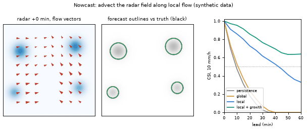
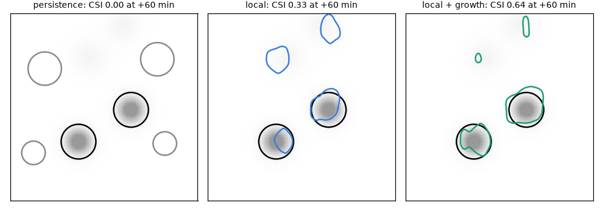
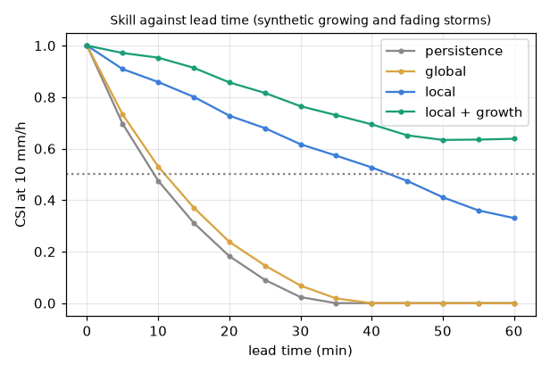
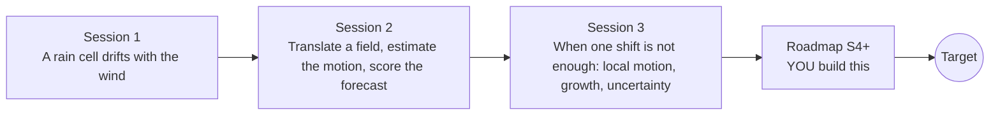

# opennowcast

[](https://github.com/KrunalPanchal1995/pan-iit-oss/actions/workflows/tests.yml)   [](https://colab.research.google.com/github/KrunalPanchal1995/pan-iit-oss/blob/main/opennowcast/sessions/session-01/lesson.ipynb) [](https://krunalpanchal1995.github.io/pan-iit-oss/opennowcast/)

**Nowcast rain by sliding the radar picture along the wind, in three sessions.**

opennowcast teaches how short-range rain forecasts are made by moving radar pictures along the measured motion, then measures how good (and how limited) that is, using only Python and a browser.

- **Start from zero.** Session 1 needs only speed = distance / time; the radar picture is explained from scratch.
- **See it move.** Every session ships a slider app that runs in the browser, with labelled graphs.
- **Know you got it right.** Each session ends with a checkpoint that prints PASS or FAIL against hand calculations.
- **Build the missing half.** The repo stops at Session 3 on purpose; the roadmap shows the path to the Target.

[Target](#the-target) · [Who is this for](#who-is-this-for) · [Quick start](#quick-start) · [Sessions](#sessions) · [Roadmap](#roadmap) · [Contribute](#contribute) · [Explainer PDF](docs/explainer.pdf)

> **This repo is incomplete on purpose.** Sessions 1 to 3 are here and fully working. The finished Target below is a preview of what the community can build next. We show you the path, not the code. Sessions 4 and up are yours.

## The Target

A synthetic radar scene with four storms, two moving east and two moving north-west, some growing and some fading. The animation shows the red motion vectors found by local optical flow, the forecast outline of each method against what actually happened, and the skill curve filling in. On the right, a single global wind and plain persistence lose skill within 15 minutes, local vectors keep a useful forecast for about 45 minutes, and a version that also follows growth and decay keeps a CSI of about 0.64 at 60 minutes. Your goal over the coming sessions: build that, and then make it better.



*Target: local flow, forecast against truth, and the skill curve (synthetic data)*



*Target: the 60-minute forecast outline of three methods against what happened*



*Target: CSI against lead time for four methods*

Try it live:

- [Math Visual Studio: numerical PDEs (Atlas S34)](https://krunalpanchal1995.github.io/studio/#atlas?ch=S34&ex=1)
- [Math Visual Studio: fluid kinematics (Atlas S58)](https://krunalpanchal1995.github.io/studio/#atlas?ch=S58&ex=1)

How the Target was made is shown only as a path in [promo/roadmap.md](promo/roadmap.md).

## Who is this for
**secondary school to diploma / undergraduate (levels 3-5).** Topic area: Geography, Climate, Environment and Earth Science.

Prerequisites:

- Speed = distance / time, and what a graph with two axes is (school level).
- Python 3.10 or newer; if `python --version` works, you are ready. PRIMER.md explains the rest.
- No prior GitHub, meteorology or image-processing experience is needed. This is a teaching model, not a weather warning system.

New to Python? Read [PRIMER.md](PRIMER.md) first (10 minutes).

## Quick start

No installation knowledge needed. You need [Git](https://git-scm.com/downloads) and [Python 3.10+](https://www.python.org/downloads/) (Windows: tick "Add Python to PATH"). On Mac and Linux type `python3` wherever this page says `python`.

```bash
git clone https://github.com/KrunalPanchal1995/pan-iit-oss.git
cd pan-iit-oss/opennowcast
python start.py 1
```

`start.py` creates a private environment, installs what is needed and runs Session 1 with its checkpoint. Next: `python start.py 2`, `python start.py 3`, or `python start.py test` to check everything. Only a checkpoint: `python start.py check 1`.

<!-- friendly-help -->
<details>
<summary><b>Not working? Common fixes (no Git, "python not found", no internet)</b></summary>

- **No Git?** You do not need it. On the main page of this collection click the green **Code** button, then **Download ZIP**, unzip it, open a terminal inside the folder `pan-iit-oss-main/opennowcast` and run `python start.py 1`. The ZIP holds every project, so it is large; the live apps need no download at all.
- **"python is not recognized" or "command not found".** On Windows try `py start.py 1`. On Mac and Linux try `python3 start.py 1`. If neither works, install Python from [python.org](https://www.python.org/downloads/) and tick "Add Python to PATH".
- **Needs internet once.** The first run downloads NumPy and Matplotlib into a private folder (`.venv`); after that it works offline.
- **Rather not install anything?** Open the [live apps](https://krunalpanchal1995.github.io/pan-iit-oss/opennowcast/) in your browser, or use the Colab badge at the top of this page.
- **Still stuck?** [Open an issue](https://github.com/KrunalPanchal1995/pan-iit-oss/issues/new?title=%5Bopennowcast%5D%20) with your operating system and the message you see. Questions from beginners are welcome.

</details>

Four lines turn the idea of Session 1 into a result (they work as they are): Save it as `try.py` and run it with `python start.py run try.py` (this uses the private environment, where NumPy is installed):

```python
import numpy as np
y, x = np.mgrid[0:100, 0:100]                  # a 100 x 100 km radar picture, 1 pixel = 1 km
cell = lambda cx: 40 * np.exp(-((x - cx) ** 2 + (y - 50) ** 2) / 72)   # a 40 mm/h rain cell
print(round(cell(20)[50, 20]), 'mm/h at the centre;', 3 * 12, 'km/h if it moved 3 pixels in 5 minutes')
```

Every session also opens in your browser with sliders (no install): [live apps](https://krunalpanchal1995.github.io/pan-iit-oss/opennowcast/). Or use the Colab badge above for the notebook.

## Sessions

| # | Session | Model level | Time | Live app |
|---|---|---|---|---|
| 1 | [A rain cell drifts with the wind](sessions/session-01/README.md) | Level 1: conceptual interactive model | 60 min | [open](https://krunalpanchal1995.github.io/pan-iit-oss/opennowcast/session-01/) |
| 2 | [Translate a field, estimate the motion, score the forecast](sessions/session-02/README.md) | Level 2: mathematical engineering model | 75 min | [open](https://krunalpanchal1995.github.io/pan-iit-oss/opennowcast/session-02/) |
| 3 | [When one shift is not enough: local motion, growth, uncertainty](sessions/session-03/README.md) | Level 3: simulation and validation | 90 min | [open](https://krunalpanchal1995.github.io/pan-iit-oss/opennowcast/session-03/) |

Each session follows the same six steps: A real-world problem, B concept and theory, C visual explanation, D interactive simulation, E worked example and experiment, F assessment and design challenge. Each ends with `checkpoint.py`, which prints `PASS` or `FAIL` against reference numbers. Session 3 also contains the real-world mini-project: **Nowcast a two-region storm field for 60 minutes**.

## Architecture



| Folder or file | What is inside |
|---|---|
| `sessions/` | three sessions: README (A-F), `lesson.py`, notebook, live app, exercises, activity sheet, checkpoint |
| `promo/` | the Target: media, live links, and the roadmap (path only) |
| `docs/` | `explainer.tex` and the built `explainer.pdf` |
| `tests/` | runs every lesson and checkpoint headless |
| `start.py` | one command to set up and run anything |
| `QUALITY.md`, `RUBRIC.md` | the quality checklist and the scoring rubric |
| `.github/` | CI, PDF build, Pages deploy, issue and PR templates |

## Roadmap

| Milestone | What you will build | Difficulty |
|---|---|---|
| Session 4: Growth-aware advection | A forecast that advects the field and multiplies it by a growth map that is itself advected. | intermediate |
| Session 5: Follow the rotation | A forecast that advects in several sub-steps using the vectors at each new position. | advanced |
| Session 6: Sharper long steps | A stepping scheme that moves a cell for 60 minutes in 12 steps without smoothing it. | intermediate |
| Session 7: Reliable at every confidence level | A probability forecast whose reliability table lies near the diagonal in every bin. | advanced |
| Session 8: Storm initiation hints | A rule that flags areas of likely initiation and a way to score it. | advanced |

Full detail with a checkpoint per milestone: [promo/roadmap.md](promo/roadmap.md).

## Contribute
New to GitHub? Read [CONTRIBUTING.md](CONTRIBUTING.md); it starts from zero. Pick an issue labelled `good first issue`. Translations into Hindi, Telugu, Tamil and Malayalam are welcome.

<details>
<summary>Development</summary>

```bash
python start.py test        # runs every lesson and checkpoint
```
Lessons use `# %%` cell markers so they open as notebooks in VS Code. See [QUALITY.md](QUALITY.md) for the standard every session meets.
</details>

## License
MIT. See [LICENSE](LICENSE). Media in `promo/media` is (c) Krunal Panchal, CC BY 4.0.

## Acknowledgments
Part of the [PAN IIT OSS](https://hellofoss.tech-iitb.org/projects) open-source teaching collection, modelled on the structure of [openspline](https://github.com/openspline/openspline). Built on ideas from the Math Visual Studio at https://krunalpanchal1995.github.io/studio/.
