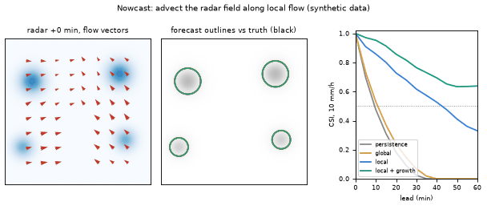
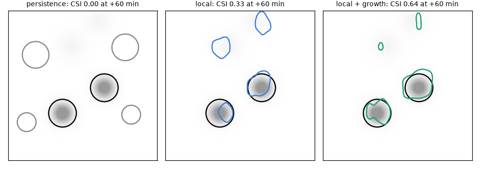
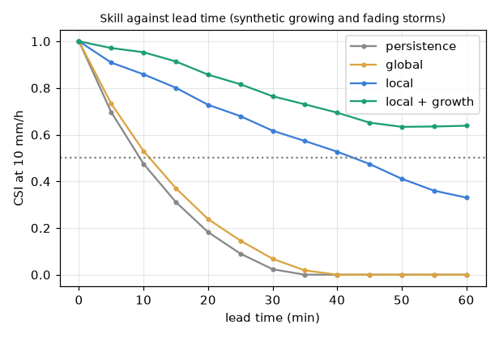

# What you are building toward

A synthetic radar scene with four storms, two moving east and two moving north-west, some growing and some fading. The animation shows the red motion vectors found by local optical flow, the forecast outline of each method against what actually happened, and the skill curve filling in. On the right, a single global wind and plain persistence lose skill within 15 minutes, local vectors keep a useful forecast for about 45 minutes, and a version that also follows growth and decay keeps a CSI of about 0.64 at 60 minutes. Your goal over the coming sessions: build that, and then make it better.

*Target: local flow, forecast against truth, and the skill curve (synthetic data)*

*Target: the 60-minute forecast outline of three methods against what happened*

*Target: CSI against lead time for four methods*

These results come from a private reference build. The code is not published; the roadmap shows the path so you can build your own.

Live links:

- [Math Visual Studio: numerical PDEs (Atlas S34)](https://krunalpanchal1995.github.io/studio/#atlas?ch=S34&ex=1)
- [Math Visual Studio: fluid kinematics (Atlas S58)](https://krunalpanchal1995.github.io/studio/#atlas?ch=S58&ex=1)
