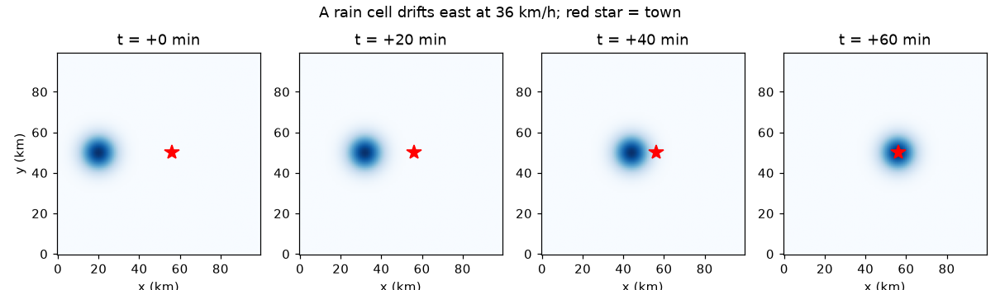
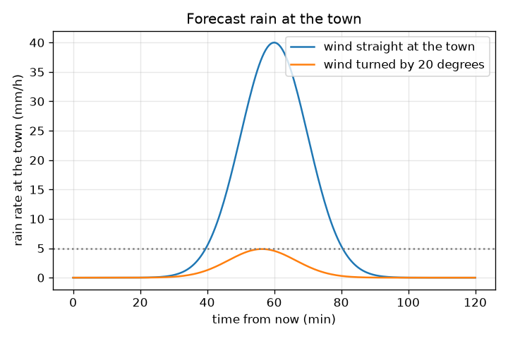

# सत्र 1: एक वर्षा कोशिका हवा के साथ बहती है

*स्तर 1 (वैचारिक इंटरैक्टिव मॉडल) · लगभग 60 मिनट · opennowcast*

> यह एक सरलीकृत शैक्षिक मॉडल (simplified educational model) है। यह कोई सत्यापित डिज़ाइन टूल नहीं है और इसका उपयोग वास्तविक संरचनाओं, बिजली की स्थापनाओं, वाहनों, औद्योगिक प्रक्रियाओं या चिकित्सा निर्णयों के लिए नहीं किया जाना चाहिए।

**पूर्व-आवश्यकताएँ (Prerequisites)**

- चाल = दूरी / समय।
- आपने PRIMER.md पढ़ लिया है और `python start.py 1` एक बार चला लिया है।

**सीखने के उद्देश्य (Learning objectives).** इस सत्र के बाद आप:

- रडार चित्र को वर्षा दरों (mm/h) के ग्रिड के रूप में पढ़ सकेंगे, जिसमें 1 km के पिक्सेल हैं और हर 5 मिनट में एक फ्रेम।
- दो फ्रेमों के बीच किसी कोशिका (cell) की गति को km/h में हवा की चाल में बदल सकेंगे।
- बता सकेंगे कि कोशिका किसी कस्बे तक कब पहुँचती है और वहाँ वर्षा पहली बार 5 mm/h तक कब पहुँचती है।
- समझा सकेंगे कि हवा की दिशा में छोटा सा बदलाव भी चूक (miss) का कारण क्यों बन सकता है।

## A. वास्तविक दुनिया की समस्या
मौसम रडार हर 5 मिनट में वर्षा का एक नया चित्र भेजता है। एक चित्र में वर्षा कोशिका, यानी भारी वर्षा का एक धब्बा, एक जगह पर है; अगले चित्र में वह आगे बढ़ चुकी है। अगर हम मापें कि कितनी दूर, तो हम उसे ले जाने वाली हवा जान लेते हैं, और बता सकते हैं कि अगले एक घंटे में वह किसी कस्बे तक कब पहुँचेगी। यह नाउकास्ट (nowcast) है: अगले एक-दो घंटे का पूर्वानुमान। सुरक्षा टिप्पणी: यह काल्पनिक डेटा वाला एक शिक्षण मॉडल है। यह मौसम चेतावनी प्रणाली नहीं है। हमेशा अपनी राष्ट्रीय मौसम सेवा के आधिकारिक पूर्वानुमानों और चेतावनियों का पालन कीजिए।

## B. अवधारणा और सिद्धांत
रडार चित्र संख्याओं का एक ग्रिड है। यहाँ यह 100 x 100 पिक्सेल का है, एक पिक्सेल 1 km चौड़ा है, और हर पिक्सेल में mm/h (प्रति घंटा वर्षा के मिलीमीटर) में वर्षा दर (rain rate) है। वर्षा कोशिका वर्षा की एक चिकनी पहाड़ी है: केंद्र पर सबसे तेज़ और बाहर कमज़ोर, जिसे केंद्रीय वर्षा दर P और चौड़ाई sigma वाली गाउसियन घंटी (Gaussian bell) के रूप में लिखा जाता है। अगर एक 5 मिनट के फ्रेम में केंद्र dx पिक्सेल पूर्व और dy पिक्सेल उत्तर खिसका, तो उसे ले जाने वाली हवा km/h में उन संख्याओं की 12 गुना है, क्योंकि 5 मिनट एक घंटे का 1/12 है और एक पिक्सेल 1 km है। इस पूरी रिपॉज़िटरी की मुख्य मान्यता: पूर्वानुमान के दौरान हवा समान रहती है। तब केंद्र स्थिर चाल से सीधी रेखा में चलता है, और कस्बे पर वर्षा केंद्र से दूरी पर घंटी का मान है।

| प्रतीक | अर्थ | इकाई |
|---|---|---|
| (x, y) | रडार चित्र पर स्थिति | km (1 पिक्सेल = 1 km) |
| R | वर्षा दर | mm/h |
| P | कोशिका के केंद्र पर वर्षा दर (40) | mm/h |
| sigma | कोशिका की चौड़ाई (6) | km |
| (u, v) | कोशिका को ले जाने वाली हवा, पूर्व और उत्तर | km/h |
| d | कोशिका केंद्र से कस्बे तक दूरी | km |
| r | केंद्र से वह दूरी जिस पर वर्षा सीमा-मान (threshold) तक गिर जाती है | km |

**मान्यताएँ (Assumptions)**

- पूर्वानुमान के दौरान हवा स्थान और समय में स्थिर है।
- कोशिका अपना आकार और अपनी शिखर वर्षा दर बनाए रखती है (न वृद्धि, न क्षय)।
- डेटा कृत्रिम (synthetic) है; वास्तविक रडार में शोर, खाली स्थान और त्रुटियाँ होती हैं।

$$ R(d)=P\,\exp\!\left(-\frac{d^{2}}{2\sigma^{2}}\right) $$

$$ (u,v)=\frac{(\Delta x,\Delta y)\times 1\,\mathrm{km}}{5/60\ \mathrm{h}}=12\,(\Delta x,\Delta y)\ \mathrm{km/h} $$

$$ r=\sigma\sqrt{2\ln\!\left(P/R_{\mathrm{thr}}\right)} $$

$$ (x_c,y_c)(t)=(x_0,y_0)+(u,v)\,\frac{t}{60}\qquad(t\ \text{in minutes}) $$

## C. दृश्य व्याख्या
पहला चित्र 0, 20, 40 और 60 मिनट पर उसी कोशिका को दिखाता है, जो 36 km/h से पूर्व की ओर लाल तारे (कस्बे) की तरफ़ बढ़ रही है। दूसरा चित्र दो हवाओं के लिए समय के सापेक्ष कस्बे पर पूर्वानुमानित वर्षा दर दिखाता है: एक सीधे कस्बे की ओर बहती हुई (60 मिनट बाद 40 mm/h का शिखर) और एक 20 डिग्री घूमी हुई। घूमी हुई हवा कोशिका के केंद्र को 12.3 km से चूक जाती है और कस्बे को अधिकतम केवल 4.87 mm/h मिलता है, जो 5 mm/h की बिंदीदार रेखा से ठीक नीचे है: हवा की दिशा में छोटा बदलाव सीधे प्रहार को लगभग-चूक में बदल देता है।

*0, 20, 40 और 60 मिनट पर 36 km/h से पूर्व की ओर बहती एक कोशिका; लाल तारा कस्बा है।*

*कस्बे पर पूर्वानुमानित वर्षा, सीधे उसकी ओर बहती हवा और 20 डिग्री घूमी हुई हवा के लिए।*

## D. इंटरैक्टिव सिमुलेशन
पाठ चलाइए (`python start.py 1`), फिर लाइव ऐप खोलिए: [सत्र 1: वर्षा कस्बे तक कब पहुँचती है?](https://krunalpanchal1995.github.io/pan-iit-oss/opennowcast/session-01/) (या इस फ़ोल्डर में `app.html`)। हवा की चाल और दिशा के स्लाइडर खिसकाइए और मानचित्र पर कोशिका का पथ देखिए। फिर ग्राफ़ दृश्य खोलिए और देखिए कि कस्बे पर वर्षा समय के साथ कैसे बदलती है। निकटतम पहुँच, चूक की दूरी और 5 mm/h या अधिक वर्षा शुरू होने का समय पढ़िए।

**चुनौती (Challenge).** कस्बे पर ठीक 60 मिनट बाद 30 mm/h या अधिक वर्षा कराइए।

## E. हल किया गया उदाहरण और प्रयोग
**समस्या.** 5 मिनट के अंतर वाले दो फ्रेमों के बीच एक कोशिका (चौड़ाई 6 km, केंद्रीय वर्षा दर 40 mm/h) 3 पिक्सेल पूर्व की ओर खिसकी। कस्बा कोशिका से 36 km पूर्व में है। हवा क्या है, केंद्र कब पहुँचता है, और कस्बे पर वर्षा पहली बार 5 mm/h तक कब पहुँचती है?

1. हवा = 12 x 3 = 36 km/h पूर्व की ओर (1/12 घंटे में 3 km)।
2. केंद्र 36 km / 36 km/h = 1 घंटा = 60 मिनट बाद पहुँचता है।
3. कोशिका का 5 mm/h वाला किनारा केंद्र से r = 6 x sqrt(2 ln(40/5)) = 6 x sqrt(2 x 2.079) = 12.24 km दूर है।
4. 5 mm/h की वर्षा कस्बे तक तब पहुँचती है जब केंद्र 12.24 km दूर हो, यानी 36 - 12.24 = 23.76 km चलने के बाद, जिसमें 23.76 / 36 x 60 = 39.6 मिनट लगते हैं।
5. जाँच: 39.6 मिनट बाद दूरी 12.24 km है और R = 40 exp(-12.24^2 / 72) = 5.0 mm/h।

**उत्तर.** हवा 36 km/h पूर्व की ओर है, केंद्र 60 मिनट बाद पहुँचता है, और 5 mm/h या अधिक की वर्षा 39.6 मिनट बाद शुरू होती है।

**प्रयोग (Experiment).** अपनी राष्ट्रीय मौसम सेवा से एक वास्तविक रडार लूप खोलिए (पिछले एक घंटे का एनिमेशन)। एक स्पष्ट कोशिका चुनिए, 30 मिनट के अंतर वाले दो फ्रेमों में मानचित्र ग्रिड पर उसकी स्थिति नोट कीजिए, दूरी को 0.5 घंटे से भाग दीजिए और हवा के पूर्वानुमान से तुलना कीजिए। केवल मोटे तौर पर मेल की अपेक्षा कीजिए: वास्तविक कोशिकाएँ बढ़ती हैं, फीकी पड़ती हैं, दिशा बदलती हैं और ज़मीन की हवा से नहीं बल्कि ऊपर की हवाओं से चलाई जाती हैं। मॉडल चलते धब्बे के लिए सटीक है; वास्तविकता कोई कठोर धब्बा नहीं है।

## F. मूल्यांकन और डिज़ाइन चुनौती
**प्रश्न प्रकार A: वैचारिक (Conceptual).** हवा जानने के लिए हमें दो रडार चित्रों की आवश्यकता क्यों है, और हम यह क्यों मानते हैं कि पूर्वानुमान के दौरान हवा समान रहती है?

संकेत

एक चित्र दिखाता है कि वर्षा कहाँ है, यह नहीं कि वह कहाँ जा रही है। चाल मापने के लिए आपको क्या चाहिए?

चरण-दर-चरण हल

चाल के लिए दूरी और समय चाहिए: ज्ञात समय-अंतर पर लिए गए दो चित्रों के बीच कोशिका द्वारा तय की गई दूरी। एक चित्र में गति की कोई जानकारी नहीं होती। फिर पूर्वानुमान उस गति को भविष्य में आगे बढ़ाता है, जो केवल तभी काम करता है जब हवा न बदले; वास्तविक हवाएँ बदलती हैं, इसीलिए अग्रिम समय (lead time) के साथ कौशल (skill) घटता है (सत्र 2 और 3)।

**प्रश्न प्रकार B: संख्यात्मक (Numerical).** एक कोशिका 5 मिनट में 5 पिक्सेल पूर्व की ओर खिसकती है। एक कस्बा उसके केंद्र से 45 km पूर्व में है। हवा क्या है और केंद्र कब पहुँचता है?

संकेत

प्रति फ्रेम प्रति पिक्सेल 12 km/h; फिर समय = दूरी / चाल।

चरण-दर-चरण हल

हवा = 12 x 5 = 60 km/h। समय = 45 km / 60 km/h = 0.75 h = 45 मिनट। तर्कसंगतता जाँच (sanity check): 60 km/h का अर्थ है 1 km प्रति मिनट, इसलिए 45 km में 45 मिनट लगते हैं।

**प्रश्न प्रकार C: ग्राफ़ और सिमुलेशन की व्याख्या.** कस्बे पर वर्षा के ग्राफ़ में, सीधे कस्बे की ओर बहती हवा और 20 डिग्री घूमी हुई हवा बहुत अलग शिखर देती हैं। दोनों शिखर पढ़िए और अंतर समझाइए।

संकेत

चूक की दूरी देखिए और यह देखिए कि केंद्र से दूर जाने पर घंटी कितनी तेज़ी से गिरती है।

चरण-दर-चरण हल

सीधी हवा का शिखर 40 mm/h है (60 मिनट बाद)। घूमी हुई हवा का शिखर 56.4 मिनट बाद केवल 4.87 mm/h है, जो 5 mm/h रेखा से नीचे है। घूमा हुआ पथ कस्बे से 36 x sin(20 degrees) = 12.3 km दूर से गुज़रता है, और 12.3 km पर घंटी 4.87 mm/h तक गिर चुकी होती है। चूक की दूरी की तुलना में कोशिका संकरी है, इसलिए दिशा बहुत मायने रखती है।

**प्रश्न प्रकार D: डिज़ाइन और अनुकूलन (optimisation) चुनौती.** डिज़ाइन: एक कस्बा 36 km/h से सीधे उसकी ओर बढ़ रही कोशिका के लिए 5 mm/h या अधिक वर्षा से कम से कम 20 मिनट पहले चेतावनी चाहता है। पूर्वानुमान जारी करते समय कोशिका केंद्र कितनी दूर होना चाहिए?

संकेत

20 मिनट की यात्रा और केंद्र से 5 mm/h वाले किनारे तक की दूरी।

चरण-दर-चरण हल

20 मिनट में कोशिका 36 x 20/60 = 12 km चलती है। वर्षा कस्बे तक तब पहुँचती है जब केंद्र 12.24 km दूर हो, इसलिए केंद्र 12 + 12.24 = 24.24 km दूर होना चाहिए। मान्यताएँ: स्थिर हवा और अपना आकार बनाए रखने वाली कोशिका। व्यवहार में सुरक्षा मार्जिन जोड़िए क्योंकि दोनों अनिश्चित हैं।

[RUBRIC.md](../../RUBRIC.md) से स्वयं को अंक दीजिए। कागज़ पर काम करने के लिए [गतिविधि पत्रक](activity_sheet.md) प्रिंट कीजिए।

## सामान्य भ्रांतियाँ
| सामान्य भ्रांति (misconception) | वास्तव में क्या सच है |
|---|---|
| वर्षा कोशिका एक ऐसी चीज़ है जो कार की तरह यात्रा करती है। | चित्र दिखाता है कि अभी वर्षा कहाँ गिर रही है; पैटर्न चलता है, पर उसके भीतर की वर्षा बढ़ती और फीकी पड़ती रहती है। |
| अगर कोशिका केंद्र कस्बे से चूक जाए, तो कस्बा सूखा रहता है। | कोशिका की एक चौड़ाई होती है। किनारे के पास का कस्बा फिर भी वर्षा पा सकता है; यहाँ 12.3 km की चूक भी अधिकतम 4.87 mm/h देती है। |
| पूर्वानुमान 1 घंटे पर उतना ही अच्छा है जितना 5 मिनट पर। | हवा की हर छोटी त्रुटि अग्रिम समय के साथ बढ़ती है; जितना आगे देखेंगे, कौशल उतना घटेगा। |
| हवा जानने के लिए एक चित्र पर्याप्त है। | आपको ज्ञात समय-अंतर वाले दो चित्र चाहिए: हवा इस बात से मिलती है कि पैटर्न कितनी दूर खिसका। |

## शब्दावली
- **नाउकास्ट (nowcast)**: अगले एक-दो घंटे का पूर्वानुमान, यहाँ रडार चित्रों को मापी गई गति के साथ आगे खिसकाकर बनाया गया
- **रडार फ्रेम (radar frame)**: ग्रिड पर वर्षा दर का एक चित्र; यहाँ हर 5 मिनट में एक फ्रेम
- **वर्षा दर (rain rate)**: वर्षा कितनी तेज़ी से गिरती है, mm/h में
- **गाउसियन कोशिका (Gaussian cell)**: एक चिकना घंटी के आकार का धब्बा: वर्षा दर केंद्र पर सबसे अधिक होती है और दूरी के साथ घटती है
- **सीमा-मान (threshold)**: एक वर्षा दर (यहाँ 5 mm/h) जिसके ऊपर हम कहते हैं कि 'गिनने लायक' वर्षा हो रही है

## समापन
1. [exercises.md](exercises.md) में दिए तीन कोडिंग कार्य कीजिए।
2. अपने बदलावों के बाद `python start.py 1` फिर से चलाइए। यह चेकपॉइंट (checkpoint) के साथ समाप्त होता है; जब यह `PASS` छापे, तो आपका काम पूरा है। (केवल चेकपॉइंट: `python start.py check 1`।)

आगे: [सत्र 2](../session-02/README.md)
