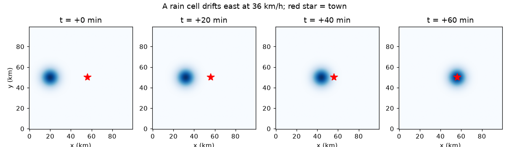
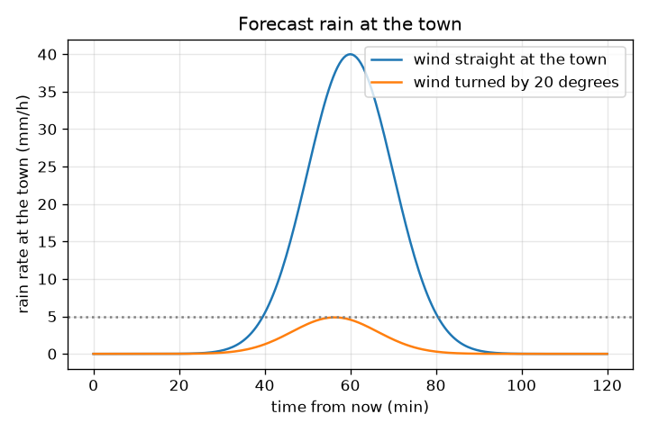

# Session 1: A rain cell drifts with the wind

[Session 1 — हिन्दी](README.hi.md) · [Session 1 — മലയാളം](README.ml.md) · [Session 1 — தமிழ்](README.ta.md) · [Session 1 — తెలుగు](README.te.md)

*Level 1 (conceptual interactive model) · about 60 minutes · opennowcast*

> This is a simplified educational model. It is not a validated design tool and must not be used for real structures, electrical installations, vehicles, industrial processes or medical decisions.

**Prerequisites**

- Speed = distance / time.
- You have read PRIMER.md and run `python start.py 1` once.

**Learning objectives.** After this session you can:

- Read a radar picture as a grid of rain rates (mm/h) with 1 km pixels and one frame every 5 minutes.
- Turn the movement of a cell between two frames into a wind speed in km/h.
- Say when a cell reaches a town and when the rain there first reaches 5 mm/h.
- Explain why a small change in wind direction can mean a miss.

## A. Real-world problem
A weather radar sends a new picture of rain every 5 minutes. In a picture a rain cell, a blob of heavy rain, is in one place; in the next picture it has moved. If we measure how far, we know the wind that carries it, and we can say when it will reach a town in the next hour. This is a nowcast: a forecast for the next hour or two. Safety note: this is a teaching model with made-up data. It is not a weather warning system. Always follow the official forecasts and warnings of your national weather service.

## B. Concept and theory
A radar picture is a grid of numbers. Here it is 100 x 100 pixels, one pixel is 1 km wide, and each pixel holds a rain rate in mm/h (millimetres of rain per hour). A rain cell is a smooth hill of rain: strongest at the centre and weaker outside, written as a Gaussian bell with centre rain rate P and width sigma. If the centre moved dx pixels east and dy pixels north in one 5 minute frame, the wind that carries it is 12 times those numbers in km/h, because 5 minutes is 1/12 of an hour and a pixel is 1 km. The key assumption of this whole repo: the wind stays the same during the forecast. Then the centre moves in a straight line at constant speed, and the rain at a town is the bell evaluated at the distance from the centre.

| Symbol | Meaning | Unit |
|---|---|---|
| (x, y) | position on the radar picture | km (1 pixel = 1 km) |
| R | rain rate | mm/h |
| P | rain rate at the centre of the cell (40) | mm/h |
| sigma | width of the cell (6) | km |
| (u, v) | wind carrying the cell, east and north | km/h |
| d | distance from the cell centre to the town | km |
| r | distance from the centre at which the rain falls to the threshold | km |

**Assumptions**

- The wind is constant in space and time during the forecast.
- The cell keeps its size and its peak rain rate (no growth or decay).
- The data are synthetic; a real radar adds noise, gaps and errors.

$$ R(d)=P\,\exp\!\left(-\frac{d^{2}}{2\sigma^{2}}\right) $$

$$ (u,v)=\frac{(\Delta x,\Delta y)\times 1\,\mathrm{km}}{5/60\ \mathrm{h}}=12\,(\Delta x,\Delta y)\ \mathrm{km/h} $$

$$ r=\sigma\sqrt{2\ln\!\left(P/R_{\mathrm{thr}}\right)} $$

$$ (x_c,y_c)(t)=(x_0,y_0)+(u,v)\,\frac{t}{60}\qquad(t\ \text{in minutes}) $$

## C. Visual explanation
The first figure shows the same cell at 0, 20, 40 and 60 minutes, moving east at 36 km/h towards the red star (the town). The second figure plots the forecast rain rate at the town against time for two winds: one blowing straight at the town (a peak of 40 mm/h after 60 minutes) and one turned by 20 degrees. The turned wind misses the centre of the cell by 12.3 km and the town only sees 4.87 mm/h at best, just under the 5 mm/h dotted line: a small change in wind direction changes a hit into a near miss.

*One cell drifting east at 36 km/h at 0, 20, 40 and 60 minutes; the red star is the town.*

*Forecast rain at the town for a wind straight at it and for a wind turned by 20 degrees.*

## D. Interactive simulation
Run the lesson (`python start.py 1`), then open the live app: [Session 1: when does the rain reach the town?](https://krunalpanchal1995.github.io/pan-iit-oss/opennowcast/session-01/) (or `app.html` in this folder). Move the wind speed and direction sliders and watch the cell path on the map. Then open the graph view and see how the rain at the town changes with time. Read the closest approach, the miss distance and the time rain of 5 mm/h or more begins.

**Challenge.** Make the rain at the town 30 mm/h or more exactly 60 minutes from now.

## E. Worked example and experiment
**Problem.** Between two frames 5 minutes apart a cell (width 6 km, centre rain rate 40 mm/h) moved 3 pixels east. The town is 36 km east of the cell. What is the wind, when does the centre arrive, and when does the rain at the town first reach 5 mm/h?

1. Wind = 12 x 3 = 36 km/h towards the east (3 km in 1/12 hour).
2. The centre arrives after 36 km / 36 km/h = 1 hour = 60 minutes.
3. The 5 mm/h edge of the cell is r = 6 x sqrt(2 ln(40/5)) = 6 x sqrt(2 x 2.079) = 12.24 km from the centre.
4. Rain of 5 mm/h reaches the town when the centre is 12.24 km away, that is after travelling 36 - 12.24 = 23.76 km, which takes 23.76 / 36 x 60 = 39.6 minutes.
5. Check: after 39.6 minutes the distance is 12.24 km and R = 40 exp(-12.24^2 / 72) = 5.0 mm/h.

**Answer.** The wind is 36 km/h east, the centre arrives after 60 minutes, and rain of 5 mm/h or more starts after 39.6 minutes.

**Experiment.** Open a real radar loop from your national weather service (animation of the last hour). Pick one clear cell, note its position on a map grid in two frames 30 minutes apart, divide the distance by 0.5 hours and compare with the wind forecast. Expect a rough agreement only: real cells grow, fade, change direction and are steered by the winds higher up, not by the wind at the ground. The model is exact for the moving blob; reality is not a rigid blob.

## F. Assessment and design challenge
**Question type A: Conceptual.** Why do we need two radar pictures to get the wind, and why do we assume the wind stays the same during the forecast?

Hint

One picture shows where the rain is, not where it is going. What do you need to measure a speed?

Step-by-step solution

A speed needs a distance and a time: the distance a cell moved between two pictures taken a known time apart. One picture has no motion information at all. The forecast then extends that motion into the future, which only works if the wind does not change; real winds change, which is why skill falls with lead time (Sessions 2 and 3).

**Question type B: Numerical.** A cell moves 5 pixels east in 5 minutes. A town is 45 km east of its centre. What is the wind and when does the centre arrive?

Hint

12 km/h per pixel per frame; then time = distance / speed.

Step-by-step solution

Wind = 12 x 5 = 60 km/h. Time = 45 km / 60 km/h = 0.75 h = 45 minutes. Sanity check: 60 km/h is 1 km per minute, so 45 km takes 45 minutes.

**Question type C: Graph and simulation interpretation.** In the graph of rain at the town, the wind straight at the town and the wind turned by 20 degrees give very different peaks. Read both peaks and explain the difference.

Hint

Look at the miss distance and at how fast the bell falls away from the centre.

Step-by-step solution

The straight wind peaks at 40 mm/h (after 60 minutes). The turned wind peaks at only 4.87 mm/h, below the 5 mm/h line, after 56.4 minutes. The turned path passes 36 x sin(20 degrees) = 12.3 km from the town, and at 12.3 km the bell has fallen to 4.87 mm/h. The cell is narrow compared with the miss distance, so the direction matters a lot.

**Question type D: Design and optimisation challenge.** Design: a town wants at least 20 minutes of warning before rain of 5 mm/h or more, for a cell moving straight at it at 36 km/h. How far away must the cell centre be at the moment the forecast is issued?

Hint

20 minutes of travel plus the distance from the centre to the 5 mm/h edge.

Step-by-step solution

In 20 minutes the cell moves 36 x 20/60 = 12 km. The rain reaches the town when the centre is 12.24 km away, so the centre must be 12 + 12.24 = 24.24 km away. Assumptions: constant wind and a cell that keeps its size. In practice add a safety margin because both are uncertain.

Score yourself with [RUBRIC.md](../../RUBRIC.md). Print the [activity sheet](activity_sheet.md) to work on paper.

## Common misconceptions
| Common misconception | What is actually true |
|---|---|
| A rain cell is a thing that travels like a car. | The picture shows where rain is falling now; the pattern moves, but the rain inside it keeps growing and fading. |
| If the cell centre misses the town, the town stays dry. | The cell has a width. A town near the edge can still get rain; here a 12.3 km miss still gives 4.87 mm/h at best. |
| The forecast is as good at 1 hour as at 5 minutes. | Every small error in the wind grows with the lead time; skill falls as you look further ahead. |
| One picture is enough to know the wind. | You need two pictures a known time apart: the wind comes from how far the pattern moved. |

## Glossary
- **nowcast**: a forecast for the next hour or two, here made by moving radar pictures along the measured motion
- **radar frame**: one picture of rain rate on a grid; here one frame every 5 minutes
- **rain rate**: how fast rain falls, in mm/h
- **Gaussian cell**: a smooth bell-shaped blob: the rain rate is highest at the centre and falls with distance
- **threshold**: a rain rate (here 5 mm/h) above which we say it is raining 'enough to count'

## Finish
1. Do the three coding tasks in [exercises.md](exercises.md).
2. Run `python start.py 1` again after your changes. It ends with the checkpoint; when it prints `PASS`, you are done. (Checkpoint only: `python start.py check 1`.)

Next: [Session 2](../session-02/README.md)
