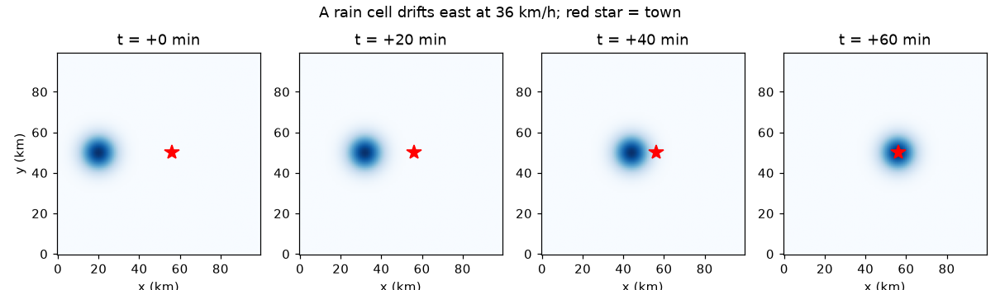
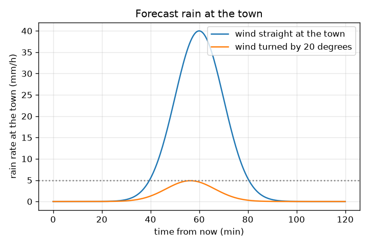

# സെഷൻ 1: ഒരു മഴ സെൽ കാറ്റിനൊപ്പം നീങ്ങുന്നു

[Session 1 — हिन्दी](README.hi.md) · [Session 1 — മലയാളം](README.ml.md)

*ലെവൽ 1 (ആശയപരമായ ഇന്ററാക്ടീവ് മോഡൽ) · ഏകദേശം 60 മിനിറ്റ് · opennowcast*

> ഇത് ലളിതമാക്കിയ ഒരു വിദ്യാഭ്യാസ മോഡലാണ്. ഇത് സാധൂകരിക്കപ്പെട്ട (validated) ഒരു ഡിസൈൻ ഉപകരണമല്ല; യഥാർത്ഥ നിർമ്മിതികൾ, ഇലക്ട്രിക്കൽ ഇൻസ്റ്റലേഷനുകൾ, വാഹനങ്ങൾ, വ്യാവസായിക പ്രക്രിയകൾ അല്ലെങ്കിൽ മെഡിക്കൽ തീരുമാനങ്ങൾ എന്നിവയ്ക്ക് ഇത് ഉപയോഗിക്കരുത്.

**മുൻ‌വ്യവസ്ഥകൾ (Prerequisites)**

- വേഗത = ദൂരം / സമയം.
- നിങ്ങൾ PRIMER.md വായിക്കുകയും `python start.py 1` ഒരിക്കൽ റൺ ചെയ്യുകയും ചെയ്തിട്ടുണ്ട്.

**പഠന ലക്ഷ്യങ്ങൾ (Learning objectives).** ഈ സെഷനു ശേഷം നിങ്ങൾക്ക് കഴിയും:

- ഒരു റഡാർ ചിത്രത്തെ 1 km പിക്സലുകളും ഓരോ 5 മിനിറ്റിലും ഒരു ഫ്രെയിമും ഉള്ള മഴ നിരക്കുകളുടെ (mm/h) ഗ്രിഡായി വായിക്കാൻ.
- രണ്ട് ഫ്രെയിമുകൾക്കിടയിൽ ഒരു സെല്ലിന്റെ ചലനത്തെ km/h-ൽ കാറ്റിന്റെ വേഗതയാക്കി മാറ്റാൻ.
- ഒരു സെൽ ഒരു പട്ടണത്തിൽ എപ്പോൾ എത്തുമെന്നും അവിടെ മഴ ആദ്യം 5 mm/h ആകുന്നത് എപ്പോഴാണെന്നും പറയാൻ.
- കാറ്റിന്റെ ദിശയിലെ ഒരു ചെറിയ മാറ്റം ലക്ഷ്യം തെറ്റുന്നതിന് (miss) കാരണമാകുന്നത് എന്തുകൊണ്ടെന്ന് വിശദീകരിക്കാൻ.

## A. യഥാർത്ഥ ലോക പ്രശ്നം
ഒരു കാലാവസ്ഥാ റഡാർ ഓരോ 5 മിനിറ്റിലും മഴയുടെ പുതിയ ചിത്രം അയയ്ക്കുന്നു. ഒരു ചിത്രത്തിൽ ഒരു മഴ സെൽ, കനത്ത മഴയുടെ ഒരു പിണ്ഡം, ഒരിടത്താണ്; അടുത്ത ചിത്രത്തിൽ അത് നീങ്ങിയിരിക്കുന്നു. എത്ര ദൂരം എന്ന് അളന്നാൽ അതിനെ വഹിക്കുന്ന കാറ്റ് നമുക്ക് അറിയാം, അടുത്ത മണിക്കൂറിൽ അത് ഒരു പട്ടണത്തിൽ എപ്പോൾ എത്തുമെന്ന് പറയാനും കഴിയും. ഇതാണ് നൗകാസ്റ്റ് (nowcast): അടുത്ത ഒന്നോ രണ്ടോ മണിക്കൂറിലേക്കുള്ള പ്രവചനം. സുരക്ഷാ കുറിപ്പ്: ഇത് സാങ്കല്പിക ഡാറ്റയുള്ള ഒരു അധ്യാപന മോഡലാണ്. ഇത് ഒരു കാലാവസ്ഥാ മുന്നറിയിപ്പ് സംവിധാനമല്ല. എപ്പോഴും നിങ്ങളുടെ ദേശീയ കാലാവസ്ഥാ സേവനത്തിന്റെ ഔദ്യോഗിക പ്രവചനങ്ങളും മുന്നറിയിപ്പുകളും പിന്തുടരുക.

## B. ആശയവും സിദ്ധാന്തവും
ഒരു റഡാർ ചിത്രം സംഖ്യകളുടെ ഒരു ഗ്രിഡാണ്. ഇവിടെ അത് 100 x 100 പിക്സൽ ആണ്, ഒരു പിക്സലിന് 1 km വീതി, ഓരോ പിക്സലും mm/h-ൽ (മണിക്കൂറിൽ മില്ലിമീറ്റർ മഴ) ഒരു മഴ നിരക്ക് വഹിക്കുന്നു. മഴ സെൽ എന്നത് മഴയുടെ മിനുസമുള്ള ഒരു കുന്നാണ്: കേന്ദ്രത്തിൽ ഏറ്റവും ശക്തം, പുറത്ത് ദുർബലം, കേന്ദ്ര മഴ നിരക്ക് P-യും വീതി sigma-യും ഉള്ള ഒരു ഗോസിയൻ (Gaussian) മണിയായി എഴുതുന്നു. 5 മിനിറ്റ് ഫ്രെയിമിൽ കേന്ദ്രം dx പിക്സൽ കിഴക്കോട്ടും dy പിക്സൽ വടക്കോട്ടും നീങ്ങിയാൽ, അതിനെ വഹിക്കുന്ന കാറ്റ് ആ സംഖ്യകളുടെ 12 മടങ്ങ് km/h ആണ്, കാരണം 5 മിനിറ്റ് ഒരു മണിക്കൂറിന്റെ 1/12 ഉം ഒരു പിക്സൽ 1 km ഉം ആണ്. ഈ മുഴുവൻ റിപ്പോസിറ്ററിയുടെയും പ്രധാന അനുമാനം: പ്രവചന സമയത്ത് കാറ്റ് ഒരുപോലെ തുടരുന്നു. അപ്പോൾ കേന്ദ്രം സ്ഥിര വേഗതയിൽ ഒരു നേർരേഖയിൽ നീങ്ങുന്നു, ഒരു പട്ടണത്തിലെ മഴ എന്നത് കേന്ദ്രത്തിൽ നിന്നുള്ള ദൂരത്തിൽ വിലയിരുത്തിയ മണിയാണ്.

| ചിഹ്നം | അർത്ഥം | യൂണിറ്റ് |
|---|---|---|
| (x, y) | റഡാർ ചിത്രത്തിലെ സ്ഥാനം | km (1 പിക്സൽ = 1 km) |
| R | മഴ നിരക്ക് | mm/h |
| P | സെല്ലിന്റെ കേന്ദ്രത്തിലെ മഴ നിരക്ക് (40) | mm/h |
| sigma | സെല്ലിന്റെ വീതി (6) | km |
| (u, v) | സെല്ലിനെ വഹിക്കുന്ന കാറ്റ്, കിഴക്കും വടക്കും | km/h |
| d | സെൽ കേന്ദ്രത്തിൽ നിന്ന് പട്ടണത്തിലേക്കുള്ള ദൂരം | km |
| r | മഴ പരിധിയിലേക്ക് (threshold) വീഴുന്ന കേന്ദ്രത്തിൽ നിന്നുള്ള ദൂരം | km |

**അനുമാനങ്ങൾ (Assumptions)**

- പ്രവചന സമയത്ത് കാറ്റ് സ്ഥലത്തിലും സമയത്തിലും സ്ഥിരമാണ്.
- സെൽ അതിന്റെ വലിപ്പവും കൊടുമുടി മഴ നിരക്കും നിലനിർത്തുന്നു (വളർച്ചയോ ക്ഷയമോ ഇല്ല).
- ഡാറ്റ കൃത്രിമമാണ് (synthetic); യഥാർത്ഥ റഡാർ ശബ്ദം, വിടവുകൾ, പിശകുകൾ എന്നിവ ചേർക്കുന്നു.

$$ R(d)=P\,\exp\!\left(-\frac{d^{2}}{2\sigma^{2}}\right) $$

$$ (u,v)=\frac{(\Delta x,\Delta y)\times 1\,\mathrm{km}}{5/60\ \mathrm{h}}=12\,(\Delta x,\Delta y)\ \mathrm{km/h} $$

$$ r=\sigma\sqrt{2\ln\!\left(P/R_{\mathrm{thr}}\right)} $$

$$ (x_c,y_c)(t)=(x_0,y_0)+(u,v)\,\frac{t}{60}\qquad(t\ \text{in minutes}) $$

## C. ദൃശ്യ വിശദീകരണം
ആദ്യ ചിത്രം ഒരേ സെല്ലിനെ 0, 20, 40, 60 മിനിറ്റുകളിൽ കാണിക്കുന്നു, ചുവന്ന നക്ഷത്രത്തിലേക്ക് (പട്ടണം) 36 km/h-ൽ കിഴക്കോട്ട് നീങ്ങുന്നു. രണ്ടാമത്തെ ചിത്രം രണ്ട് കാറ്റുകൾക്ക് സമയത്തിനെതിരെ പട്ടണത്തിലെ പ്രവചിച്ച മഴ നിരക്ക് പ്ലോട്ട് ചെയ്യുന്നു: ഒന്ന് പട്ടണത്തിലേക്ക് നേരെ വീശുന്നു (60 മിനിറ്റിനു ശേഷം 40 mm/h കൊടുമുടി), മറ്റൊന്ന് 20 ഡിഗ്രി തിരിഞ്ഞത്. തിരിഞ്ഞ കാറ്റ് സെല്ലിന്റെ കേന്ദ്രത്തെ 12.3 km കൊണ്ട് തെറ്റിക്കുന്നു, പട്ടണം ഏറ്റവും നല്ലതിൽ 4.87 mm/h മാത്രം കാണുന്നു, 5 mm/h ഡോട്ടഡ് രേഖയ്ക്ക് തൊട്ടുതാഴെ: കാറ്റിന്റെ ദിശയിലെ ചെറിയ മാറ്റം ഒരു ഹിറ്റിനെ (hit) തൊട്ടടുത്ത മിസ്സാക്കി മാറ്റുന്നു.

*ഒരു സെൽ 36 km/h-ൽ കിഴക്കോട്ട് 0, 20, 40, 60 മിനിറ്റുകളിൽ നീങ്ങുന്നു; ചുവന്ന നക്ഷത്രം പട്ടണമാണ്.*

*പട്ടണത്തിലേക്ക് നേരെയുള്ള കാറ്റിനും 20 ഡിഗ്രി തിരിഞ്ഞ കാറ്റിനും പട്ടണത്തിലെ പ്രവചിച്ച മഴ.*

## D. ഇന്ററാക്ടീവ് സിമുലേഷൻ
പാഠം റൺ ചെയ്യുക (`python start.py 1`), തുടർന്ന് ലൈവ് ആപ്പ് തുറക്കുക: [സെഷൻ 1: മഴ പട്ടണത്തിൽ എപ്പോൾ എത്തും?](https://krunalpanchal1995.github.io/pan-iit-oss/opennowcast/session-01/) (അല്ലെങ്കിൽ ഈ ഫോൾഡറിലെ `app.html`). കാറ്റിന്റെ വേഗത, ദിശ സ്ലൈഡറുകൾ നീക്കി മാപ്പിലെ സെൽ പാത നിരീക്ഷിക്കുക. പിന്നെ ഗ്രാഫ് വ്യൂ തുറന്ന് പട്ടണത്തിലെ മഴ സമയത്തിനൊപ്പം എങ്ങനെ മാറുന്നുവെന്ന് കാണുക. ഏറ്റവും അടുത്ത സമീപനം (closest approach), മിസ് ദൂരം, 5 mm/h അല്ലെങ്കിൽ അതിൽ കൂടുതൽ മഴ തുടങ്ങുന്ന സമയം എന്നിവ വായിക്കുക.

**വെല്ലുവിളി (Challenge).** ഇപ്പോൾ മുതൽ കൃത്യം 60 മിനിറ്റിൽ പട്ടണത്തിലെ മഴ 30 mm/h അല്ലെങ്കിൽ അതിൽ കൂടുതലാക്കുക.

## E. പരിഹരിച്ച ഉദാഹരണവും പരീക്ഷണവും
**പ്രശ്നം.** 5 മിനിറ്റ് ഇടവേളയുള്ള രണ്ട് ഫ്രെയിമുകൾക്കിടയിൽ ഒരു സെൽ (വീതി 6 km, കേന്ദ്ര മഴ നിരക്ക് 40 mm/h) 3 പിക്സൽ കിഴക്കോട്ട് നീങ്ങി. പട്ടണം സെല്ലിന്റെ 36 km കിഴക്കാണ്. കാറ്റ് എത്രയാണ്, കേന്ദ്രം എപ്പോൾ എത്തും, പട്ടണത്തിലെ മഴ ആദ്യം 5 mm/h ആകുന്നത് എപ്പോഴാണ്?

1. കാറ്റ് = 12 x 3 = കിഴക്കോട്ട് 36 km/h (1/12 മണിക്കൂറിൽ 3 km).
2. കേന്ദ്രം എത്തുന്നത് 36 km / 36 km/h = 1 മണിക്കൂർ = 60 മിനിറ്റിനു ശേഷം.
3. സെല്ലിന്റെ 5 mm/h അറ്റം കേന്ദ്രത്തിൽ നിന്ന് r = 6 x sqrt(2 ln(40/5)) = 6 x sqrt(2 x 2.079) = 12.24 km അകലെയാണ്.
4. കേന്ദ്രം 12.24 km അകലെയായിരിക്കുമ്പോൾ 5 mm/h മഴ പട്ടണത്തിൽ എത്തുന്നു, അതായത് 36 - 12.24 = 23.76 km സഞ്ചരിച്ചതിനു ശേഷം, ഇതിന് 23.76 / 36 x 60 = 39.6 മിനിറ്റ് എടുക്കും.
5. പരിശോധന: 39.6 മിനിറ്റിനു ശേഷം ദൂരം 12.24 km, R = 40 exp(-12.24^2 / 72) = 5.0 mm/h.

**ഉത്തരം.** കാറ്റ് കിഴക്കോട്ട് 36 km/h ആണ്, കേന്ദ്രം 60 മിനിറ്റിനു ശേഷം എത്തുന്നു, 5 mm/h അല്ലെങ്കിൽ അതിൽ കൂടുതൽ മഴ 39.6 മിനിറ്റിനു ശേഷം തുടങ്ങുന്നു.

**പരീക്ഷണം.** നിങ്ങളുടെ ദേശീയ കാലാവസ്ഥാ സേവനത്തിൽ നിന്ന് ഒരു യഥാർത്ഥ റഡാർ ലൂപ്പ് (അവസാന മണിക്കൂറിന്റെ ആനിമേഷൻ) തുറക്കുക. വ്യക്തമായ ഒരു സെൽ തിരഞ്ഞെടുത്ത്, 30 മിനിറ്റ് ഇടവേളയുള്ള രണ്ട് ഫ്രെയിമുകളിൽ ഒരു മാപ്പ് ഗ്രിഡിലെ അതിന്റെ സ്ഥാനം കുറിക്കുക, ദൂരത്തെ 0.5 മണിക്കൂർ കൊണ്ട് ഹരിച്ച് കാറ്റ് പ്രവചനവുമായി താരതമ്യം ചെയ്യുക. ഏകദേശ യോജിപ്പ് മാത്രം പ്രതീക്ഷിക്കുക: യഥാർത്ഥ സെല്ലുകൾ വളരുന്നു, മങ്ങുന്നു, ദിശ മാറ്റുന്നു, ഭൂമിയിലെ കാറ്റിനാലല്ല, ഉയരത്തിലെ കാറ്റിനാൽ നയിക്കപ്പെടുന്നു. നീങ്ങുന്ന പിണ്ഡത്തിന് മോഡൽ കൃത്യമാണ്; യാഥാർത്ഥ്യം ഒരു കർക്കശ പിണ്ഡമല്ല.

## F. വിലയിരുത്തലും ഡിസൈൻ വെല്ലുവിളിയും
**ചോദ്യ തരം A: ആശയപരം.** കാറ്റ് ലഭിക്കാൻ രണ്ട് റഡാർ ചിത്രങ്ങൾ വേണ്ടത് എന്തുകൊണ്ട്, പ്രവചന സമയത്ത് കാറ്റ് ഒരുപോലെ തുടരുമെന്ന് അനുമാനിക്കുന്നത് എന്തുകൊണ്ട്?

സൂചന

ഒരു ചിത്രം മഴ എവിടെയാണെന്ന് കാണിക്കുന്നു, എവിടേക്ക് പോകുന്നുവെന്നല്ല. ഒരു വേഗത അളക്കാൻ നിങ്ങൾക്ക് എന്ത് വേണം?

ഘട്ടം ഘട്ടമായുള്ള പരിഹാരം

ഒരു വേഗതയ്ക്ക് ഒരു ദൂരവും ഒരു സമയവും വേണം: അറിയാവുന്ന സമയ ഇടവേളയിൽ എടുത്ത രണ്ട് ചിത്രങ്ങൾക്കിടയിൽ ഒരു സെൽ നീങ്ങിയ ദൂരം. ഒരു ചിത്രത്തിൽ ചലന വിവരം ഒട്ടുമില്ല. പ്രവചനം പിന്നെ ആ ചലനത്തെ ഭാവിയിലേക്ക് നീട്ടുന്നു, ഇത് കാറ്റ് മാറാതിരുന്നാൽ മാത്രമേ ഫലിക്കൂ; യഥാർത്ഥ കാറ്റുകൾ മാറുന്നു, അതുകൊണ്ടാണ് ലീഡ് സമയത്തിനൊപ്പം മികവ് കുറയുന്നത് (സെഷൻ 2, 3).

**ചോദ്യ തരം B: സംഖ്യാപരം.** ഒരു സെൽ 5 മിനിറ്റിൽ 5 പിക്സൽ കിഴക്കോട്ട് നീങ്ങുന്നു. ഒരു പട്ടണം അതിന്റെ കേന്ദ്രത്തിന്റെ 45 km കിഴക്കാണ്. കാറ്റ് എത്ര, കേന്ദ്രം എപ്പോൾ എത്തും?

സൂചന

ഒരു ഫ്രെയിമിൽ ഒരു പിക്സലിന് 12 km/h; പിന്നെ സമയം = ദൂരം / വേഗത.

ഘട്ടം ഘട്ടമായുള്ള പരിഹാരം

കാറ്റ് = 12 x 5 = 60 km/h. സമയം = 45 km / 60 km/h = 0.75 h = 45 മിനിറ്റ്. യുക്തിപരിശോധന (sanity check): 60 km/h എന്നാൽ മിനിറ്റിൽ 1 km, അതിനാൽ 45 km-ന് 45 മിനിറ്റ്.

**ചോദ്യ തരം C: ഗ്രാഫ്, സിമുലേഷൻ വ്യാഖ്യാനം.** പട്ടണത്തിലെ മഴയുടെ ഗ്രാഫിൽ, പട്ടണത്തിലേക്ക് നേരെയുള്ള കാറ്റും 20 ഡിഗ്രി തിരിഞ്ഞ കാറ്റും വളരെ വ്യത്യസ്തമായ കൊടുമുടികൾ നൽകുന്നു. രണ്ട് കൊടുമുടികളും വായിച്ച് വ്യത്യാസം വിശദീകരിക്കുക.

സൂചന

മിസ് ദൂരവും കേന്ദ്രത്തിൽ നിന്ന് മണി എത്ര വേഗത്തിൽ താഴുന്നുവെന്നും നോക്കുക.

ഘട്ടം ഘട്ടമായുള്ള പരിഹാരം

നേരെയുള്ള കാറ്റ് 40 mm/h-ൽ കൊടുമുടിയിലെത്തുന്നു (60 മിനിറ്റിനു ശേഷം). തിരിഞ്ഞ കാറ്റ് 56.4 മിനിറ്റിനു ശേഷം 4.87 mm/h-ൽ മാത്രം, 5 mm/h രേഖയ്ക്ക് താഴെ, കൊടുമുടിയിലെത്തുന്നു. തിരിഞ്ഞ പാത പട്ടണത്തിൽ നിന്ന് 36 x sin(20 ഡിഗ്രി) = 12.3 km അകലത്തിലൂടെ കടന്നുപോകുന്നു, 12.3 km-ൽ മണി 4.87 mm/h-ലേക്ക് താഴ്ന്നിരിക്കുന്നു. മിസ് ദൂരത്തെ അപേക്ഷിച്ച് സെൽ ഇടുങ്ങിയതാണ്, അതിനാൽ ദിശ വളരെ പ്രധാനമാണ്.

**ചോദ്യ തരം D: ഡിസൈൻ, ഒപ്റ്റിമൈസേഷൻ വെല്ലുവിളി.** ഡിസൈൻ: 36 km/h-ൽ നേരെ തങ്ങളിലേക്ക് നീങ്ങുന്ന ഒരു സെല്ലിൽ നിന്ന് 5 mm/h അല്ലെങ്കിൽ അതിൽ കൂടുതൽ മഴയ്ക്ക് മുമ്പ് ഒരു പട്ടണത്തിന് കുറഞ്ഞത് 20 മിനിറ്റ് മുന്നറിയിപ്പ് വേണം. പ്രവചനം നൽകുന്ന നിമിഷത്തിൽ സെൽ കേന്ദ്രം എത്ര അകലെയായിരിക്കണം?

സൂചന

20 മിനിറ്റ് യാത്രയും കേന്ദ്രത്തിൽ നിന്ന് 5 mm/h അറ്റത്തേക്കുള്ള ദൂരവും.

ഘട്ടം ഘട്ടമായുള്ള പരിഹാരം

20 മിനിറ്റിൽ സെൽ 36 x 20/60 = 12 km നീങ്ങുന്നു. കേന്ദ്രം 12.24 km അകലെയായിരിക്കുമ്പോൾ മഴ പട്ടണത്തിൽ എത്തുന്നു, അതിനാൽ കേന്ദ്രം 12 + 12.24 = 24.24 km അകലെയായിരിക്കണം. അനുമാനങ്ങൾ: സ്ഥിര കാറ്റും വലിപ്പം നിലനിർത്തുന്ന സെല്ലും. പ്രായോഗികമായി ഒരു സുരക്ഷാ മാർജിൻ ചേർക്കുക, കാരണം രണ്ടും അനിശ്ചിതമാണ്.

[RUBRIC.md](../../RUBRIC.md) ഉപയോഗിച്ച് സ്വയം സ്കോർ ചെയ്യുക. കടലാസിൽ പ്രവർത്തിക്കാൻ [ആക്ടിവിറ്റി ഷീറ്റ്](activity_sheet.md) പ്രിന്റ് ചെയ്യുക.

## സാധാരണ തെറ്റിദ്ധാരണകൾ
| സാധാരണ തെറ്റിദ്ധാരണ | യഥാർത്ഥത്തിൽ സത്യം എന്താണ് |
|---|---|
| ഒരു മഴ സെൽ ഒരു കാർ പോലെ സഞ്ചരിക്കുന്ന ഒരു വസ്തുവാണ്. | ചിത്രം ഇപ്പോൾ മഴ പെയ്യുന്നത് എവിടെയാണെന്ന് കാണിക്കുന്നു; മാതൃക നീങ്ങുന്നു, പക്ഷേ അതിനുള്ളിലെ മഴ വളരുകയും മങ്ങുകയും ചെയ്തുകൊണ്ടിരിക്കുന്നു. |
| സെൽ കേന്ദ്രം പട്ടണത്തെ തെറ്റിച്ചാൽ പട്ടണം വരണ്ടതായി തുടരും. | സെല്ലിന് ഒരു വീതിയുണ്ട്. അരികിനടുത്തുള്ള ഒരു പട്ടണത്തിനും മഴ ലഭിക്കാം; ഇവിടെ 12.3 km മിസ് പോലും ഏറ്റവും നല്ലതിൽ 4.87 mm/h നൽകുന്നു. |
| പ്രവചനം 5 മിനിറ്റിലെ പോലെ തന്നെ 1 മണിക്കൂറിലും നല്ലതാണ്. | കാറ്റിലെ ഓരോ ചെറിയ പിശകും ലീഡ് സമയത്തിനൊപ്പം വളരുന്നു; കൂടുതൽ മുന്നോട്ട് നോക്കുമ്പോൾ മികവ് കുറയുന്നു. |
| കാറ്റ് അറിയാൻ ഒരു ചിത്രം മതി. | അറിയാവുന്ന സമയ ഇടവേളയുള്ള രണ്ട് ചിത്രങ്ങൾ വേണം: മാതൃക എത്ര ദൂരം നീങ്ങി എന്നതിൽ നിന്നാണ് കാറ്റ് വരുന്നത്. |

## പദാവലി (Glossary)
- **നൗകാസ്റ്റ് (nowcast)**: അടുത്ത ഒന്നോ രണ്ടോ മണിക്കൂറിലേക്കുള്ള പ്രവചനം, ഇവിടെ റഡാർ ചിത്രങ്ങളെ അളന്ന ചലനത്തിലൂടെ നീക്കി ഉണ്ടാക്കുന്നു
- **റഡാർ ഫ്രെയിം (radar frame)**: ഒരു ഗ്രിഡിലെ മഴ നിരക്കിന്റെ ഒരു ചിത്രം; ഇവിടെ ഓരോ 5 മിനിറ്റിലും ഒരു ഫ്രെയിം
- **മഴ നിരക്ക് (rain rate)**: മഴ എത്ര വേഗത്തിൽ വീഴുന്നു, mm/h-ൽ
- **ഗോസിയൻ സെൽ (Gaussian cell)**: മിനുസമുള്ള മണി ആകൃതിയിലുള്ള പിണ്ഡം: മഴ നിരക്ക് കേന്ദ്രത്തിൽ ഏറ്റവും ഉയർന്നതും ദൂരത്തിനൊപ്പം താഴുന്നതുമാണ്
- **പരിധി (threshold)**: ഒരു മഴ നിരക്ക് (ഇവിടെ 5 mm/h), അതിനു മുകളിൽ മഴ 'കണക്കാക്കാൻ മതിയാകും' എന്ന് നാം പറയുന്നു

## പൂർത്തിയാക്കുക
1. [exercises.md](exercises.md)-ലെ മൂന്ന് കോഡിംഗ് ടാസ്കുകൾ ചെയ്യുക.
2. നിങ്ങളുടെ മാറ്റങ്ങൾക്കു ശേഷം `python start.py 1` വീണ്ടും റൺ ചെയ്യുക. അത് ചെക്ക്‌പോയിന്റോടെ അവസാനിക്കുന്നു; അത് `PASS` പ്രിന്റ് ചെയ്യുമ്പോൾ, നിങ്ങൾ പൂർത്തിയാക്കി. (ചെക്ക്‌പോയിന്റ് മാത്രം: `python start.py check 1`.)

അടുത്തത്: [സെഷൻ 2](../session-02/README.md)
