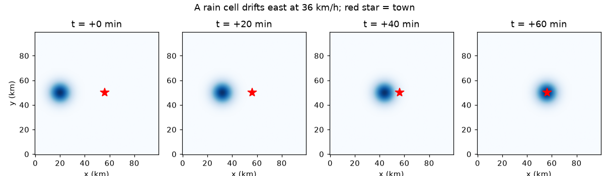
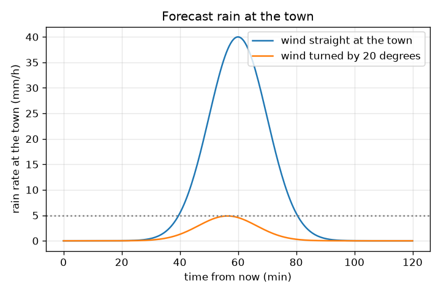

# அமர்வு 1: ஒரு மழைக் கூறு காற்றுடன் நகர்கிறது

[Session 1 — हिन्दी](README.hi.md) · [Session 1 — മലയാളം](README.ml.md) · [Session 1 — தமிழ்](README.ta.md)

*நிலை 1 (கருத்தியல் ஊடாடும் மாதிரி) · சுமார் 60 நிமிடங்கள் · opennowcast*

> இது ஒரு எளிமைப்படுத்தப்பட்ட கல்வி மாதிரி. இது சரிபார்க்கப்பட்ட (validated) வடிவமைப்புக் கருவி அல்ல; உண்மையான கட்டமைப்புகள், மின் நிறுவல்கள், வாகனங்கள், தொழில்துறை செயல்முறைகள் அல்லது மருத்துவ முடிவுகளுக்கு இதைப் பயன்படுத்தக் கூடாது.

**முன்தேவைகள் (Prerequisites)**

- வேகம் = தூரம் / நேரம்.
- நீங்கள் PRIMER.md படித்து, `python start.py 1` ஐ ஒருமுறை இயக்கியிருக்கிறீர்கள்.

**கற்றல் நோக்கங்கள் (Learning objectives).** இந்த அமர்வுக்குப் பிறகு உங்களால் முடியும்:

- ஒரு ரேடார் படத்தை 1 km பிக்சல்களும் ஒவ்வொரு 5 நிமிடத்துக்கும் ஒரு பிரேமும் கொண்ட மழை வீதங்களின் (mm/h) கட்டமாகப் படிக்க.
- இரண்டு பிரேம்களுக்கு இடையே ஒரு கூறின் நகர்வை km/h இல் காற்றின் வேகமாக மாற்ற.
- ஒரு கூறு ஒரு நகரத்தை எப்போது அடையும், அங்கு மழை முதலில் 5 mm/h ஐ எப்போது எட்டும் என்று சொல்ல.
- காற்றின் திசையில் சிறிய மாற்றம் ஏன் இலக்கைத் தவறவிடுவதைக் குறிக்கலாம் என்பதை விளக்க.

## A. நிஜ உலகப் பிரச்சினை
ஒரு வானிலை ரேடார் ஒவ்வொரு 5 நிமிடத்துக்கும் மழையின் புதிய படத்தை அனுப்புகிறது. ஒரு படத்தில் ஒரு மழைக் கூறு, கனமழையின் ஒரு திரள், ஓர் இடத்தில் உள்ளது; அடுத்த படத்தில் அது நகர்ந்திருக்கிறது. எவ்வளவு தூரம் என்று அளந்தால், அதைச் சுமக்கும் காற்றை நாம் அறிவோம், அடுத்த மணி நேரத்தில் அது ஒரு நகரத்தை எப்போது அடையும் என்றும் சொல்லலாம். இது நவ்காஸ்ட் (nowcast): அடுத்த ஒன்று அல்லது இரண்டு மணி நேரத்துக்கான முன்னறிவிப்பு. பாதுகாப்புக் குறிப்பு: இது கற்பனைத் தரவுகள் கொண்ட ஒரு கற்பித்தல் மாதிரி. இது வானிலை எச்சரிக்கை அமைப்பு அல்ல. எப்போதும் உங்கள் தேசிய வானிலை சேவையின் அதிகாரப்பூர்வ முன்னறிவிப்புகளையும் எச்சரிக்கைகளையும் பின்பற்றுங்கள்.

## B. கருத்தும் கோட்பாடும்
ஒரு ரேடார் படம் எண்களின் கட்டம். இங்கே அது 100 x 100 பிக்சல்கள், ஒரு பிக்சலின் அகலம் 1 km, ஒவ்வொரு பிக்சலும் mm/h இல் (மணிக்கு மில்லிமீட்டர் மழை) ஒரு மழை வீதத்தைக் கொண்டுள்ளது. ஒரு மழைக் கூறு என்பது மழையின் மென்மையான குன்று: மையத்தில் வலுவானது, வெளியே பலவீனமானது, மைய மழை வீதம் P மற்றும் அகலம் sigma கொண்ட காஸியன் (Gaussian) மணியாக எழுதப்படுகிறது. 5 நிமிட பிரேமில் மையம் dx பிக்சல் கிழக்கே, dy பிக்சல் வடக்கே நகர்ந்தால், அதைச் சுமக்கும் காற்று அந்த எண்களின் 12 மடங்கு km/h, ஏனெனில் 5 நிமிடம் ஒரு மணியின் 1/12 மற்றும் ஒரு பிக்சல் 1 km. இந்த முழுக் களஞ்சியத்தின் முக்கிய அனுமானம்: முன்னறிவிப்பின் போது காற்று மாறாமல் இருக்கும். அப்போது மையம் நிலையான வேகத்தில் நேர்கோட்டில் நகர்கிறது, ஒரு நகரத்தில் மழை என்பது மையத்திலிருந்து உள்ள தூரத்தில் மதிப்பிடப்பட்ட மணி.

| குறியீடு | பொருள் | அலகு |
|---|---|---|
| (x, y) | ரேடார் படத்தில் நிலை | km (1 பிக்சல் = 1 km) |
| R | மழை வீதம் | mm/h |
| P | கூறின் மையத்தில் மழை வீதம் (40) | mm/h |
| sigma | கூறின் அகலம் (6) | km |
| (u, v) | கூறைச் சுமக்கும் காற்று, கிழக்கு மற்றும் வடக்கு | km/h |
| d | கூறு மையத்திலிருந்து நகரத்துக்கு உள்ள தூரம் | km |
| r | மழை எல்லைமதிப்புக்கு (threshold) வீழும் மையத்திலிருந்து உள்ள தூரம் | km |

**அனுமானங்கள் (Assumptions)**

- முன்னறிவிப்பின் போது காற்று இடத்திலும் நேரத்திலும் மாறாதது.
- கூறு தன் அளவையும் உச்ச மழை வீதத்தையும் தக்கவைக்கிறது (வளர்ச்சியோ தேய்வோ இல்லை).
- தரவு செயற்கையானது (synthetic); உண்மை ரேடார் இரைச்சல், இடைவெளிகள், பிழைகளைச் சேர்க்கிறது.

$$ R(d)=P\,\exp\!\left(-\frac{d^{2}}{2\sigma^{2}}\right) $$

$$ (u,v)=\frac{(\Delta x,\Delta y)\times 1\,\mathrm{km}}{5/60\ \mathrm{h}}=12\,(\Delta x,\Delta y)\ \mathrm{km/h} $$

$$ r=\sigma\sqrt{2\ln\!\left(P/R_{\mathrm{thr}}\right)} $$

$$ (x_c,y_c)(t)=(x_0,y_0)+(u,v)\,\frac{t}{60}\qquad(t\ \text{in minutes}) $$

## C. காட்சி விளக்கம்
முதல் படம் அதே கூறை 0, 20, 40, 60 நிமிடங்களில் காட்டுகிறது, சிவப்பு நட்சத்திரத்தை (நகரம்) நோக்கி 36 km/h இல் கிழக்கே நகர்கிறது. இரண்டாவது படம் இரண்டு காற்றுகளுக்கு நேரத்துக்கு எதிராக நகரத்தில் முன்னறிவித்த மழை வீதத்தை வரைகிறது: ஒன்று நகரத்தை நோக்கி நேராக வீசுகிறது (60 நிமிடத்துக்குப் பின் 40 mm/h உச்சம்), மற்றொன்று 20 டிகிரி திரும்பியது. திரும்பிய காற்று கூறின் மையத்தை 12.3 km தவறவிடுகிறது, நகரம் சிறந்தபட்சம் 4.87 mm/h மட்டுமே காண்கிறது, 5 mm/h புள்ளிக்கோட்டுக்குச் சற்றுக் கீழே: காற்றின் திசையில் சிறிய மாற்றம் ஒரு இலக்கை (hit) நூலிழைத் தவறாக மாற்றுகிறது.

*ஒரு கூறு 36 km/h இல் கிழக்கே 0, 20, 40, 60 நிமிடங்களில் நகர்கிறது; சிவப்பு நட்சத்திரம் நகரம்.*

*நகரத்தை நோக்கி நேராக வீசும் காற்றுக்கும் 20 டிகிரி திரும்பிய காற்றுக்கும் நகரத்தில் முன்னறிவித்த மழை.*

## D. ஊடாடும் உருவகப்படுத்தல் (Interactive simulation)
பாடத்தை இயக்குங்கள் (`python start.py 1`), பின்னர் நேரடிச் செயலியைத் திறங்கள்: [அமர்வு 1: மழை நகரத்தை எப்போது அடையும்?](https://krunalpanchal1995.github.io/pan-iit-oss/opennowcast/session-01/) (அல்லது இந்தக் கோப்புறையில் உள்ள `app.html`). காற்றின் வேகம், திசை ஸ்லைடர்களை நகர்த்தி வரைபடத்தில் கூறின் பாதையைக் கவனியுங்கள். பின்னர் வரைபடக் காட்சியைத் திறந்து நகரத்தில் மழை நேரத்துடன் எப்படி மாறுகிறது என்று பாருங்கள். மிக நெருங்கிய அணுகுமுறை (closest approach), தவறவிடும் தூரம், 5 mm/h அல்லது அதற்கு மேல் மழை தொடங்கும் நேரம் ஆகியவற்றைப் படியுங்கள்.

**சவால் (Challenge).** இப்போதிலிருந்து சரியாக 60 நிமிடத்தில் நகரத்தில் மழையை 30 mm/h அல்லது அதற்கு மேல் ஆக்குங்கள்.

## E. தீர்க்கப்பட்ட எடுத்துக்காட்டும் சோதனையும்
**பிரச்சினை.** 5 நிமிட இடைவெளியுள்ள இரண்டு பிரேம்களுக்கு இடையே ஒரு கூறு (அகலம் 6 km, மைய மழை வீதம் 40 mm/h) 3 பிக்சல் கிழக்கே நகர்ந்தது. நகரம் கூறிலிருந்து 36 km கிழக்கே உள்ளது. காற்று என்ன, மையம் எப்போது வந்து சேரும், நகரத்தில் மழை முதலில் 5 mm/h ஐ எப்போது எட்டும்?

1. காற்று = 12 x 3 = கிழக்கு நோக்கி 36 km/h (1/12 மணியில் 3 km).
2. மையம் வந்து சேர்வது 36 km / 36 km/h = 1 மணி = 60 நிமிடங்களுக்குப் பிறகு.
3. கூறின் 5 mm/h விளிம்பு மையத்திலிருந்து r = 6 x sqrt(2 ln(40/5)) = 6 x sqrt(2 x 2.079) = 12.24 km தொலைவில் உள்ளது.
4. மையம் 12.24 km தொலைவில் இருக்கும்போது 5 mm/h மழை நகரத்தை அடைகிறது, அதாவது 36 - 12.24 = 23.76 km பயணித்த பின், இதற்கு 23.76 / 36 x 60 = 39.6 நிமிடங்கள் ஆகும்.
5. சரிபார்ப்பு: 39.6 நிமிடங்களுக்குப் பின் தூரம் 12.24 km, R = 40 exp(-12.24^2 / 72) = 5.0 mm/h.

**விடை.** காற்று கிழக்கே 36 km/h, மையம் 60 நிமிடங்களுக்குப் பின் வந்து சேர்கிறது, 5 mm/h அல்லது அதற்கு மேல் மழை 39.6 நிமிடங்களுக்குப் பின் தொடங்குகிறது.

**சோதனை.** உங்கள் தேசிய வானிலை சேவையிலிருந்து ஒரு உண்மை ரேடார் சுழற்சியைத் (கடைசி மணியின் அனிமேஷன்) திறங்கள். தெளிவான ஒரு கூறைத் தேர்ந்தெடுத்து, 30 நிமிட இடைவெளியுள்ள இரண்டு பிரேம்களில் ஒரு வரைபடக் கட்டத்தில் அதன் நிலையைக் குறித்து, தூரத்தை 0.5 மணியால் வகுத்து காற்று முன்னறிவிப்புடன் ஒப்பிடுங்கள். தோராயமான ஒத்திசைவை மட்டுமே எதிர்பாருங்கள்: உண்மைக் கூறுகள் வளர்கின்றன, மங்குகின்றன, திசை மாறுகின்றன, தரைக் காற்றால் அல்ல, உயரத்தில் உள்ள காற்றுகளால் செலுத்தப்படுகின்றன. நகரும் திரளுக்கு மாதிரி துல்லியமானது; யதார்த்தம் ஒரு விறைப்புத் திரள் அல்ல.

## F. மதிப்பீடும் வடிவமைப்புச் சவாலும்
**கேள்வி வகை A: கருத்தியல்.** காற்றைப் பெற இரண்டு ரேடார் படங்கள் ஏன் தேவை, முன்னறிவிப்பின் போது காற்று மாறாமல் இருக்கும் என்று ஏன் அனுமானிக்கிறோம்?

குறிப்பு

ஒரு படம் மழை எங்கே இருக்கிறது என்பதைக் காட்டுகிறது, எங்கே போகிறது என்பதை அல்ல. ஒரு வேகத்தை அளக்க உங்களுக்கு என்ன தேவை?

படிப்படியான தீர்வு

ஒரு வேகத்துக்கு ஒரு தூரமும் ஒரு நேரமும் தேவை: தெரிந்த கால இடைவெளியில் எடுத்த இரண்டு படங்களுக்கு இடையே ஒரு கூறு நகர்ந்த தூரம். ஒரு படத்தில் நகர்வுத் தகவல் எதுவும் இல்லை. முன்னறிவிப்பு பின்னர் அந்த நகர்வை எதிர்காலத்துக்கு நீட்டிக்கிறது, இது காற்று மாறாவிட்டால் மட்டுமே வேலை செய்யும்; உண்மைக் காற்றுகள் மாறுகின்றன, அதனால்தான் முன்னேற்ற நேரத்துடன் திறன் குறைகிறது (அமர்வு 2 மற்றும் 3).

**கேள்வி வகை B: எண்ணியல்.** ஒரு கூறு 5 நிமிடத்தில் 5 பிக்சல் கிழக்கே நகர்கிறது. ஒரு நகரம் அதன் மையத்திலிருந்து 45 km கிழக்கே உள்ளது. காற்று என்ன, மையம் எப்போது வந்து சேரும்?

குறிப்பு

ஒரு பிரேமுக்கு ஒரு பிக்சலுக்கு 12 km/h; பின்னர் நேரம் = தூரம் / வேகம்.

படிப்படியான தீர்வு

காற்று = 12 x 5 = 60 km/h. நேரம் = 45 km / 60 km/h = 0.75 h = 45 நிமிடங்கள். நம்பகத்தன்மைச் சோதனை (sanity check): 60 km/h என்றால் நிமிடத்துக்கு 1 km, எனவே 45 km க்கு 45 நிமிடங்கள்.

**கேள்வி வகை C: வரைபடம் மற்றும் உருவகப்படுத்தல் விளக்கம்.** நகரத்தில் மழையின் வரைபடத்தில், நகரத்தை நோக்கி நேராக வீசும் காற்றும் 20 டிகிரி திரும்பிய காற்றும் மிகவும் வேறுபட்ட உச்சங்களைத் தருகின்றன. இரண்டு உச்சங்களையும் படித்து வேறுபாட்டை விளக்குங்கள்.

குறிப்பு

தவறவிடும் தூரத்தையும், மணி மையத்திலிருந்து எவ்வளவு வேகமாக விலகி இறங்குகிறது என்பதையும் பாருங்கள்.

படிப்படியான தீர்வு

நேர்க்காற்று 40 mm/h இல் உச்சமடைகிறது (60 நிமிடத்துக்குப் பின்). திரும்பிய காற்று 56.4 நிமிடத்துக்குப் பின் வெறும் 4.87 mm/h இல், 5 mm/h கோட்டுக்குக் கீழே, உச்சமடைகிறது. திரும்பிய பாதை நகரத்திலிருந்து 36 x sin(20 டிகிரி) = 12.3 km தொலைவில் கடக்கிறது, 12.3 km இல் மணி 4.87 mm/h க்கு இறங்கிவிட்டது. தவறவிடும் தூரத்துடன் ஒப்பிடும்போது கூறு குறுகியது, எனவே திசை மிகவும் முக்கியம்.

**கேள்வி வகை D: வடிவமைப்பு மற்றும் உகப்பாக்கச் சவால்.** வடிவமைப்பு: 36 km/h இல் நேராகத் தன்னை நோக்கி நகரும் ஒரு கூறிலிருந்து 5 mm/h அல்லது அதற்கு மேல் மழை வருவதற்கு முன் ஒரு நகரத்துக்குக் குறைந்தது 20 நிமிட எச்சரிக்கை வேண்டும். முன்னறிவிப்பு வெளியிடப்படும் தருணத்தில் கூறின் மையம் எவ்வளவு தொலைவில் இருக்க வேண்டும்?

குறிப்பு

20 நிமிடப் பயணம் மற்றும் மையத்திலிருந்து 5 mm/h விளிம்புக்கு உள்ள தூரம்.

படிப்படியான தீர்வு

20 நிமிடத்தில் கூறு 36 x 20/60 = 12 km நகர்கிறது. மையம் 12.24 km தொலைவில் இருக்கும்போது மழை நகரத்தை அடைகிறது, எனவே மையம் 12 + 12.24 = 24.24 km தொலைவில் இருக்க வேண்டும். அனுமானங்கள்: நிலையான காற்றும் தன் அளவைத் தக்கவைக்கும் கூறும். நடைமுறையில் ஒரு பாதுகாப்பு இடைவெளியைச் சேர்க்கவும், ஏனெனில் இரண்டும் நிச்சயமற்றவை.

[RUBRIC.md](../../RUBRIC.md) கொண்டு உங்களுக்கு நீங்களே மதிப்பெண் இடுங்கள். தாளில் வேலை செய்ய [செயல்பாட்டுத் தாளை](activity_sheet.md) அச்சிடுங்கள்.

## பொதுவான தவறான கருத்துகள்
| பொதுவான தவறான கருத்து | உண்மையில் சரியானது என்ன |
|---|---|
| ஒரு மழைக் கூறு ஒரு காரைப் போலப் பயணிக்கும் ஒரு பொருள். | படம் இப்போது மழை பெய்யும் இடத்தைக் காட்டுகிறது; வடிவம் நகர்கிறது, ஆனால் அதற்குள் உள்ள மழை வளர்ந்து மங்கிக்கொண்டே இருக்கிறது. |
| கூறின் மையம் நகரத்தைத் தவறவிட்டால், நகரம் வறண்டிருக்கும். | கூறுக்கு ஓர் அகலம் உண்டு. விளிம்பருகில் உள்ள நகரத்துக்கும் மழை கிடைக்கலாம்; இங்கே 12.3 km தவறவிட்டாலும் சிறந்தபட்சம் 4.87 mm/h கிடைக்கிறது. |
| முன்னறிவிப்பு 5 நிமிடத்தில் உள்ளதைப் போலவே 1 மணியிலும் நன்றாக இருக்கும். | காற்றில் உள்ள ஒவ்வொரு சிறு பிழையும் முன்னேற்ற நேரத்துடன் வளர்கிறது; நீங்கள் தொலைவில் பார்க்கும்போது திறன் குறைகிறது. |
| காற்றை அறிய ஒரு படம் போதும். | தெரிந்த கால இடைவெளியுள்ள இரண்டு படங்கள் தேவை: வடிவம் எவ்வளவு தூரம் நகர்ந்தது என்பதிலிருந்தே காற்று வருகிறது. |

## சொற்களஞ்சியம் (Glossary)
- **நவ்காஸ்ட் (nowcast)**: அடுத்த ஒன்று அல்லது இரண்டு மணி நேரத்துக்கான முன்னறிவிப்பு, இங்கே ரேடார் படங்களை அளக்கப்பட்ட நகர்வுடன் நகர்த்துவதன் மூலம் உருவாக்கப்படுகிறது
- **ரேடார் பிரேம் (radar frame)**: ஒரு கட்டத்தில் மழை வீதத்தின் ஒரு படம்; இங்கே ஒவ்வொரு 5 நிமிடத்துக்கும் ஒரு பிரேம்
- **மழை வீதம் (rain rate)**: மழை எவ்வளவு வேகமாகப் பெய்கிறது, mm/h இல்
- **காஸியன் கூறு (Gaussian cell)**: மென்மையான மணி வடிவத் திரள்: மழை வீதம் மையத்தில் அதிகம், தூரத்துடன் குறைகிறது
- **எல்லைமதிப்பு (threshold)**: ஒரு மழை வீதம் (இங்கே 5 mm/h), இதற்கு மேல் மழை 'கணக்கில் கொள்ளப் போதுமானது' என்று சொல்கிறோம்

## முடிக்க
1. [exercises.md](exercises.md) இல் உள்ள மூன்று நிரலாக்கப் பணிகளைச் செய்யுங்கள்.
2. உங்கள் மாற்றங்களுக்குப் பிறகு `python start.py 1` ஐ மீண்டும் இயக்குங்கள். அது சோதனைச் சாவடியுடன் (checkpoint) முடிகிறது; அது `PASS` என அச்சிடும்போது, நீங்கள் முடித்துவிட்டீர்கள். (சோதனைச் சாவடி மட்டும்: `python start.py check 1`.)

அடுத்து: [அமர்வு 2](../session-02/README.md)
