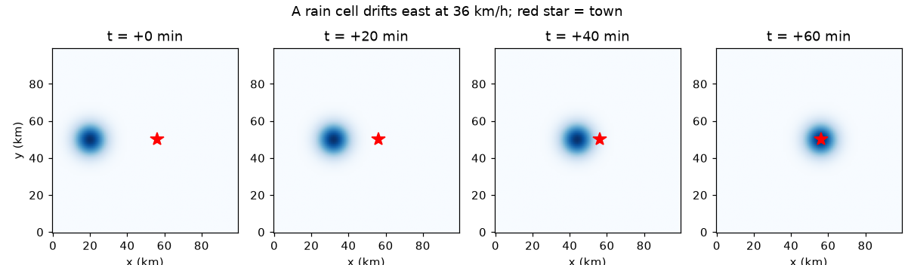
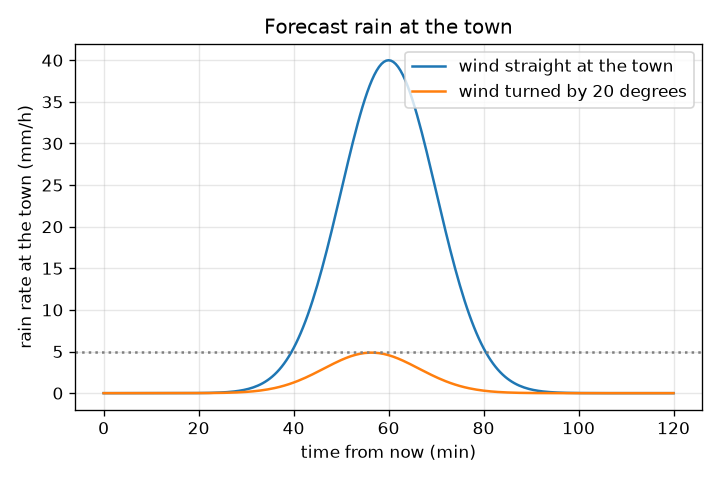

# సెషన్ 1: ఒక వర్ష కణం గాలితో కదులుతుంది

[Session 1 — हिन्दी](README.hi.md) · [Session 1 — മലയാളം](README.ml.md) · [Session 1 — தமிழ்](README.ta.md) · [Session 1 — తెలుగు](README.te.md)

*స్థాయి 1 (భావనాత్మక ఇంటరాక్టివ్ మోడల్) · సుమారు 60 నిమిషాలు · opennowcast*

> ఇది సరళీకరించిన ఒక విద్యా మోడల్. ఇది ధృవీకరించబడిన (validated) డిజైన్ సాధనం కాదు; నిజమైన నిర్మాణాలు, విద్యుత్ ఇన్‌స్టలేషన్‌లు, వాహనాలు, పారిశ్రామిక ప్రక్రియలు లేదా వైద్య నిర్ణయాల కోసం దీనిని ఉపయోగించకూడదు.

**ముందస్తు అవసరాలు (Prerequisites)**

- వేగం = దూరం / సమయం.
- మీరు PRIMER.md చదివి, `python start.py 1` ను ఒకసారి రన్ చేశారు.

**అభ్యాస లక్ష్యాలు (Learning objectives).** ఈ సెషన్ తర్వాత మీరు చేయగలరు:

- రాడార్ చిత్రాన్ని 1 km పిక్సెల్‌లు మరియు ప్రతి 5 నిమిషాలకు ఒక ఫ్రేమ్‌తో వర్షపాత రేట్ల (mm/h) గ్రిడ్‌గా చదవడం.
- రెండు ఫ్రేమ్‌ల మధ్య ఒక కణం కదలికను km/h లో గాలి వేగంగా మార్చడం.
- ఒక కణం పట్టణాన్ని ఎప్పుడు చేరుతుందో, అక్కడ వర్షం మొదట 5 mm/h ను ఎప్పుడు చేరుతుందో చెప్పడం.
- గాలి దిశలో చిన్న మార్పు ఎందుకు లక్ష్యం తప్పిపోవడానికి దారితీయవచ్చో వివరించడం.

## A. నిజ జీవిత సమస్య
వాతావరణ రాడార్ ప్రతి 5 నిమిషాలకు వర్షం యొక్క కొత్త చిత్రాన్ని పంపుతుంది. ఒక చిత్రంలో ఒక వర్ష కణం, భారీ వర్షం యొక్క ముద్ద, ఒక చోట ఉంటుంది; తరువాతి చిత్రంలో అది కదిలి ఉంటుంది. ఎంత దూరం అని కొలిస్తే, దానిని మోసుకెళ్లే గాలి మనకు తెలుస్తుంది, తరువాతి గంటలో అది పట్టణాన్ని ఎప్పుడు చేరుతుందో కూడా చెప్పగలం. ఇదే నౌకాస్ట్ (nowcast): తరువాతి ఒకటి లేదా రెండు గంటల అంచనా. భద్రతా గమనిక: ఇది కల్పిత డేటాతో కూడిన బోధనా మోడల్. ఇది వాతావరణ హెచ్చరిక వ్యవస్థ కాదు. ఎల్లప్పుడూ మీ జాతీయ వాతావరణ సేవ అధికారిక అంచనాలను, హెచ్చరికలను అనుసరించండి.

## B. భావన మరియు సిద్ధాంతం
రాడార్ చిత్రం సంఖ్యల గ్రిడ్. ఇక్కడ అది 100 x 100 పిక్సెల్‌లు, ఒక పిక్సెల్ వెడల్పు 1 km, ప్రతి పిక్సెల్ mm/h లో (గంటకు మిల్లీమీటర్ల వర్షం) వర్షపాత రేటును కలిగి ఉంటుంది. వర్ష కణం అంటే వర్షం యొక్క నునుపైన కొండ: మధ్యలో బలంగా, వెలుపల బలహీనంగా, కేంద్ర వర్షపాత రేటు P మరియు వెడల్పు sigma ఉన్న గాస్సియన్ (Gaussian) గంటగా రాస్తారు. 5 నిమిషాల ఫ్రేమ్‌లో కేంద్రం dx పిక్సెల్ తూర్పుకు, dy పిక్సెల్ ఉత్తరానికి కదిలితే, దానిని మోసుకెళ్లే గాలి ఆ సంఖ్యల 12 రెట్లు km/h, ఎందుకంటే 5 నిమిషాలు గంటలో 1/12 మరియు ఒక పిక్సెల్ 1 km. ఈ మొత్తం రిపాజిటరీ యొక్క కీలక ఊహ: అంచనా సమయంలో గాలి ఒకేలా ఉంటుంది. అప్పుడు కేంద్రం స్థిర వేగంతో సరళరేఖలో కదులుతుంది, పట్టణం వద్ద వర్షం అంటే కేంద్రం నుండి దూరం వద్ద లెక్కించిన గంట.

| గుర్తు | అర్థం | యూనిట్ |
|---|---|---|
| (x, y) | రాడార్ చిత్రంలో స్థానం | km (1 పిక్సెల్ = 1 km) |
| R | వర్షపాత రేటు | mm/h |
| P | కణం కేంద్రం వద్ద వర్షపాత రేటు (40) | mm/h |
| sigma | కణం వెడల్పు (6) | km |
| (u, v) | కణాన్ని మోసే గాలి, తూర్పు మరియు ఉత్తరం | km/h |
| d | కణం కేంద్రం నుండి పట్టణానికి దూరం | km |
| r | వర్షం థ్రెషోల్డ్‌కు (threshold) పడిపోయే కేంద్రం నుండి దూరం | km |

**ఊహలు (Assumptions)**

- అంచనా సమయంలో గాలి స్థలంలో మరియు సమయంలో స్థిరం.
- కణం తన పరిమాణాన్ని మరియు శిఖర వర్షపాత రేటును నిలుపుకుంటుంది (పెరుగుదల లేదా క్షీణత లేదు).
- డేటా కృత్రిమమైనది (synthetic); నిజమైన రాడార్ శబ్దం, ఖాళీలు, దోషాలను జోడిస్తుంది.

$$ R(d)=P\,\exp\!\left(-\frac{d^{2}}{2\sigma^{2}}\right) $$

$$ (u,v)=\frac{(\Delta x,\Delta y)\times 1\,\mathrm{km}}{5/60\ \mathrm{h}}=12\,(\Delta x,\Delta y)\ \mathrm{km/h} $$

$$ r=\sigma\sqrt{2\ln\!\left(P/R_{\mathrm{thr}}\right)} $$

$$ (x_c,y_c)(t)=(x_0,y_0)+(u,v)\,\frac{t}{60}\qquad(t\ \text{in minutes}) $$

## C. దృశ్య వివరణ
మొదటి చిత్రం అదే కణాన్ని 0, 20, 40, 60 నిమిషాల వద్ద చూపిస్తుంది, ఎరుపు నక్షత్రం (పట్టణం) వైపు 36 km/h తో తూర్పుకు కదులుతోంది. రెండవ చిత్రం రెండు గాలులకు సమయానికి వ్యతిరేకంగా పట్టణం వద్ద అంచనా వేసిన వర్షపాత రేటును ప్లాట్ చేస్తుంది: ఒకటి పట్టణం వైపు నేరుగా వీస్తుంది (60 నిమిషాల తర్వాత 40 mm/h శిఖరం), మరొకటి 20 డిగ్రీలు తిరిగినది. తిరిగిన గాలి కణం కేంద్రాన్ని 12.3 km తో తప్పిస్తుంది, పట్టణం గరిష్టంగా 4.87 mm/h మాత్రమే చూస్తుంది, 5 mm/h చుక్కల రేఖకు కొంచెం కింద: గాలి దిశలో చిన్న మార్పు ఒక హిట్‌ను (hit) తృటిలో మిస్‌గా మారుస్తుంది.

*ఒక కణం 36 km/h తో తూర్పుకు 0, 20, 40, 60 నిమిషాల వద్ద కదులుతోంది; ఎరుపు నక్షత్రం పట్టణం.*

*పట్టణం వైపు నేరుగా వీచే గాలికి మరియు 20 డిగ్రీలు తిరిగిన గాలికి పట్టణం వద్ద అంచనా వర్షం.*

## D. ఇంటరాక్టివ్ సిమ్యులేషన్
పాఠాన్ని రన్ చేయండి (`python start.py 1`), ఆపై లైవ్ యాప్ తెరవండి: [సెషన్ 1: వర్షం పట్టణాన్ని ఎప్పుడు చేరుతుంది?](https://krunalpanchal1995.github.io/pan-iit-oss/opennowcast/session-01/) (లేదా ఈ ఫోల్డర్‌లోని `app.html`). గాలి వేగం మరియు దిశ స్లైడర్‌లను కదిపి మ్యాప్‌లో కణం మార్గాన్ని గమనించండి. ఆపై గ్రాఫ్ వ్యూ తెరిచి పట్టణం వద్ద వర్షం సమయంతో ఎలా మారుతుందో చూడండి. అత్యంత సమీప చేరిక (closest approach), తప్పిపోయే దూరం, 5 mm/h లేదా అంతకంటే ఎక్కువ వర్షం మొదలయ్యే సమయం చదవండి.

**సవాలు (Challenge).** ఇప్పటి నుండి సరిగ్గా 60 నిమిషాలకు పట్టణం వద్ద వర్షాన్ని 30 mm/h లేదా అంతకంటే ఎక్కువ చేయండి.

## E. సాధించిన ఉదాహరణ మరియు ప్రయోగం
**సమస్య.** 5 నిమిషాల వ్యవధి ఉన్న రెండు ఫ్రేమ్‌ల మధ్య ఒక కణం (వెడల్పు 6 km, కేంద్ర వర్షపాత రేటు 40 mm/h) 3 పిక్సెల్ తూర్పుకు కదిలింది. పట్టణం కణానికి 36 km తూర్పున ఉంది. గాలి ఎంత, కేంద్రం ఎప్పుడు చేరుతుంది, పట్టణం వద్ద వర్షం మొదట 5 mm/h ను ఎప్పుడు చేరుతుంది?

1. గాలి = 12 x 3 = తూర్పు వైపు 36 km/h (1/12 గంటలో 3 km).
2. కేంద్రం చేరేది 36 km / 36 km/h = 1 గంట = 60 నిమిషాల తర్వాత.
3. కణం యొక్క 5 mm/h అంచు కేంద్రం నుండి r = 6 x sqrt(2 ln(40/5)) = 6 x sqrt(2 x 2.079) = 12.24 km దూరంలో ఉంది.
4. కేంద్రం 12.24 km దూరంలో ఉన్నప్పుడు 5 mm/h వర్షం పట్టణాన్ని చేరుతుంది, అంటే 36 - 12.24 = 23.76 km ప్రయాణించిన తర్వాత, దీనికి 23.76 / 36 x 60 = 39.6 నిమిషాలు పడుతుంది.
5. తనిఖీ: 39.6 నిమిషాల తర్వాత దూరం 12.24 km, R = 40 exp(-12.24^2 / 72) = 5.0 mm/h.

**సమాధానం.** గాలి తూర్పు వైపు 36 km/h, కేంద్రం 60 నిమిషాల తర్వాత చేరుతుంది, 5 mm/h లేదా అంతకంటే ఎక్కువ వర్షం 39.6 నిమిషాల తర్వాత మొదలవుతుంది.

**ప్రయోగం.** మీ జాతీయ వాతావరణ సేవ నుండి నిజమైన రాడార్ లూప్ (చివరి గంట యానిమేషన్) తెరవండి. స్పష్టమైన ఒక కణాన్ని ఎంచుకుని, 30 నిమిషాల వ్యవధి ఉన్న రెండు ఫ్రేమ్‌లలో మ్యాప్ గ్రిడ్‌పై దాని స్థానాన్ని గమనించి, దూరాన్ని 0.5 గంటలతో భాగించి గాలి అంచనాతో పోల్చండి. స్థూల ఏకీభావాన్ని మాత్రమే ఆశించండి: నిజమైన కణాలు పెరుగుతాయి, మసకబారతాయి, దిశ మారుతాయి, నేల వద్ద గాలి ద్వారా కాకుండా ఎత్తులోని గాలుల ద్వారా నడిపించబడతాయి. కదిలే ముద్దకు మోడల్ ఖచ్చితమైనది; వాస్తవం దృఢమైన ముద్ద కాదు.

## F. మూల్యాంకనం మరియు డిజైన్ సవాలు
**ప్రశ్న రకం A: భావనాత్మకం.** గాలిని పొందడానికి రెండు రాడార్ చిత్రాలు ఎందుకు కావాలి, అంచనా సమయంలో గాలి ఒకేలా ఉంటుందని ఎందుకు ఊహిస్తాము?

సూచన

ఒక చిత్రం వర్షం ఎక్కడ ఉందో చూపిస్తుంది, ఎక్కడికి వెళ్తుందో కాదు. వేగాన్ని కొలవడానికి మీకు ఏమి కావాలి?

దశలవారీ పరిష్కారం

వేగానికి దూరం మరియు సమయం కావాలి: తెలిసిన సమయ వ్యవధిలో తీసిన రెండు చిత్రాల మధ్య కణం కదిలిన దూరం. ఒక చిత్రంలో కదలిక సమాచారం అసలు ఉండదు. అంచనా ఆ కదలికను భవిష్యత్తులోకి పొడిగిస్తుంది, ఇది గాలి మారకపోతేనే పనిచేస్తుంది; నిజమైన గాలులు మారతాయి, అందుకే ముందస్తు సమయంతో నైపుణ్యం తగ్గుతుంది (సెషన్ 2 మరియు 3).

**ప్రశ్న రకం B: సంఖ్యాత్మకం.** ఒక కణం 5 నిమిషాల్లో 5 పిక్సెల్ తూర్పుకు కదులుతుంది. ఒక పట్టణం దాని కేంద్రానికి 45 km తూర్పున ఉంది. గాలి ఎంత, కేంద్రం ఎప్పుడు చేరుతుంది?

సూచన

ఫ్రేమ్‌కు ఒక పిక్సెల్‌కు 12 km/h; ఆపై సమయం = దూరం / వేగం.

దశలవారీ పరిష్కారం

గాలి = 12 x 5 = 60 km/h. సమయం = 45 km / 60 km/h = 0.75 h = 45 నిమిషాలు. సహేతుకత తనిఖీ (sanity check): 60 km/h అంటే నిమిషానికి 1 km, కాబట్టి 45 km కు 45 నిమిషాలు.

**ప్రశ్న రకం C: గ్రాఫ్ మరియు సిమ్యులేషన్ వ్యాఖ్యానం.** పట్టణం వద్ద వర్షం గ్రాఫ్‌లో, పట్టణం వైపు నేరుగా వీచే గాలి మరియు 20 డిగ్రీలు తిరిగిన గాలి చాలా భిన్నమైన శిఖరాలను ఇస్తాయి. రెండు శిఖరాలను చదివి తేడాను వివరించండి.

సూచన

తప్పిపోయే దూరాన్ని మరియు గంట కేంద్రం నుండి ఎంత వేగంగా పడిపోతుందో చూడండి.

దశలవారీ పరిష్కారం

నేరు గాలి 40 mm/h వద్ద శిఖరానికి చేరుతుంది (60 నిమిషాల తర్వాత). తిరిగిన గాలి 56.4 నిమిషాల తర్వాత కేవలం 4.87 mm/h వద్ద, 5 mm/h రేఖ కంటే కింద, శిఖరానికి చేరుతుంది. తిరిగిన మార్గం పట్టణం నుండి 36 x sin(20 డిగ్రీలు) = 12.3 km దూరంలో దాటుతుంది, 12.3 km వద్ద గంట 4.87 mm/h కు పడిపోయింది. తప్పిపోయే దూరంతో పోలిస్తే కణం ఇరుకైనది, కాబట్టి దిశ చాలా ముఖ్యం.

**ప్రశ్న రకం D: డిజైన్ మరియు ఆప్టిమైజేషన్ సవాలు.** డిజైన్: 36 km/h తో నేరుగా తమ వైపు కదిలే కణం నుండి 5 mm/h లేదా అంతకంటే ఎక్కువ వర్షం రావడానికి ముందు ఒక పట్టణానికి కనీసం 20 నిమిషాల హెచ్చరిక కావాలి. అంచనా జారీ చేసే క్షణంలో కణం కేంద్రం ఎంత దూరంలో ఉండాలి?

సూచన

20 నిమిషాల ప్రయాణం మరియు కేంద్రం నుండి 5 mm/h అంచుకు దూరం.

దశలవారీ పరిష్కారం

20 నిమిషాల్లో కణం 36 x 20/60 = 12 km కదులుతుంది. కేంద్రం 12.24 km దూరంలో ఉన్నప్పుడు వర్షం పట్టణాన్ని చేరుతుంది, కాబట్టి కేంద్రం 12 + 12.24 = 24.24 km దూరంలో ఉండాలి. ఊహలు: స్థిర గాలి మరియు తన పరిమాణాన్ని నిలుపుకునే కణం. ఆచరణలో భద్రతా మార్జిన్ జోడించండి, ఎందుకంటే రెండూ అనిశ్చితమైనవి.

[RUBRIC.md](../../RUBRIC.md) తో మీకు మీరే స్కోర్ ఇచ్చుకోండి. కాగితంపై పని చేయడానికి [కార్యాచరణ పత్రాన్ని](activity_sheet.md) ప్రింట్ చేయండి.

## సాధారణ అపోహలు
| సాధారణ అపోహ | వాస్తవంగా నిజం ఏమిటి |
|---|---|
| వర్ష కణం కారు లాగా ప్రయాణించే వస్తువు. | చిత్రం ఇప్పుడు వర్షం పడుతున్న చోటును చూపిస్తుంది; నమూనా కదులుతుంది, కానీ దానిలోని వర్షం పెరుగుతూ మసకబారుతూనే ఉంటుంది. |
| కణం కేంద్రం పట్టణాన్ని తప్పిస్తే, పట్టణం పొడిగా ఉంటుంది. | కణానికి వెడల్పు ఉంది. అంచు దగ్గర ఉన్న పట్టణానికి కూడా వర్షం రావచ్చు; ఇక్కడ 12.3 km తప్పినా గరిష్టంగా 4.87 mm/h వస్తుంది. |
| అంచనా 5 నిమిషాల వద్ద ఎంత మంచిదో 1 గంట వద్ద కూడా అంతే మంచిది. | గాలిలో ప్రతి చిన్న దోషం ముందస్తు సమయంతో పెరుగుతుంది; మీరు ఇంకా ముందుకు చూసేకొద్దీ నైపుణ్యం తగ్గుతుంది. |
| గాలిని తెలుసుకోవడానికి ఒక చిత్రం చాలు. | తెలిసిన సమయ వ్యవధి ఉన్న రెండు చిత్రాలు కావాలి: నమూనా ఎంత దూరం కదిలిందో దాని నుండే గాలి వస్తుంది. |

## పదకోశం (Glossary)
- **నౌకాస్ట్ (nowcast)**: తరువాతి ఒకటి లేదా రెండు గంటల అంచనా, ఇక్కడ రాడార్ చిత్రాలను కొలిచిన కదలిక వెంట కదిపి తయారు చేస్తారు
- **రాడార్ ఫ్రేమ్ (radar frame)**: గ్రిడ్‌పై వర్షపాత రేటు యొక్క ఒక చిత్రం; ఇక్కడ ప్రతి 5 నిమిషాలకు ఒక ఫ్రేమ్
- **వర్షపాత రేటు (rain rate)**: వర్షం ఎంత వేగంగా పడుతుంది, mm/h లో
- **గాస్సియన్ కణం (Gaussian cell)**: నునుపైన గంట ఆకార ముద్ద: వర్షపాత రేటు కేంద్రం వద్ద అత్యధికం, దూరంతో తగ్గుతుంది
- **థ్రెషోల్డ్ (threshold)**: ఒక వర్షపాత రేటు (ఇక్కడ 5 mm/h), దీనికి పైన వర్షం 'లెక్కలోకి తీసుకునేంత' అని చెబుతాము

## ముగించండి
1. [exercises.md](exercises.md) లోని మూడు కోడింగ్ పనులు చేయండి.
2. మీ మార్పుల తర్వాత `python start.py 1` ను మళ్ళీ రన్ చేయండి. అది చెక్‌పాయింట్‌తో ముగుస్తుంది; అది `PASS` అని ప్రింట్ చేసినప్పుడు, మీరు పూర్తి చేశారు. (చెక్‌పాయింట్ మాత్రమే: `python start.py check 1`.)

తదుపరి: [సెషన్ 2](../session-02/README.md)
