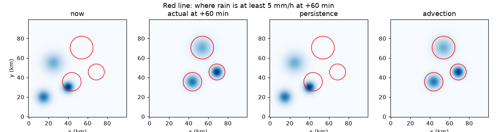
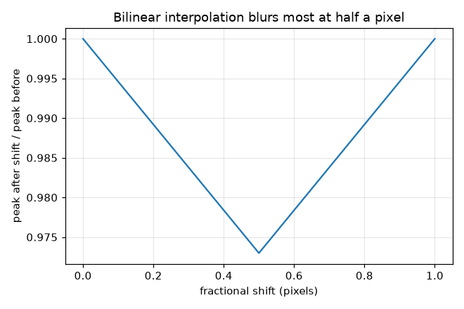
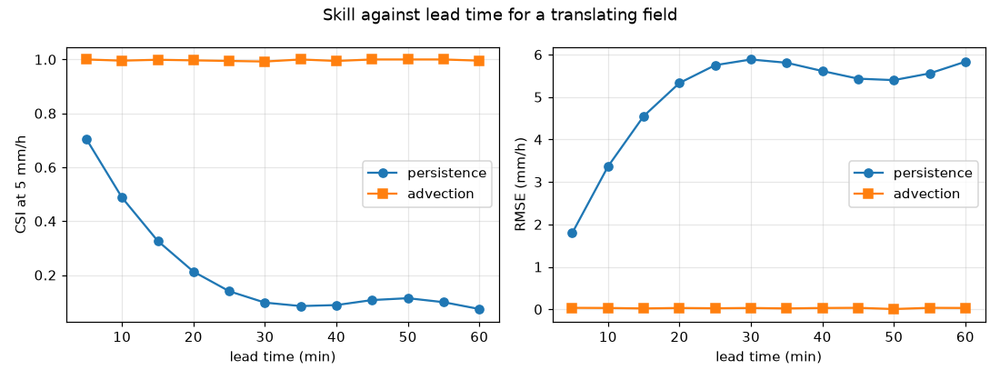

# Session 2: Translate a field, estimate the motion, score the forecast

*Level 2 (mathematical engineering model) · about 75 minutes · opennowcast*

> This is a simplified educational model. It is not a validated design tool and must not be used for real structures, electrical installations, vehicles, industrial processes or medical decisions.

**Prerequisites**

- Session 1: rain cells, wind from two frames.
- Arrays in NumPy are explained as we go.

**Learning objectives.** After this session you can:

- Shift a 2-D radar field by whole pixels and by fractions of a pixel (bilinear interpolation).
- Show that interpolation conserves total rain but blurs the field, and predict by how much.
- Estimate the shift between two frames by a brute-force search and check it against a known shift.
- Compare persistence and advection forecasts with RMSE, CSI and the fractions skill score.

## A. Real-world problem
A real nowcast moves the whole radar picture, not one cell. The motion is rarely a whole number of pixels, so we must shift by fractions of a pixel, and we must find the motion from two frames. Then comes the honest question: is the advected forecast any better than saying 'nothing changes' (persistence), and how do we measure that? A forecast that is displaced by a few kilometres looks bad pixel by pixel but may still be useful; good scores must take this into account. Safety note: synthetic data, teaching model only, not a warning system.

## B. Concept and theory
The field R(x, y) is a 100 x 100 array of rain rates. An integer shift copies the array to a new place (rain pushed off the edge is lost). For a shift by (dx, dy) that is not a whole number, the new value at a pixel is read from the old field at (x - dx, y - dy); that point lies between four pixels and we take a weighted average of them (bilinear interpolation). The four weights add up to 1, so total rain is conserved. Along one axis a fractional shift f uses the two weights (1 - f) and f; this averaging adds a blur of variance f(1 - f) pixels squared, which is largest (0.25) at f = 0.5. To estimate the motion we try shifts of the old frame and keep the one that makes the squared difference from the new frame smallest (the cousin of finding the peak of the cross-correlation), first in whole pixels, then on a finer grid. Persistence uses the latest frame as the forecast. Advection shifts it by (shift per frame) x (lead in frames). Skill: RMSE is the root mean squared difference (mm/h). CSI counts pixels at or above a threshold: hits / (hits + misses + false alarms). The fractions skill score (FSS) compares the fraction of rainy pixels in n x n windows, so it forgives small displacements. For a Gaussian cell the area above the threshold is a disc of radius r = sigma sqrt(2 ln(P/threshold)); two such discs displaced by d have CSI equal to overlap / union, which only depends on d / r. This explains why skill falls with lead time: d = (wind error) x (lead time).

| Symbol | Meaning | Unit |
|---|---|---|
| R(x, y) | rain rate field | mm/h |
| (dx, dy) | shift per frame, east and north | pixels per frame (1 pixel = 1 km) |
| f | fractional part of a shift | pixels |
| thr | rain-rate threshold for CSI and FSS (5) | mm/h |
| n | window size for FSS | pixels |
| r | radius of the area above the threshold | km |
| d | displacement between forecast and true cell | km |
| e | error of the estimated wind | km/h |

**Assumptions**

- The whole pattern moves with one shift (we relax this in Session 3).
- The pattern does not grow or fade.
- Rain pushed off the picture is lost and nothing enters from outside.
- Synthetic Gaussian cells; real radar has noise, which we also test with seeded random noise.

$$ R'(x,y)=R(x-\Delta x,\;y-\Delta y)\quad\text{(bilinear weights }(1-f)\text{ and }f\text{ per axis)} $$

$$ \sigma^{2}_{\mathrm{added}}=f(1-f)\ \ \text{pixels}^2 $$

$$ \mathrm{RMSE}=\sqrt{\frac{1}{N}\sum (F-O)^{2}},\qquad \mathrm{CSI}=\frac{H}{H+M+FA} $$

$$ \mathrm{FSS}=1-\frac{\overline{(P_F-P_O)^{2}}}{\overline{P_F^{2}}+\overline{P_O^{2}}} $$

$$ \mathrm{CSI}(d/r)=\frac{A_{\cap}}{2\pi r^{2}-A_{\cap}},\quad A_{\cap}=2r^{2}\arccos\frac{d}{2r}-\frac{d}{2}\sqrt{4r^{2}-d^{2}} $$

## C. Visual explanation
The first figure shows the field now, what actually happened 60 minutes later, the persistence forecast and the advection forecast, with the red outline of where the true rain is at least 5 mm/h. Persistence leaves the cells where they were (RMSE 5.83 mm/h and CSI 0.074 at 60 minutes); advection puts them on the red outline (RMSE 0.03 mm/h and CSI 0.996). The second figure plots CSI and RMSE against lead time: the persistence curve falls fast while the advection curve stays near perfect because the motion is exactly a shift. The third figure shows how much of the peak of a narrow cell (sigma = 3) survives a fractional shift: it is worst at half a pixel, where 0.973 of the peak is left.

*Now, truth at +60 minutes, persistence and advection; red outline marks 5 mm/h in the truth.*

*Peak of a sigma = 3 cell after a fractional shift: the blur is largest at half a pixel.*

*CSI and RMSE against lead time for persistence and advection on a translating field.*

## D. Interactive simulation
Run the lesson (`python start.py 2`), then open the live app: [Session 2: displacement error and skill](https://krunalpanchal1995.github.io/pan-iit-oss/opennowcast/session-02/) (or `app.html` in this folder). Choose a wind speed, a wind error and a cell size. The map shows where the rain really is (black), where persistence puts it (grey) and where advection with the wrong wind puts it (blue). Switch to the graph to see CSI against lead time and where it crosses 0.5.

**Challenge.** At 60 minutes keep the advection CSI at 0.5 or more while persistence stays below 0.1.

## E. Worked example and experiment
**Problem.** Two frames show the whole pattern moved (2.4, 1.3) pixels in 5 minutes. What is the wind, how far does the pattern move in 60 minutes, and what is the CSI if a forecast has 80 hits, 10 misses and 10 false alarms?

1. Wind: u = 2.4 x 12 = 28.8 km/h east and v = 1.3 x 12 = 15.6 km/h north.
2. Speed = sqrt(28.8^2 + 15.6^2) = sqrt(829.4 + 243.4) = 32.76 km/h.
3. In 60 minutes there are 12 frames, so the pattern moves (2.4 x 12, 1.3 x 12) = (28.8, 15.6) km.
4. CSI = hits / (hits + misses + false alarms) = 80 / (80 + 10 + 10) = 0.8.
5. Check with the code: `estimate_shift` returns about (2.4, 1.3) and the checkpoint recomputes all of these.

**Answer.** Wind (28.8, 15.6) km/h, speed 32.76 km/h; the pattern moves (28.8, 15.6) km in an hour; the CSI is 0.8.

**Experiment.** Take two real radar images of the same area 5 or 10 minutes apart (screenshots of a weather service loop work), put a transparent grid over them and estimate by eye how far a clear cell moved. Compare with the output of `estimate_shift` on a small synthetic copy. Differences to expect: real cells change shape, the image has colour steps instead of true rain rates, and different heights in the storm move differently; the model assumes one rigid shift.

## F. Assessment and design challenge
**Question type A: Conceptual.** Why does shifting a field by half a pixel make the peak lower, even though no rain is lost?

Hint

Each new value is a weighted average of neighbouring pixels. What does averaging do to a sharp peak?

Step-by-step solution

Bilinear interpolation averages neighbouring pixels. The weights add up to 1, so the total rain is unchanged, but a peak is averaged with its lower neighbours, so the peak falls and the cell spreads out. The added blur is f(1 - f) pixels squared per axis, largest at f = 0.5.

**Question type B: Numerical.** The estimated shift is (1.5, 0.5) pixels per 5 minutes. Give the wind components and speed in km/h and the displacement after 60 minutes.

Hint

Multiply by 12 for km/h; there are 12 frames in 60 minutes.

Step-by-step solution

u = 1.5 x 12 = 18 km/h and v = 0.5 x 12 = 6 km/h. Speed = sqrt(18^2 + 6^2) = sqrt(360) = 18.97 km/h. Displacement after 60 minutes = (18, 6) km. Sanity check: 18.97 km/h for one hour is about 19 km.

**Question type C: Graph and simulation interpretation.** On the skill-against-lead-time graph for a translating field, which method wins and why does the other curve fall? Quote the 60 minute CSI values.

Hint

Persistence keeps the cells in the old place.

Step-by-step solution

Advection wins at every lead time. At 60 minutes its CSI is 0.996 against 0.074 for persistence. Persistence leaves the rain where it was while the true rain moved about 32 km, so the true and forecast areas almost do not overlap and CSI is close to zero. Advection moves the field with the right motion, so the overlap is nearly complete. This is the best case: constant wind, no growth.

**Question type D: Design and optimisation challenge.** Design: a cell has a 5 mm/h radius of 9.47 km. You want a CSI of at least 0.5 at 60 minutes. How accurate must the wind be? What if you only need 30 minutes?

Hint

The two-disc model gives CSI 0.50 when d is about 5 km for r = 9.47 km. Displacement = wind error x time.

Step-by-step solution

At 60 minutes d = e x 1 h, so the wind error e must be at most about 5 km/h. At 30 minutes d = e x 0.5 h = 5 km needs e = 10 km/h, so the wind can be twice as bad. CSI depends only on d / r, so a cell twice as big tolerates twice the displacement. Trade-off: a forecast to a longer lead time needs a much more accurate wind; to a user, a larger scale answer (bigger area) is more reliable than a pixel-exact one.

Score yourself with [RUBRIC.md](../../RUBRIC.md). Print the [activity sheet](activity_sheet.md) to work on paper.

## Common misconceptions
| Common misconception | What is actually true |
|---|---|
| Shifting by a fraction of a pixel is free. | Interpolation conserves total rain but blurs the field: the peak falls and the cell spreads, most at half a pixel. |
| A forecast displaced by a few pixels is useless. | Pixel-by-pixel scores punish it twice (a miss and a false alarm), but the fractions skill score shows it still has skill at a larger scale. |
| A lower RMSE always means a better forecast of rain. | RMSE rewards smooth, weak forecasts. CSI and FSS ask the question we actually care about: is the rain in the right place? |
| CSI is a percentage of pixels forecast correctly. | CSI ignores the large dry area: it only counts pixels where rain was forecast or observed. |

## Glossary
- **bilinear interpolation**: a weighted average of the 4 nearest pixels; used to read a field between pixels
- **advection**: moving a quantity along with a flow, here the rain pattern along the wind
- **persistence**: the forecast 'nothing changes': the latest picture is the forecast
- **CSI**: critical success index: hits / (hits + misses + false alarms) above a threshold; 1 is perfect, 0 is no overlap
- **RMSE**: root mean squared error, in mm/h
- **FSS**: fractions skill score: compares the fraction of rainy pixels in windows; grows with window size when the error is only a displacement

## Finish
1. Do the three coding tasks in [exercises.md](exercises.md).
2. Run `python start.py 2` again after your changes. It ends with the checkpoint; when it prints `PASS`, you are done. (Checkpoint only: `python start.py check 2`.)

Next: [Session 3](../session-03/README.md)
