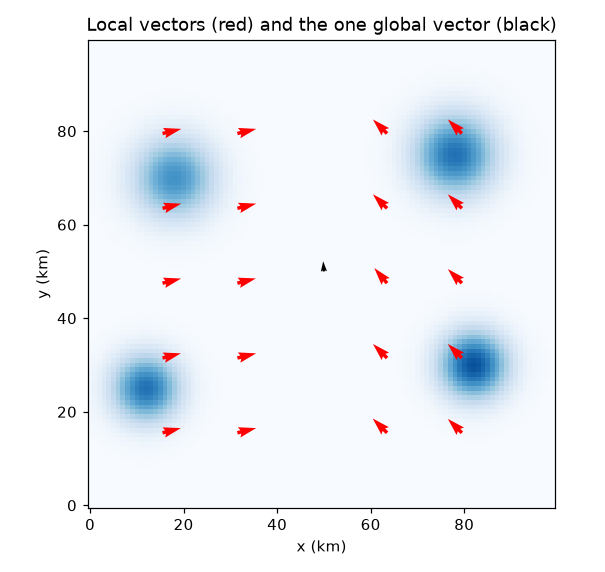
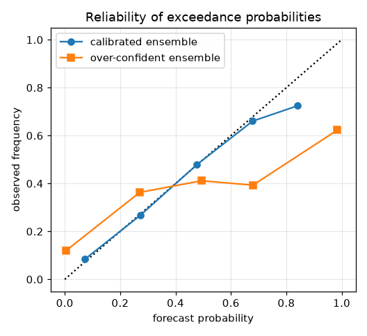
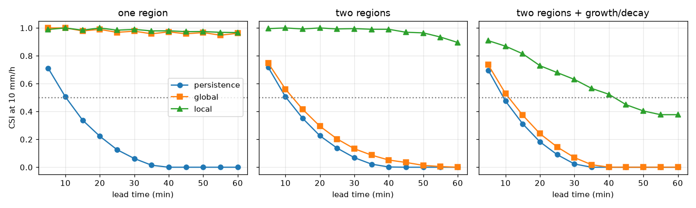

# Session 3: When one shift is not enough: local motion, growth, uncertainty

*Level 3 (simulation and validation) · about 90 minutes · opennowcast*

> This is a simplified educational model. It is not a validated design tool and must not be used for real structures, electrical installations, vehicles, industrial processes or medical decisions.

**Prerequisites**

- Session 2: shifting fields, CSI.
- Session 1: wind from two frames.

**Learning objectives.** After this session you can:

- Estimate local motion by block matching and show that a global vector fails when two regions move differently.
- Measure how forecast skill falls with lead time, and why growth and decay break pure advection.
- Compare 12 small interpolated shifts with one 60-minute shift and explain the numerical diffusion.
- Turn motion uncertainty into a probability with a seeded ensemble and check its reliability.
- Recognise where advection fails: new storms and rotating patterns.

## A. Real-world problem
Real storms do not move as one rigid sheet. One storm may move east while another, 60 km away, moves north-west. Cells also grow and fade, and the wind we measure is never exact. A forecaster would also like a probability ('how likely is 10 mm/h at my town?'), not only a single picture. In this session you build a local-motion nowcast, measure where it works and where it breaks, and finish with a mini-project. Safety note: synthetic data only; this is not a warning system. Real nowcasting is done by trained forecasters with validated systems.

## B. Concept and theory
Local motion: cut the picture into overlapping blocks (32 x 32 pixels, step 16). In each block that has rain, find the shift of the old frame that best matches the new frame inside the block (whole pixels, then a parabola fit for fractions). Empty blocks borrow the nearest vector; vectors are then interpolated to every pixel. Semi-Lagrangian advection: for every target pixel look back along the motion to where its rain came from and copy the value (interpolated); one look-back covers the whole lead time. Repeating small shifts instead interpolates at each step: with a fractional part f per step, n steps add n f (1 - f) pixels squared of blur, while one shift adds only f_total (1 - f_total). Growth: if a cell's peak changes by a factor (1 + g) per frame while advection keeps it constant, the area above the threshold is wrong; the radius of the area is r = sigma sqrt(2 ln(P (1 + g)^k / thr)) after k frames, and the CSI of two discs with different radii and a displacement d can be computed from circle overlap geometry. Uncertainty: add random errors to the wind (ensemble members), advect once per member and count the fraction of members with rain at or above the threshold; the Brier score (mean squared difference between probability and the 0/1 outcome) and a reliability table (forecast probability against observed frequency) judge the result. Advection cannot create rain: a storm that starts after the forecast time is invisible to it, and a rotating pattern has no single straight-line motion.

| Symbol | Meaning | Unit |
|---|---|---|
| (u, v) | motion vector | pixels per frame (1 pixel per 5 minutes = 12 km/h) |
| g | growth rate of the peak of a cell | per frame (0.08 = 8 %) |
| k | lead time in frames | frames of 5 minutes |
| thr | threshold for CSI (10) | mm/h |
| r_f, r_t | radius of the forecast and true area above the threshold | km |
| d | distance between their centres | km |
| p | ensemble probability of rain at or above the threshold | 0 to 1 |
| BS | Brier score | 0 (best) to 1 |

**Assumptions**

- Motion is constant over the 60 minutes of the forecast but may differ between regions.
- Cells keep their shape; growth only changes the peak.
- Ensemble members share one random error for the whole picture (a wind error), not independent errors per pixel.
- Synthetic data with a known truth; real verification uses radar and rain gauges.

$$ \mathbf{x}_{\mathrm{dep}}=\mathbf{x}-k\,\mathbf{u}(\mathbf{x}_{\mathrm{dep}}),\qquad R_f(\mathbf{x})=R_0(\mathbf{x}_{\mathrm{dep}}) $$

$$ n\,f(1-f)\ \text{(repeated steps)}\quad\text{versus}\quad f_{\mathrm{tot}}(1-f_{\mathrm{tot}})\ \text{(one shift)} $$

$$ r_t(k)=\sigma\sqrt{2\ln\!\left(\frac{P(1+g)^{k}}{\mathrm{thr}}\right)} $$

$$ \mathrm{BS}=\frac{1}{N}\sum_i (p_i-o_i)^{2} $$

## C. Visual explanation
The first figure shows the two-region scene with the red local vectors and the single black global vector. The west storms move at (2.0, 0.5) pixels per frame and the east storms at (-1.5, 1.5); the global vector (-0.08, 1.10) matches neither. The second figure shows CSI against lead time (at 10 mm/h) for three cases and three methods: with one region the global vector is already good (CSI at least 0.95 at 60 minutes); with two regions the local method keeps a CSI of 0.90 at 60 minutes while the global one is below 0.01; with growth and decay the local method falls from 0.91 at 5 minutes to 0.38 at 60 minutes and crosses 0.5 at 45 minutes. The third figure is a reliability diagram: the calibrated ensemble follows the diagonal; the over-confident one does not.

*Local vectors (red) and the single global vector (black) on the two-region field.*

*Reliability of exceedance probabilities: calibrated versus over-confident ensemble.*

*CSI against lead time for persistence, global and local advection in three cases.*

## D. Interactive simulation
Run the lesson (`python start.py 3`), then open the live app: [Session 3: skill, growth and error](https://krunalpanchal1995.github.io/pan-iit-oss/opennowcast/session-03/) (or `app.html` in this folder). Set the growth rate, the wind error, the threshold and the lead time and watch the forecast disc (blue, size frozen) against the true disc (black). Switch to the graph and compare the three curves: growth and error, error only, growth only.

**Challenge.** Keep the CSI at 0.6 or more at 60 minutes for cells that grow at least 3 % per frame.

## E. Worked example and experiment
**Problem.** A cell of width sigma = 2.5 pixels moves 8.4 pixels east in 60 minutes (0.7 pixels per 5 minutes). Compare the blur from 12 separate 0.7 pixel shifts with one 8.4 pixel shift.

1. One 0.7 pixel shift has fractional part f = 0.7 and adds f(1 - f) = 0.7 x 0.3 = 0.21 pixels squared of blur.
2. Twelve of them add 12 x 0.21 = 2.52 pixels squared.
3. One shift of 8.4 pixels has fractional part 0.4 and adds 0.4 x 0.6 = 0.24 pixels squared.
4. The cell starts with variance 6.25 pixels squared, so the 12-step cell is wider: its peak ends at 24.99 mm/h from 30, against 29.08 mm/h for the single shift.
5. Both conserve the total rain exactly; only the shape differs. The checkpoint measures all these numbers from the arrays.

**Answer.** Twelve small interpolated steps add 2.52 pixels squared of blur and lower the peak to 24.99 mm/h; one 60-minute shift adds only 0.24 pixels squared and keeps 29.08 mm/h.

**Experiment.** Photocopy a picture, then copy the copy, ten times: each generation is a little blurrier. That is numerical diffusion. For a real nowcast compare a forecast made in many small steps with one made in a single step on a recent real event and compare the peak rain rates; expect the many-step forecast to be smoother. Reality differs from the model because real storms also change shape and intensity by physics, not just by interpolation.

## Real-world application and mini-project: Nowcast a two-region storm field for 60 minutes
A synthetic radar scene (`GROWTH` in Session 3) has two regions that move differently, with cells that grow and fade. Make a nowcast from the last two frames with persistence, one global vector and local vectors, score each against the truth for every 5 minutes up to 60, and find the lead time at which each skill first drops below a CSI of 0.5. Repeat for the thresholds 5, 10 and 15 mm/h.

**Deliverable:** A script that prints, for each threshold, the lead time (minutes) below CSI 0.5 for the three methods, plus the CSI at 60 minutes for local vectors, and saves a plot of the three skill curves at 10 mm/h.

**Success looks like:** At 10 mm/h the lead times are 10 (persistence), 15 (global) and 45 (local) minutes; at 15 mm/h they are 10, 10 and 25; at 5 mm/h local vectors never drop below 0.5 in the hour (CSI 0.62 at 60 minutes) while the other two drop at 15 minutes.

## F. Assessment and design challenge
**Question type A: Conceptual.** Why can advection never forecast a storm that starts after the forecast time? And why does a rotating pattern break a single-vector forecast?

Hint

What does advection do with the rain that is already in the picture?

Step-by-step solution

Advection only moves rain that already exists. A new storm has no rain in the latest picture, so it is missing from every forecast: in our test none of its 193 rainy pixels is forecast and the CSI falls from 0.90 to 0.72. A rotating pattern has no mean motion (the global vector is about zero), so global advection equals persistence, and even local straight-line vectors reach only a CSI of 0.08 at 60 minutes because the cells move on curved paths.

**Question type B: Numerical.** A cell is moved in 12 steps of 0.5 pixels. How much blur (in pixels squared) is added in total? How much would one shift of 6 pixels add?

Hint

Each step with fractional part f adds f(1 - f).

Step-by-step solution

Each step adds 0.5 x 0.5 = 0.25, so 12 steps add 3.0 pixels squared. A single shift of 6 pixels has fractional part 0, so it adds nothing. Same total movement, very different blur: this is why a nowcast should shift once by the total displacement.

**Question type C: Graph and simulation interpretation.** In the growth and decay panel of the skill curves, at what lead time does each method fall below CSI 0.5 (10 mm/h)? What does that mean for a user?

Hint

Find where each curve crosses the dotted 0.5 line.

Step-by-step solution

Persistence falls below 0.5 at 10 minutes, the global vector at 15 minutes and local vectors at 45 minutes. A user relying on persistence or a single wind can trust the forecast for a quarter of an hour at most; local vectors give about 45 minutes. After that even the best method here is mostly wrong at 10 mm/h because cells grow and fade.

**Question type D: Design and optimisation challenge.** Design: you must publish a 60-minute forecast for a field with two regions that move differently and cells that grow and fade. Choose the motion method and the longest lead time you would show as a single picture, and say what you would show beyond that.

Hint

Use the 0.5 crossing times for each method, and the reliability result.

Step-by-step solution

Use local vectors: a global vector falls below 0.5 at 15 minutes against 45 minutes for local vectors. Show the single picture up to about 45 minutes, where CSI at 10 mm/h stays above 0.5. Beyond that, show a probability map from an ensemble: the calibrated ensemble has a Brier score of 0.140 against 0.199 for a single answer, and its probabilities are reliable. Trade-off: local vectors are noisier in empty areas and cost more compute; a probability is harder for a user to read than a picture, so label it clearly. Always point users to official warnings.

Score yourself with [RUBRIC.md](../../RUBRIC.md). Print the [activity sheet](activity_sheet.md) to work on paper.

## Common misconceptions
| Common misconception | What is actually true |
|---|---|
| A better motion estimate fixes everything. | Even with the true motion, ignoring growth and decay gives a CSI of only 0.24 at 60 minutes on our growing and fading scene; motion is only half of the problem. |
| More small time steps give a more accurate forecast. | Each interpolation blurs the field; 12 small steps blur much more than one big shift (2.52 against 0.24 pixels squared in our example). |
| Local vectors are always better than one global vector. | With a single motion the global vector is as good (CSI at least 0.95 at 60 minutes); local vectors are noisier and pay off only when regions move differently. |
| A probability forecast is just a fuzzy picture. | A probability can be checked: of all the times 70 % was forecast, about 70 % should happen. An over-confident ensemble fails this reliability test. |

## Glossary
- **optical flow**: a motion vector for each part of a picture, found from two frames
- **block matching**: finding the shift that best matches a small block of one picture in the next
- **semi-Lagrangian**: advection by looking back from each pixel to where its rain came from
- **numerical diffusion**: unwanted blurring caused by repeated interpolation
- **ensemble**: many forecasts, each with a slightly different input, to show the uncertainty
- **Brier score**: mean squared error of a probability forecast; lower is better
- **reliability**: agreement between forecast probability and how often the event happens

## Finish
1. Do the three coding tasks in [exercises.md](exercises.md).
2. Run `python start.py 3` again after your changes. It ends with the checkpoint; when it prints `PASS`, you are done. (Checkpoint only: `python start.py check 3`.)

Next: the [roadmap](../../promo/roadmap.md). Session 4 is yours to build.
