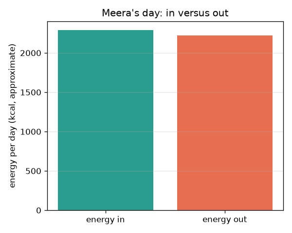
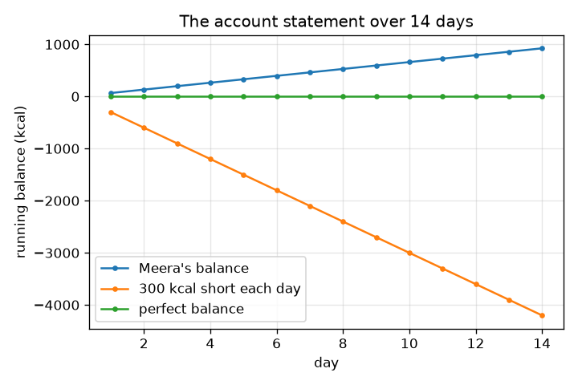

# सत्र 1: ऊर्जा अंदर, ऊर्जा बाहर: एक बैंक बैलेंस

*स्तर 1 (वैचारिक इंटरैक्टिव मॉडल) · लगभग 60 मिनट · opennutrition*

> यह एक सरलीकृत शैक्षिक मॉडल है। यह कोई प्रमाणित डिज़ाइन उपकरण नहीं है और इसका उपयोग वास्तविक संरचनाओं, विद्युत संस्थापनों, वाहनों, औद्योगिक प्रक्रियाओं या चिकित्सा निर्णयों के लिए नहीं किया जाना चाहिए।

**पूर्व-आवश्यकताएँ (Prerequisites)**

- स्कूल का अंकगणित: गुणा और जोड़।
- आपने PRIMER.md पढ़ लिया है और एक बार `python start.py 1` चला लिया है।

**सीखने के उद्देश्य (Learning objectives)।** इस सत्र के बाद आप:

- ऊर्जा संतुलन (energy balance) को ऊर्जा अंदर घटा ऊर्जा बाहर के रूप में, बैंक बैलेंस की तरह, समझा सकेंगे।
- किलोकैलोरी और किलोजूल के बीच बदल सकेंगे (1 kcal = 4.184 kJ)।
- एक गतिविधि तालिका से बाहर जाने वाली ऊर्जा का अनुमान लगा सकेंगे: ऊर्जा = MET x द्रव्यमान x घंटे (अनुमानित)।
- चालू-बैलेंस (running balance) ग्राफ़ पढ़ सकेंगे और बता सकेंगे कि उसकी ढलान का क्या अर्थ है।

## A. वास्तविक जीवन की समस्या
भोजन ऊर्जा लाता है और शरीर पूरे दिन ऊर्जा ख़र्च करता है, सोते हुए भी। यदि बाहर जाने से अधिक अंदर आता है तो बैलेंस धनात्मक है; यदि कम, तो ऋणात्मक, ठीक वैसे ही जैसे बैंक खाते में पैसा। क्या हम एक दिन पर संख्याएँ लगाकर बैलेंस देख सकते हैं? यह केवल सामान्य शिक्षा है, चिकित्सा या आहार संबंधी सलाह नहीं। लोग काल्पनिक हैं। खाद्य पदार्थों और गतिविधियों के मान पाठ्यपुस्तक के पूर्णांकित मान हैं और अनुमानित हैं।

## B. अवधारणा और सिद्धांत
ऊर्जा किलोकैलोरी (kcal, जिसे भोजन के पैकेटों पर Calories भी कहा जाता है) या किलोजूल (kJ) में मापी जाती है: 1 kcal = 4.184 kJ। अंदर आने वाली ऊर्जा भोजन से आती है। बाहर जाने वाली ऊर्जा वह ऊर्जा है जो शरीर जीवित रहने, चलने-फिरने और पचाने पर ख़र्च करता है। गतिविधि के लिए एक सामान्य पाठ्यपुस्तक अनुमान है ऊर्जा (kcal) = MET x शरीर का द्रव्यमान (kg) x समय (घंटे), जहाँ MET मान बताता है कि कोई गतिविधि विश्राम दर (resting rate) की कितने गुना ऊर्जा उपयोग करती है; एक MET लगभग एक kcal प्रति kg प्रति घंटा है। दैनिक बैलेंस ऊर्जा अंदर घटा ऊर्जा बाहर है; दिन-प्रतिदिन बैलेंस जोड़ने से एक चालू कुल (running total) मिलता है, यानी खाते का विवरण (account statement)। सभी मान अनुमानित हैं और व्यक्ति-व्यक्ति में भिन्न होते हैं।

| प्रतीक | अर्थ | इकाई |
|---|---|---|
| E_in | भोजन से अंदर आने वाली ऊर्जा | kcal प्रति दिन |
| E_out | शरीर और गतिविधियों से बाहर जाने वाली ऊर्जा | kcal प्रति दिन |
| B | दैनिक बैलेंस, E_in - E_out | kcal प्रति दिन |
| MET | विश्राम दर के गुणज के रूप में गतिविधि की तीव्रता | कोई इकाई नहीं |
| m | शरीर का द्रव्यमान | kg |
| t | किसी गतिविधि पर बिताया गया समय | घंटे |

**मान्यताएँ (Assumptions)**

- यह सामान्य शिक्षा है, चिकित्सा या आहार संबंधी सलाह नहीं।
- भोजन और MET मान पूर्णांकित, अनुमानित पाठ्यपुस्तक मान हैं।
- मॉडल व्यक्ति काल्पनिक है (60 kg) और हर दिन एक जैसा है।
- दिन के 24 घंटे सूचीबद्ध गतिविधियों में बँटे हुए हैं।

$$ 1\ \mathrm{kcal}=4.184\ \mathrm{kJ} $$

$$ E_{\mathrm{out}}\approx\sum_{\text{activities}}\mathrm{MET}\times m\times t $$

$$ B = E_{\mathrm{in}}-E_{\mathrm{out}},\qquad \text{running total after } n \text{ days}=\sum_{i=1}^{n}B_i $$

## C. दृश्य व्याख्या
पहला चित्र मीरा (एक काल्पनिक व्यक्ति) के दिन को दो बार के रूप में दिखाता है, ऊर्जा अंदर और ऊर्जा बाहर। वे क़रीब हैं, इसलिए उसका बैलेंस छोटा है। दूसरा चित्र तीन स्थितियों के लिए 14 दिनों का चालू बैलेंस आलेखित करता है: मीरा का अपना छोटा बैलेंस, प्रतिदिन 300 kcal की स्थिर कमी, और शून्य का पूर्ण संतुलन। हर रेखा सीधी है क्योंकि हर दिन उतनी ही मात्रा जुड़ती है, और उसकी ढलान दैनिक बैलेंस है।

*मीरा का दिन: ऊर्जा अंदर बनाम ऊर्जा बाहर (अनुमानित मान)।*

*14 दिनों का चालू बैलेंस: ढलान दैनिक बैलेंस है।*

## D. इंटरैक्टिव सिमुलेशन
पाठ चलाएँ (`python start.py 1`), फिर लाइव ऐप खोलें: [सत्र 1: ऊर्जा अंदर बनाम ऊर्जा बाहर](https://krunalpanchal1995.github.io/pan-iit-oss/opennutrition/session-01/) (या इसी फ़ोल्डर में `app.html`)। सेवन (intake), पैदल चलने और साइकिल चलाने के स्लाइडर हिलाएँ और दोनों बार देखें। फिर चालू-बैलेंस ग्राफ़ खोलें और देखें कि दैनिक बैलेंस बदलने पर रेखा कैसे झुकती है।

**चुनौती।** कम से कम 2000 kcal खाते हुए दैनिक बैलेंस को शून्य के 50 kcal के भीतर ले आएँ।

## E. हल किया गया उदाहरण और प्रयोग
**समस्या।** 60 kg के व्यक्ति के लिए 1 घंटा पैदल चलना कितनी ऊर्जा उपयोग करता है, वह कितने किलोजूल है, और वह भोजन ऊर्जा के कितने केलों के बराबर है?

1. पैदल चलने का MET 3.5 है (अनुमानित)। ऊर्जा = 3.5 x 60 kg x 1 h = 210 kcal।
2. किलोजूल में: 210 x 4.184 = 878.64, लगभग 879 kJ।
3. एक मध्यम केला लगभग 105 kcal है (अनुमानित), इसलिए 210 / 105 = 2 केले।

**उत्तर।** लगभग 210 kcal (लगभग 879 kJ), मोटे तौर पर दो केले। तीनों संख्याएँ अनुमानित हैं।

**प्रयोग।** किसी पैकेट का लेबल पढ़ें जिस पर kJ और kcal दोनों लिखे हों। kcal को 4.184 से गुणा करें और छपे kJ से तुलना करें; छोटे अंतर पूर्णांकन से आते हैं। फिर एक काल्पनिक व्यक्ति (या केवल अभ्यास के लिए आप) एक दिन में क्या खाता और करता है उसकी डायरी रखें और जोड़ें। वास्तविक ऊर्जा उपयोग MET तालिका से भिन्न होता है, जो कई लोगों का औसत है, और भोजन ऊर्जा भी तालिका से भिन्न होती है, इसलिए परिणाम को एक अनुमान मानें।

## F. मूल्यांकन और डिज़ाइन चुनौती
**प्रश्न प्रकार A: वैचारिक।** मीरा 8 घंटे सोती है और कुछ नहीं करती। क्या उसकी बाहर जाने वाली ऊर्जा शून्य है? समझाएँ, और 60 kg के व्यक्ति के लिए तालिका अनुमान दें।

संकेत

सोने का MET मान 1 से थोड़ा कम है।

चरण-दर-चरण हल

नहीं। सोते समय भी शरीर काम करता रहता है (हृदय, साँस लेना, मरम्मत, गर्म रहना)। MET 0.95 के साथ, ऊर्जा = 0.95 x 60 x 8 = 456 kcal। बाहर जाने वाली ऊर्जा कभी शून्य नहीं होती, इसीलिए बैलेंस केवल 'भोजन घटा व्यायाम' नहीं है।

**प्रश्न प्रकार B: संख्यात्मक।** एक पैक पर 1500 kcal लिखा है। यह कितने किलोजूल है? किसी और दिन एक व्यक्ति 2000 kcal खाता है और 2300 kcal उपयोग करता है: बैलेंस क्या है और 7 दिनों के बाद चालू कुल क्या है?

संकेत

4.184 से गुणा करें, फिर दैनिक बैलेंस को 7 से गुणा करें।

चरण-दर-चरण हल

1500 x 4.184 = 6276 kJ। बैलेंस = 2000 - 2300 = -300 kcal प्रति दिन; 7 दिनों के बाद चालू कुल 7 x (-300) = -2100 kcal है। जाँच (sanity check): इकाइयाँ kcal हैं और चिह्न ऋणात्मक है क्योंकि बाहर जाने से कम अंदर आया।

**प्रश्न प्रकार C: ग्राफ़ और सिमुलेशन की व्याख्या।** चालू-बैलेंस ग्राफ़ में, 14 दिनों के बाद 'प्रतिदिन 300 kcal कम' वाली रेखा का मान क्या है, और किसी रेखा की ढलान का क्या अर्थ है?

संकेत

ढलान rise over run है: kcal प्रति दिन।

चरण-दर-चरण हल

14 दिनों के बाद रेखा 14 x (-300) = -4200 kcal पर है। हर रेखा की ढलान kcal प्रति दिन में दैनिक बैलेंस है: अधिक खड़ी का अर्थ है बड़ा दैनिक अधिशेष (surplus) या कमी, सपाट का अर्थ है संतुलन।

**प्रश्न प्रकार D: डिज़ाइन और अनुकूलन (optimisation) चुनौती।** मीरा का दिन +66 kcal का बैलेंस देता है। आधे घंटे बैठने की जगह पैदल चलकर, क्या वह इसे शून्य पर ला सकती है? गणना दिखाएँ और मान्यता बताएँ।

संकेत

पैदल चलना 3.5 MET और बैठना 1.3 MET उपयोग करता है; 60 kg के लिए प्रति घंटा अतिरिक्त kcal ज्ञात करें।

चरण-दर-चरण हल

बैठने के बजाय पैदल चलने के प्रति घंटे अतिरिक्त ऊर्जा = (3.5 - 1.3) x 60 = 132 kcal। आधा घंटा 66 kcal देता है। इसलिए उसकी बाहर जाने वाली ऊर्जा 2223 से 2289 kcal हो जाती है, जो उसके अंदर आने वाले 2289 kcal के बराबर है, और बैलेंस शून्य है। मान्यता: MET तालिका उसके लिए सटीक है; वास्तव में यह केवल एक अनुमान है, इसलिए वास्तविक बैलेंस अनिश्चित है।

[RUBRIC.md](../../RUBRIC.md) से स्वयं को अंक दें। काग़ज़ पर काम करने के लिए [गतिविधि पत्रक (activity sheet)](activity_sheet.md) प्रिंट करें।

## सामान्य भ्रांतियाँ (Common misconceptions)
| सामान्य भ्रांति | वास्तव में क्या सच है |
|---|---|
| बाहर जाने वाली ऊर्जा केवल व्यायाम है। | बाहर जाने वाली अधिकांश ऊर्जा शरीर को चलाने में जाती है, विश्राम में भी; व्यायाम उसके ऊपर जुड़ता है। |
| एक किलोकैलोरी और एक Calorie अलग हैं। | भोजन की एक Calorie एक किलोकैलोरी है। लेबल किलोजूल भी दे सकते हैं; 1 kcal = 4.184 kJ। |
| तालिका के मान सटीक हैं। | वे पूर्णांकित औसत हैं; वास्तविक खाद्य पदार्थ और वास्तविक लोग भिन्न होते हैं। |

## शब्दावली (Glossary)
- **ऊर्जा संतुलन (energy balance)**: ऊर्जा अंदर घटा ऊर्जा बाहर
- **किलोकैलोरी (kcal)**: भोजन ऊर्जा की इकाई; 1 kcal = 4.184 kJ
- **किलोजूल (kJ)**: ऊर्जा की SI इकाई जो अक्सर लेबलों पर छपी होती है
- **MET**: विश्राम दर के गुणज के रूप में गतिविधि की तीव्रता
- **चालू बैलेंस (running balance)**: अब तक के दैनिक बैलेंसों का कुल योग

## समापन
1. [exercises.md](exercises.md) में दिए गए तीन कोडिंग कार्य करें।
2. अपने बदलावों के बाद `python start.py 1` फिर से चलाएँ। यह चेकपॉइंट के साथ समाप्त होता है; जब यह `PASS` छापे, तो आपका काम पूरा हो गया। (केवल चेकपॉइंट: `python start.py check 1`।)

आगे: [सत्र 2](../session-02/README.md)
