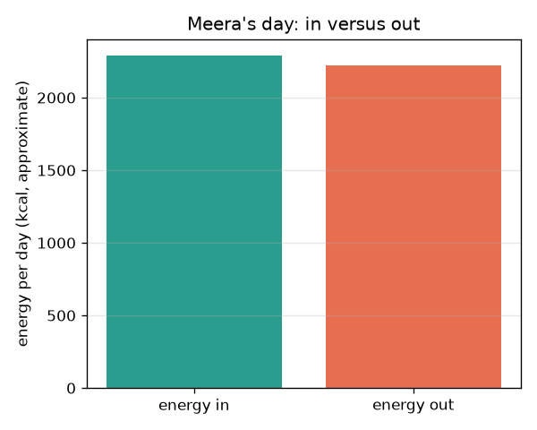
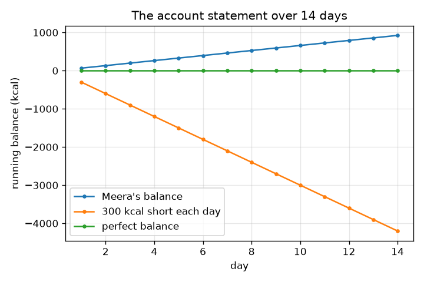

# സെഷൻ 1: ഉള്ളിലേക്കുള്ള ഊർജ്ജം, പുറത്തേക്കുള്ള ഊർജ്ജം: ഒരു ബാങ്ക് ബാലൻസ്

[Session 1 — हिन्दी](README.hi.md) · [Session 1 — മലയാളം](README.ml.md)

*ലെവൽ 1 (ആശയപരമായ ഇന്ററാക്ടീവ് മോഡൽ) · ഏകദേശം 60 മിനിറ്റ് · opennutrition*

> ഇത് ലളിതമാക്കിയ ഒരു വിദ്യാഭ്യാസ മോഡലാണ്. ഇത് സാധൂകരിക്കപ്പെട്ട (validated) ഡിസൈൻ ഉപകരണമല്ല; യഥാർത്ഥ ഘടനകൾ, വൈദ്യുത സംവിധാനങ്ങൾ, വാഹനങ്ങൾ, വ്യാവസായിക പ്രക്രിയകൾ അല്ലെങ്കിൽ വൈദ്യശാസ്ത്ര തീരുമാനങ്ങൾ എന്നിവയ്ക്ക് ഇത് ഉപയോഗിക്കരുത്.

**മുൻ‌അറിവ് (Prerequisites)**

- സ്കൂൾ അങ്കഗണിതം: ഗുണിക്കലും കൂട്ടലും.
- നിങ്ങൾ PRIMER.md വായിക്കുകയും `python start.py 1` ഒരിക്കൽ പ്രവർത്തിപ്പിക്കുകയും ചെയ്തിട്ടുണ്ട്.

**പഠന ലക്ഷ്യങ്ങൾ (Learning objectives).** ഈ സെഷനു ശേഷം നിങ്ങൾക്ക് കഴിയും:

- ഊർജ്ജ സന്തുലനം (energy balance) ഒരു ബാങ്ക് ബാലൻസ് പോലെ, ഉള്ളിലേക്കുള്ള ഊർജ്ജം മൈനസ് പുറത്തേക്കുള്ള ഊർജ്ജം എന്ന് വിശദീകരിക്കാൻ.
- കിലോകലോറിയും കിലോജൂളും തമ്മിൽ മാറ്റാൻ (1 kcal = 4.184 kJ).
- ഒരു പ്രവർത്തന പട്ടികയിൽ നിന്ന് പുറത്തേക്കുള്ള ഊർജ്ജം കണക്കാക്കാൻ: ഊർജ്ജം = MET x പിണ്ഡം x മണിക്കൂർ (ഏകദേശം).
- ഒരു ഓടിക്കൊണ്ടിരിക്കുന്ന ബാലൻസ് ഗ്രാഫ് വായിക്കാനും അതിന്റെ ചരിവ് എന്താണ് അർത്ഥമാക്കുന്നതെന്ന് പറയാനും.

## A. യഥാർത്ഥ ലോക പ്രശ്നം
ഭക്ഷണം ഊർജ്ജം വഹിക്കുന്നു, ഉറങ്ങുമ്പോൾ പോലും ശരീരം ദിവസം മുഴുവൻ ഊർജ്ജം ചെലവഴിക്കുന്നു. പുറത്തേക്ക് പോകുന്നതിനേക്കാൾ കൂടുതൽ ഉള്ളിലേക്ക് വന്നാൽ ബാലൻസ് പോസിറ്റീവ് ആണ്; കുറവാണെങ്കിൽ നെഗറ്റീവ്, ഒരു ബാങ്ക് അക്കൗണ്ടിലെ പണം പോലെ. ഒരു ദിവസത്തിന് സംഖ്യകൾ ഇട്ട് ബാലൻസ് കാണാൻ കഴിയുമോ? ഇത് പൊതു വിദ്യാഭ്യാസം മാത്രമാണ്, വൈദ്യശാസ്ത്രപരമോ ഭക്ഷണക്രമപരമോ ആയ ഉപദേശമല്ല. ആളുകൾ ഭാവനയിലുള്ളവരാണ്. ഭക്ഷണങ്ങളുടെയും പ്രവർത്തനങ്ങളുടെയും മൂല്യങ്ങൾ വൃത്താക്കിയ പാഠപുസ്തക മൂല്യങ്ങളാണ്, ഏകദേശമാണ്.

## B. ആശയവും സിദ്ധാന്തവും
ഊർജ്ജം കിലോകലോറിയിൽ (kcal, ഭക്ഷണ പായ്ക്കറ്റുകളിൽ കലോറി എന്നും വിളിക്കുന്നു) അല്ലെങ്കിൽ കിലോജൂളിൽ (kJ) അളക്കുന്നു: 1 kcal = 4.184 kJ. ഉള്ളിലേക്കുള്ള ഊർജ്ജം ഭക്ഷണത്തിൽ നിന്ന് വരുന്നു. പുറത്തേക്കുള്ള ഊർജ്ജം എന്നത് ശരീരം ജീവൻ നിലനിർത്താനും ചലിക്കാനും ദഹിപ്പിക്കാനും ചെലവഴിക്കുന്ന ഊർജ്ജമാണ്. പ്രവർത്തനത്തിനുള്ള ഒരു സാധാരണ പാഠപുസ്തക കണക്ക് ഊർജ്ജം (kcal) = MET x ശരീര പിണ്ഡം (kg) x സമയം (മണിക്കൂർ) ആണ്, ഇവിടെ ഒരു പ്രവർത്തനം വിശ്രമ നിരക്കിന്റെ എത്ര മടങ്ങ് ഉപയോഗിക്കുന്നു എന്ന് MET മൂല്യം പറയുന്നു; ഒരു MET ഏകദേശം ഒരു kcal പെർ kg പെർ മണിക്കൂർ ആണ്. ദൈനംദിന ബാലൻസ് എന്നത് ഉള്ളിലേക്കുള്ള ഊർജ്ജം മൈനസ് പുറത്തേക്കുള്ള ഊർജ്ജമാണ്; ബാലൻസുകൾ ദിവസംതോറും കൂട്ടുന്നത് ഒരു ഓടിക്കൊണ്ടിരിക്കുന്ന ആകെത്തുക നൽകുന്നു, അക്കൗണ്ട് സ്റ്റേറ്റ്മെന്റ്. എല്ലാ മൂല്യങ്ങളും ഏകദേശമാണ്, ആളുകൾക്കനുസരിച്ച് വ്യത്യാസപ്പെടുന്നു.

| ചിഹ്നം | അർത്ഥം | യൂണിറ്റ് |
|---|---|---|
| E_in | ഭക്ഷണത്തിൽ നിന്ന് ഉള്ളിലേക്കുള്ള ഊർജ്ജം | kcal പ്രതിദിനം |
| E_out | ശരീരത്തിൽ നിന്നും പ്രവർത്തനങ്ങളിൽ നിന്നും പുറത്തേക്കുള്ള ഊർജ്ജം | kcal പ്രതിദിനം |
| B | ദൈനംദിന ബാലൻസ്, E_in - E_out | kcal പ്രതിദിനം |
| MET | വിശ്രമ നിരക്കിന്റെ ഗുണിതമായി പ്രവർത്തന തീവ്രത | യൂണിറ്റില്ല |
| m | ശരീര പിണ്ഡം | kg |
| t | ഒരു പ്രവർത്തനത്തിൽ ചെലവഴിച്ച സമയം | മണിക്കൂർ |

**അനുമാനങ്ങൾ (Assumptions)**

- ഇത് പൊതു വിദ്യാഭ്യാസമാണ്, വൈദ്യശാസ്ത്രപരമോ ഭക്ഷണക്രമപരമോ ആയ ഉപദേശമല്ല.
- ഭക്ഷണ, MET മൂല്യങ്ങൾ വൃത്താക്കിയ, ഏകദേശ പാഠപുസ്തക മൂല്യങ്ങളാണ്.
- മാതൃകാ വ്യക്തി ഭാവനയിലുള്ളയാളാണ് (60 kg), ഓരോ ദിവസവും ഒരുപോലെയാണ്.
- ദിവസത്തിലെ 24 മണിക്കൂർ പട്ടികപ്പെടുത്തിയ പ്രവർത്തനങ്ങൾക്കിടയിൽ വിഭജിക്കപ്പെടുന്നു.

$$ 1\ \mathrm{kcal}=4.184\ \mathrm{kJ} $$

$$ E_{\mathrm{out}}\approx\sum_{\text{activities}}\mathrm{MET}\times m\times t $$

$$ B = E_{\mathrm{in}}-E_{\mathrm{out}},\qquad \text{running total after } n \text{ days}=\sum_{i=1}^{n}B_i $$

## C. ദൃശ്യ വിശദീകരണം
ആദ്യ ചിത്രം മീരയുടെ ദിവസം (ഒരു ഭാവന വ്യക്തി) രണ്ട് ബാറുകളായി കാണിക്കുന്നു, ഉള്ളിലേക്കുള്ള ഊർജ്ജവും പുറത്തേക്കുള്ള ഊർജ്ജവും. അവ അടുത്താണ്, അതിനാൽ അവളുടെ ബാലൻസ് ചെറുതാണ്. രണ്ടാമത്തെ ചിത്രം 14 ദിവസത്തെ ഓടിക്കൊണ്ടിരിക്കുന്ന ബാലൻസ് മൂന്ന് സാഹചര്യങ്ങൾക്ക് പ്ലോട്ട് ചെയ്യുന്നു: മീരയുടെ സ്വന്തം ചെറിയ ബാലൻസ്, പ്രതിദിനം 300 kcal-ന്റെ സ്ഥിര കുറവ്, പൂജ്യത്തിന്റെ പൂർണ്ണ ബാലൻസ്. ഓരോ ദിവസവും ഒരേ അളവ് ചേർക്കപ്പെടുന്നതിനാൽ ഓരോ രേഖയും നേരെയാണ്, അതിന്റെ ചരിവ് ദൈനംദിന ബാലൻസാണ്.

*മീരയുടെ ദിവസം: ഉള്ളിലേക്കുള്ള ഊർജ്ജം പുറത്തേക്കുള്ള ഊർജ്ജത്തിനെതിരെ (ഏകദേശ മൂല്യങ്ങൾ).*

*14 ദിവസത്തെ ഓടിക്കൊണ്ടിരിക്കുന്ന ബാലൻസ്: ചരിവ് ദൈനംദിന ബാലൻസാണ്.*

## D. ഇന്ററാക്ടീവ് സിമുലേഷൻ
പാഠം പ്രവർത്തിപ്പിക്കുക (`python start.py 1`), തുടർന്ന് ലൈവ് ആപ്പ് തുറക്കുക: [സെഷൻ 1: ഉള്ളിലേക്കുള്ള ഊർജ്ജം പുറത്തേക്കുള്ള ഊർജ്ജത്തിനെതിരെ](https://krunalpanchal1995.github.io/pan-iit-oss/opennutrition/session-01/) (അല്ലെങ്കിൽ ഈ ഫോൾഡറിലെ `app.html`). ഉപഭോഗം, നടത്തം, സൈക്കിൾ സവാരി സ്ലൈഡറുകൾ നീക്കി രണ്ട് ബാറുകൾ നിരീക്ഷിക്കുക. തുടർന്ന് ഓടിക്കൊണ്ടിരിക്കുന്ന ബാലൻസ് ഗ്രാഫ് തുറന്ന് ദൈനംദിന ബാലൻസ് മാറുമ്പോൾ രേഖ എങ്ങനെ ചരിയുന്നു എന്ന് കാണുക.

**വെല്ലുവിളി.** കുറഞ്ഞത് 2000 kcal കഴിച്ചുകൊണ്ട് ദൈനംദിന ബാലൻസ് പൂജ്യത്തിന്റെ 50 kcal-നുള്ളിൽ കൊണ്ടുവരിക.

## E. ഉദാഹരണ പ്രശ്നവും പരീക്ഷണവും
**പ്രശ്നം.** 60 kg ഉള്ള ഒരാൾക്ക് 1 മണിക്കൂർ നടത്തം എത്ര ഊർജ്ജം ഉപയോഗിക്കുന്നു, അത് എത്ര കിലോജൂൾ ആണ്, ഭക്ഷണ ഊർജ്ജത്തിൽ അത് എത്ര വാഴപ്പഴമാണ്?

1. നടത്തത്തിന് MET 3.5 (ഏകദേശം). ഊർജ്ജം = 3.5 x 60 kg x 1 h = 210 kcal.
2. കിലോജൂളിൽ: 210 x 4.184 = 878.64, ഏകദേശം 879 kJ.
3. ഒരു ഇടത്തരം വാഴപ്പഴം ഏകദേശം 105 kcal (ഏകദേശം) ആണ്, അതിനാൽ 210 / 105 = 2 വാഴപ്പഴം.

**ഉത്തരം.** ഏകദേശം 210 kcal (ഏകദേശം 879 kJ), ഏതാണ്ട് രണ്ട് വാഴപ്പഴം. മൂന്ന് സംഖ്യകളും ഏകദേശമാണ്.

**പരീക്ഷണം.** kJ-ഉം kcal-ഉം രണ്ടും കാണിക്കുന്ന ഒരു പായ്ക്കറ്റ് ലേബൽ വായിക്കുക. kcal-നെ 4.184 കൊണ്ട് ഗുണിച്ച് അച്ചടിച്ച kJ-യുമായി താരതമ്യം ചെയ്യുക; ചെറിയ വ്യത്യാസങ്ങൾ വൃത്താക്കലിൽ നിന്നാണ്. തുടർന്ന് ഒരു ഭാവന വ്യക്തി (അല്ലെങ്കിൽ പരിശീലനത്തിന് മാത്രം, നിങ്ങൾ) ഒരു ദിവസം കഴിക്കുന്നതും ചെയ്യുന്നതും ഒരു ഡയറിയിൽ രേഖപ്പെടുത്തി കൂട്ടുക. യഥാർത്ഥ ഊർജ്ജ ഉപയോഗം പലരുടെയും ശരാശരിയായ MET പട്ടികയിൽ നിന്ന് വ്യത്യസ്തമാണ്, ഭക്ഷണ ഊർജ്ജവും പട്ടികയിൽ നിന്ന് വ്യത്യസ്തമാണ്, അതിനാൽ ഫലത്തെ ഒരു കണക്കായി കരുതുക.

## F. മൂല്യനിർണ്ണയവും ഡിസൈൻ വെല്ലുവിളിയും
**ചോദ്യ തരം A: ആശയപരം.** മീര 8 മണിക്കൂർ ഉറങ്ങുന്നു, മറ്റൊന്നും ചെയ്യുന്നില്ല. അവളുടെ പുറത്തേക്കുള്ള ഊർജ്ജം പൂജ്യമാണോ? വിശദീകരിക്കുക, 60 kg ഉള്ള ഒരാൾക്കുള്ള പട്ടിക കണക്ക് നൽകുക.

സൂചന

ഉറക്കത്തിന് 1-ന് തൊട്ടുതാഴെയുള്ള ഒരു MET മൂല്യമുണ്ട്.

ഘട്ടം ഘട്ടമായുള്ള പരിഹാരം

അല്ല. ഉറങ്ങുമ്പോഴും ശരീരം പ്രവർത്തിക്കുന്നു (ഹൃദയം, ശ്വസനം, അറ്റകുറ്റപ്പണി, ചൂട് നിലനിർത്തൽ). MET 0.95 ആയാൽ, ഊർജ്ജം = 0.95 x 60 x 8 = 456 kcal. പുറത്തേക്കുള്ള ഊർജ്ജം ഒരിക്കലും പൂജ്യമല്ല, അതുകൊണ്ടാണ് ബാലൻസ് വെറും 'ഭക്ഷണം മൈനസ് വ്യായാമം' അല്ലാത്തത്.

**ചോദ്യ തരം B: സംഖ്യാപരം.** ഒരു പായ്ക്കറ്റ് 1500 kcal എന്ന് പറയുന്നു. അത് എത്ര കിലോജൂൾ ആണ്? മറ്റൊരു ദിവസം ഒരാൾ 2000 kcal കഴിക്കുകയും 2300 kcal ഉപയോഗിക്കുകയും ചെയ്യുന്നു: ബാലൻസ് എന്താണ്, 7 ദിവസത്തിനു ശേഷം ഓടിക്കൊണ്ടിരിക്കുന്ന ആകെത്തുക എന്താണ്?

സൂചന

4.184 കൊണ്ട് ഗുണിക്കുക, തുടർന്ന് ദൈനംദിന ബാലൻസിനെ 7 കൊണ്ട് ഗുണിക്കുക.

ഘട്ടം ഘട്ടമായുള്ള പരിഹാരം

1500 x 4.184 = 6276 kJ. ബാലൻസ് = 2000 - 2300 = -300 kcal പ്രതിദിനം; 7 ദിവസത്തിനു ശേഷം ഓടിക്കൊണ്ടിരിക്കുന്ന ആകെത്തുക 7 x (-300) = -2100 kcal. യുക്തിപരിശോധന (sanity check): യൂണിറ്റുകൾ kcal ആണ്, പുറത്തേക്ക് പോയതിനേക്കാൾ കുറവ് ഉള്ളിലേക്ക് വന്നതിനാൽ ചിഹ്നം നെഗറ്റീവ് ആണ്.

**ചോദ്യ തരം C: ഗ്രാഫ്, സിമുലേഷൻ വ്യാഖ്യാനം.** ഓടിക്കൊണ്ടിരിക്കുന്ന ബാലൻസ് ഗ്രാഫിൽ, '300 kcal പ്രതിദിനം കുറവ്' രേഖയുടെ 14 ദിവസത്തിനു ശേഷമുള്ള മൂല്യം എന്താണ്, ഒരു രേഖയുടെ ചരിവ് എന്താണ് അർത്ഥമാക്കുന്നത്?

സൂചന

ചരിവ് എന്നത് ഉയർച്ച ഹരണം നീളം: kcal പ്രതിദിനം.

ഘട്ടം ഘട്ടമായുള്ള പരിഹാരം

14 ദിവസത്തിനു ശേഷം രേഖ 14 x (-300) = -4200 kcal-ൽ ആണ്. ഓരോ രേഖയുടെയും ചരിവ് kcal പ്രതിദിനത്തിൽ ദൈനംദിന ബാലൻസാണ്: കൂടുതൽ കുത്തനെ എന്നാൽ വലിയ ദൈനംദിന മിച്ചമോ കുറവോ, പരന്നത് എന്നാൽ സന്തുലനം.

**ചോദ്യ തരം D: ഡിസൈൻ, ഒപ്റ്റിമൈസേഷൻ വെല്ലുവിളി.** മീരയുടെ ദിവസം +66 kcal ബാലൻസ് നൽകുന്നു. അര മണിക്കൂർ ഇരിപ്പ് നടത്തം കൊണ്ട് മാറ്റുന്നതിലൂടെ അവൾക്ക് അത് പൂജ്യത്തിൽ കൊണ്ടുവരാൻ കഴിയുമോ? കണക്ക് കാണിച്ച് അനുമാനം പറയുക.

സൂചന

നടത്തം 3.5 MET ഉപയോഗിക്കുന്നു, ഇരിപ്പ് 1.3 MET; 60 kg-ന് മണിക്കൂറിലെ അധിക kcal കണ്ടെത്തുക.

ഘട്ടം ഘട്ടമായുള്ള പരിഹാരം

ഇരിപ്പിന് പകരം ഒരു മണിക്കൂർ നടത്തത്തിലെ അധിക ഊർജ്ജം = (3.5 - 1.3) x 60 = 132 kcal. അര മണിക്കൂർ 66 kcal നൽകുന്നു. അതിനാൽ അവളുടെ പുറത്തേക്കുള്ള ഊർജ്ജം 2223-ൽ നിന്ന് 2289 kcal ആയി ഉയരുന്നു, ഇത് അവളുടെ 2289 kcal ഉള്ളിലേക്കുള്ളതിന് തുല്യമാണ്, ബാലൻസ് പൂജ്യമാണ്. അനുമാനം: MET പട്ടിക അവൾക്ക് കൃത്യമാണ്; യാഥാർത്ഥ്യത്തിൽ അത് ഒരു കണക്ക് മാത്രമാണ്, അതിനാൽ യഥാർത്ഥ ബാലൻസ് അനിശ്ചിതമാണ്.

[RUBRIC.md](../../RUBRIC.md) ഉപയോഗിച്ച് സ്വയം സ്കോർ ചെയ്യുക. പേപ്പറിൽ ചെയ്യാൻ [പ്രവർത്തന ഷീറ്റ്](activity_sheet.md) പ്രിന്റ് ചെയ്യുക.

## സാധാരണ തെറ്റിദ്ധാരണകൾ
| സാധാരണ തെറ്റിദ്ധാരണ | യഥാർത്ഥത്തിൽ ശരിയായത് |
|---|---|
| പുറത്തേക്കുള്ള ഊർജ്ജം വ്യായാമം മാത്രമാണ്. | പുറത്തേക്കുള്ള ഊർജ്ജത്തിൽ ഭൂരിഭാഗവും, വിശ്രമത്തിൽ പോലും, ശരീരം സ്വയം പ്രവർത്തിപ്പിക്കുന്നതാണ്; വ്യായാമം അതിനു മുകളിൽ ചേർക്കുന്നു. |
| കിലോകലോറിയും കലോറിയും വ്യത്യസ്തമാണ്. | ഭക്ഷണ കലോറി ഒരു കിലോകലോറിയാണ്. ലേബലുകൾ കിലോജൂളും നൽകാം; 1 kcal = 4.184 kJ. |
| പട്ടിക മൂല്യങ്ങൾ കൃത്യമാണ്. | അവ വൃത്താക്കിയ ശരാശരികളാണ്; യഥാർത്ഥ ഭക്ഷണങ്ങളും യഥാർത്ഥ ആളുകളും വ്യത്യാസപ്പെടുന്നു. |

## പദാവലി (Glossary)
- **ഊർജ്ജ സന്തുലനം (energy balance)**: ഉള്ളിലേക്കുള്ള ഊർജ്ജം മൈനസ് പുറത്തേക്കുള്ള ഊർജ്ജം
- **കിലോകലോറി (kilocalorie, kcal)**: ഭക്ഷണ ഊർജ്ജത്തിന്റെ യൂണിറ്റ്; 1 kcal = 4.184 kJ
- **കിലോജൂൾ (kilojoule, kJ)**: ലേബലുകളിൽ പലപ്പോഴും അച്ചടിക്കുന്ന ഊർജ്ജത്തിന്റെ SI യൂണിറ്റ്
- **MET**: വിശ്രമ നിരക്കിന്റെ ഗുണിതമായി പ്രവർത്തന തീവ്രത
- **ഓടിക്കൊണ്ടിരിക്കുന്ന ബാലൻസ് (running balance)**: ഇതുവരെയുള്ള ദൈനംദിന ബാലൻസുകളുടെ ആകെത്തുക

## പൂർത്തിയാക്കുക
1. [exercises.md](exercises.md)-ലെ മൂന്ന് കോഡിംഗ് ടാസ്കുകൾ ചെയ്യുക.
2. നിങ്ങളുടെ മാറ്റങ്ങൾക്ക് ശേഷം `python start.py 1` വീണ്ടും പ്രവർത്തിപ്പിക്കുക. അത് ചെക്ക്പോയിന്റോടെ അവസാനിക്കുന്നു; അത് `PASS` പ്രിന്റ് ചെയ്യുമ്പോൾ നിങ്ങൾ പൂർത്തിയാക്കി. (ചെക്ക്പോയിന്റ് മാത്രം: `python start.py check 1`.)

അടുത്തത്: [സെഷൻ 2](../session-02/README.md)
