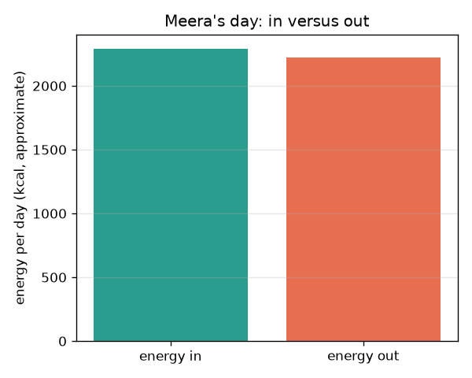
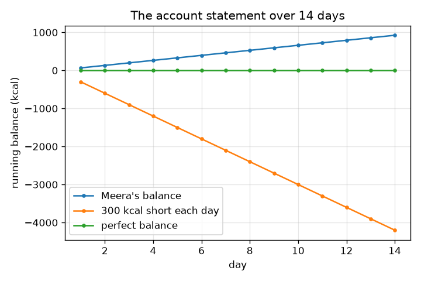

# அமர்வு 1: உள்வரும் ஆற்றல், வெளிச்செல்லும் ஆற்றல்: ஒரு வங்கி இருப்பு

[Session 1 — हिन्दी](README.hi.md) · [Session 1 — മലയാളം](README.ml.md) · [Session 1 — தமிழ்](README.ta.md)

*நிலை 1 (கருத்தியல் ஊடாடும் மாதிரி) · சுமார் 60 நிமிடங்கள் · opennutrition*

> இது எளிமைப்படுத்தப்பட்ட ஒரு கல்வி மாதிரி. இது சரிபார்க்கப்பட்ட (validated) வடிவமைப்புக் கருவி அல்ல; உண்மையான கட்டமைப்புகள், மின் நிறுவல்கள், வாகனங்கள், தொழில்துறை செயல்முறைகள் அல்லது மருத்துவ முடிவுகளுக்கு இதைப் பயன்படுத்தக் கூடாது.

**முன்தேவைகள் (Prerequisites)**

- பள்ளி எண்கணிதம்: பெருக்கலும் கூட்டலும்.
- நீங்கள் PRIMER.md-ஐப் படித்து `python start.py 1`-ஐ ஒருமுறை இயக்கியிருக்கிறீர்கள்.

**கற்றல் நோக்கங்கள் (Learning objectives).** இந்த அமர்வுக்குப் பிறகு நீங்கள்:

- ஆற்றல் சமநிலையை (energy balance) ஒரு வங்கி இருப்பைப் போல, உள்வரும் ஆற்றல் கழித்தல் வெளிச்செல்லும் ஆற்றல் என விளக்க முடியும்.
- கிலோகலோரிக்கும் கிலோஜூலுக்கும் இடையே மாற்ற முடியும் (1 kcal = 4.184 kJ).
- ஒரு செயல்பாட்டு அட்டவணையிலிருந்து வெளிச்செல்லும் ஆற்றலை மதிப்பிட முடியும்: ஆற்றல் = MET x நிறை x மணிநேரம் (தோராயமாக).
- ஓடிக்கொண்டிருக்கும் இருப்பு வரைபடத்தைப் படித்து அதன் சாய்வு என்ன என்பதைச் சொல்ல முடியும்.

## A. நிஜ உலகச் சிக்கல்
உணவு ஆற்றலைச் சுமக்கிறது, தூங்கும்போதும் உடல் நாள் முழுவதும் ஆற்றலைச் செலவிடுகிறது. வெளியே செல்வதை விட அதிகம் உள்ளே வந்தால் இருப்பு நேர்மறை; குறைவாக வந்தால் எதிர்மறை, ஒரு வங்கிக் கணக்கில் உள்ள பணத்தைப் போலவே. ஒரு நாளுக்கு எண்களைப் போட்டு இருப்பைப் பார்க்க முடியுமா? இது பொதுக் கல்வி மட்டுமே, மருத்துவ அல்லது உணவு ஆலோசனை அல்ல. நபர்கள் கற்பனையானவர்கள். உணவுகள் மற்றும் செயல்பாடுகளின் மதிப்புகள் முழுமையாக்கிய பாடநூல் மதிப்புகள், தோராயமானவை.

## B. கருத்தும் கோட்பாடும்
ஆற்றல் கிலோகலோரியில் (kcal, உணவுப் பொட்டலங்களில் கலோரி எனவும் அழைக்கப்படுகிறது) அல்லது கிலோஜூலில் (kJ) அளக்கப்படுகிறது: 1 kcal = 4.184 kJ. உள்வரும் ஆற்றல் உணவிலிருந்து வருகிறது. வெளிச்செல்லும் ஆற்றல் என்பது உடல் உயிரோடிருக்கவும், நகரவும், செரிக்கவும் செலவிடும் ஆற்றல். செயல்பாட்டுக்கான பொதுவான பாடநூல் மதிப்பீடு ஆற்றல் (kcal) = MET x உடல் நிறை (kg) x நேரம் (மணிநேரம்), இங்கு ஒரு MET மதிப்பு ஒரு செயல்பாடு ஓய்வு வீதத்தின் எத்தனை மடங்கைப் பயன்படுத்துகிறது என்று சொல்கிறது; ஒரு MET என்பது சுமார் ஒரு kcal ஒரு kg-க்கு ஒரு மணிநேரத்திற்கு. தினசரி இருப்பு என்பது உள்வரும் ஆற்றல் கழித்தல் வெளிச்செல்லும் ஆற்றல்; இருப்புகளை நாள்வாரியாகக் கூட்டுவது ஓடிக்கொண்டிருக்கும் மொத்தத்தைத் தருகிறது, கணக்கு அறிக்கை. எல்லா மதிப்புகளும் தோராயமானவை, மனிதர்களுக்கு இடையே வேறுபடும்.

| குறியீடு | பொருள் | அலகு |
|---|---|---|
| E_in | உணவிலிருந்து உள்வரும் ஆற்றல் | kcal ஒரு நாளுக்கு |
| E_out | உடல் மற்றும் செயல்பாடுகளிலிருந்து வெளிச்செல்லும் ஆற்றல் | kcal ஒரு நாளுக்கு |
| B | தினசரி இருப்பு, E_in - E_out | kcal ஒரு நாளுக்கு |
| MET | ஓய்வு வீதத்தின் மடங்காகச் செயல்பாட்டுத் தீவிரம் | அலகு இல்லை |
| m | உடல் நிறை | kg |
| t | ஒரு செயல்பாட்டில் செலவிட்ட நேரம் | மணிநேரம் |

**அனுமானங்கள் (Assumptions)**

- இது பொதுக் கல்வி, மருத்துவ அல்லது உணவு ஆலோசனை அல்ல.
- உணவு மற்றும் MET மதிப்புகள் முழுமையாக்கிய, தோராயமான பாடநூல் மதிப்புகள்.
- மாதிரி நபர் கற்பனையானவர் (60 kg), ஒவ்வொரு நாளும் ஒரே மாதிரி.
- நாளின் 24 மணிநேரமும் பட்டியலிடப்பட்ட செயல்பாடுகளுக்கு இடையே பிரிக்கப்படுகிறது.

$$ 1\ \mathrm{kcal}=4.184\ \mathrm{kJ} $$

$$ E_{\mathrm{out}}\approx\sum_{\text{activities}}\mathrm{MET}\times m\times t $$

$$ B = E_{\mathrm{in}}-E_{\mathrm{out}},\qquad \text{running total after } n \text{ days}=\sum_{i=1}^{n}B_i $$

## C. காட்சி விளக்கம்
முதல் படம் மீராவின் நாளை (ஒரு கற்பனை நபர்) இரண்டு பட்டைகளாகக் காட்டுகிறது, உள்வரும் ஆற்றலும் வெளிச்செல்லும் ஆற்றலும். அவை நெருக்கமாக உள்ளன, எனவே அவளது இருப்பு சிறியது. இரண்டாவது படம் 14 நாட்களுக்கு ஓடிக்கொண்டிருக்கும் இருப்பை மூன்று சூழ்நிலைகளுக்கு வரைகிறது: மீராவின் சொந்தச் சிறிய இருப்பு, நாளொன்றுக்கு 300 kcal நிலையான பற்றாக்குறை, பூஜ்ய சரியான இருப்பு. ஒவ்வொரு நாளும் அதே அளவு சேர்க்கப்படுவதால் ஒவ்வொரு கோடும் நேராக உள்ளது, அதன் சாய்வு தினசரி இருப்பு.

*மீராவின் நாள்: உள்வரும் ஆற்றல் வெளிச்செல்லும் ஆற்றலுக்கு எதிராக (தோராய மதிப்புகள்).*

*14 நாட்களில் ஓடிக்கொண்டிருக்கும் இருப்பு: சாய்வு தினசரி இருப்பு.*

## D. ஊடாடும் உருவகப்படுத்தல்
பாடத்தை இயக்கவும் (`python start.py 1`), பிறகு நேரடி செயலியைத் திறக்கவும்: [அமர்வு 1: உள்வரும் ஆற்றல் வெளிச்செல்லும் ஆற்றலுக்கு எதிராக](https://krunalpanchal1995.github.io/pan-iit-oss/opennutrition/session-01/) (அல்லது இந்தக் கோப்புறையில் உள்ள `app.html`). உட்கொள்ளல், நடைப்பயிற்சி, சைக்கிள் ஓட்டல் நழுவிகளை (sliders) நகர்த்தி இரண்டு பட்டைகளைக் கவனிக்கவும். பிறகு ஓடிக்கொண்டிருக்கும் இருப்பு வரைபடத்தைத் திறந்து தினசரி இருப்பு மாறும்போது கோடு எப்படிச் சாய்கிறது என்று பார்க்கவும்.

**சவால்.** குறைந்தது 2000 kcal உண்டுகொண்டு, தினசரி இருப்பைப் பூஜ்யத்தின் 50 kcal-க்குள் கொண்டுவரவும்.

## E. தீர்க்கப்பட்ட உதாரணமும் சோதனையும்
**சிக்கல்.** 60 kg உள்ள ஒருவருக்கு 1 மணிநேர நடைப்பயிற்சி எவ்வளவு ஆற்றலைப் பயன்படுத்துகிறது, அது எத்தனை கிலோஜூல், உணவு ஆற்றலில் அது எத்தனை வாழைப்பழங்கள்?

1. நடைக்கு MET 3.5 (தோராயமாக). ஆற்றல் = 3.5 x 60 kg x 1 h = 210 kcal.
2. கிலோஜூலில்: 210 x 4.184 = 878.64, சுமார் 879 kJ.
3. ஒரு நடுத்தர வாழைப்பழம் சுமார் 105 kcal (தோராயமாக), எனவே 210 / 105 = 2 வாழைப்பழங்கள்.

**விடை.** சுமார் 210 kcal (சுமார் 879 kJ), ஏறக்குறைய இரண்டு வாழைப்பழங்கள். மூன்று எண்களும் தோராயமானவை.

**சோதனை.** kJ, kcal இரண்டையும் பட்டியலிடும் ஒரு பொட்டல லேபிளைப் படிக்கவும். kcal-ஐ 4.184 ஆல் பெருக்கி அச்சிடப்பட்ட kJ-உடன் ஒப்பிடவும்; சிறிய வேறுபாடுகள் முழுமையாக்கலிலிருந்து வருகின்றன. பிறகு ஒரு கற்பனை நபர் (அல்லது பயிற்சிக்காக மட்டும் நீங்கள்) ஒரு நாளில் உண்பதையும் செய்வதையும் ஒரு நாட்குறிப்பில் பதிவுசெய்து கூட்டவும். உண்மை ஆற்றல் பயன்பாடு பலரின் சராசரியான MET அட்டவணையிலிருந்து வேறுபடும், உணவு ஆற்றலும் அட்டவணையிலிருந்து வேறுபடும், எனவே முடிவை ஒரு மதிப்பீடாகக் கருதுங்கள்.

## F. மதிப்பீடும் வடிவமைப்புச் சவாலும்
**கேள்வி வகை A: கருத்தியல்.** மீரா 8 மணிநேரம் தூங்குகிறாள், வேறு எதுவும் செய்யவில்லை. அவளது வெளிச்செல்லும் ஆற்றல் பூஜ்யமா? விளக்கி, 60 kg நபருக்கான அட்டவணை மதிப்பீட்டைத் தரவும்.

குறிப்பு

தூக்கத்திற்கு 1-க்குச் சற்றுக் கீழே ஒரு MET மதிப்பு உண்டு.

படிப்படியான தீர்வு

இல்லை. தூங்கும்போதும் உடல் வேலை செய்கிறது (இதயம், சுவாசம், பழுதுபார்ப்பு, வெப்பம் பேணுதல்). MET 0.95 எனில், ஆற்றல் = 0.95 x 60 x 8 = 456 kcal. வெளிச்செல்லும் ஆற்றல் ஒருபோதும் பூஜ்யம் அல்ல, அதனால்தான் இருப்பு வெறும் 'உணவு கழித்தல் உடற்பயிற்சி' அல்ல.

**கேள்வி வகை B: எண்ணியல்.** ஒரு பொட்டலம் 1500 kcal என்கிறது. அது எத்தனை கிலோஜூல்? மற்றொரு நாள் ஒருவர் 2000 kcal உண்டு 2300 kcal பயன்படுத்துகிறார்: இருப்பு என்ன, 7 நாட்களுக்குப் பிறகு ஓடிக்கொண்டிருக்கும் மொத்தம் என்ன?

குறிப்பு

4.184 ஆல் பெருக்கவும், பிறகு தினசரி இருப்பை 7 ஆல் பெருக்கவும்.

படிப்படியான தீர்வு

1500 x 4.184 = 6276 kJ. இருப்பு = 2000 - 2300 = -300 kcal ஒரு நாளுக்கு; 7 நாட்களுக்குப் பிறகு ஓடிக்கொண்டிருக்கும் மொத்தம் 7 x (-300) = -2100 kcal. நியாயச் சோதனை (sanity check): அலகுகள் kcal, வெளியே சென்றதை விடக் குறைவாக உள்ளே வந்ததால் குறி எதிர்மறை.

**கேள்வி வகை C: வரைபடம் மற்றும் உருவகப்படுத்தல் விளக்கம்.** ஓடிக்கொண்டிருக்கும் இருப்பு வரைபடத்தில், '300 kcal தினசரி குறைவு' கோட்டின் 14 நாட்களுக்குப் பிறகான மதிப்பு என்ன, ஒரு கோட்டின் சாய்வு என்ன பொருள் தருகிறது?

குறிப்பு

சாய்வு என்பது ஏற்றம் வகுத்தல் ஓட்டம்: kcal ஒரு நாளுக்கு.

படிப்படியான தீர்வு

14 நாட்களுக்குப் பிறகு கோடு 14 x (-300) = -4200 kcal-இல் உள்ளது. ஒவ்வொரு கோட்டின் சாய்வும் kcal ஒரு நாளுக்கு என்ற தினசரி இருப்பு: அதிகச் செங்குத்து என்றால் பெரிய தினசரி உபரி அல்லது பற்றாக்குறை, தட்டை என்றால் சமநிலை.

**கேள்வி வகை D: வடிவமைப்பு மற்றும் உகப்பாக்கச் சவால்.** மீராவின் நாள் +66 kcal இருப்பைத் தருகிறது. அரை மணிநேர உட்காருதலை நடைப்பயிற்சியால் மாற்றுவதன் மூலம் அவள் அதைப் பூஜ்யத்திற்குக் கொண்டுவர முடியுமா? கணக்கைக் காட்டி அனுமானத்தைக் கூறவும்.

குறிப்பு

நடை 3.5 MET பயன்படுத்துகிறது, உட்காருதல் 1.3 MET; 60 kg-க்கு ஒரு மணிநேரத்தின் கூடுதல் kcal-ஐக் கண்டறியவும்.

படிப்படியான தீர்வு

உட்காருதலுக்குப் பதிலாக ஒரு மணிநேர நடையில் கூடுதல் ஆற்றல் = (3.5 - 1.3) x 60 = 132 kcal. அரை மணிநேரம் 66 kcal தருகிறது. எனவே அவளது வெளிச்செல்லும் ஆற்றல் 2223-இலிருந்து 2289 kcal ஆக உயர்கிறது, இது அவளது உள்வரும் 2289 kcal-க்குச் சமம், இருப்பு பூஜ்யம். அனுமானம்: MET அட்டவணை அவளுக்குத் துல்லியமானது; உண்மையில் அது ஒரு மதிப்பீடு மட்டுமே, எனவே உண்மை இருப்பு நிச்சயமற்றது.

[RUBRIC.md](../../RUBRIC.md) கொண்டு உங்களை நீங்களே மதிப்பிடுங்கள். தாளில் செய்ய [செயல்பாட்டுத் தாளை](activity_sheet.md) அச்சிடுங்கள்.

## பொதுவான தவறான கருத்துகள்
| பொதுவான தவறான கருத்து | உண்மையில் சரியானது |
|---|---|
| வெளிச்செல்லும் ஆற்றல் என்பது உடற்பயிற்சி மட்டுமே. | வெளிச்செல்லும் ஆற்றலில் பெரும்பகுதி, ஓய்விலும் கூட, உடல் தன்னை இயக்கிக்கொள்வதே; உடற்பயிற்சி அதற்கு மேல் சேர்கிறது. |
| கிலோகலோரியும் கலோரியும் வேறுபட்டவை. | உணவுக் கலோரி என்பது ஒரு கிலோகலோரி. லேபிள்கள் கிலோஜூலையும் தரலாம்; 1 kcal = 4.184 kJ. |
| அட்டவணை மதிப்புகள் துல்லியமானவை. | அவை முழுமையாக்கிய சராசரிகள்; உண்மை உணவுகளும் உண்மை மனிதர்களும் வேறுபடுகின்றனர். |

## சொற்களஞ்சியம் (Glossary)
- **ஆற்றல் சமநிலை (energy balance)**: உள்வரும் ஆற்றல் கழித்தல் வெளிச்செல்லும் ஆற்றல்
- **கிலோகலோரி (kilocalorie, kcal)**: உணவு ஆற்றலின் அலகு; 1 kcal = 4.184 kJ
- **கிலோஜூல் (kilojoule, kJ)**: லேபிள்களில் பெரும்பாலும் அச்சிடப்படும் ஆற்றலின் SI அலகு
- **MET**: ஓய்வு வீதத்தின் மடங்காகச் செயல்பாட்டுத் தீவிரம்
- **ஓடிக்கொண்டிருக்கும் இருப்பு (running balance)**: இதுவரையிலான தினசரி இருப்புகளின் மொத்தம்

## நிறைவு
1. [exercises.md](exercises.md)-இல் உள்ள மூன்று நிரலாக்கப் பணிகளைச் செய்யவும்.
2. உங்கள் மாற்றங்களுக்குப் பிறகு `python start.py 1`-ஐ மீண்டும் இயக்கவும். அது சோதனைச்சாவடியுடன் (checkpoint) முடிகிறது; அது `PASS` என அச்சிடும்போது நீங்கள் முடித்துவிட்டீர்கள். (சோதனைச்சாவடி மட்டும்: `python start.py check 1`.)

அடுத்து: [அமர்வு 2](../session-02/README.md)
