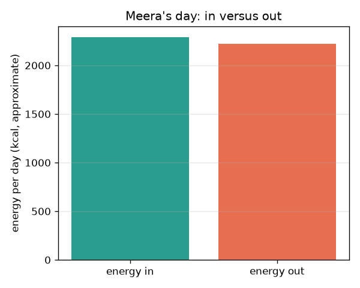
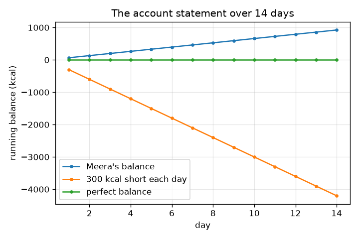

# సెషన్ 1: లోపలికి శక్తి, బయటికి శక్తి: ఒక బ్యాంక్ బ్యాలెన్స్

[Session 1 — हिन्दी](README.hi.md) · [Session 1 — മലയാളം](README.ml.md) · [Session 1 — தமிழ்](README.ta.md) · [Session 1 — తెలుగు](README.te.md)

*స్థాయి 1 (భావనాత్మక ఇంటరాక్టివ్ నమూనా) · సుమారు 60 నిమిషాలు · opennutrition*

> ఇది సరళీకరించిన విద్యా నమూనా. ఇది ధృవీకరించబడిన (validated) డిజైన్ సాధనం కాదు; నిజమైన నిర్మాణాలు, విద్యుత్ సంస్థాపనలు, వాహనాలు, పారిశ్రామిక ప్రక్రియలు లేదా వైద్య నిర్ణయాల కోసం దీన్ని ఉపయోగించకూడదు.

**ముందస్తు జ్ఞానం (Prerequisites)**

- పాఠశాల అంకగణితం: గుణించడం, కూడటం.
- మీరు PRIMER.md చదివి `python start.py 1` ఒకసారి నడిపారు.

**అభ్యసన లక్ష్యాలు (Learning objectives).** ఈ సెషన్ తర్వాత మీరు:

- శక్తి సమతుల్యతను (energy balance) బ్యాంక్ బ్యాలెన్స్ లాగా, లోపలికి శక్తి మైనస్ బయటికి శక్తి అని వివరించగలరు.
- కిలోకేలరీలు, కిలోజౌళ్ల మధ్య మార్చగలరు (1 kcal = 4.184 kJ).
- కార్యకలాప పట్టిక నుండి బయటికి శక్తిని అంచనా వేయగలరు: శక్తి = MET x ద్రవ్యరాశి x గంటలు (సుమారుగా).
- నడుస్తున్న బ్యాలెన్స్ గ్రాఫ్ చదివి దాని వాలు అర్థమేమిటో చెప్పగలరు.

## A. వాస్తవ ప్రపంచ సమస్య
ఆహారం శక్తిని మోసుకొస్తుంది, నిద్రలో కూడా శరీరం రోజంతా శక్తిని ఖర్చు చేస్తుంది. బయటికి పోయేదాని కంటే ఎక్కువ లోపలికి వస్తే బ్యాలెన్స్ ధనాత్మకం; తక్కువ వస్తే రుణాత్మకం, బ్యాంక్ ఖాతాలోని డబ్బులా. ఒక రోజుకు సంఖ్యలు పెట్టి బ్యాలెన్స్ చూడగలమా? ఇది సాధారణ విద్య మాత్రమే, వైద్య లేదా ఆహార సలహా కాదు. వ్యక్తులు కల్పితం. ఆహారాలు, కార్యకలాపాల విలువలు గుండ్రంగా చేసిన పాఠ్యపుస్తక విలువలు, సుమారుగా ఉంటాయి.

## B. భావన మరియు సిద్ధాంతం
శక్తిని కిలోకేలరీలలో (kcal, ఆహార ప్యాక్‌లపై కేలరీలు అని కూడా అంటారు) లేదా కిలోజౌళ్లలో (kJ) కొలుస్తారు: 1 kcal = 4.184 kJ. లోపలికి శక్తి ఆహారం నుండి వస్తుంది. బయటికి శక్తి అంటే శరీరం బతికి ఉండటానికి, కదలడానికి, జీర్ణించుకోవడానికి ఖర్చు చేసే శక్తి. కార్యకలాపానికి సాధారణ పాఠ్యపుస్తక అంచనా శక్తి (kcal) = MET x శరీర ద్రవ్యరాశి (kg) x సమయం (గంటలు), ఇక్కడ ఒక కార్యకలాపం విశ్రాంతి రేటుకు ఎన్ని రెట్లు వాడుతుందో MET విలువ చెబుతుంది; ఒక MET సుమారు ఒక kcal ప్రతి kg కు ప్రతి గంటకు. రోజువారీ బ్యాలెన్స్ అంటే లోపలికి శక్తి మైనస్ బయటికి శక్తి; బ్యాలెన్స్‌లను రోజురోజుకూ కూడితే నడుస్తున్న మొత్తం వస్తుంది, ఖాతా స్టేట్‌మెంట్. అన్ని విలువలు సుమారుగా ఉంటాయి, వ్యక్తుల మధ్య భిన్నంగా ఉంటాయి.

| గుర్తు | అర్థం | యూనిట్ |
|---|---|---|
| E_in | ఆహారం నుండి లోపలికి శక్తి | kcal రోజుకు |
| E_out | శరీరం, కార్యకలాపాల నుండి బయటికి శక్తి | kcal రోజుకు |
| B | రోజువారీ బ్యాలెన్స్, E_in - E_out | kcal రోజుకు |
| MET | విశ్రాంతి రేటుకు గుణిజంగా కార్యకలాప తీవ్రత | యూనిట్ లేదు |
| m | శరీర ద్రవ్యరాశి | kg |
| t | ఒక కార్యకలాపంపై గడిపిన సమయం | గంటలు |

**ఊహలు (Assumptions)**

- ఇది సాధారణ విద్య, వైద్య లేదా ఆహార సలహా కాదు.
- ఆహారం, MET విలువలు గుండ్రంగా చేసిన, సుమారు పాఠ్యపుస్తక విలువలు.
- నమూనా వ్యక్తి కల్పితం (60 kg), ప్రతి రోజు ఒకేలా ఉంటుంది.
- రోజులోని 24 గంటలు జాబితా చేసిన కార్యకలాపాల మధ్య విభజించబడతాయి.

$$ 1\ \mathrm{kcal}=4.184\ \mathrm{kJ} $$

$$ E_{\mathrm{out}}\approx\sum_{\text{activities}}\mathrm{MET}\times m\times t $$

$$ B = E_{\mathrm{in}}-E_{\mathrm{out}},\qquad \text{running total after } n \text{ days}=\sum_{i=1}^{n}B_i $$

## C. దృశ్య వివరణ
మొదటి చిత్రం మీరా రోజును (ఒక కల్పిత వ్యక్తి) రెండు బార్‌లుగా చూపిస్తుంది, లోపలికి శక్తి, బయటికి శక్తి. అవి దగ్గరగా ఉన్నాయి, కాబట్టి ఆమె బ్యాలెన్స్ చిన్నది. రెండో చిత్రం 14 రోజులపాటు నడుస్తున్న బ్యాలెన్స్‌ను మూడు సందర్భాలకు ప్లాట్ చేస్తుంది: మీరా సొంత చిన్న బ్యాలెన్స్, రోజుకు 300 kcal స్థిర లోటు, సున్నా పరిపూర్ణ బ్యాలెన్స్. ప్రతి రోజు అదే మొత్తం కలుస్తుంది కాబట్టి ప్రతి రేఖ సరళంగా ఉంటుంది, దాని వాలు రోజువారీ బ్యాలెన్స్.

*మీరా రోజు: లోపలికి శక్తి బయటికి శక్తికి వ్యతిరేకంగా (సుమారు విలువలు).*

*14 రోజుల్లో నడుస్తున్న బ్యాలెన్స్: వాలు రోజువారీ బ్యాలెన్స్.*

## D. ఇంటరాక్టివ్ సిమ్యులేషన్
పాఠాన్ని నడపండి (`python start.py 1`), తర్వాత లైవ్ యాప్‌ను తెరవండి: [సెషన్ 1: లోపలికి శక్తి బయటికి శక్తికి వ్యతిరేకంగా](https://krunalpanchal1995.github.io/pan-iit-oss/opennutrition/session-01/) (లేదా ఈ ఫోల్డర్‌లోని `app.html`). తీసుకోవడం, నడక, సైక్లింగ్ స్లైడర్‌లను కదిపి రెండు బార్‌లను గమనించండి. తర్వాత నడుస్తున్న బ్యాలెన్స్ గ్రాఫ్ తెరిచి రోజువారీ బ్యాలెన్స్ మారినప్పుడు రేఖ ఎలా వాలుతుందో చూడండి.

**సవాలు.** కనీసం 2000 kcal తింటూ రోజువారీ బ్యాలెన్స్‌ను సున్నాకు 50 kcal లోపు తీసుకురండి.

## E. సాధించిన ఉదాహరణ మరియు ప్రయోగం
**సమస్య.** 60 kg ఉన్న వ్యక్తికి 1 గంట నడక ఎంత శక్తి వాడుతుంది, అది ఎన్ని కిలోజౌళ్లు, ఆహార శక్తిలో అది ఎన్ని అరటిపండ్లు?

1. నడకకు MET 3.5 (సుమారుగా). శక్తి = 3.5 x 60 kg x 1 h = 210 kcal.
2. కిలోజౌళ్లలో: 210 x 4.184 = 878.64, సుమారు 879 kJ.
3. ఒక మధ్యస్థ అరటిపండు సుమారు 105 kcal (సుమారుగా), కాబట్టి 210 / 105 = 2 అరటిపండ్లు.

**సమాధానం.** సుమారు 210 kcal (సుమారు 879 kJ), దాదాపు రెండు అరటిపండ్లు. మూడు సంఖ్యలు సుమారువే.

**ప్రయోగం.** kJ, kcal రెండూ ఇచ్చే ప్యాకెట్ లేబుల్ చదవండి. kcal ను 4.184 తో గుణించి ముద్రించిన kJ తో పోల్చండి; చిన్న తేడాలు గుండ్రంగా చేయడం వల్ల వస్తాయి. తర్వాత ఒక కల్పిత వ్యక్తి (లేదా సాధన కోసం మాత్రమే, మీరు) ఒక రోజులో తినేదాన్ని, చేసేదాన్ని డైరీలో నమోదు చేసి కూడండి. నిజమైన శక్తి వినియోగం చాలామంది సగటైన MET పట్టికకు భిన్నంగా ఉంటుంది, ఆహార శక్తి కూడా పట్టికకు భిన్నంగా ఉంటుంది, కాబట్టి ఫలితాన్ని అంచనాగా భావించండి.

## F. మూల్యాంకనం మరియు డిజైన్ సవాలు
**ప్రశ్న రకం A: భావనాత్మక.** మీరా 8 గంటలు నిద్రపోతుంది, మరేమీ చేయదు. ఆమె బయటికి శక్తి సున్నానా? వివరించి, 60 kg వ్యక్తికి పట్టిక అంచనా ఇవ్వండి.

సూచన

నిద్రకు 1 కి కొంచెం తక్కువ MET విలువ ఉంటుంది.

దశలవారీ పరిష్కారం

కాదు. నిద్రలో కూడా శరీరం పనిచేస్తూనే ఉంటుంది (గుండె, శ్వాస, మరమ్మత్తు, వెచ్చగా ఉంచడం). MET 0.95 అయితే, శక్తి = 0.95 x 60 x 8 = 456 kcal. బయటికి శక్తి ఎప్పుడూ సున్నా కాదు, అందుకే బ్యాలెన్స్ కేవలం 'ఆహారం మైనస్ వ్యాయామం' కాదు.

**ప్రశ్న రకం B: సంఖ్యాత్మక.** ఒక ప్యాక్ 1500 kcal అని చెబుతుంది. అది ఎన్ని కిలోజౌళ్లు? మరో రోజు ఒక వ్యక్తి 2000 kcal తిని 2300 kcal వాడతాడు: బ్యాలెన్స్ ఎంత, 7 రోజుల తర్వాత నడుస్తున్న మొత్తం ఎంత?

సూచన

4.184 తో గుణించండి, తర్వాత రోజువారీ బ్యాలెన్స్‌ను 7 తో గుణించండి.

దశలవారీ పరిష్కారం

1500 x 4.184 = 6276 kJ. బ్యాలెన్స్ = 2000 - 2300 = -300 kcal రోజుకు; 7 రోజుల తర్వాత నడుస్తున్న మొత్తం 7 x (-300) = -2100 kcal. సహేతుకత తనిఖీ (sanity check): యూనిట్లు kcal, బయటికి పోయినదాని కంటే తక్కువ లోపలికి వచ్చింది కాబట్టి గుర్తు రుణాత్మకం.

**ప్రశ్న రకం C: గ్రాఫ్ మరియు సిమ్యులేషన్ వ్యాఖ్యానం.** నడుస్తున్న బ్యాలెన్స్ గ్రాఫ్‌లో, 'రోజుకు 300 kcal లోటు' రేఖ 14 రోజుల తర్వాత విలువ ఎంత, ఒక రేఖ వాలు అర్థమేమిటి?

సూచన

వాలు అంటే ఎత్తు భాగహారం పొడవు: kcal రోజుకు.

దశలవారీ పరిష్కారం

14 రోజుల తర్వాత రేఖ 14 x (-300) = -4200 kcal వద్ద ఉంది. ప్రతి రేఖ వాలు kcal రోజుకు లో రోజువారీ బ్యాలెన్స్: నిటారుగా ఉంటే పెద్ద రోజువారీ మిగులు లేదా లోటు, చదునుగా ఉంటే సమతుల్యం.

**ప్రశ్న రకం D: డిజైన్ మరియు ఆప్టిమైజేషన్ సవాలు.** మీరా రోజు +66 kcal బ్యాలెన్స్ ఇస్తుంది. అర గంట కూర్చోవడాన్ని నడకతో మార్చడం ద్వారా ఆమె దాన్ని సున్నాకు తేగలదా? పని చూపి, ఊహను చెప్పండి.

సూచన

నడక 3.5 MET వాడుతుంది, కూర్చోవడం 1.3 MET; 60 kg కు గంటకు అదనపు kcal కనుగొనండి.

దశలవారీ పరిష్కారం

కూర్చోవడానికి బదులు ఒక గంట నడకలో అదనపు శక్తి = (3.5 - 1.3) x 60 = 132 kcal. అర గంట 66 kcal ఇస్తుంది. కాబట్టి ఆమె బయటికి శక్తి 2223 నుండి 2289 kcal కి పెరుగుతుంది, ఇది ఆమె లోపలికి 2289 kcal కు సమానం, బ్యాలెన్స్ సున్నా. ఊహ: MET పట్టిక ఆమెకు ఖచ్చితమైనది; వాస్తవంలో అది ఒక అంచనా మాత్రమే, కాబట్టి నిజమైన బ్యాలెన్స్ అనిశ్చితం.

[RUBRIC.md](../../RUBRIC.md) తో మిమ్మల్ని మీరు అంచనా వేసుకోండి. కాగితంపై పని చేయడానికి [కార్యాచరణ పత్రాన్ని](activity_sheet.md) ప్రింట్ చేయండి.

## సాధారణ అపోహలు
| సాధారణ అపోహ | నిజానికి సరైనది |
|---|---|
| బయటికి శక్తి అంటే వ్యాయామం మాత్రమే. | బయటికి శక్తిలో ఎక్కువ భాగం, విశ్రాంతిలో కూడా, శరీరం తనను తాను నడుపుకోవడమే; వ్యాయామం దానిపై అదనంగా చేరుతుంది. |
| కిలోకేలరీ, కేలరీ వేరువేరు. | ఆహార కేలరీ అంటే ఒక కిలోకేలరీ. లేబుల్‌లు కిలోజౌళ్లు కూడా ఇవ్వవచ్చు; 1 kcal = 4.184 kJ. |
| పట్టిక విలువలు ఖచ్చితమైనవి. | అవి గుండ్రంగా చేసిన సగటులు; నిజమైన ఆహారాలు, నిజమైన వ్యక్తులు భిన్నంగా ఉంటారు. |

## పదకోశం (Glossary)
- **శక్తి సమతుల్యత (energy balance)**: లోపలికి శక్తి మైనస్ బయటికి శక్తి
- **కిలోకేలరీ (kilocalorie, kcal)**: ఆహార శక్తి యూనిట్; 1 kcal = 4.184 kJ
- **కిలోజౌళ్ (kilojoule, kJ)**: లేబుల్‌లపై తరచుగా ముద్రించే శక్తి SI యూనిట్
- **MET**: విశ్రాంతి రేటుకు గుణిజంగా కార్యకలాప తీవ్రత
- **నడుస్తున్న బ్యాలెన్స్ (running balance)**: ఇప్పటివరకు రోజువారీ బ్యాలెన్స్‌ల మొత్తం

## ముగింపు
1. [exercises.md](exercises.md) లోని మూడు కోడింగ్ పనులు చేయండి.
2. మీ మార్పుల తర్వాత `python start.py 1` ను మళ్ళీ నడపండి. అది చెక్‌పాయింట్‌తో ముగుస్తుంది; అది `PASS` అని ప్రింట్ చేసినప్పుడు మీరు పూర్తి చేశారు. (చెక్‌పాయింట్ మాత్రమే: `python start.py check 1`.)

తదుపరి: [సెషన్ 2](../session-02/README.md)
