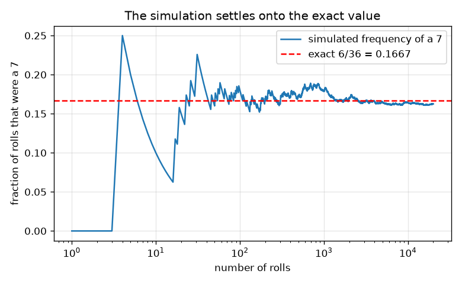
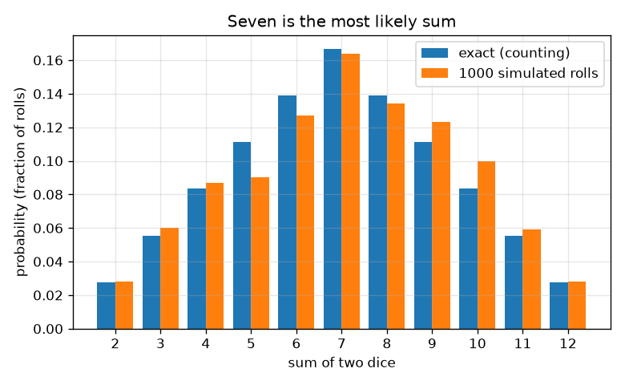

# सत्र 1: निष्पक्ष परिणाम और दो पासों का योग

*स्तर 1 (वैचारिक इंटरैक्टिव मॉडल) · लगभग 60 मिनट · openodds*

> यह एक सरलीकृत शैक्षिक मॉडल है। यह कोई प्रमाणित डिज़ाइन उपकरण नहीं है और इसका उपयोग वास्तविक संरचनाओं, बिजली की स्थापनाओं, वाहनों, औद्योगिक प्रक्रियाओं या चिकित्सा निर्णयों के लिए नहीं किया जाना चाहिए।

**पूर्वापेक्षाएँ (Prerequisites)**

- भिन्न और गुणा।
- आपने PRIMER.md पढ़ लिया है और `python start.py 1` एक बार चला लिया है।

**सीखने के उद्देश्य।** इस सत्र के बाद आप:

- एक और दो निष्पक्ष पासों का प्रतिदर्श समष्टि (sample space) सूचीबद्ध कर सकेंगे और बता सकेंगे कि हर परिणाम समान रूप से संभावित क्यों है।
- प्रायिकता (probability) की गणना अनुकूल परिणाम भाग कुल परिणाम के रूप में कर सकेंगे।
- दंड आरेख (bar chart) से समझा सकेंगे कि दो पासों का सबसे संभावित योग 7 क्यों है।
- एक बीज-युक्त (seeded) सिमुलेशन चला सकेंगे और उसकी आवृत्तियों को सटीक मानों पर टिकते देख सकेंगे।

## A. वास्तविक दुनिया की समस्या
एक बोर्ड गेम में आप दो पासे फेंकते हैं और उन्हें जोड़ते हैं। खिलाड़ी कहते हैं कि 7 'बहुत आता है' और 2 या 12 दुर्लभ हैं। क्या यह सच है, या केवल याददाश्त? हम इसे हर संभव परिणाम सूचीबद्ध करके, गिनकर, और फिर उस गिनती को हज़ारों आभासी फेंकों से जाँचकर तय कर सकते हैं। यह केवल संयोग के बारे में शिक्षा है, सट्टेबाज़ी की सलाह नहीं।

## B. अवधारणा और सिद्धांत
प्रतिदर्श समष्टि सभी संभव परिणामों की सूची है। एक निष्पक्ष पासे के लिए 6 फलकों में से हर एक समान रूप से संभावित है, इसलिए हर एक की प्रायिकता 1/6 है। दो पासों के लिए एक परिणाम एक जोड़ा (पहला, दूसरा) है, इसलिए 6 x 6 = 36 समान रूप से संभावित परिणाम हैं; (1, 2) और (2, 1) अलग-अलग परिणाम हैं। जब परिणाम समान रूप से संभावित हों, तो किसी घटना (event) की प्रायिकता अनुकूल परिणामों की संख्या भाग कुल परिणामों की संख्या है। योग 7 छह तरीक़ों से बन सकता है, (1,6), (2,5), (3,4), (4,3), (5,2), (6,1), जबकि योग 2 केवल एक तरीक़े से, (1,1)। n सिमुलेटेड प्रयासों में किसी घटना की सापेक्ष आवृत्ति (relative frequency) वह संख्या है जितनी बार वह हुई, भाग n; बड़ी संख्याओं का नियम (law of large numbers) कहता है कि n बढ़ने के साथ यह वास्तविक प्रायिकता के पास टिक जाती है।

| प्रतीक | अर्थ | इकाई |
|---|---|---|
| s | दोनों पासों का योग | कोई इकाई नहीं (2 से 12) |
| c(s) | योग s वाले परिणामों की संख्या | गिनती |
| P(s) | योग s की प्रायिकता | कोई इकाई नहीं (0 से 1) |
| n | सिमुलेटेड फेंकों की संख्या | गिनती |
| f(s) | सिमुलेशन में योग s की सापेक्ष आवृत्ति | कोई इकाई नहीं (0 से 1) |

**मान्यताएँ (Assumptions)**

- पासे निष्पक्ष हैं: हर फलक की प्रायिकता 1/6 है।
- दोनों पासे एक-दूसरे को प्रभावित नहीं करते।
- सिमुलेटेड फेंक एक बीज-युक्त छद्म-यादृच्छिक जनित्र (pseudo-random generator) से आते हैं, जो इस उद्देश्य के लिए निष्पक्ष पासों जैसा व्यवहार करता है।

$$ P(\text{event})=\dfrac{\text{favourable outcomes}}{\text{total outcomes}} $$

$$ P(s)=\dfrac{c(s)}{36},\qquad c(s)=6-|s-7|\quad (s=2,\dots,12) $$

$$ \sum_{s=2}^{12}P(s)=1 $$

$$ f(s)=\dfrac{\text{rolls with sum } s}{n}\;\longrightarrow\;P(s)\quad (n\to\infty) $$

## C. दृश्य व्याख्या
पहला चित्र हर योग की सटीक प्रायिकता का दंड आरेख है, साथ में 1000 सिमुलेटेड फेंकों की आवृत्तियाँ: दंड एक तंबू बनाते हैं जिसका शिखर 7 पर (6/36 = 0.167) और पैर 2 और 12 पर (1/36 = 0.028) हैं। दूसरा चित्र लघुगणकीय अक्ष पर फेंकों की संख्या बढ़ने के साथ 7 की आवृत्ति का अनुसरण करता है। कुछ फेंकों तक यह बुरी तरह डगमगाती है, फिर 6/36 पर लाल डैश वाली रेखा के क़रीब टिक जाती है।

*7 की आवृत्ति पहले डगमगाती है और फिर सटीक मान 6/36 पर टिक जाती है।*

*दो पासों के हर योग की सटीक प्रायिकताएँ, 1000 सिमुलेटेड फेंकों के साथ: सात सबसे संभावित है।*

## D. इंटरैक्टिव सिमुलेशन
पाठ चलाइए (`python start.py 1`), फिर लाइव ऐप खोलिए: [सत्र 1: दो पासे](https://krunalpanchal1995.github.io/pan-iit-oss/openodds/session-01/) (या इसी फ़ोल्डर में `app.html`)। एक योग और फेंकों की संख्या चुनिए। ग्रिड दृश्य में देखिए कि 36 में से कौन-से खाने वह योग बनाते हैं; दंड दृश्य में सटीक दंड की तुलना सिमुलेटेड दंड से कीजिए और फेंक बढ़ाने पर अंतर को सिकुड़ते देखिए।

**चुनौती।** सबसे संभावित योग चुनिए और कम से कम 1000 फेंक चलाइए।

## E. हल किया गया उदाहरण और प्रयोग
**समस्या।** इसकी प्रायिकता क्या है कि दो निष्पक्ष पासों का योग 7 हो? सभी परिणाम गिनकर इसे जाँचिए।

1. परिणाम सूचीबद्ध कीजिए: 6 x 6 = 36 समान रूप से संभावित जोड़े।
2. अनुकूल जोड़े: (1,6), (2,5), (3,4), (4,3), (5,2), (6,1)। यानी 6 जोड़े।
3. P(7) = 6 / 36 = 1/6 = 0.1667।
4. समझदारी जाँच: 11 संभव योगों के 1,2,3,4,5,6,5,4,3,2,1 परिणाम हैं, जिनका जोड़ 36 है, इसलिए प्रायिकताओं का जोड़ 1 है।

**उत्तर।** P(7) = 6/36 = 1/6, लगभग 0.167: सबसे संभावित योग।

**प्रयोग।** दो असली पासे 100 बार फेंकिए और योगों का मिलान (tally) कीजिए, फिर सटीक तालिका और सिमुलेशन से तुलना कीजिए। 100 फेंकों में 7 की आवृत्ति आम तौर पर लगभग 0.10 और 0.24 के बीच होगी, इसलिए हो सकता है कि आपको 7 सबसे ऊपर दिखे भी नहीं। मॉडल सटीक है; एक वास्तविक छोटा प्रतिदर्श शोरयुक्त होता है, और असली पासे कभी पूरी तरह निष्पक्ष नहीं होते।

## F. मूल्यांकन और डिज़ाइन चुनौती
**प्रश्न प्रकार A: वैचारिक।** एक मित्र कहता है: 'योग 6 और 8 में से हर एक 7 से कम बार आता है, पर 6 और 8 मिलकर 7 और 12 मिलकर से अधिक बार आते हैं।' क्या यह सही है? (1, 2), (2, 1) जैसा ही परिणाम क्यों नहीं है?

संकेत

हर योग के परिणाम गिनिए और जोड़िए।

चरण-दर-चरण हल

योग 6 और 8 के 5 + 5 = 10 परिणाम हैं; 7 और 12 मिलाकर 6 + 1 = 7 परिणाम हैं, इसलिए हाँ। (1, 2) और (2, 1) अलग-अलग परिणाम हैं (पहला पासा 1 और दूसरा 2, या उल्टा); दोनों को सूचीबद्ध करने से ही सभी 36 परिणाम समान रूप से संभावित बनते हैं और योग 3 दो तरीक़ों से मिलता है, इसीलिए 3, 2 से दोगुना संभावित है।

**प्रश्न प्रकार B: संख्यात्मक।** इसकी प्रायिकता ज्ञात कीजिए कि दो पासों का योग कम से कम 10 हो। अपना उत्तर भिन्न और दशमलव में दीजिए और जाँचिए कि यह 0 और 1 के बीच है।

संकेत

c(s) = 6 - |s - 7| का उपयोग करके योग 10, 11 और 12 के परिणाम गिनिए।

चरण-दर-चरण हल

c(10) = 3, c(11) = 2, c(12) = 1, इसलिए 6 अनुकूल परिणाम। P = 6/36 = 1/6 = 0.167। यह 0 और 1 के बीच है, और P(7) के बराबर है, जो समझ में आता है क्योंकि गिनतियाँ 3 + 2 + 1 मिलकर 6 हैं।

**प्रश्न प्रकार C: ग्राफ़ और सिमुलेशन की व्याख्या।** अभिसरण (convergence) चित्र में, 10 फेंकों के बाद 7 की आवृत्ति 0.167 से बहुत दूर है पर 20000 फेंकों के बाद बहुत क़रीब। क्या इसका अर्थ है कि यदि शुरुआती आवृत्ति बहुत कम थी तो अगला फेंक 7 'होना ही चाहिए'?

संकेत

सोचिए कि क्या टिकता है: अंश या गिनतियाँ?

चरण-दर-चरण हल

नहीं। हर फेंक स्वतंत्र है और उसके 7 होने की प्रायिकता अब भी 1/6 है। अंश इसलिए टिकता है क्योंकि शुरुआती अधिकता या कमी अधिक से अधिक फेंकों पर फैल जाती है, इसलिए नहीं कि बाद के फेंक उसकी भरपाई करते हैं। डगमगाहट का आकार मोटे तौर पर n के वर्गमूल के व्युत्क्रम की तरह घटता है; सत्र 3 इसे सटीक बनाता है।

**प्रश्न प्रकार D: डिज़ाइन और अनुकूलन (optimisation) चुनौती।** एक खेल डिज़ाइन कीजिए: यदि योग आपके चुने समुच्चय S में है तो आप जीतते हैं। S को ऐसे चुनिए कि जीतने की प्रायिकता ठीक 1/3 हो, जितने कम अलग-अलग योग हो सकें उतने उपयोग करके, और बताइए कि आपने कौन-सा समझौता किया।

संकेत

आपको 36 में से 12 अनुकूल परिणाम चाहिए।

चरण-दर-चरण हल

आपको 36 में से 12 अनुकूल परिणाम चाहिए। एक विकल्प है योग 4, 7 और 10: 3 + 6 + 3 = 12, इसलिए S = {4, 7, 10} प्रायिकता 12/36 = 1/3 से जीतता है। एक अकेला योग यह नहीं कर सकता क्योंकि सबसे बड़ी गिनती 6 है, और दो योग अधिकतम 6 + 5 = 11 देते हैं। समझौता (trade-off): कम योग का अर्थ है सरल नियम पर पहुँच योग्य प्रायिकताएँ छोटी। मान्यता: निष्पक्ष पासे।

[RUBRIC.md](../../RUBRIC.md) से स्वयं को अंक दीजिए। काग़ज़ पर काम करने के लिए [गतिविधि पत्रक](activity_sheet.md) प्रिंट कीजिए।

## सामान्य भ्रांतियाँ
| सामान्य भ्रांति | वास्तव में क्या सच है |
|---|---|
| दो पासों के सभी योग समान रूप से संभावित हैं क्योंकि वे 11 हैं। | 11 योग समान रूप से संभावित नहीं हैं। 36 जोड़े हैं। योग 7 के पास 6 जोड़े हैं और योग 2 के पास 1। |
| (1, 2) और (2, 1) एक ही परिणाम हैं। | दो अलग-अलग पासों के साथ वे अलग परिणाम हैं, और दोनों को गिनने से ही सभी 36 परिणाम समान रूप से संभावित रहते हैं। |
| बिना 7 के लंबे सिलसिले के बाद 7 अधिक संभावित होता है। | पासों की कोई स्मृति नहीं होती। हर फेंक की प्रायिकता एक ही है; अंश टिकता है, गिनतियों का बराबर होना ज़रूरी नहीं। |

## शब्दावली
- **प्रतिदर्श समष्टि (sample space)**: सभी संभव परिणामों की सूची
- **घटना (event)**: परिणामों का एक समुच्चय जिसकी हमें परवाह है, जैसे 'योग 7 है'
- **प्रायिकता (probability)**: 0 (असंभव) से 1 (निश्चित) तक की एक संख्या; समान रूप से संभावित परिणामों के लिए अनुकूल भाग कुल
- **सापेक्ष आवृत्ति (relative frequency)**: कोई घटना कितनी बार हुई, भाग प्रयासों की संख्या
- **बीज (seed)**: एक प्रारंभिक संख्या जो छद्म-यादृच्छिक जनित्र को ठीक-ठीक दोहराने देती है

## समापन
1. [exercises.md](exercises.md) में दिए तीन कोडिंग कार्य कीजिए।
2. अपने बदलावों के बाद `python start.py 1` फिर से चलाइए। यह चेकपॉइंट (checkpoint) पर समाप्त होता है; जब यह `PASS` छापे, तो आपका काम पूरा है। (केवल चेकपॉइंट: `python start.py check 1`।)

अगला: [सत्र 2](../session-02/README.md)
