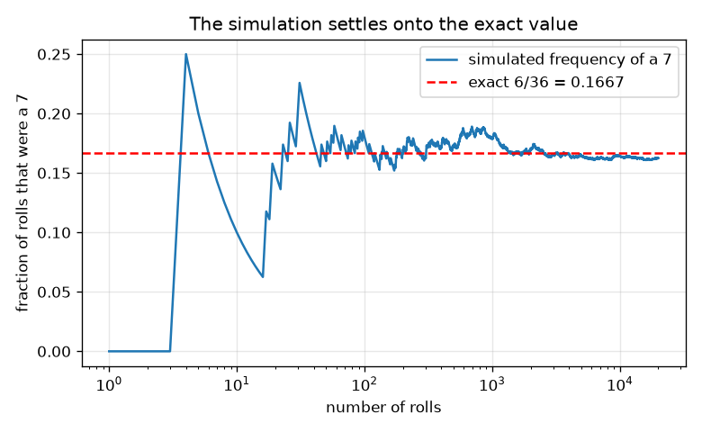
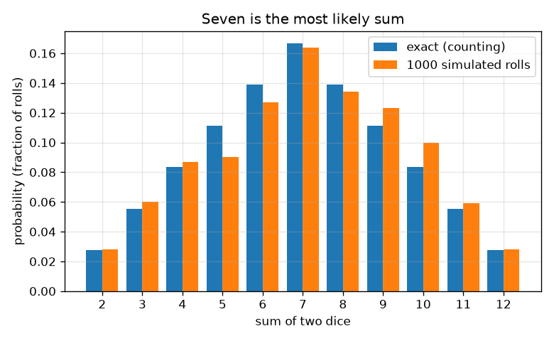

# സെഷൻ 1: നീതിയുള്ള ഫലങ്ങളും രണ്ട് ഡൈസുകളുടെ തുകയും

[Session 1 — हिन्दी](README.hi.md)

*ലെവൽ 1 (ആശയപരമായ ഇന്ററാക്ടീവ് മോഡൽ) · ഏകദേശം 60 മിനിറ്റ് · openodds*

> ഇത് ലളിതമാക്കിയ ഒരു വിദ്യാഭ്യാസ മോഡൽ ആണ്. ഇത് സാധൂകരിച്ച (validated) ഡിസൈൻ ഉപകരണമല്ല; യഥാർത്ഥ നിർമിതികൾ, വൈദ്യുത ഇൻസ്റ്റലേഷനുകൾ, വാഹനങ്ങൾ, വ്യാവസായിക പ്രക്രിയകൾ അല്ലെങ്കിൽ വൈദ്യശാസ്ത്ര തീരുമാനങ്ങൾ എന്നിവയ്ക്ക് ഇത് ഉപയോഗിക്കരുത്.

**മുൻകൂട്ടി അറിയേണ്ടവ (Prerequisites)**

- ഭിന്നസംഖ്യകളും ഗുണനവും.
- നിങ്ങൾ PRIMER.md വായിച്ചിട്ടുണ്ട്, `python start.py 1` ഒരിക്കൽ റൺ ചെയ്തിട്ടുണ്ട്.

**പഠന ലക്ഷ്യങ്ങൾ (Learning objectives).** ഈ സെഷനു ശേഷം നിങ്ങൾക്ക്:

- ഒന്നോ രണ്ടോ നീതിയുള്ള ഡൈസുകളുടെ സാമ്പിൾ സ്പേസ് (sample space) പട്ടികപ്പെടുത്തി ഓരോ ഫലവും തുല്യ സാധ്യതയുള്ളത് എന്തുകൊണ്ടെന്ന് പറയാം.
- സാധ്യത (probability) അനുകൂല ഫലങ്ങളെ ആകെ ഫലങ്ങൾ കൊണ്ട് ഹരിച്ചതായി കണക്കാക്കാം.
- ബാർ ചാർട്ട് ഉപയോഗിച്ച്, രണ്ട് ഡൈസുകളുടെ തുകയിൽ 7 ഏറ്റവും സാധ്യതയുള്ളതാകുന്നത് എന്തുകൊണ്ടെന്ന് വിശദീകരിക്കാം.
- ഒരു സീഡ് (seed) ചെയ്ത സിമുലേഷൻ റൺ ചെയ്ത് അതിന്റെ ആവൃത്തികൾ കൃത്യമായ മൂല്യങ്ങളിലേക്ക് സ്ഥിരമാകുന്നത് കാണാം.

## A. യഥാർത്ഥ ലോക പ്രശ്നം
ഒരു ബോർഡ് ഗെയിമിൽ നിങ്ങൾ രണ്ട് ഡൈസുകൾ ഉരുട്ടി കൂട്ടുന്നു. കളിക്കാർ പറയുന്നു 7 'ധാരാളം വരുന്നു', 2 അല്ലെങ്കിൽ 12 അപൂർവമാണ്. ഇത് യഥാർത്ഥമാണോ, അതോ ഓർമ്മ മാത്രമാണോ? സംഭവിക്കാവുന്ന എല്ലാം പട്ടികപ്പെടുത്തി, എണ്ണി, പിന്നെ ആ എണ്ണം ആയിരക്കണക്കിന് വെർച്വൽ റോളുകളുമായി പരിശോധിച്ച് നമുക്കിത് തീർപ്പാക്കാം. ഇത് സാധ്യതയെക്കുറിച്ചുള്ള വിദ്യാഭ്യാസം മാത്രമാണ്, വാതുവയ്പ്പ് ഉപദേശമല്ല.

## B. ആശയവും സിദ്ധാന്തവും
സാമ്പിൾ സ്പേസ് എന്നത് സാധ്യമായ എല്ലാ ഫലങ്ങളുടെയും പട്ടികയാണ്. ഒരു നീതിയുള്ള ഡൈസിന് 6 മുഖങ്ങളും തുല്യ സാധ്യതയുള്ളതാണ്, അതിനാൽ ഓരോന്നിനും സാധ്യത 1/6. രണ്ട് ഡൈസുകൾക്ക് ഒരു ഫലം ഒരു ജോടിയാണ് (ആദ്യത്തേത്, രണ്ടാമത്തേത്), അതിനാൽ 6 x 6 = 36 തുല്യ സാധ്യതയുള്ള ഫലങ്ങളുണ്ട്; (1, 2), (2, 1) എന്നിവ വ്യത്യസ്ത ഫലങ്ങളാണ്. ഫലങ്ങൾ തുല്യ സാധ്യതയുള്ളപ്പോൾ, ഒരു സംഭവത്തിന്റെ സാധ്യത അനുകൂല ഫലങ്ങളുടെ എണ്ണത്തെ ആകെ ഫലങ്ങളുടെ എണ്ണം കൊണ്ട് ഹരിച്ചതാണ്. 7 എന്ന തുക ആറ് വിധത്തിൽ ഉണ്ടാക്കാം, (1,6), (2,5), (3,4), (4,3), (5,2), (6,1), എന്നാൽ 2 എന്ന തുക ഒരു വിധത്തിൽ മാത്രം, (1,1). n സിമുലേറ്റ് ചെയ്ത പരീക്ഷണങ്ങളിൽ ഒരു സംഭവത്തിന്റെ ആപേക്ഷിക ആവൃത്തി (relative frequency) അത് സംഭവിച്ച തവണകളെ n കൊണ്ട് ഹരിച്ചതാണ്; n വളരുമ്പോൾ അത് യഥാർത്ഥ സാധ്യതയ്ക്ക് സമീപം സ്ഥിരമാകുമെന്ന് വലിയ സംഖ്യകളുടെ നിയമം (law of large numbers) പറയുന്നു.

| ചിഹ്നം | അർത്ഥം | യൂണിറ്റ് |
|---|---|---|
| s | രണ്ട് ഡൈസുകളുടെ തുക | യൂണിറ്റ് ഇല്ല (2 മുതൽ 12 വരെ) |
| c(s) | തുക s ഉള്ള ഫലങ്ങളുടെ എണ്ണം | എണ്ണം |
| P(s) | തുക s-ന്റെ സാധ്യത | യൂണിറ്റ് ഇല്ല (0 മുതൽ 1 വരെ) |
| n | സിമുലേറ്റ് ചെയ്ത റോളുകളുടെ എണ്ണം | എണ്ണം |
| f(s) | സിമുലേഷനിൽ തുക s-ന്റെ ആപേക്ഷിക ആവൃത്തി | യൂണിറ്റ് ഇല്ല (0 മുതൽ 1 വരെ) |

**അനുമാനങ്ങൾ (Assumptions)**

- ഡൈസുകൾ നീതിയുള്ളവയാണ്: ഓരോ മുഖത്തിനും സാധ്യത 1/6.
- രണ്ട് ഡൈസുകളും പരസ്പരം സ്വാധീനിക്കുന്നില്ല.
- സിമുലേറ്റ് ചെയ്ത റോളുകൾ ഒരു സീഡ് ചെയ്ത സ്യൂഡോ-റാൻഡം ജനറേറ്ററിൽ നിന്നാണ്, ഈ ആവശ്യത്തിന് അത് നീതിയുള്ള ഡൈസ് പോലെ പെരുമാറുന്നു.

$$ P(\text{event})=\dfrac{\text{favourable outcomes}}{\text{total outcomes}} $$

$$ P(s)=\dfrac{c(s)}{36},\qquad c(s)=6-|s-7|\quad (s=2,\dots,12) $$

$$ \sum_{s=2}^{12}P(s)=1 $$

$$ f(s)=\dfrac{\text{rolls with sum } s}{n}\;\longrightarrow\;P(s)\quad (n\to\infty) $$

## C. ദൃശ്യ വിശദീകരണം
ആദ്യ ചിത്രം ഓരോ തുകയുടെയും കൃത്യമായ സാധ്യതയുടെ ഒരു ബാർ ചാർട്ടാണ്, 1000 സിമുലേറ്റ് ചെയ്ത റോളുകളിൽ നിന്നുള്ള ആവൃത്തികൾക്ക് അരികിൽ: ബാറുകൾ 7-ൽ ഉച്ചസ്ഥായിയും (6/36 = 0.167) 2-ലും 12-ലും അടിത്തറയും (1/36 = 0.028) ഉള്ള ഒരു കൂടാരം രൂപപ്പെടുത്തുന്നു. രണ്ടാമത്തെ ചിത്രം ഒരു ലോഗരിതമിക് അക്ഷത്തിൽ റോളുകളുടെ എണ്ണം വളരുമ്പോൾ 7-ന്റെ ആവൃത്തിയെ പിന്തുടരുന്നു. ഏതാനും റോളുകൾക്ക് അത് ക്രമരഹിതമായി ചാഞ്ചാടുന്നു, പിന്നെ 6/36-ലെ ചുവന്ന ഡാഷ് രേഖയ്ക്ക് സമീപം സ്ഥിരമാകുന്നു.

*7-ന്റെ ആവൃത്തി ആദ്യം ചാഞ്ചാടുകയും കൃത്യമായ മൂല്യം 6/36-ലേക്ക് സ്ഥിരമാകുകയും ചെയ്യുന്നു.*

*രണ്ട് ഡൈസുകളുടെ ഓരോ തുകയുടെയും കൃത്യമായ സാധ്യതകൾ 1000 സിമുലേറ്റ് ചെയ്ത റോളുകൾക്ക് അരികിൽ: ഏഴ് ഏറ്റവും സാധ്യതയുള്ളത്.*

## D. ഇന്ററാക്ടീവ് സിമുലേഷൻ
പാഠം റൺ ചെയ്യുക (`python start.py 1`), തുടർന്ന് ലൈവ് ആപ്പ് തുറക്കുക: [സെഷൻ 1: രണ്ട് ഡൈസുകൾ](https://krunalpanchal1995.github.io/pan-iit-oss/openodds/session-01/) (അല്ലെങ്കിൽ ഈ ഫോൾഡറിലെ `app.html`). ഒരു തുകയും റോളുകളുടെ എണ്ണവും തിരഞ്ഞെടുക്കുക. ഗ്രിഡ് കാഴ്ചയിൽ 36 കളങ്ങളിൽ ഏതൊക്കെ ആ തുക ഉണ്ടാക്കുന്നു എന്ന് കാണുക; ബാർ കാഴ്ചയിൽ കൃത്യമായ ബാറിനെ സിമുലേറ്റ് ചെയ്ത ബാറുമായി താരതമ്യം ചെയ്ത് റോളുകൾ കൂട്ടുമ്പോൾ വിടവ് ചുരുങ്ങുന്നത് നിരീക്ഷിക്കുക.

**വെല്ലുവിളി.** ഏറ്റവും സാധ്യതയുള്ള തുക തിരഞ്ഞെടുത്ത് കുറഞ്ഞത് 1000 റോളുകൾ റൺ ചെയ്യുക.

## E. ഉദാഹരണവും പരീക്ഷണവും
**പ്രശ്നം.** രണ്ട് നീതിയുള്ള ഡൈസുകൾ കൂടി 7 ആകാനുള്ള സാധ്യത എന്താണ്? എല്ലാ ഫലങ്ങളും എണ്ണി പരിശോധിക്കുക.

1. ഫലങ്ങൾ പട്ടികപ്പെടുത്തുക: 6 x 6 = 36 തുല്യ സാധ്യതയുള്ള ജോടികൾ.
2. അനുകൂല ജോടികൾ: (1,6), (2,5), (3,4), (4,3), (5,2), (6,1). അതായത് 6 ജോടികൾ.
3. P(7) = 6 / 36 = 1/6 = 0.1667.
4. യുക്തി പരിശോധന: 11 സാധ്യമായ തുകകൾക്ക് 1,2,3,4,5,6,5,4,3,2,1 ഫലങ്ങളുണ്ട്, അവ 36 ആയി കൂടുന്നു, അതിനാൽ സാധ്യതകൾ 1 ആയി കൂടുന്നു.

**ഉത്തരം.** P(7) = 6/36 = 1/6, ഏകദേശം 0.167: ഏറ്റവും സാധ്യതയുള്ള തുക.

**പരീക്ഷണം.** രണ്ട് യഥാർത്ഥ ഡൈസുകൾ 100 തവണ ഉരുട്ടി തുകകൾ ടാലി ചെയ്യുക, പിന്നെ കൃത്യമായ പട്ടികയുമായും സിമുലേഷനുമായും താരതമ്യം ചെയ്യുക. 100 റോളുകളിൽ 7-ന്റെ ആവൃത്തി സാധാരണയായി ഏകദേശം 0.10 നും 0.24 നും ഇടയിലായിരിക്കും, അതിനാൽ 7 ഒന്നാമതായി കാണണമെന്നുമില്ല. മോഡൽ കൃത്യമാണ്; ഒരു യഥാർത്ഥ ചെറിയ സാമ്പിൾ ശബ്ദമുള്ളതാണ്, യഥാർത്ഥ ഡൈസുകൾ ഒരിക്കലും പൂർണ്ണമായും നീതിയുള്ളതുമല്ല.

## F. വിലയിരുത്തലും ഡിസൈൻ വെല്ലുവിളിയും
**ചോദ്യ തരം A: ആശയപരം.** ഒരു സുഹൃത്ത് പറയുന്നു: 'തുകകൾ 6, 8 എന്നിവ ഓരോന്നും 7-നേക്കാൾ കുറച്ച് മാത്രം വരുന്നു, എന്നാൽ 6-ഉം 8-ഉം ഒരുമിച്ച് 7-ഉം 12-ഉം ഒരുമിച്ചതിനേക്കാൾ കൂടുതൽ വരുന്നു.' ഇത് ശരിയാണോ? (1, 2), (2, 1) എന്നിവ ഒരേ ഫലം അല്ലാത്തത് എന്തുകൊണ്ട്?

സൂചന

ഓരോ തുകയുടെയും ഫലങ്ങൾ എണ്ണി കൂട്ടുക.

ഘട്ടം ഘട്ടമായുള്ള പരിഹാരം

തുകകൾ 6, 8 എന്നിവയ്ക്ക് 5 + 5 = 10 ഫലങ്ങളുണ്ട്; 7-ഉം 12-ഉം ഒരുമിച്ച് 6 + 1 = 7 ഫലങ്ങൾ, അതിനാൽ ശരിയാണ്. (1, 2), (2, 1) എന്നിവ വ്യത്യസ്ത ഫലങ്ങളാണ് (ആദ്യ ഡൈസ് 1, രണ്ടാമത്തേത് 2, അല്ലെങ്കിൽ നേരെ തിരിച്ച്); രണ്ടും പട്ടികപ്പെടുത്തുന്നതാണ് എല്ലാ 36 ഫലങ്ങളെയും തുല്യ സാധ്യതയുള്ളതാക്കുന്നതും തുക 3-ന് രണ്ട് വിധങ്ങൾ നൽകുന്നതും, അതുകൊണ്ടാണ് 3, 2-നേക്കാൾ ഇരട്ടി സാധ്യതയുള്ളത്.

**ചോദ്യ തരം B: സംഖ്യാപരം.** രണ്ട് ഡൈസുകളുടെ തുക കുറഞ്ഞത് 10 ആകാനുള്ള സാധ്യത കണ്ടെത്തുക. ഉത്തരം ഒരു ഭിന്നമായും ദശാംശമായും നൽകി അത് 0-നും 1-നും ഇടയിലാണെന്ന് പരിശോധിക്കുക.

സൂചന

c(s) = 6 - |s - 7| ഉപയോഗിച്ച് തുകകൾ 10, 11, 12 എന്നിവയുടെ ഫലങ്ങൾ എണ്ണുക.

ഘട്ടം ഘട്ടമായുള്ള പരിഹാരം

c(10) = 3, c(11) = 2, c(12) = 1, അതിനാൽ 6 അനുകൂല ഫലങ്ങൾ. P = 6/36 = 1/6 = 0.167. ഇത് 0-നും 1-നും ഇടയിലാണ്, P(7)-ന് തുല്യവുമാണ്, 3 + 2 + 1 എണ്ണങ്ങൾ 6-ന് തുല്യമായതിനാൽ ഇത് യുക്തിസഹമാണ്.

**ചോദ്യ തരം C: ഗ്രാഫും സിമുലേഷനും വ്യാഖ്യാനിക്കൽ.** കൺവേർജൻസ് ചിത്രത്തിൽ, 10 റോളുകൾക്ക് ശേഷം 7-ന്റെ ആവൃത്തി 0.167-ൽ നിന്ന് വളരെ അകലെയാണ്, എന്നാൽ 20000 റോളുകൾക്ക് ശേഷം വളരെ അടുത്താണ്. തുടക്കത്തിലെ ആവൃത്തി വളരെ കുറവായിരുന്നെങ്കിൽ അടുത്ത റോൾ 7 ആകാൻ 'സമയമായി' എന്നാണോ ഇതിനർത്ഥം?

സൂചന

എന്താണ് സ്ഥിരമാകുന്നത് എന്ന് ചിന്തിക്കുക: ഭിന്നമോ എണ്ണങ്ങളോ?

ഘട്ടം ഘട്ടമായുള്ള പരിഹാരം

അല്ല. ഓരോ റോളും സ്വതന്ത്രമാണ്, 7 ആകാനുള്ള സാധ്യത ഇപ്പോഴും 1/6 ആണ്. തുടക്കത്തിലെ മിച്ചമോ കുറവോ കൂടുതൽ കൂടുതൽ റോളുകളിലേക്ക് പരക്കുന്നതിനാലാണ് ഭിന്നം സ്ഥിരമാകുന്നത്, പിന്നീടുള്ള റോളുകൾ നികത്തുന്നതുകൊണ്ടല്ല. ചാഞ്ചാട്ടത്തിന്റെ വലിപ്പം ഏകദേശം n-ന്റെ വർഗ്ഗമൂലത്തിന്റെ വ്യുൽക്രമം പോലെ കുറയുന്നു; സെഷൻ 3 ഇത് കൃത്യമാക്കുന്നു.

**ചോദ്യ തരം D: ഡിസൈനും ഒപ്റ്റിമൈസേഷനും വെല്ലുവിളി.** ഒരു ഗെയിം ഡിസൈൻ ചെയ്യുക: നിങ്ങൾ തിരഞ്ഞെടുക്കുന്ന ഒരു ഗണം S-ൽ തുക വന്നാൽ നിങ്ങൾ ജയിക്കുന്നു. ജയിക്കാനുള്ള സാധ്യത കൃത്യമായി 1/3 ആകത്തക്കവിധം, കഴിയുന്നത്ര കുറച്ച് വ്യത്യസ്ത തുകകൾ ഉപയോഗിച്ച് S തിരഞ്ഞെടുക്കുക, നിങ്ങൾ എന്ത് വിട്ടുവീഴ്ചയാണ് ചെയ്തതെന്ന് പറയുക.

സൂചന

36-ൽ 12 അനുകൂല ഫലങ്ങൾ വേണം.

ഘട്ടം ഘട്ടമായുള്ള പരിഹാരം

36-ൽ 12 അനുകൂല ഫലങ്ങൾ വേണം. ഒരു തിരഞ്ഞെടുപ്പ് തുകകൾ 4, 7, 10 ആണ്: 3 + 6 + 3 = 12, അതിനാൽ S = {4, 7, 10} 12/36 = 1/3 സാധ്യതയോടെ ജയിക്കുന്നു. ഒരൊറ്റ തുകയ്ക്ക് ഇത് സാധ്യമല്ല, കാരണം ഏറ്റവും വലിയ എണ്ണം 6 ആണ്, രണ്ട് തുകകൾ പരമാവധി 6 + 5 = 11 നൽകുന്നു. വിട്ടുവീഴ്ച (trade-off): കുറച്ച് തുകകൾ എന്നാൽ ലളിതമായ നിയമങ്ങൾ, എന്നാൽ എത്തിച്ചേരാവുന്ന സാധ്യതകൾ ചെറുത്. അനുമാനം: നീതിയുള്ള ഡൈസുകൾ.

[RUBRIC.md](../../RUBRIC.md) ഉപയോഗിച്ച് സ്വയം സ്കോർ ചെയ്യുക. പേപ്പറിൽ ചെയ്യാൻ [ആക്ടിവിറ്റി ഷീറ്റ്](activity_sheet.md) പ്രിന്റ് ചെയ്യുക.

## സാധാരണ തെറ്റിദ്ധാരണകൾ
| സാധാരണ തെറ്റിദ്ധാരണ | യഥാർത്ഥത്തിൽ ശരിയായത് |
|---|---|
| രണ്ട് ഡൈസുകളുടെ എല്ലാ തുകകളും 11 എണ്ണം ഉള്ളതിനാൽ തുല്യ സാധ്യതയുള്ളതാണ്. | 11 തുകകൾ തുല്യ സാധ്യതയുള്ളതല്ല. 36 ജോടികളാണ് അങ്ങനെയുള്ളത്. തുക 7-ന് 6 ജോടികളും തുക 2-ന് 1-ഉം ഉണ്ട്. |
| (1, 2), (2, 1) എന്നിവ ഒരേ ഫലമാണ്. | രണ്ട് വ്യത്യസ്ത ഡൈസുകൾക്ക് അവ വ്യത്യസ്ത ഫലങ്ങളാണ്, രണ്ടും എണ്ണുന്നതാണ് എല്ലാ 36 ഫലങ്ങളെയും തുല്യ സാധ്യതയുള്ളതാക്കി നിലനിർത്തുന്നത്. |
| 7 വരാത്ത ഒരു നീണ്ട നിരയ്ക്ക് ശേഷം 7 വരാൻ കൂടുതൽ സാധ്യതയുണ്ട്. | ഡൈസുകൾക്ക് ഓർമ്മയില്ല. ഓരോ റോളിനും ഒരേ സാധ്യതയാണ്; ഭിന്നം സ്ഥിരമാകുന്നു, എണ്ണങ്ങൾ തുല്യമാകണമെന്നില്ല. |

## പദാവലി (Glossary)
- **സാമ്പിൾ സ്പേസ് (sample space)**: സാധ്യമായ എല്ലാ ഫലങ്ങളുടെയും പട്ടിക
- **സംഭവം (event)**: 'തുക 7 ആണ്' പോലെ, നാം ശ്രദ്ധിക്കുന്ന ഫലങ്ങളുടെ ഒരു ഗണം
- **സാധ്യത (probability)**: 0 (അസാധ്യം) മുതൽ 1 (ഉറപ്പ്) വരെയുള്ള സംഖ്യ; തുല്യ സാധ്യതയുള്ള ഫലങ്ങൾക്ക് അനുകൂലത്തെ ആകെ കൊണ്ട് ഹരിച്ചത്
- **ആപേക്ഷിക ആവൃത്തി (relative frequency)**: ഒരു സംഭവം എത്ര തവണ സംഭവിച്ചു എന്നതിനെ പരീക്ഷണങ്ങളുടെ എണ്ണം കൊണ്ട് ഹരിച്ചത്
- **സീഡ് (seed)**: ഒരു സ്യൂഡോ-റാൻഡം ജനറേറ്ററിനെ കൃത്യമായി ആവർത്തിക്കുന്നതാക്കുന്ന ഒരു ആരംഭ സംഖ്യ

## പൂർത്തിയാക്കുക
1. [exercises.md](exercises.md)-ലെ മൂന്ന് കോഡിംഗ് ടാസ്കുകൾ ചെയ്യുക.
2. നിങ്ങളുടെ മാറ്റങ്ങൾക്ക് ശേഷം `python start.py 1` വീണ്ടും റൺ ചെയ്യുക. അത് ചെക്ക്‌പോയിന്റോടെ അവസാനിക്കുന്നു; അത് `PASS` പ്രിന്റ് ചെയ്യുമ്പോൾ നിങ്ങൾ പൂർത്തിയാക്കി. (ചെക്ക്‌പോയിന്റ് മാത്രം: `python start.py check 1`.)

അടുത്തത്: [സെഷൻ 2](../session-02/README.md)
