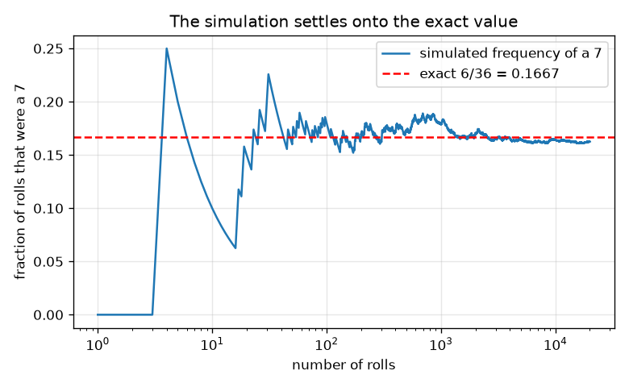
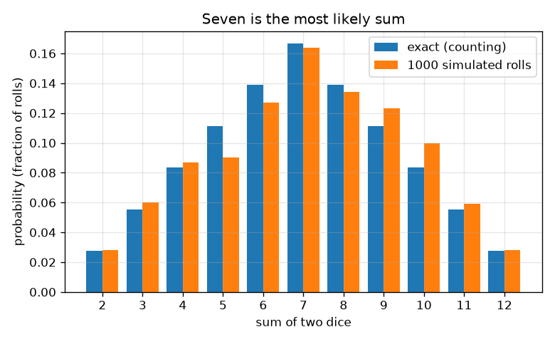

# அமர்வு 1: நியாயமான விளைவுகளும் இரண்டு பகடைகளின் கூட்டுத்தொகையும்

[Session 1 — हिन्दी](README.hi.md)

*நிலை 1 (கருத்தியல் ஊடாடும் மாதிரி) · சுமார் 60 நிமிடங்கள் · openodds*

> இது எளிமைப்படுத்தப்பட்ட ஒரு கல்வி மாதிரி. இது சரிபார்க்கப்பட்ட (validated) வடிவமைப்புக் கருவி அல்ல; உண்மையான கட்டமைப்புகள், மின் நிறுவல்கள், வாகனங்கள், தொழிற்சாலை செயல்முறைகள் அல்லது மருத்துவ முடிவுகளுக்கு இதைப் பயன்படுத்தக் கூடாது.

**முன்தேவைகள் (Prerequisites)**

- பின்னங்களும் பெருக்கலும்.
- நீங்கள் PRIMER.md படித்து, `python start.py 1` ஒருமுறை இயக்கியுள்ளீர்கள்.

**கற்றல் நோக்கங்கள் (Learning objectives).** இந்த அமர்வுக்குப் பிறகு நீங்கள்:

- ஒன்று மற்றும் இரண்டு நியாயமான பகடைகளின் கூறுவெளியைப் (sample space) பட்டியலிட்டு, ஒவ்வொரு விளைவும் ஏன் சமவாய்ப்புள்ளது என்று கூறலாம்.
- நிகழ்தகவை (probability) சாதகமான விளைவுகளை மொத்த விளைவுகளால் வகுத்ததாகக் கணக்கிடலாம்.
- பட்டை வரைபடத்தைப் பயன்படுத்தி, இரண்டு பகடைகளின் கூட்டுத்தொகையில் 7 ஏன் மிக வாய்ப்புள்ளது என்று விளக்கலாம்.
- விதை (seed) இட்ட உருவகப்படுத்தலை இயக்கி, அதன் நிகழ்வெண்கள் துல்லிய மதிப்புகளில் நிலைபெறுவதைக் காணலாம்.

## A. நிஜ உலகப் பிரச்சினை
ஒரு பலகை விளையாட்டில் நீங்கள் இரண்டு பகடைகளை உருட்டிக் கூட்டுகிறீர்கள். வீரர்கள் 7 'அடிக்கடி வரும்', 2 அல்லது 12 அரிது என்கிறார்கள். இது உண்மையா, அல்லது நினைவு மட்டுமா? நடக்கக்கூடிய அனைத்தையும் பட்டியலிட்டு, எண்ணி, பின்னர் அந்த எண்ணிக்கையை ஆயிரக்கணக்கான மெய்நிகர் உருட்டல்களுடன் சரிபார்த்து இதை நாம் தீர்க்கலாம். இது வாய்ப்பு பற்றிய கல்வி மட்டுமே, பந்தய ஆலோசனை அல்ல.

## B. கருத்தும் கோட்பாடும்
கூறுவெளி என்பது சாத்தியமான அனைத்து விளைவுகளின் பட்டியல். ஒரு நியாயமான பகடையில் 6 முகங்களும் சமவாய்ப்புள்ளவை, எனவே ஒவ்வொன்றுக்கும் நிகழ்தகவு 1/6. இரண்டு பகடைகளுக்கு ஒரு விளைவு ஒரு ஜோடி (முதலாவது, இரண்டாவது), எனவே 6 x 6 = 36 சமவாய்ப்பு விளைவுகள் உள்ளன; (1, 2), (2, 1) வெவ்வேறு விளைவுகள். விளைவுகள் சமவாய்ப்புள்ளவையாக இருக்கும்போது, ஒரு நிகழ்வின் நிகழ்தகவு சாதகமான விளைவுகளின் எண்ணிக்கையை மொத்த விளைவுகளின் எண்ணிக்கையால் வகுத்தது. கூட்டுத்தொகை 7 ஐ ஆறு வழிகளில் உருவாக்கலாம், (1,6), (2,5), (3,4), (4,3), (5,2), (6,1), ஆனால் கூட்டுத்தொகை 2 ஐ ஒரே வழியில் மட்டுமே, (1,1). n உருவகப்படுத்திய சோதனைகளில் ஒரு நிகழ்வின் சார்பு நிகழ்வெண் (relative frequency) அது நடந்த முறைகளை n ஆல் வகுத்தது; n வளரும்போது அது உண்மை நிகழ்தகவுக்கு அருகில் நிலைபெறும் என்று பெரிய எண்களின் விதி (law of large numbers) கூறுகிறது.

| குறியீடு | பொருள் | அலகு |
|---|---|---|
| s | இரண்டு பகடைகளின் கூட்டுத்தொகை | அலகு இல்லை (2 முதல் 12 வரை) |
| c(s) | கூட்டுத்தொகை s கொண்ட விளைவுகளின் எண்ணிக்கை | எண்ணிக்கை |
| P(s) | கூட்டுத்தொகை s இன் நிகழ்தகவு | அலகு இல்லை (0 முதல் 1 வரை) |
| n | உருவகப்படுத்திய உருட்டல்களின் எண்ணிக்கை | எண்ணிக்கை |
| f(s) | உருவகப்படுத்தலில் கூட்டுத்தொகை s இன் சார்பு நிகழ்வெண் | அலகு இல்லை (0 முதல் 1 வரை) |

**அனுமானங்கள் (Assumptions)**

- பகடைகள் நியாயமானவை: ஒவ்வொரு முகத்திற்கும் நிகழ்தகவு 1/6.
- இரண்டு பகடைகளும் ஒன்றையொன்று பாதிப்பதில்லை.
- உருவகப்படுத்திய உருட்டல்கள் விதை இட்ட போலி-சீரற்ற உருவாக்கியிலிருந்து வருகின்றன, இந்த நோக்கத்திற்கு அது நியாயமான பகடைகளைப் போல நடந்துகொள்கிறது.

$$ P(\text{event})=\dfrac{\text{favourable outcomes}}{\text{total outcomes}} $$

$$ P(s)=\dfrac{c(s)}{36},\qquad c(s)=6-|s-7|\quad (s=2,\dots,12) $$

$$ \sum_{s=2}^{12}P(s)=1 $$

$$ f(s)=\dfrac{\text{rolls with sum } s}{n}\;\longrightarrow\;P(s)\quad (n\to\infty) $$

## C. காட்சி விளக்கம்
முதல் படம் ஒவ்வொரு கூட்டுத்தொகையின் துல்லிய நிகழ்தகவின் பட்டை வரைபடம், 1000 உருவகப்படுத்திய உருட்டல்களின் நிகழ்வெண்களுக்கு அருகில்: பட்டைகள் 7 இல் உச்சமும் (6/36 = 0.167) 2 மற்றும் 12 இல் அடிப்பகுதியும் (1/36 = 0.028) கொண்ட கூடாரத்தை உருவாக்குகின்றன. இரண்டாவது படம் மடக்கை அச்சில் உருட்டல்களின் எண்ணிக்கை வளரும்போது 7 இன் நிகழ்வெண்ணைப் பின்தொடர்கிறது. சில உருட்டல்களுக்கு அது கட்டுக்கடங்காமல் ஆடுகிறது, பின்னர் 6/36 இல் உள்ள சிவப்புக் கோடிட்ட கோட்டுக்கு அருகில் நிலைபெறுகிறது.

*7 இன் நிகழ்வெண் முதலில் ஆடி, துல்லிய மதிப்பு 6/36 இல் நிலைபெறுகிறது.*

*இரண்டு பகடைகளின் ஒவ்வொரு கூட்டுத்தொகையின் துல்லிய நிகழ்தகவுகள் 1000 உருவகப்படுத்திய உருட்டல்களுக்கு அருகில்: ஏழு மிக வாய்ப்புள்ளது.*

## D. ஊடாடும் உருவகப்படுத்தல் (Interactive simulation)
பாடத்தை இயக்கவும் (`python start.py 1`), பின்னர் நேரடிச் செயலியைத் திறக்கவும்: [அமர்வு 1: இரண்டு பகடைகள்](https://krunalpanchal1995.github.io/pan-iit-oss/openodds/session-01/) (அல்லது இந்தக் கோப்புறையிலுள்ள `app.html`). ஒரு கூட்டுத்தொகையையும் உருட்டல்களின் எண்ணிக்கையையும் தேர்ந்தெடுக்கவும். கட்டக் காட்சியில் 36 கட்டங்களில் எவை அந்தக் கூட்டுத்தொகையை உருவாக்குகின்றன என்று பாருங்கள்; பட்டைக் காட்சியில் துல்லியப் பட்டையை உருவகப்படுத்திய பட்டையுடன் ஒப்பிட்டு, உருட்டல்களைக் கூட்டும்போது இடைவெளி சுருங்குவதைக் கவனியுங்கள்.

**சவால்.** மிக வாய்ப்புள்ள கூட்டுத்தொகையைத் தேர்ந்தெடுத்து குறைந்தது 1000 உருட்டல்களை இயக்கவும்.

## E. தீர்க்கப்பட்ட எடுத்துக்காட்டும் சோதனையும்
**பிரச்சினை.** இரண்டு நியாயமான பகடைகள் கூட்டி 7 வர நிகழ்தகவு என்ன? அனைத்து விளைவுகளையும் எண்ணிச் சரிபார்க்கவும்.

1. விளைவுகளைப் பட்டியலிடுங்கள்: 6 x 6 = 36 சமவாய்ப்பு ஜோடிகள்.
2. சாதகமான ஜோடிகள்: (1,6), (2,5), (3,4), (4,3), (5,2), (6,1). அதாவது 6 ஜோடிகள்.
3. P(7) = 6 / 36 = 1/6 = 0.1667.
4. நியாயச் சரிபார்ப்பு: 11 சாத்தியமான கூட்டுத்தொகைகளுக்கு 1,2,3,4,5,6,5,4,3,2,1 விளைவுகள் உள்ளன, அவை கூடி 36 ஆகின்றன, எனவே நிகழ்தகவுகள் கூடி 1 ஆகின்றன.

**விடை.** P(7) = 6/36 = 1/6, சுமார் 0.167: மிக வாய்ப்புள்ள கூட்டுத்தொகை.

**சோதனை.** இரண்டு உண்மைப் பகடைகளை 100 முறை உருட்டிக் கூட்டுத்தொகைகளைக் கணக்கிடுங்கள், பின்னர் துல்லிய அட்டவணையுடனும் உருவகப்படுத்தலுடனும் ஒப்பிடுங்கள். 100 உருட்டல்களில் 7 இன் நிகழ்வெண் பொதுவாக சுமார் 0.10 முதல் 0.24 வரை இருக்கும், எனவே 7 முதலிடத்தில் இருப்பதைக்கூடக் காணாமல் போகலாம். மாதிரி துல்லியமானது; உண்மையான சிறிய மாதிரி இரைச்சலானது, உண்மைப் பகடைகள் ஒருபோதும் முழுமையாக நியாயமானவை அல்ல.

## F. மதிப்பீடும் வடிவமைப்புச் சவாலும்
**கேள்வி வகை A: கருத்தியல்.** ஒரு நண்பர் கூறுகிறார்: 'கூட்டுத்தொகைகள் 6 மற்றும் 8 ஒவ்வொன்றும் 7 ஐ விடக் குறைவாக வருகின்றன, ஆனால் 6 உம் 8 உம் சேர்ந்து 7 உம் 12 உம் சேர்ந்ததை விட அதிகமாக வருகின்றன.' இது சரியா? (1, 2) உம் (2, 1) உம் ஒரே விளைவு அல்லாதது ஏன்?

குறிப்பு

ஒவ்வொரு கூட்டுத்தொகையின் விளைவுகளை எண்ணிக் கூட்டுங்கள்.

படிப்படியான தீர்வு

கூட்டுத்தொகைகள் 6 மற்றும் 8 க்கு 5 + 5 = 10 விளைவுகள்; 7 உம் 12 உம் சேர்ந்து 6 + 1 = 7 விளைவுகள், எனவே ஆம். (1, 2) உம் (2, 1) உம் வெவ்வேறு விளைவுகள் (முதல் பகடை 1, இரண்டாவது 2, அல்லது எதிர்மாறாக); இரண்டையும் பட்டியலிடுவதுதான் அனைத்து 36 விளைவுகளையும் சமவாய்ப்புள்ளதாக்குகிறது, கூட்டுத்தொகை 3 க்கு இரண்டு வழிகளைத் தருகிறது, அதனால்தான் 3, 2 ஐ விட இரு மடங்கு வாய்ப்புள்ளது.

**கேள்வி வகை B: எண்ணியல்.** இரண்டு பகடைகளின் கூட்டுத்தொகை குறைந்தது 10 ஆக இருக்க நிகழ்தகவைக் கண்டறியவும். விடையைப் பின்னமாகவும் தசமமாகவும் தந்து அது 0 க்கும் 1 க்கும் இடையே உள்ளதா என்று சரிபார்க்கவும்.

குறிப்பு

c(s) = 6 - |s - 7| ஐப் பயன்படுத்தி கூட்டுத்தொகைகள் 10, 11, 12 இன் விளைவுகளை எண்ணுங்கள்.

படிப்படியான தீர்வு

c(10) = 3, c(11) = 2, c(12) = 1, எனவே 6 சாதகமான விளைவுகள். P = 6/36 = 1/6 = 0.167. இது 0 க்கும் 1 க்கும் இடையே உள்ளது, P(7) க்குச் சமம், 3 + 2 + 1 எண்ணிக்கைகள் 6 க்குச் சமம் என்பதால் இது பொருத்தமானது.

**கேள்வி வகை C: வரைபடம் மற்றும் உருவகப்படுத்தல் விளக்கம்.** ஒருங்கல் படத்தில், 10 உருட்டல்களுக்குப் பிறகு 7 இன் நிகழ்வெண் 0.167 இலிருந்து வெகு தொலைவில் உள்ளது ஆனால் 20000 உருட்டல்களுக்குப் பிறகு மிக அருகில் உள்ளது. தொடக்க நிகழ்வெண் மிகக் குறைவாக இருந்தால் அடுத்த உருட்டல் 7 ஆக 'வரவேண்டிய நேரம்' என்று இதற்கு அர்த்தமா?

குறிப்பு

எது நிலைபெறுகிறது என்று சிந்தியுங்கள்: பின்னமா அல்லது எண்ணிக்கைகளா?

படிப்படியான தீர்வு

இல்லை. ஒவ்வொரு உருட்டலும் சுதந்திரமானது, 7 ஆக இருக்க நிகழ்தகவு இன்னும் 1/6. தொடக்கத்தின் மிகுதியோ பற்றாக்குறையோ மேலும் மேலும் உருட்டல்களில் பரவுவதால் பின்னம் நிலைபெறுகிறது, பின்னர் வரும் உருட்டல்கள் ஈடுசெய்வதால் அல்ல. ஆட்டத்தின் அளவு சுமார் n இன் வர்க்கமூலத்தின் தலைகீழ் போலக் குறைகிறது; அமர்வு 3 இதைத் துல்லியமாக்குகிறது.

**கேள்வி வகை D: வடிவமைப்பு மற்றும் உகப்பாக்கச் (optimisation) சவால்.** ஒரு விளையாட்டை வடிவமைக்கவும்: நீங்கள் தேர்ந்தெடுக்கும் ஒரு தொகுப்பு S இல் கூட்டுத்தொகை வந்தால் நீங்கள் வெல்கிறீர்கள். வெல்லும் நிகழ்தகவு சரியாக 1/3 ஆக, முடிந்தவரை குறைவான வெவ்வேறு கூட்டுத்தொகைகளைப் பயன்படுத்தி S ஐத் தேர்ந்தெடுத்து, நீங்கள் என்ன சமரசம் செய்தீர்கள் என்று கூறுங்கள்.

குறிப்பு

36 இல் 12 சாதகமான விளைவுகள் வேண்டும்.

படிப்படியான தீர்வு

36 இல் 12 சாதகமான விளைவுகள் வேண்டும். ஒரு தேர்வு கூட்டுத்தொகைகள் 4, 7, 10: 3 + 6 + 3 = 12, எனவே S = {4, 7, 10} 12/36 = 1/3 நிகழ்தகவுடன் வெல்கிறது. ஒரே கூட்டுத்தொகையால் இது முடியாது ஏனெனில் மிகப்பெரிய எண்ணிக்கை 6, இரண்டு கூட்டுத்தொகைகள் அதிகபட்சம் 6 + 5 = 11 தருகின்றன. சமரசம் (trade-off): குறைவான கூட்டுத்தொகைகள் என்றால் எளிய விதிகள், ஆனால் அடையக்கூடிய நிகழ்தகவுகள் சிறியவை. அனுமானம்: நியாயமான பகடைகள்.

[RUBRIC.md](../../RUBRIC.md) மூலம் உங்களை நீங்களே மதிப்பிடுங்கள். தாளில் செய்ய [செயல்பாட்டுத் தாளை](activity_sheet.md) அச்சிடவும்.

## பொதுவான தவறான கருத்துகள்
| பொதுவான தவறான கருத்து | உண்மையில் சரியானது |
|---|---|
| இரண்டு பகடைகளின் அனைத்துக் கூட்டுத்தொகைகளும் 11 இருப்பதால் சமவாய்ப்புள்ளவை. | 11 கூட்டுத்தொகைகள் சமவாய்ப்புள்ளவை அல்ல. 36 ஜோடிகளே சமவாய்ப்புள்ளவை. கூட்டுத்தொகை 7 க்கு 6 ஜோடிகளும் கூட்டுத்தொகை 2 க்கு 1 உம் உள்ளன. |
| (1, 2) உம் (2, 1) உம் ஒரே விளைவு. | இரண்டு தனித்தனிப் பகடைகளுக்கு அவை வெவ்வேறு விளைவுகள், இரண்டையும் எண்ணுவதுதான் அனைத்து 36 விளைவுகளையும் சமவாய்ப்புள்ளதாக வைத்திருக்கிறது. |
| 7 வராத நீண்ட தொடருக்குப் பிறகு 7 வர வாய்ப்பு அதிகம். | பகடைகளுக்கு நினைவு இல்லை. ஒவ்வொரு உருட்டலுக்கும் அதே நிகழ்தகவு; பின்னம் நிலைபெறுகிறது, எண்ணிக்கைகள் சமமாக வேண்டியதில்லை. |

## சொற்களஞ்சியம் (Glossary)
- **கூறுவெளி (sample space)**: சாத்தியமான அனைத்து விளைவுகளின் பட்டியல்
- **நிகழ்வு (event)**: 'கூட்டுத்தொகை 7' போல நாம் கவனிக்கும் விளைவுகளின் தொகுப்பு
- **நிகழ்தகவு (probability)**: 0 (இயலாதது) முதல் 1 (உறுதி) வரையிலான எண்; சமவாய்ப்பு விளைவுகளுக்குச் சாதகமானதை மொத்தத்தால் வகுத்தது
- **சார்பு நிகழ்வெண் (relative frequency)**: ஒரு நிகழ்வு எத்தனை முறை நடந்தது என்பதைச் சோதனைகளின் எண்ணிக்கையால் வகுத்தது
- **விதை (seed)**: போலி-சீரற்ற உருவாக்கியைச் சரியாக மீண்டும் செய்ய வைக்கும் தொடக்க எண்

## நிறைவு
1. [exercises.md](exercises.md)-இல் உள்ள மூன்று நிரலாக்கப் பணிகளைச் செய்யவும்.
2. உங்கள் மாற்றங்களுக்குப் பிறகு `python start.py 1` மீண்டும் இயக்கவும். அது சோதனைச் சாவடியுடன் (checkpoint) முடிகிறது; அது `PASS` அச்சிடும்போது நீங்கள் முடித்துவிட்டீர்கள். (சோதனைச் சாவடி மட்டும்: `python start.py check 1`.)

அடுத்து: [அமர்வு 2](../session-02/README.md)
