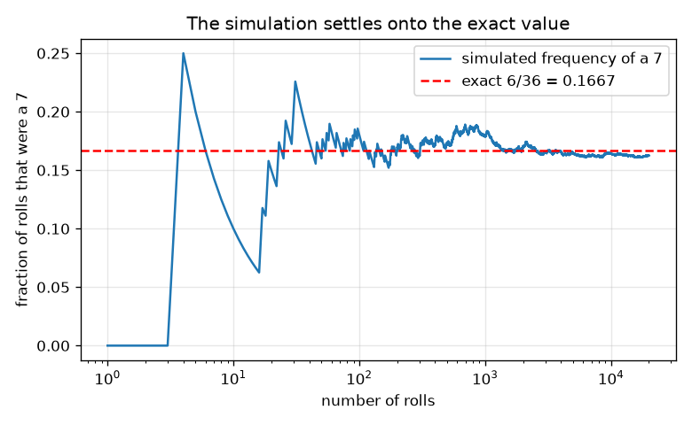
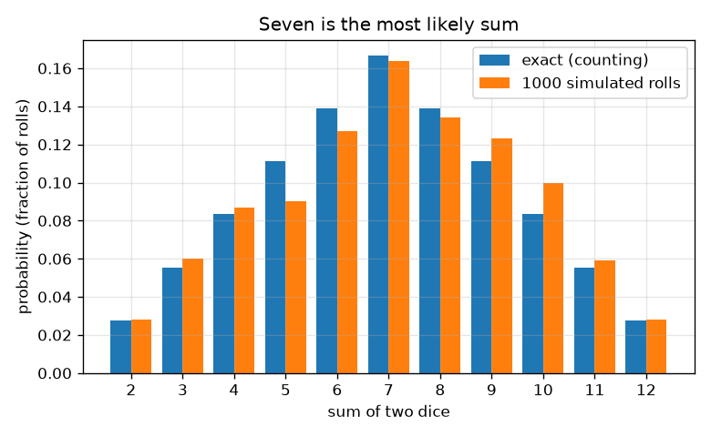

# సెషన్ 1: న్యాయమైన ఫలితాలు మరియు రెండు పాచికల మొత్తం

[Session 1 — हिन्दी](README.hi.md)

*స్థాయి 1 (భావనాత్మక ఇంటరాక్టివ్ నమూనా) · సుమారు 60 నిమిషాలు · openodds*

> ఇది సరళీకరించిన విద్యా నమూనా. ఇది ధృవీకరించబడిన (validated) డిజైన్ సాధనం కాదు; నిజమైన నిర్మాణాలు, విద్యుత్ ఇన్‌స్టలేషన్లు, వాహనాలు, పారిశ్రామిక ప్రక్రియలు లేదా వైద్య నిర్ణయాల కోసం దీనిని ఉపయోగించకూడదు.

**ముందస్తు అవసరాలు (Prerequisites)**

- భిన్నాలు మరియు గుణకారం.
- మీరు PRIMER.md చదివి, `python start.py 1` ఒకసారి రన్ చేశారు.

**అభ్యసన లక్ష్యాలు (Learning objectives).** ఈ సెషన్ తర్వాత మీరు:

- ఒకటి మరియు రెండు న్యాయమైన పాచికల యొక్క నమూనా అంతరాళాన్ని (sample space) జాబితా చేసి, ప్రతి ఫలితం ఎందుకు సమాన సంభావ్యతతో ఉందో చెప్పగలరు.
- సంభావ్యతను (probability) అనుకూల ఫలితాలను మొత్తం ఫలితాలతో భాగించినదిగా లెక్కించగలరు.
- బార్ చార్ట్ ఉపయోగించి, రెండు పాచికల మొత్తంలో 7 ఎందుకు అత్యంత సంభావ్యమో వివరించగలరు.
- సీడ్ (seed) చేసిన సిమ్యులేషన్ రన్ చేసి దాని పౌనఃపున్యాలు ఖచ్చితమైన విలువల్లో స్థిరపడటం చూడగలరు.

## A. వాస్తవ ప్రపంచ సమస్య
బోర్డ్ గేమ్‌లో మీరు రెండు పాచికలు వేసి కూడతారు. ఆటగాళ్ళు 7 'తరచుగా వస్తుంది', 2 లేదా 12 అరుదు అంటారు. ఇది నిజమా, లేక జ్ఞాపకం మాత్రమేనా? జరగగలిగిన ప్రతిదాన్నీ జాబితా చేసి, లెక్కించి, ఆ లెక్కను వేలాది వర్చువల్ రోల్‌లతో సరిచూసి దీన్ని మనం తేల్చవచ్చు. ఇది అవకాశం గురించిన విద్య మాత్రమే, పందెం సలహా కాదు.

## B. భావన మరియు సిద్ధాంతం
నమూనా అంతరాళం అంటే సాధ్యమైన అన్ని ఫలితాల జాబితా. న్యాయమైన పాచికలో 6 ముఖాలూ సమాన సంభావ్యత కలవి, కాబట్టి ప్రతిదానికి సంభావ్యత 1/6. రెండు పాచికలకు ఫలితం ఒక జత (మొదటిది, రెండవది), కాబట్టి 6 x 6 = 36 సమాన సంభావ్య ఫలితాలు ఉన్నాయి; (1, 2) మరియు (2, 1) వేర్వేరు ఫలితాలు. ఫలితాలు సమాన సంభావ్యత కలవైనప్పుడు, ఒక ఘటన యొక్క సంభావ్యత అనుకూల ఫలితాల సంఖ్యను మొత్తం ఫలితాల సంఖ్యతో భాగించినది. మొత్తం 7 ను ఆరు విధాలుగా చేయవచ్చు, (1,6), (2,5), (3,4), (4,3), (5,2), (6,1), కానీ మొత్తం 2 ను ఒకే విధంగా, (1,1). n అనుకరించిన ప్రయత్నాల్లో ఒక ఘటన యొక్క సాపేక్ష పౌనఃపున్యం (relative frequency) అది జరిగిన సార్లను n తో భాగించినది; n పెరిగేకొద్దీ అది నిజమైన సంభావ్యత దగ్గర స్థిరపడుతుందని పెద్ద సంఖ్యల నియమం (law of large numbers) చెబుతుంది.

| గుర్తు | అర్థం | ప్రమాణం |
|---|---|---|
| s | రెండు పాచికల మొత్తం | ప్రమాణం లేదు (2 నుండి 12 వరకు) |
| c(s) | మొత్తం s ఉన్న ఫలితాల సంఖ్య | లెక్క |
| P(s) | మొత్తం s యొక్క సంభావ్యత | ప్రమాణం లేదు (0 నుండి 1 వరకు) |
| n | అనుకరించిన రోల్‌ల సంఖ్య | లెక్క |
| f(s) | సిమ్యులేషన్‌లో మొత్తం s యొక్క సాపేక్ష పౌనఃపున్యం | ప్రమాణం లేదు (0 నుండి 1 వరకు) |

**ఊహలు (Assumptions)**

- పాచికలు న్యాయమైనవి: ప్రతి ముఖానికి సంభావ్యత 1/6.
- రెండు పాచికలు ఒకదానినొకటి ప్రభావితం చేయవు.
- అనుకరించిన రోల్‌లు సీడ్ చేసిన నకిలీ-యాదృచ్ఛిక జనరేటర్ నుండి వస్తాయి, ఈ ప్రయోజనానికి అది న్యాయమైన పాచికల్లా ప్రవర్తిస్తుంది.

$$ P(\text{event})=\dfrac{\text{favourable outcomes}}{\text{total outcomes}} $$

$$ P(s)=\dfrac{c(s)}{36},\qquad c(s)=6-|s-7|\quad (s=2,\dots,12) $$

$$ \sum_{s=2}^{12}P(s)=1 $$

$$ f(s)=\dfrac{\text{rolls with sum } s}{n}\;\longrightarrow\;P(s)\quad (n\to\infty) $$

## C. దృశ్య వివరణ
మొదటి చిత్రం ప్రతి మొత్తం యొక్క ఖచ్చితమైన సంభావ్యత బార్ చార్ట్, 1000 అనుకరించిన రోల్‌ల పౌనఃపున్యాల పక్కన: బార్‌లు 7 వద్ద శిఖరం (6/36 = 0.167) మరియు 2, 12 వద్ద అడుగు (1/36 = 0.028) ఉన్న గుడారాన్ని ఏర్పరుస్తాయి. రెండవ చిత్రం లాగరిథమిక్ అక్షంపై రోల్‌ల సంఖ్య పెరిగేకొద్దీ 7 యొక్క పౌనఃపున్యాన్ని అనుసరిస్తుంది. కొన్ని రోల్‌లకు అది విపరీతంగా ఊగుతుంది, తర్వాత 6/36 వద్ద ఎరుపు చుక్కల గీత దగ్గర స్థిరపడుతుంది.

*7 యొక్క పౌనఃపున్యం మొదట ఊగి, ఖచ్చితమైన విలువ 6/36 వద్ద స్థిరపడుతుంది.*

*రెండు పాచికల ప్రతి మొత్తం యొక్క ఖచ్చితమైన సంభావ్యతలు 1000 అనుకరించిన రోల్‌ల పక్కన: ఏడు అత్యంత సంభావ్యం.*

## D. ఇంటరాక్టివ్ సిమ్యులేషన్
పాఠాన్ని రన్ చేయండి (`python start.py 1`), తర్వాత లైవ్ యాప్‌ను తెరవండి: [సెషన్ 1: రెండు పాచికలు](https://krunalpanchal1995.github.io/pan-iit-oss/openodds/session-01/) (లేదా ఈ ఫోల్డర్‌లోని `app.html`). ఒక మొత్తాన్ని మరియు రోల్‌ల సంఖ్యను ఎంచుకోండి. గ్రిడ్ వీక్షణలో 36 గడుల్లో ఏవి ఆ మొత్తాన్ని ఇస్తాయో చూడండి; బార్ వీక్షణలో ఖచ్చితమైన బార్‌ను అనుకరించిన బార్‌తో పోల్చి, రోల్‌లు పెంచేకొద్దీ అంతరం తగ్గడం గమనించండి.

**సవాలు.** అత్యంత సంభావ్యమైన మొత్తాన్ని ఎంచుకుని కనీసం 1000 రోల్‌లు రన్ చేయండి.

## E. సాధించిన ఉదాహరణ మరియు ప్రయోగం
**సమస్య.** రెండు న్యాయమైన పాచికలు కూడి 7 అయ్యే సంభావ్యత ఎంత? అన్ని ఫలితాలను లెక్కించి సరిచూడండి.

1. ఫలితాలను జాబితా చేయండి: 6 x 6 = 36 సమాన సంభావ్య జతలు.
2. అనుకూల జతలు: (1,6), (2,5), (3,4), (4,3), (5,2), (6,1). అంటే 6 జతలు.
3. P(7) = 6 / 36 = 1/6 = 0.1667.
4. సహేతుకత తనిఖీ: 11 సాధ్యమైన మొత్తాలకు 1,2,3,4,5,6,5,4,3,2,1 ఫలితాలు ఉన్నాయి, అవి కూడి 36 అవుతాయి, కాబట్టి సంభావ్యతలు కూడి 1 అవుతాయి.

**సమాధానం.** P(7) = 6/36 = 1/6, సుమారు 0.167: అత్యంత సంభావ్యమైన మొత్తం.

**ప్రయోగం.** రెండు నిజమైన పాచికలను 100 సార్లు వేసి మొత్తాలను లెక్కించండి, తర్వాత ఖచ్చితమైన పట్టికతో మరియు సిమ్యులేషన్‌తో పోల్చండి. 100 రోల్‌లలో 7 యొక్క పౌనఃపున్యం సాధారణంగా సుమారు 0.10 మరియు 0.24 మధ్య ఉంటుంది, కాబట్టి 7 అగ్రస్థానంలో ఉండటం కూడా కనిపించకపోవచ్చు. నమూనా ఖచ్చితమైనది; నిజమైన చిన్న నమూనా శబ్దంతో కూడినది, నిజమైన పాచికలు ఎప్పుడూ పూర్తిగా న్యాయమైనవి కావు.

## F. మూల్యాంకనం మరియు డిజైన్ సవాలు
**ప్రశ్న రకం A: భావనాత్మక.** ఒక స్నేహితుడు అంటాడు: 'మొత్తాలు 6 మరియు 8 ఒక్కొక్కటి 7 కంటే తక్కువ సార్లు వస్తాయి, కానీ 6 మరియు 8 కలిసి 7 మరియు 12 కలిసిన దానికంటే ఎక్కువ సార్లు వస్తాయి.' ఇది సరైనదేనా? (1, 2) మరియు (2, 1) ఒకే ఫలితం కాకపోవడానికి కారణం ఏమిటి?

సూచన

ప్రతి మొత్తం యొక్క ఫలితాలను లెక్కించి కూడండి.

దశలవారీ పరిష్కారం

మొత్తాలు 6 మరియు 8 కు 5 + 5 = 10 ఫలితాలు; 7 మరియు 12 కలిసి 6 + 1 = 7 ఫలితాలు, కాబట్టి అవును. (1, 2) మరియు (2, 1) వేర్వేరు ఫలితాలు (మొదటి పాచిక 1 మరియు రెండవది 2, లేదా వ్యతిరేకంగా); రెండింటినీ జాబితా చేయడమే మొత్తం 36 ఫలితాలను సమాన సంభావ్యంగా చేస్తుంది మరియు మొత్తం 3 కి రెండు విధాలు ఇస్తుంది, అందుకే 3, 2 కంటే రెండు రెట్లు సంభావ్యం.

**ప్రశ్న రకం B: సంఖ్యాత్మక.** రెండు పాచికల మొత్తం కనీసం 10 అయ్యే సంభావ్యతను కనుగొనండి. సమాధానాన్ని భిన్నంగా మరియు దశాంశంగా ఇచ్చి అది 0 మరియు 1 మధ్య ఉందో సరిచూడండి.

సూచన

c(s) = 6 - |s - 7| ఉపయోగించి మొత్తాలు 10, 11, 12 ఫలితాలను లెక్కించండి.

దశలవారీ పరిష్కారం

c(10) = 3, c(11) = 2, c(12) = 1, కాబట్టి 6 అనుకూల ఫలితాలు. P = 6/36 = 1/6 = 0.167. ఇది 0 మరియు 1 మధ్య ఉంది, P(7) తో సమానం, 3 + 2 + 1 లెక్కలు 6 కు సమానం కాబట్టి ఇది సమంజసం.

**ప్రశ్న రకం C: గ్రాఫ్ మరియు సిమ్యులేషన్ వ్యాఖ్యానం.** అభిసరణ చిత్రంలో, 10 రోల్‌ల తర్వాత 7 యొక్క పౌనఃపున్యం 0.167 నుండి చాలా దూరంగా ఉంది కానీ 20000 రోల్‌ల తర్వాత చాలా దగ్గరగా ఉంది. తొలి పౌనఃపున్యం చాలా తక్కువగా ఉంటే తదుపరి రోల్ 7 కావడానికి 'వంతు వచ్చింది' అని దీని అర్థమా?

సూచన

ఏది స్థిరపడుతుందో ఆలోచించండి: భిన్నమా లేక లెక్కలా?

దశలవారీ పరిష్కారం

కాదు. ప్రతి రోల్ స్వతంత్రం, 7 అయ్యే సంభావ్యత ఇప్పటికీ 1/6. తొలి మిగులు లేదా కొరత మరింత ఎక్కువ రోల్‌లలో విస్తరించడం వల్ల భిన్నం స్థిరపడుతుంది, తరువాతి రోల్‌లు భర్తీ చేయడం వల్ల కాదు. ఊగిసలాట పరిమాణం సుమారుగా n యొక్క వర్గమూలం యొక్క విలోమంలా తగ్గుతుంది; సెషన్ 3 దీన్ని ఖచ్చితంగా చేస్తుంది.

**ప్రశ్న రకం D: డిజైన్ మరియు ఆప్టిమైజేషన్ (optimisation) సవాలు.** ఒక ఆటను డిజైన్ చేయండి: మీరు ఎంచుకున్న సమితి S లో మొత్తం వస్తే మీరు గెలుస్తారు. గెలిచే సంభావ్యత సరిగ్గా 1/3 అయ్యేలా, వీలైనంత తక్కువ వేర్వేరు మొత్తాలను ఉపయోగించి S ను ఎంచుకుని, మీరు ఏ రాజీ చేశారో చెప్పండి.

సూచన

36 లో 12 అనుకూల ఫలితాలు కావాలి.

దశలవారీ పరిష్కారం

36 లో 12 అనుకూల ఫలితాలు కావాలి. ఒక ఎంపిక మొత్తాలు 4, 7, 10: 3 + 6 + 3 = 12, కాబట్టి S = {4, 7, 10} 12/36 = 1/3 సంభావ్యతతో గెలుస్తుంది. ఒకే మొత్తం దీన్ని చేయలేదు ఎందుకంటే అతిపెద్ద లెక్క 6, రెండు మొత్తాలు గరిష్టంగా 6 + 5 = 11 ఇస్తాయి. రాజీ (trade-off): తక్కువ మొత్తాలు అంటే సరళ నియమాలు, కానీ చేరగల సంభావ్యతలు తక్కువ. ఊహ: న్యాయమైన పాచికలు.

[RUBRIC.md](../../RUBRIC.md) తో మిమ్మల్ని మీరు స్కోర్ చేసుకోండి. కాగితంపై చేయడానికి [కార్యాచరణ పత్రాన్ని](activity_sheet.md) ప్రింట్ చేయండి.

## సాధారణ అపోహలు
| సాధారణ అపోహ | వాస్తవంగా నిజమైనది |
|---|---|
| రెండు పాచికల అన్ని మొత్తాలు 11 ఉన్నాయి కాబట్టి సమాన సంభావ్యం. | 11 మొత్తాలు సమాన సంభావ్యం కావు. 36 జతలే సమాన సంభావ్యం. మొత్తం 7 కి 6 జతలు, మొత్తం 2 కి 1 ఉన్నాయి. |
| (1, 2) మరియు (2, 1) ఒకే ఫలితం. | రెండు వేర్వేరు పాచికలకు అవి వేర్వేరు ఫలితాలు, రెండింటినీ లెక్కించడమే మొత్తం 36 ఫలితాలను సమాన సంభావ్యంగా ఉంచుతుంది. |
| 7 రాని సుదీర్ఘ వరుస తర్వాత 7 రావడానికి ఎక్కువ అవకాశం ఉంది. | పాచికలకు జ్ఞాపకశక్తి లేదు. ప్రతి రోల్‌కు అదే సంభావ్యత; భిన్నం స్థిరపడుతుంది, లెక్కలు సమం కావాల్సిన అవసరం లేదు. |

## పదకోశం (Glossary)
- **నమూనా అంతరాళం (sample space)**: సాధ్యమైన అన్ని ఫలితాల జాబితా
- **ఘటన (event)**: 'మొత్తం 7' వంటి మనం పట్టించుకునే ఫలితాల సమితి
- **సంభావ్యత (probability)**: 0 (అసాధ్యం) నుండి 1 (ఖచ్చితం) వరకు సంఖ్య; సమాన సంభావ్య ఫలితాలకు అనుకూలాన్ని మొత్తంతో భాగించినది
- **సాపేక్ష పౌనఃపున్యం (relative frequency)**: ఒక ఘటన ఎన్నిసార్లు జరిగిందో దాన్ని ప్రయత్నాల సంఖ్యతో భాగించినది
- **సీడ్ (seed)**: నకిలీ-యాదృచ్ఛిక జనరేటర్‌ను సరిగ్గా పునరావృతం చేయించే ప్రారంభ సంఖ్య

## ముగింపు
1. [exercises.md](exercises.md) లోని మూడు కోడింగ్ పనులను చేయండి.
2. మీ మార్పుల తర్వాత `python start.py 1` మళ్ళీ రన్ చేయండి. అది చెక్‌పాయింట్‌తో ముగుస్తుంది; అది `PASS` ప్రింట్ చేసినప్పుడు మీరు పూర్తి చేశారు. (చెక్‌పాయింట్ మాత్రమే: `python start.py check 1`.)

తర్వాత: [సెషన్ 2](../session-02/README.md)
