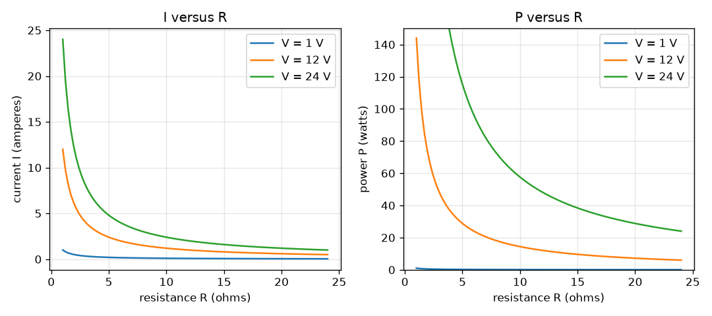
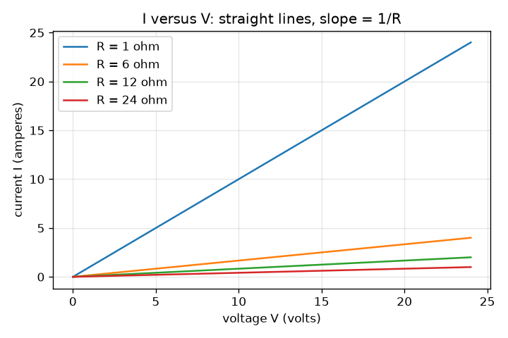

# सत्र 1: ओम का नियम और विद्युत शक्ति

*स्तर 1 (अवधारणात्मक इंटरैक्टिव मॉडल) · लगभग 60 मिनट · openohm*

> यह एक सरलीकृत शैक्षिक मॉडल है। यह कोई प्रमाणित डिज़ाइन उपकरण नहीं है और इसका उपयोग वास्तविक संरचनाओं, विद्युत संस्थापनों, वाहनों, औद्योगिक प्रक्रियाओं या चिकित्सा निर्णयों के लिए नहीं किया जाना चाहिए।

**पूर्वापेक्षाएँ (Prerequisites)**

- एक सरल समीकरण को पुनर्व्यवस्थित करना (यदि V = I R और आप V और R जानते हैं, तो I ज्ञात करें)।
- आपने PRIMER.md पढ़ लिया है और `python start.py 1` एक बार चला लिया है।

**सीखने के उद्देश्य (Learning objectives)।** इस सत्र के बाद आप:

- इकाइयों सहित ओम का नियम (Ohm's law) V = I R और शक्ति (power) सूत्र P = V I बता सकेंगे।
- वोल्टता और प्रतिरोध से किसी प्रतिरोधक की धारा और शक्ति, हाथ से और Python में, गणना कर सकेंगे।
- दिखा सकेंगे कि P = V I = I^2 R = V^2 / R एक ही संख्या देते हैं।
- तीनों ग्राफ़ I बनाम V, I बनाम R और P बनाम R पढ़ सकेंगे।

## A. वास्तविक दुनिया की समस्या
एक फ़ोन चार्जर, एक टॉर्च का बल्ब और एक केतली, हर एक किसी ऐसी चीज़ से विद्युत धारा धकेलता है जो उसका विरोध करती है। पतला तार गर्म क्यों हो जाता है जबकि मोटा नहीं, और छोटा प्रतिरोधक बहुत बड़ी बैटरी से जोड़ने पर जल क्यों जाता है? दो छोटे नियम दोनों का उत्तर देते हैं: ओम का नियम बताता है कि कितनी धारा बहती है, और शक्ति सूत्र बताता है कि कितनी ऊष्मा उत्पन्न होती है। यह रिपॉज़िटरी केवल कम-वोल्टता परिपथों का उपयोग करती है (बैटरियाँ और छोटी सप्लाई, मेन्स बिजली कभी नहीं)।

## B. अवधारणा और सिद्धांत
वोल्टता (voltage) V दो बिंदुओं के बीच विद्युत धक्का है। प्रतिरोध (resistance) R यह है कि कोई भाग प्रवाह का कितनी दृढ़ता से विरोध करता है। धारा (current) I आवेश का प्रवाह है। एक ओमीय (ohmic) भाग (जिसका R स्थिर रहता है) के लिए ये तीनों ओम के नियम से जुड़े हैं। प्रतिरोधक विद्युत ऊर्जा को एक दर से ऊष्मा में बदलता है जिसे शक्ति कहते हैं, P = V I। ओम का नियम प्रतिस्थापित करने से दो और रूप मिलते हैं जो अक्सर उपयोग में आसान होते हैं: जब आप धारा जानते हों तो P = I^2 R, और जब आप वोल्टता जानते हों तो P = V^2 / R।

| प्रतीक | अर्थ | इकाई |
|---|---|---|
| V | प्रतिरोधक के सिरों पर वोल्टता | V (वोल्ट) |
| I | प्रतिरोधक से होकर धारा | A (ऐम्पियर) |
| R | प्रतिरोध | ohm |
| P | ऊष्मा में बदली शक्ति | W (वाट) |

**मान्यताएँ (Assumptions)**

- सप्लाई आदर्श है: धारा चाहे जो हो, वह अपनी वोल्टता बनाए रखती है।
- तारों का प्रतिरोध शून्य है।
- प्रतिरोधक ओमीय है: R धारा या तापमान के साथ नहीं बदलता (सत्र 3 इसे तोड़ता है)।
- केवल दिष्ट धारा (DC)।

$$ V = I\,R \quad\Longleftrightarrow\quad I = \frac{V}{R} $$

$$ P = V\,I $$

$$ P = I^2 R = \frac{V^2}{R} $$

## C. दृश्य व्याख्या
पहला चित्र चार प्रतिरोधकों (1, 6, 12 और 24 ohm) के लिए वोल्टता के सापेक्ष धारा दिखाता है: हर एक मूल बिंदु से होकर जाने वाली सीधी रेखा है और उसका ढाल 1/R है, इसलिए छोटा प्रतिरोधक एक ढलवाँ रेखा देता है। दूसरे चित्र में 1, 12 और 24 V पर दो पैनल हैं: प्रतिरोध के सापेक्ष धारा 1/R के रूप में घटती है, और प्रतिरोध के सापेक्ष शक्ति भी 1/R के रूप में घटती है, क्योंकि P = V^2 / R। 12 V और 6 ohm पर बिंदु (2 A, 24 W) है।

*1, 12 और 24 V पर प्रतिरोध के सापेक्ष धारा और शक्ति: दोनों 1/R के रूप में घटती हैं।*

*चार प्रतिरोधकों के लिए वोल्टता के सापेक्ष धारा: 1/R ढाल वाली सीधी रेखाएँ।*

## D. इंटरैक्टिव सिमुलेशन
पाठ चलाएँ (`python start.py 1`), फिर लाइव ऐप खोलें: [सत्र 1: ओम का नियम और शक्ति](https://krunalpanchal1995.github.io/pan-iit-oss/openohm/session-01/) (या इस फ़ोल्डर में `app.html`)। वोल्टता और प्रतिरोध स्लाइडर खिसकाएँ और परिपथ का चित्र देखें (तीर का आकार धारा के अनुसार, लाल रंग शक्ति के अनुसार)। फिर तीनों ग्राफ़ खोलें और हर वक्र पर बिंदु को चलते देखें।

**चुनौती।** प्रतिरोधक से 0.5 A धारा लें जबकि वह 6 W क्षय (dissipate) करे।

## E. हल किया गया उदाहरण और प्रयोग
**समस्या।** एक 12 V सप्लाई एक 6 ohm प्रतिरोधक के सिरों पर जोड़ी गई है। धारा और शक्ति ज्ञात कीजिए, और तीनों रूपों में शक्ति की जाँच कीजिए।

1. I = V / R = 12 V / 6 ohm = 2 A।
2. P = V I = 12 V x 2 A = 24 W।
3. I^2 R से जाँच = 2^2 x 6 = 4 x 6 = 24 W।
4. V^2 / R से जाँच = 144 / 6 = 24 W। तीनों रूप मेल खाते हैं।

**उत्तर।** धारा 2 A है और प्रतिरोधक 24 W क्षय करता है।

**प्रयोग।** श्रेणी में दो AA सेल (लगभग 3 V) और कम से कम 0.25 W रेटिंग वाला एक 100 ohm प्रतिरोधक लें; मॉडल कहता है I = 3 / 100 = 0.03 A (30 mA) और P = 0.09 W। श्रेणी में एक मल्टीमीटर से धारा मापें। 30 mA से थोड़ा कम मान की अपेक्षा करें: प्रतिरोधक की लगभग 5 प्रतिशत की सहनसीमा (tolerance) है, सेलों का अपना एक छोटा आंतरिक प्रतिरोध है, और मीटर थोड़ा प्रतिरोध जोड़ता है। मॉडल आदर्श सप्लाई और आदर्श भागों के लिए सटीक है, प्रयोगशाला की मेज़ नहीं।

## F. मूल्यांकन और डिज़ाइन चुनौती
**प्रश्न प्रकार A: अवधारणात्मक।** यदि आप किसी प्रतिरोधक के सिरों पर वोल्टता दोगुनी कर दें, तो धारा और शक्ति का क्या होता है? समझाइए कि वे अलग-अलग गुणकों से क्यों बदलती हैं।

संकेत

पहले I = V / R का उपयोग करें, फिर नई धारा के साथ P = V I।

चरण-दर-चरण हल

धारा दोगुनी हो जाती है क्योंकि I = V / R, V के समानुपाती है। शक्ति V गुणा I है, और दोनों दोगुने हुए, इसलिए P, 2 x 2 = 4 गुना बढ़ती है (V^2 / R से भी: V^2 चौगुना होता है)। शक्ति वोल्टता पर दो बार निर्भर करती है: एक बार क्योंकि धक्का बड़ा है, एक बार क्योंकि प्रवाह बड़ा है।

**प्रश्न प्रकार B: संख्यात्मक।** एक 24 ohm प्रतिरोधक आदर्श 12 V सप्लाई से कितनी धारा लेता है, और वह कितनी शक्ति क्षय करता है? तर्कसंगतता जाँच कीजिए।

संकेत

I = V / R, फिर P = V I।

चरण-दर-चरण हल

I = 12 / 24 = 0.5 A और P = 12 x 0.5 = 6 W। तर्कसंगतता जाँच: हल किए गए उदाहरण का 6 ohm प्रतिरोधक 2 A लेता था, और यह प्रतिरोधक चार गुना बड़ा है, इसलिए धारा चार गुना छोटी होनी चाहिए: 2 / 4 = 0.5 A। इकाइयाँ: वोल्ट भाग ohm से ऐम्पियर मिलता है; वोल्ट गुणा ऐम्पियर से वाट मिलता है।

**प्रश्न प्रकार C: ग्राफ़ और सिमुलेशन की व्याख्या।** 12 V पर P बनाम R ग्राफ़ पर, 6, 12 और 24 ohm पर P क्या है? यह पैटर्न प्रतिरोध को आधा करने के बारे में क्या बताता है?

संकेत

हर प्रतिरोधक के लिए बिंदु पढ़ें, या P = V^2 / R = 144 / R का उपयोग करें।

चरण-दर-चरण हल

6 ohm पर P = 24 W, 12 ohm पर 12 W और 24 ohm पर 6 W। हर बार R आधा होने पर P दोगुनी हो जाती है, क्योंकि स्थिर वोल्टता पर P = 144 / R, R के व्युत्क्रमानुपाती है। स्थिर सप्लाई पर किसी भाग का प्रतिरोध घटाने से वह अधिक गर्म होता है, ठंडा नहीं।

**प्रश्न प्रकार D: डिज़ाइन और इष्टतमीकरण (optimisation) चुनौती।** डिज़ाइन: पहले से तय प्रतिरोधकों 1, 6, 12 और 24 ohm में से, 12 V सप्लाई के लिए एक ऐसा चुनें कि धारा अधिकतम 1 A हो और प्रतिरोधक अधिकतम 10 W क्षय करे। पहले से तय मानों तक सीमित न रहते हुए, वह सबसे छोटा प्रतिरोध क्या है जो दोनों सीमाओं को पूरा करता है?

संकेत

हर सीमा एक न्यूनतम R देती है: R >= V / I_max और R >= V^2 / P_max।

चरण-दर-चरण हल

धारा सीमा: R >= 12 / 1 = 12 ohm। शक्ति सीमा: R >= 144 / 10 = 14.4 ohm। दोनों लागू होनी चाहिए, इसलिए R >= 14.4 ohm। पहले से तय मानों में केवल 24 ohm योग्य है (12 ohm ठीक 1 A देता है पर 12 W, जो 10 W से अधिक है)। 24 ohm का चुनाव 0.5 A और 6 W देता है। समझौता (trade-off): बड़ा R अधिक सुरक्षित है पर लोड को कम धारा देता है।

[RUBRIC.md](../../RUBRIC.md) से स्वयं को अंक दें। काग़ज़ पर काम करने के लिए [गतिविधि पत्रक](activity_sheet.md) प्रिंट करें।

## आम भ्रांतियाँ (Common misconceptions)
| आम भ्रांति | वास्तव में क्या सही है |
|---|---|
| अधिक प्रतिरोध का अर्थ हमेशा अधिक ऊष्मा है। | स्थिर वोल्टता पर, अधिक प्रतिरोध का अर्थ है कम धारा और कम ऊष्मा (P = V^2 / R)। स्थिर धारा पर, अधिक प्रतिरोध का अर्थ है अधिक ऊष्मा (P = I^2 R)। बताइए कि कौन-सा स्थिर है। |
| प्रतिरोधक से गुज़रते समय धारा ख़र्च हो जाती है। | जितनी धारा प्रतिरोधक में प्रवेश करती है उतनी ही बाहर निकलती है; प्रति आवेश ऊर्जा (वोल्टता) ऊष्मा में बदलती है। |
| ओम का नियम हर विद्युत भाग पर लागू होता है। | यह केवल उन ओमीय भागों पर लागू होता है जिनका प्रतिरोध स्थिर है। LED और बल्ब के फ़िलामेंट इसका पालन नहीं करते (सत्र 3)। |

## शब्दावली (Glossary)
- **वोल्टता (voltage)**: दो बिंदुओं के बीच विद्युत धक्का, वोल्ट में
- **धारा (current)**: आवेश का प्रवाह, ऐम्पियर में
- **प्रतिरोध (resistance)**: कोई भाग धारा का कितनी दृढ़ता से विरोध करता है, ohm में
- **शक्ति (power)**: प्रति सेकंड ऊष्मा में बदली ऊर्जा, वाट में
- **ओमीय (ohmic)**: ऐसा भाग जिसका प्रतिरोध स्थिर रहता है, इसलिए I, V के समानुपाती है

## समापन
1. [exercises.md](exercises.md) में दिए तीन कोडिंग कार्य करें।
2. अपने बदलावों के बाद `python start.py 1` फिर से चलाएँ। यह चेकपॉइंट के साथ समाप्त होता है; जब यह `PASS` छापे, तो आपका काम पूरा है। (केवल चेकपॉइंट: `python start.py check 1`।)

आगे: [सत्र 2](../session-02/README.md)
