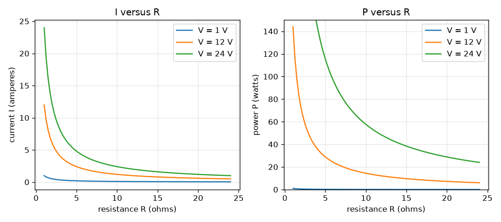
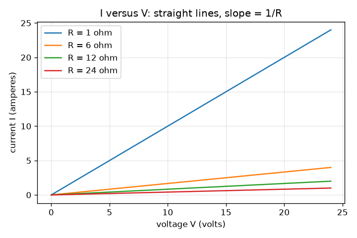

# സെഷൻ 1: ഓമിന്റെ നിയമവും വൈദ്യുത പവറും

[Session 1 — हिन्दी](README.hi.md)

*ലെവൽ 1 (ആശയപരമായ ഇന്ററാക്ടീവ് മോഡൽ) · ഏകദേശം 60 മിനിറ്റ് · openohm*

> ഇത് ഒരു ലളിതമാക്കിയ വിദ്യാഭ്യാസ മോഡൽ ആണ്. ഇത് സാധൂകരിക്കപ്പെട്ട ഒരു ഡിസൈൻ ഉപകരണമല്ല; യഥാർത്ഥ നിർമ്മിതികൾ, വൈദ്യുത ഇൻസ്റ്റലേഷനുകൾ, വാഹനങ്ങൾ, വ്യാവസായിക പ്രക്രിയകൾ അല്ലെങ്കിൽ വൈദ്യപരമായ തീരുമാനങ്ങൾ എന്നിവയ്ക്ക് ഇത് ഉപയോഗിക്കരുത്.

**മുൻ അറിവ് (Prerequisites)**

- ഒരു ലളിത സമവാക്യം പുനഃക്രമീകരിക്കൽ (V = I R ആണെങ്കിൽ, V, R അറിയാമെങ്കിൽ I കണ്ടെത്തുക).
- നിങ്ങൾ PRIMER.md വായിക്കുകയും `python start.py 1` ഒരു തവണ റൺ ചെയ്യുകയും ചെയ്തിട്ടുണ്ട്.

**പഠന ലക്ഷ്യങ്ങൾ (Learning objectives).** ഈ സെഷനു ശേഷം നിങ്ങൾക്ക് കഴിയും:

- ഓമിന്റെ നിയമം V = I R ഉം പവർ സൂത്രവാക്യം P = V I ഉം യൂണിറ്റുകളോടെ പറയാൻ.
- വോൾട്ടേജിൽ നിന്നും പ്രതിരോധത്തിൽ നിന്നും ഒരു റെസിസ്റ്ററിന്റെ കറന്റും പവറും കൈകൊണ്ടും Python ലും കണക്കാക്കാൻ.
- P = V I = I^2 R = V^2 / R ഒരേ സംഖ്യ നൽകുന്നുവെന്ന് കാണിക്കാൻ.
- I നെതിരെ V, I നെതിരെ R, P നെതിരെ R എന്നീ മൂന്ന് ഗ്രാഫുകൾ വായിക്കാൻ.

## A. യഥാർത്ഥ ലോക പ്രശ്നം
ഒരു ഫോൺ ചാർജർ, ഒരു ടോർച്ച് ബൾബ്, ഒരു കെറ്റിൽ എന്നിവ ഓരോന്നും വൈദ്യുത പ്രവാഹത്തെ എതിർക്കുന്ന ഒന്നിലൂടെ അതിനെ തള്ളിവിടുന്നു. നേർത്ത കമ്പി ചൂടാകുകയും കട്ടിയുള്ളത് ചൂടാകാതിരിക്കുകയും ചെയ്യുന്നത് എന്തുകൊണ്ട്, ഒരു ചെറിയ റെസിസ്റ്റർ വളരെ വലിയ ബാറ്ററിയുമായി ബന്ധിപ്പിച്ചാൽ കത്തിപ്പോകുന്നത് എന്തുകൊണ്ട്? രണ്ട് ചെറിയ നിയമങ്ങൾ രണ്ടിനും ഉത്തരം നൽകുന്നു: എത്ര കറന്റ് ഒഴുകുന്നുവെന്ന് ഓമിന്റെ നിയമം പറയുന്നു, എത്ര ചൂട് ഉണ്ടാകുന്നുവെന്ന് പവർ സൂത്രവാക്യം പറയുന്നു. ഈ റിപ്പോ താഴ്ന്ന വോൾട്ടേജ് സർക്യൂട്ടുകൾ മാത്രമേ ഉപയോഗിക്കുന്നുള്ളൂ (ബാറ്ററികളും ചെറിയ സപ്ലൈകളും, ഒരിക്കലും മെയിൻസ് വൈദ്യുതിയല്ല).

## B. ആശയവും സിദ്ധാന്തവും
വോൾട്ടേജ് V രണ്ട് ബിന്ദുക്കൾക്കിടയിലുള്ള വൈദ്യുത തള്ളലാണ്. പ്രതിരോധം (resistance) R ഒരു ഭാഗം പ്രവാഹത്തെ എത്ര ശക്തമായി എതിർക്കുന്നു എന്നതാണ്. കറന്റ് I ചാർജിന്റെ പ്രവാഹമാണ്. ഒരു ഓമിക് ഭാഗത്തിന് (R സ്ഥിരമായി നിൽക്കുന്നത്) ഈ മൂന്നും ഓമിന്റെ നിയമം കൊണ്ട് ബന്ധിപ്പിച്ചിരിക്കുന്നു. റെസിസ്റ്റർ വൈദ്യുത ഊർജ്ജത്തെ പവർ എന്ന നിരക്കിൽ ചൂടാക്കി മാറ്റുന്നു, P = V I. ഓമിന്റെ നിയമം ആദേശം ചെയ്യുമ്പോൾ പലപ്പോഴും ഉപയോഗിക്കാൻ എളുപ്പമുള്ള രണ്ട് രൂപങ്ങൾ കൂടി ലഭിക്കുന്നു: കറന്റ് അറിയാമെങ്കിൽ P = I^2 R, വോൾട്ടേജ് അറിയാമെങ്കിൽ P = V^2 / R.

| ചിഹ്നം | അർത്ഥം | യൂണിറ്റ് |
|---|---|---|
| V | റെസിസ്റ്ററിന് കുറുകെയുള്ള വോൾട്ടേജ് | V (വോൾട്ട്) |
| I | റെസിസ്റ്ററിലൂടെയുള്ള കറന്റ് | A (ആമ്പിയർ) |
| R | പ്രതിരോധം | ohm |
| P | ചൂടായി മാറുന്ന പവർ | W (വാട്ട്) |

**അനുമാനങ്ങൾ (Assumptions)**

- സപ്ലൈ ആദർശ (ideal) ആണ്: കറന്റ് എന്തുതന്നെയായാലും അത് വോൾട്ടേജ് നിലനിർത്തുന്നു.
- കമ്പികൾക്ക് പൂജ്യം പ്രതിരോധമാണ്.
- റെസിസ്റ്റർ ഓമിക് ആണ്: R കറന്റിനൊപ്പമോ താപനിലയ്ക്കൊപ്പമോ മാറുന്നില്ല (സെഷൻ 3 ഇത് തകർക്കുന്നു).
- നേർധാര (DC) മാത്രം.

$$ V = I\,R \quad\Longleftrightarrow\quad I = \frac{V}{R} $$

$$ P = V\,I $$

$$ P = I^2 R = \frac{V^2}{R} $$

## C. ദൃശ്യ വിശദീകരണം
ആദ്യ ചിത്രം നാല് റെസിസ്റ്ററുകൾക്ക് (1, 6, 12, 24 ohm) കറന്റിനെ വോൾട്ടേജിനെതിരെ പ്ലോട്ട് ചെയ്യുന്നു: ഓരോന്നും ഉത്ഭവത്തിലൂടെ കടന്നുപോകുന്ന നേർരേഖയാണ്, അതിന്റെ ചരിവ് 1/R ആണ്, അതിനാൽ ചെറിയ റെസിസ്റ്റർ കുത്തനെയുള്ള രേഖ നൽകുന്നു. രണ്ടാമത്തെ ചിത്രത്തിന് 1, 12, 24 V ൽ രണ്ട് പാനലുകളുണ്ട്: പ്രതിരോധത്തിനെതിരെ കറന്റ് 1/R ആയി താഴുന്നു, പ്രതിരോധത്തിനെതിരെ പവറും 1/R ആയി താഴുന്നു, കാരണം P = V^2 / R. 12 V ലും 6 ohm ലും ബിന്ദു (2 A, 24 W) ആണ്.

*1, 12, 24 V ൽ പ്രതിരോധത്തിനെതിരെ കറന്റും പവറും: രണ്ടും 1/R ആയി താഴുന്നു.*

*നാല് റെസിസ്റ്ററുകൾക്ക് വോൾട്ടേജിനെതിരെ കറന്റ്: ചരിവ് 1/R ഉള്ള നേർരേഖകൾ.*

## D. ഇന്ററാക്ടീവ് സിമുലേഷൻ
പാഠം റൺ ചെയ്യുക (`python start.py 1`), തുടർന്ന് ലൈവ് ആപ്പ് തുറക്കുക: [സെഷൻ 1: ഓമിന്റെ നിയമവും പവറും](https://krunalpanchal1995.github.io/pan-iit-oss/openohm/session-01/) (അല്ലെങ്കിൽ ഈ ഫോൾഡറിലെ `app.html`). വോൾട്ടേജ്, പ്രതിരോധ സ്ലൈഡറുകൾ നീക്കി സർക്യൂട്ട് ചിത്രം നോക്കുക (അമ്പിന്റെ വലിപ്പം കറന്റിനെ പിന്തുടരുന്നു, ചുവപ്പ് പവറിനെ പിന്തുടരുന്നു). തുടർന്ന് മൂന്ന് ഗ്രാഫുകൾ തുറന്ന് ഓരോ വക്രത്തിലൂടെയും ബിന്ദു നീങ്ങുന്നത് കാണുക.

**വെല്ലുവിളി (Challenge).** റെസിസ്റ്റർ 6 W ചൂടാക്കി മാറ്റുമ്പോൾ 0.5 A വലിക്കുന്നതാക്കുക.

## E. ഉദാഹരണ പ്രശ്നവും പരീക്ഷണവും
**പ്രശ്നം.** ഒരു 12 V സപ്ലൈ 6 ohm റെസിസ്റ്ററിന് കുറുകെ ബന്ധിപ്പിച്ചിരിക്കുന്നു. കറന്റും പവറും കണ്ടെത്തുക, പവർ മൂന്ന് രൂപങ്ങളിലും പരിശോധിക്കുക.

1. I = V / R = 12 V / 6 ohm = 2 A.
2. P = V I = 12 V x 2 A = 24 W.
3. I^2 R = 2^2 x 6 = 4 x 6 = 24 W ഉപയോഗിച്ച് പരിശോധിക്കുക.
4. V^2 / R = 144 / 6 = 24 W ഉപയോഗിച്ച് പരിശോധിക്കുക. മൂന്ന് രൂപങ്ങളും യോജിക്കുന്നു.

**ഉത്തരം.** കറന്റ് 2 A ആണ്, റെസിസ്റ്റർ 24 W ചൂടാക്കി മാറ്റുന്നു.

**പരീക്ഷണം.** ശ്രേണിയിൽ രണ്ട് AA സെല്ലുകളും (ഏകദേശം 3 V) കുറഞ്ഞത് 0.25 W റേറ്റിംഗുള്ള ഒരു 100 ohm റെസിസ്റ്ററും ഉപയോഗിക്കുക; മോഡൽ പറയുന്നത് I = 3 / 100 = 0.03 A (30 mA), P = 0.09 W. ശ്രേണിയിൽ ഒരു മൾട്ടിമീറ്റർ ഉപയോഗിച്ച് കറന്റ് അളക്കുക. 30 mA യേക്കാൾ അല്പം കുറഞ്ഞ മൂല്യം പ്രതീക്ഷിക്കുക: റെസിസ്റ്ററിന് ഏകദേശം 5 ശതമാനം സഹനം (tolerance) ഉണ്ട്, സെല്ലുകൾക്ക് സ്വന്തമായി ചെറിയ ആന്തരിക പ്രതിരോധമുണ്ട്, മീറ്റർ അല്പം പ്രതിരോധം ചേർക്കുന്നു. ആദർശ സപ്ലൈക്കും ആദർശ ഭാഗങ്ങൾക്കും മോഡൽ കൃത്യമാണ്, പരീക്ഷണ മേശ അങ്ങനെയല്ല.

## F. വിലയിരുത്തലും ഡിസൈൻ വെല്ലുവിളിയും
**ചോദ്യ തരം A: ആശയപരം.** ഒരു റെസിസ്റ്ററിന് കുറുകെയുള്ള വോൾട്ടേജ് ഇരട്ടിയാക്കിയാൽ കറന്റിനും പവറിനും എന്ത് സംഭവിക്കുന്നു? അവ വ്യത്യസ്ത ഘടകങ്ങൾ കൊണ്ട് മാറുന്നത് എന്തുകൊണ്ടെന്ന് വിശദീകരിക്കുക.

സൂചന

ആദ്യം I = V / R ഉപയോഗിക്കുക, തുടർന്ന് പുതിയ കറന്റ് ഉപയോഗിച്ച് P = V I.

ഘട്ടം ഘട്ടമായുള്ള പരിഹാരം

കറന്റ് ഇരട്ടിയാകുന്നു, കാരണം I = V / R, V ന് ആനുപാതികമാണ്. പവർ V ഗുണം I ആണ്, രണ്ടും ഇരട്ടിയായി, അതിനാൽ P 2 x 2 = 4 മടങ്ങ് ഉയരുന്നു (V^2 / R ഉം: V^2 നാലിരട്ടിയാകുന്നു). പവർ വോൾട്ടേജിനെ രണ്ട് തവണ ആശ്രയിക്കുന്നു: ഒരിക്കൽ തള്ളൽ വലുതായതുകൊണ്ട്, ഒരിക്കൽ പ്രവാഹം വലുതായതുകൊണ്ട്.

**ചോദ്യ തരം B: സംഖ്യാപരം.** ഒരു ആദർശ 12 V സപ്ലൈയിൽ നിന്ന് 24 ohm റെസിസ്റ്റർ എത്ര കറന്റ് വലിക്കുന്നു, എത്ര പവർ ചൂടാക്കി മാറ്റുന്നു? ഒരു യുക്തി പരിശോധന നടത്തുക.

സൂചന

I = V / R, തുടർന്ന് P = V I.

ഘട്ടം ഘട്ടമായുള്ള പരിഹാരം

I = 12 / 24 = 0.5 A, P = 12 x 0.5 = 6 W. യുക്തി പരിശോധന: ഉദാഹരണത്തിലെ 6 ohm റെസിസ്റ്റർ 2 A വലിച്ചു, ഈ റെസിസ്റ്റർ നാലിരട്ടി വലുതാണ്, അതിനാൽ കറന്റ് നാലിലൊന്ന് ആയിരിക്കണം: 2 / 4 = 0.5 A. യൂണിറ്റുകൾ: വോൾട്ടിനെ ഓം കൊണ്ട് ഹരിച്ചാൽ ആമ്പിയർ; വോൾട്ട് ഗുണം ആമ്പിയർ വാട്ട്.

**ചോദ്യ തരം C: ഗ്രാഫ്, സിമുലേഷൻ വ്യാഖ്യാനം.** 12 V ലെ P നെതിരെ R ഗ്രാഫിൽ, 6, 12, 24 ohm ൽ P എത്രയാണ്? പ്രതിരോധം പകുതിയാക്കുന്നതിനെക്കുറിച്ച് ഈ പാറ്റേൺ എന്ത് പറയുന്നു?

സൂചന

ഓരോ റെസിസ്റ്ററിനും ബിന്ദു വായിക്കുക, അല്ലെങ്കിൽ P = V^2 / R = 144 / R ഉപയോഗിക്കുക.

ഘട്ടം ഘട്ടമായുള്ള പരിഹാരം

6 ohm ൽ P = 24 W, 12 ohm ൽ 12 W, 24 ohm ൽ 6 W. R പകുതിയാകുമ്പോഴെല്ലാം P ഇരട്ടിയാകുന്നു, കാരണം P = 144 / R സ്ഥിര വോൾട്ടേജിൽ R ന് വിപരീതാനുപാതത്തിലാണ്. ഒരു സ്ഥിര സപ്ലൈയിൽ ഒരു ഭാഗത്തിന്റെ പ്രതിരോധം കുറച്ചാൽ അത് തണുക്കുകയല്ല, കൂടുതൽ ചൂടാകുകയാണ് ചെയ്യുന്നത്.

**ചോദ്യ തരം D: ഡിസൈൻ, ഒപ്റ്റിമൈസേഷൻ വെല്ലുവിളി.** ഡിസൈൻ: 1, 6, 12, 24 ohm എന്ന മുൻകൂട്ടി നിശ്ചയിച്ച റെസിസ്റ്ററുകളിൽ നിന്ന്, കറന്റ് പരമാവധി 1 A ഉം റെസിസ്റ്റർ പരമാവധി 10 W ഉം ചൂടാക്കി മാറ്റുന്നതുമായ ഒരു 12 V സപ്ലൈക്ക് ഒന്ന് തിരഞ്ഞെടുക്കുക. രണ്ട് പരിധികളും പാലിക്കുന്ന, മുൻകൂട്ടി നിശ്ചയിച്ചവയിൽ ഒതുങ്ങാത്ത, ഏറ്റവും ചെറിയ പ്രതിരോധം എത്രയാണ്?

സൂചന

ഓരോ പരിധിയും ഒരു ഏറ്റവും കുറഞ്ഞ R നൽകുന്നു: R >= V / I_max, R >= V^2 / P_max.

ഘട്ടം ഘട്ടമായുള്ള പരിഹാരം

കറന്റ് പരിധി: R >= 12 / 1 = 12 ohm. പവർ പരിധി: R >= 144 / 10 = 14.4 ohm. രണ്ടും പാലിക്കണം, അതിനാൽ R >= 14.4 ohm. മുൻകൂട്ടി നിശ്ചയിച്ചവയിൽ 24 ohm മാത്രം യോഗ്യമാണ് (12 ohm കൃത്യം 1 A നൽകുന്നു, പക്ഷേ 12 W, 10 W ന് മുകളിൽ). 24 ohm തിരഞ്ഞെടുപ്പ് 0.5 A ഉം 6 W ഉം നൽകുന്നു. ട്രേഡ്-ഓഫ് (Trade-off): വലിയ R സുരക്ഷിതമാണ്, പക്ഷേ ലോഡിലേക്ക് കുറഞ്ഞ കറന്റ് എത്തിക്കുന്നു.

[RUBRIC.md](../../RUBRIC.md) ഉപയോഗിച്ച് സ്വയം സ്കോർ ചെയ്യുക. പേപ്പറിൽ ചെയ്യാൻ [ആക്ടിവിറ്റി ഷീറ്റ്](activity_sheet.md) പ്രിന്റ് ചെയ്യുക.

## സാധാരണ തെറ്റിദ്ധാരണകൾ
| സാധാരണ തെറ്റിദ്ധാരണ | യഥാർത്ഥത്തിൽ ശരിയായത് |
|---|---|
| കൂടുതൽ പ്രതിരോധം എപ്പോഴും കൂടുതൽ ചൂട് എന്നാണ്. | സ്ഥിര വോൾട്ടേജിൽ, കൂടുതൽ പ്രതിരോധം എന്നാൽ കുറഞ്ഞ കറന്റും കുറഞ്ഞ ചൂടും (P = V^2 / R). സ്ഥിര കറന്റിൽ, കൂടുതൽ പ്രതിരോധം എന്നാൽ കൂടുതൽ ചൂട് (P = I^2 R). ഏതാണ് സ്ഥിരമെന്ന് പറയുക. |
| ഒരു റെസിസ്റ്ററിലൂടെ കടന്നുപോകുമ്പോൾ കറന്റ് ഉപയോഗിച്ചുതീരുന്നു. | കടക്കുന്ന അതേ കറന്റ് റെസിസ്റ്ററിൽ നിന്ന് പുറത്തുവരുന്നു; ചൂടായി മാറുന്നത് ഓരോ ചാർജിനുമുള്ള ഊർജ്ജമാണ് (വോൾട്ടേജ്). |
| ഓമിന്റെ നിയമം എല്ലാ വൈദ്യുത ഭാഗങ്ങൾക്കും ബാധകമാണ്. | പ്രതിരോധം സ്ഥിരമായ ഓമിക് ഭാഗങ്ങൾക്ക് മാത്രമേ ഇത് ബാധകമാകൂ. LED കളും ബൾബ് ഫിലമെന്റുകളും ഇത് പിന്തുടരുന്നില്ല (സെഷൻ 3). |

## പദാവലി (Glossary)
- **വോൾട്ടേജ് (voltage)**: രണ്ട് ബിന്ദുക്കൾക്കിടയിലുള്ള വൈദ്യുത തള്ളൽ, വോൾട്ടിൽ
- **കറന്റ് (current)**: ചാർജിന്റെ പ്രവാഹം, ആമ്പിയറിൽ
- **പ്രതിരോധം (resistance)**: ഒരു ഭാഗം കറന്റിനെ എത്ര ശക്തമായി എതിർക്കുന്നു, ഓമിൽ
- **പവർ (power)**: സെക്കൻഡിൽ ചൂടായി മാറുന്ന ഊർജ്ജം, വാട്ടിൽ
- **ഓമിക് (ohmic)**: പ്രതിരോധം സ്ഥിരമായി നിൽക്കുന്ന ഭാഗം, അതിനാൽ I, V ന് ആനുപാതികമാണ്

## പൂർത്തിയാക്കുക
1. [exercises.md](exercises.md) ലെ മൂന്ന് കോഡിംഗ് ടാസ്കുകൾ ചെയ്യുക.
2. നിങ്ങളുടെ മാറ്റങ്ങൾക്കു ശേഷം `python start.py 1` വീണ്ടും റൺ ചെയ്യുക. ഇത് ചെക്ക്‌പോയിന്റോടെ അവസാനിക്കുന്നു; അത് `PASS` എന്ന് പ്രിന്റ് ചെയ്യുമ്പോൾ നിങ്ങൾ പൂർത്തിയാക്കി. (ചെക്ക്‌പോയിന്റ് മാത്രം: `python start.py check 1`.)

അടുത്തത്: [സെഷൻ 2](../session-02/README.md)
