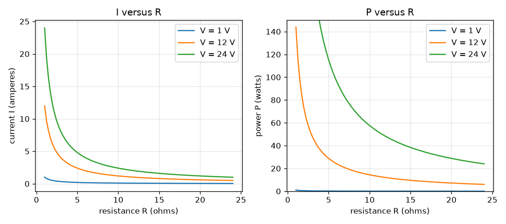
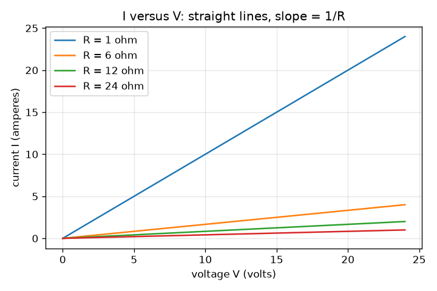

# அமர்வு 1: ஓமின் விதியும் மின்திறனும்

[Session 1 — हिन्दी](README.hi.md) · [Session 1 — മലയാളം](README.ml.md)

*நிலை 1 (கருத்தியல் ஊடாடும் மாதிரி) · சுமார் 60 நிமிடங்கள் · openohm*

> இது ஒரு எளிமைப்படுத்தப்பட்ட கல்வி மாதிரி. இது சரிபார்க்கப்பட்ட வடிவமைப்புக் கருவி அல்ல; உண்மையான கட்டமைப்புகள், மின் நிறுவல்கள், வாகனங்கள், தொழில்துறை செயல்முறைகள் அல்லது மருத்துவ முடிவுகளுக்கு இதைப் பயன்படுத்தக் கூடாது.

**முன்தேவைகள் (Prerequisites)**

- ஒரு எளிய சமன்பாட்டை மாற்றி அமைத்தல் (V = I R எனில், V மற்றும் R தெரிந்தால் I ஐக் கண்டறிதல்).
- நீங்கள் PRIMER.md ஐப் படித்து, `python start.py 1` ஐ ஒரு முறை இயக்கியிருக்கிறீர்கள்.

**கற்றல் நோக்கங்கள் (Learning objectives).** இந்த அமர்வுக்குப் பிறகு உங்களால் முடியும்:

- ஓமின் விதி V = I R மற்றும் திறன் சூத்திரம் P = V I ஐ அலகுகளுடன் கூற.
- மின்னழுத்தம் மற்றும் மின்தடையிலிருந்து ஒரு மின்தடையின் மின்னோட்டத்தையும் திறனையும் கையால் மற்றும் Python இல் கணக்கிட.
- P = V I = I^2 R = V^2 / R ஒரே எண்ணைத் தருகின்றன என்று காட்ட.
- I க்கு எதிரான V, I க்கு எதிரான R, P க்கு எதிரான R ஆகிய மூன்று வரைபடங்களைப் படிக்க.

## A. நிஜ உலகப் பிரச்சினை
கைபேசிச் சார்ஜர், டார்ச் பல்பு, கெட்டில் ஒவ்வொன்றும் மின்னோட்டத்தை எதிர்க்கும் ஒன்றின் வழியாக அதைத் தள்ளுகின்றன. மெல்லிய கம்பி ஏன் சூடாகிறது, தடித்தது ஏன் சூடாவதில்லை, சிறிய மின்தடை மிகப் பெரிய மின்கலத்துடன் இணைத்தால் ஏன் எரிந்துவிடுகிறது? இரண்டு குறுகிய விதிகள் இரண்டுக்கும் பதிலளிக்கின்றன: எவ்வளவு மின்னோட்டம் பாய்கிறது என்று ஓமின் விதி சொல்கிறது, எவ்வளவு வெப்பம் உண்டாகிறது என்று திறன் சூத்திரம் சொல்கிறது. இந்த ரெப்போ தாழ்ந்த மின்னழுத்த சுற்றுகளை மட்டுமே பயன்படுத்துகிறது (மின்கலங்களும் சிறிய மின் அளிப்புகளும், ஒருபோதும் மெயின்ஸ் மின்சாரம் அல்ல).

## B. கருத்தும் கோட்பாடும்
மின்னழுத்தம் (voltage) V என்பது இரண்டு புள்ளிகளுக்கு இடையிலான மின் தள்ளுதல். மின்தடை (resistance) R என்பது ஒரு பகுதி ஓட்டத்தை எவ்வளவு வலுவாக எதிர்க்கிறது என்பது. மின்னோட்டம் (current) I என்பது மின்னூட்டத்தின் ஓட்டம். ஓமிக் பகுதிக்கு (R மாறாமல் இருப்பது) இந்த மூன்றும் ஓமின் விதியால் இணைக்கப்படுகின்றன. மின்தடை மின் ஆற்றலைத் திறன் எனப்படும் வீதத்தில் வெப்பமாக மாற்றுகிறது, P = V I. ஓமின் விதியை மாற்றீடு செய்தால் பெரும்பாலும் பயன்படுத்த எளிதான இன்னும் இரண்டு வடிவங்கள் கிடைக்கின்றன: மின்னோட்டம் தெரிந்தால் P = I^2 R, மின்னழுத்தம் தெரிந்தால் P = V^2 / R.

| குறியீடு | பொருள் | அலகு |
|---|---|---|
| V | மின்தடைக்கு குறுக்கே மின்னழுத்தம் | V (வோல்ட்) |
| I | மின்தடை வழியே மின்னோட்டம் | A (ஆம்பியர்) |
| R | மின்தடை | ohm |
| P | வெப்பமாக மாறும் திறன் | W (வாட்) |

**அனுமானங்கள் (Assumptions)**

- மின் அளிப்பு இலட்சியமானது (ideal): மின்னோட்டம் எதுவாக இருந்தாலும் அது மின்னழுத்தத்தைத் தக்கவைக்கிறது.
- கம்பிகளுக்கு பூஜ்ஜிய மின்தடை.
- மின்தடை ஓமிக்: R மின்னோட்டத்துடனோ வெப்பநிலையுடனோ மாறுவதில்லை (அமர்வு 3 இதை உடைக்கிறது).
- நேர் மின்னோட்டம் (DC) மட்டும்.

$$ V = I\,R \quad\Longleftrightarrow\quad I = \frac{V}{R} $$

$$ P = V\,I $$

$$ P = I^2 R = \frac{V^2}{R} $$

## C. காட்சி விளக்கம்
முதல் படம் நான்கு மின்தடைகளுக்கு (1, 6, 12 மற்றும் 24 ohm) மின்னோட்டத்தை மின்னழுத்தத்துக்கு எதிராக வரைகிறது: ஒவ்வொன்றும் ஆதியின் வழியே செல்லும் நேர்கோடு, அதன் சரிவு 1/R, எனவே சிறிய மின்தடை செங்குத்தான கோட்டைத் தருகிறது. இரண்டாவது படத்தில் 1, 12 மற்றும் 24 V இல் இரண்டு பலகங்கள் உள்ளன: மின்தடைக்கு எதிரான மின்னோட்டம் 1/R ஆகக் குறைகிறது, மின்தடைக்கு எதிரான திறனும் 1/R ஆகக் குறைகிறது, ஏனெனில் P = V^2 / R. 12 V மற்றும் 6 ohm இல் புள்ளி (2 A, 24 W).

*1, 12 மற்றும் 24 V இல் மின்தடைக்கு எதிரான மின்னோட்டமும் திறனும்: இரண்டும் 1/R ஆகக் குறைகின்றன.*

*நான்கு மின்தடைகளுக்கு மின்னழுத்தத்துக்கு எதிரான மின்னோட்டம்: சரிவு 1/R கொண்ட நேர்கோடுகள்.*

## D. ஊடாடும் உருவகப்படுத்துதல்
பாடத்தை இயக்கவும் (`python start.py 1`), பின்னர் நேரடிச் செயலியைத் திறக்கவும்: [அமர்வு 1: ஓமின் விதியும் திறனும்](https://krunalpanchal1995.github.io/pan-iit-oss/openohm/session-01/) (அல்லது இந்தக் கோப்புறையில் உள்ள `app.html`). மின்னழுத்த மற்றும் மின்தடை நழுவிகளை நகர்த்தி சுற்றுப் படத்தைப் பாருங்கள் (அம்பின் அளவு மின்னோட்டத்தைப் பின்தொடர்கிறது, சிவப்பு திறனைப் பின்தொடர்கிறது). பின்னர் மூன்று வரைபடங்களையும் திறந்து ஒவ்வொரு வளைவிலும் புள்ளி நகர்வதைப் பாருங்கள்.

**சவால் (Challenge).** மின்தடை 6 W ஐ வெப்பமாக மாற்றும்போது 0.5 A ஐ இழுக்கும்படி செய்யுங்கள்.

## E. தீர்க்கப்பட்ட எடுத்துக்காட்டும் சோதனையும்
**பிரச்சினை.** ஒரு 12 V மின் அளிப்பு 6 ohm மின்தடைக்கு குறுக்கே இணைக்கப்பட்டுள்ளது. மின்னோட்டத்தையும் திறனையும் கண்டறிந்து, திறனை மூன்று வடிவங்களிலும் சரிபாருங்கள்.

1. I = V / R = 12 V / 6 ohm = 2 A.
2. P = V I = 12 V x 2 A = 24 W.
3. I^2 R = 2^2 x 6 = 4 x 6 = 24 W உடன் சரிபாருங்கள்.
4. V^2 / R = 144 / 6 = 24 W உடன் சரிபாருங்கள். மூன்று வடிவங்களும் ஒத்துப்போகின்றன.

**விடை.** மின்னோட்டம் 2 A, மின்தடை 24 W ஐ வெப்பமாக மாற்றுகிறது.

**சோதனை.** தொடராக இரண்டு AA மின்கலங்களையும் (சுமார் 3 V) குறைந்தது 0.25 W மதிப்பீடுள்ள 100 ohm மின்தடையையும் பயன்படுத்துங்கள்; மாதிரி சொல்வது I = 3 / 100 = 0.03 A (30 mA) மற்றும் P = 0.09 W. தொடரில் மல்டிமீட்டரால் மின்னோட்டத்தை அளவிடுங்கள். 30 mA ஐ விடச் சற்று குறைவான மதிப்பை எதிர்பாருங்கள்: மின்தடைக்கு சுமார் 5 சதவீத சகிப்பு (tolerance) உள்ளது, மின்கலங்களுக்குத் தங்களுக்கே சிறிய அக மின்தடை உள்ளது, மீட்டர் சிறிது மின்தடையைச் சேர்க்கிறது. இலட்சிய மின் அளிப்புக்கும் இலட்சிய பகுதிகளுக்கும் மாதிரி துல்லியமானது, சோதனை மேசை அப்படி இல்லை.

## F. மதிப்பீடும் வடிவமைப்புச் சவாலும்
**கேள்வி வகை A: கருத்தியல்.** ஒரு மின்தடைக்கு குறுக்கே மின்னழுத்தத்தை இரட்டிப்பாக்கினால் மின்னோட்டத்துக்கும் திறனுக்கும் என்ன ஆகிறது? அவை வெவ்வேறு காரணிகளால் ஏன் மாறுகின்றன என்று விளக்குங்கள்.

குறிப்பு

முதலில் I = V / R ஐப் பயன்படுத்தி, பின்னர் புதிய மின்னோட்டத்துடன் P = V I.

படிப்படியான தீர்வு

மின்னோட்டம் இரட்டிப்பாகிறது, ஏனெனில் I = V / R, V க்கு விகிதசமம். திறன் V பெருக்கல் I, இரண்டும் இரட்டிப்பாகின, எனவே P 2 x 2 = 4 மடங்கு உயர்கிறது (V^2 / R ஆலும்: V^2 நான்கு மடங்காகிறது). திறன் மின்னழுத்தத்தை இரண்டு முறை சார்ந்துள்ளது: ஒருமுறை தள்ளுதல் பெரிதாவதால், ஒருமுறை ஓட்டம் பெரிதாவதால்.

**கேள்வி வகை B: எண்ணியல்.** ஒரு இலட்சிய 12 V மின் அளிப்பிலிருந்து 24 ohm மின்தடை எவ்வளவு மின்னோட்டத்தை இழுக்கிறது, எவ்வளவு திறனை வெப்பமாக்குகிறது? ஒரு பொருத்தச் சோதனை செய்யுங்கள்.

குறிப்பு

I = V / R, பின்னர் P = V I.

படிப்படியான தீர்வு

I = 12 / 24 = 0.5 A மற்றும் P = 12 x 0.5 = 6 W. பொருத்தச் சோதனை: எடுத்துக்காட்டின் 6 ohm மின்தடை 2 A ஐ இழுத்தது, இந்த மின்தடை நான்கு மடங்கு பெரியது, எனவே மின்னோட்டம் நான்கில் ஒரு பங்காக இருக்க வேண்டும்: 2 / 4 = 0.5 A. அலகுகள்: வோல்ட்டை ஓம் ஆல் வகுத்தால் ஆம்பியர்; வோல்ட் பெருக்கல் ஆம்பியர் வாட்.

**கேள்வி வகை C: வரைபடம் மற்றும் உருவகப்படுத்துதல் விளக்கம்.** 12 V இல் P க்கு எதிரான R வரைபடத்தில், 6, 12 மற்றும் 24 ohm இல் P என்ன? மின்தடையைப் பாதியாக்குவது பற்றி இந்த வடிவம் என்ன சொல்கிறது?

குறிப்பு

ஒவ்வொரு மின்தடைக்கும் புள்ளியைப் படியுங்கள், அல்லது P = V^2 / R = 144 / R ஐப் பயன்படுத்துங்கள்.

படிப்படியான தீர்வு

6 ohm இல் P = 24 W, 12 ohm இல் 12 W, 24 ohm இல் 6 W. R பாதியாகும் ஒவ்வொரு முறையும் P இரட்டிப்பாகிறது, ஏனெனில் P = 144 / R நிலையான மின்னழுத்தத்தில் R க்கு எதிர் விகிதசமம். நிலையான மின் அளிப்பில் ஒரு பகுதியின் மின்தடையைக் குறைத்தால் அது குளிர்வதில்லை, மேலும் சூடாகிறது.

**கேள்வி வகை D: வடிவமைப்பு மற்றும் உகப்பாக்கச் சவால்.** வடிவமைப்பு: முன்னமைந்த மின்தடைகள் 1, 6, 12 மற்றும் 24 ohm இலிருந்து, மின்னோட்டம் அதிகபட்சம் 1 A ஆகவும் மின்தடை அதிகபட்சம் 10 W ஐ வெப்பமாக்குவதாகவும் இருக்கும்படி 12 V மின் அளிப்புக்கு ஒன்றைத் தேர்ந்தெடுங்கள். இரண்டு வரம்புகளையும் பூர்த்தி செய்யும், முன்னமைவுகளுக்குள் அடங்காத, மிகச் சிறிய மின்தடை என்ன?

குறிப்பு

ஒவ்வொரு வரம்பும் ஒரு குறைந்தபட்ச R ஐத் தருகிறது: R >= V / I_max மற்றும் R >= V^2 / P_max.

படிப்படியான தீர்வு

மின்னோட்ட வரம்பு: R >= 12 / 1 = 12 ohm. திறன் வரம்பு: R >= 144 / 10 = 14.4 ohm. இரண்டும் நிறைவேற வேண்டும், எனவே R >= 14.4 ohm. முன்னமைவுகளில் 24 ohm மட்டுமே தகுதியானது (12 ohm சரியாக 1 A தருகிறது ஆனால் 12 W, 10 W ஐ மீறுகிறது). 24 ohm தேர்வு 0.5 A மற்றும் 6 W தருகிறது. பரிமாற்றம் (Trade-off): பெரிய R பாதுகாப்பானது, ஆனால் சுமைக்குக் குறைவான மின்னோட்டத்தை அளிக்கிறது.

[RUBRIC.md](../../RUBRIC.md) மூலம் உங்களை நீங்களே மதிப்பிடுங்கள். காகிதத்தில் செய்ய [செயல்பாட்டுத் தாளை](activity_sheet.md) அச்சிடுங்கள்.

## பொதுவான தவறான கருத்துகள்
| பொதுவான தவறான கருத்து | உண்மையில் சரியானது |
|---|---|
| அதிக மின்தடை எப்போதும் அதிக வெப்பம். | நிலையான மின்னழுத்தத்தில், அதிக மின்தடை என்றால் குறைந்த மின்னோட்டமும் குறைந்த வெப்பமும் (P = V^2 / R). நிலையான மின்னோட்டத்தில், அதிக மின்தடை என்றால் அதிக வெப்பம் (P = I^2 R). எது நிலையானது என்று சொல்லுங்கள். |
| மின்தடை வழியே செல்லும்போது மின்னோட்டம் தீர்ந்துவிடுகிறது. | உள்ளே நுழையும் அதே மின்னோட்டம் மின்தடையிலிருந்து வெளியேறுகிறது; வெப்பமாக மாறுவது ஒவ்வொரு மின்னூட்டத்துக்குமான ஆற்றல் (மின்னழுத்தம்). |
| ஓமின் விதி எல்லா மின் பகுதிகளுக்கும் பொருந்தும். | மின்தடை மாறாத ஓமிக் பகுதிகளுக்கு மட்டுமே பொருந்தும். LED களும் பல்பு இழைகளும் இதைப் பின்பற்றுவதில்லை (அமர்வு 3). |

## சொற்களஞ்சியம் (Glossary)
- **மின்னழுத்தம் (voltage)**: இரண்டு புள்ளிகளுக்கு இடையிலான மின் தள்ளுதல், வோல்ட்டில்
- **மின்னோட்டம் (current)**: மின்னூட்டத்தின் ஓட்டம், ஆம்பியரில்
- **மின்தடை (resistance)**: ஒரு பகுதி மின்னோட்டத்தை எவ்வளவு வலுவாக எதிர்க்கிறது, ஓமில்
- **திறன் (power)**: ஒரு வினாடியில் வெப்பமாக மாறும் ஆற்றல், வாட்டில்
- **ஓமிக் (ohmic)**: மின்தடை மாறாமல் இருக்கும் பகுதி, எனவே I, V க்கு விகிதசமம்

## முடிக்கவும்
1. [exercises.md](exercises.md) இல் உள்ள மூன்று நிரலாக்கப் பணிகளைச் செய்யுங்கள்.
2. உங்கள் மாற்றங்களுக்குப் பிறகு `python start.py 1` ஐ மீண்டும் இயக்குங்கள். இது சோதனைச்சாவடியுடன் (checkpoint) முடிகிறது; அது `PASS` என்று அச்சிடும்போது நீங்கள் முடித்துவிட்டீர்கள். (சோதனைச்சாவடி மட்டும்: `python start.py check 1`.)

அடுத்து: [அமர்வு 2](../session-02/README.md)
