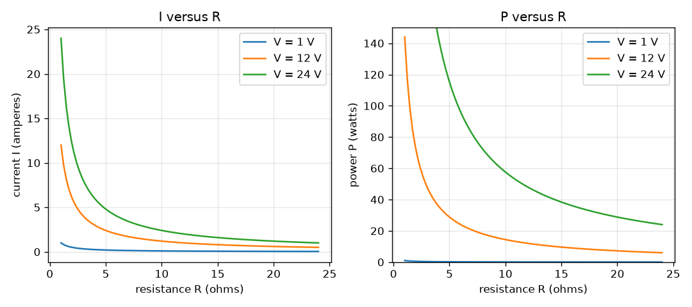
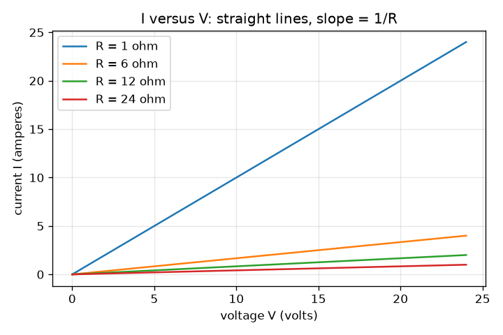

# సెషన్ 1: ఓమ్ నియమం మరియు విద్యుత్ సామర్థ్యం

[Session 1 — हिन्दी](README.hi.md) · [Session 1 — മലയാളം](README.ml.md) · [Session 1 — தமிழ்](README.ta.md)

*స్థాయి 1 (భావనాత్మక ఇంటరాక్టివ్ నమూనా) · సుమారు 60 నిమిషాలు · openohm*

> ఇది ఒక సరళీకృత విద్యా నమూనా. ఇది ధృవీకరించబడిన డిజైన్ సాధనం కాదు; నిజమైన నిర్మాణాలు, విద్యుత్ ఇన్‌స్టలేషన్లు, వాహనాలు, పారిశ్రామిక ప్రక్రియలు లేదా వైద్య నిర్ణయాల కోసం దీనిని ఉపయోగించకూడదు.

**ముందస్తు అవసరాలు (Prerequisites)**

- సరళ సమీకరణాన్ని పునర్వ్యవస్థీకరించడం (V = I R అయితే, V మరియు R తెలిస్తే I ను కనుగొనండి).
- మీరు PRIMER.md చదివి, `python start.py 1` ను ఒకసారి రన్ చేశారు.

**అభ్యసన లక్ష్యాలు (Learning objectives).** ఈ సెషన్ తర్వాత మీరు చేయగలరు:

- ఓమ్ నియమం V = I R మరియు సామర్థ్య సూత్రం P = V I ను యూనిట్లతో చెప్పడం.
- వోల్టేజ్ మరియు నిరోధం నుండి రెసిస్టర్ కరెంట్ మరియు సామర్థ్యాన్ని చేతితో మరియు Python లో లెక్కించడం.
- P = V I = I^2 R = V^2 / R ఒకే సంఖ్యను ఇస్తాయని చూపడం.
- I కు వ్యతిరేకంగా V, I కు వ్యతిరేకంగా R, P కు వ్యతిరేకంగా R అనే మూడు గ్రాఫ్‌లను చదవడం.

## A. వాస్తవ ప్రపంచ సమస్య
ఫోన్ ఛార్జర్, టార్చ్ బల్బ్, కెటిల్ ప్రతి ఒక్కటి విద్యుత్ ప్రవాహాన్ని ప్రతిఘటించే దాని ద్వారా దానిని నెడతాయి. సన్నని తీగ ఎందుకు వేడెక్కుతుంది, మందమైనది ఎందుకు వేడెక్కదు, చిన్న రెసిస్టర్‌ను చాలా పెద్ద బ్యాటరీకి కలిపితే ఎందుకు కాలిపోతుంది? రెండు చిన్న నియమాలు రెండింటికీ సమాధానం ఇస్తాయి: ఎంత కరెంట్ ప్రవహిస్తుందో ఓమ్ నియమం చెబుతుంది, ఎంత వేడి పుడుతుందో సామర్థ్య సూత్రం చెబుతుంది. ఈ రిపో తక్కువ వోల్టేజ్ సర్క్యూట్లను మాత్రమే ఉపయోగిస్తుంది (బ్యాటరీలు మరియు చిన్న సరఫరాలు, ఎప్పుడూ మెయిన్స్ విద్యుత్ కాదు).

## B. భావన మరియు సిద్ధాంతం
వోల్టేజ్ V అనేది రెండు బిందువుల మధ్య విద్యుత్ నెట్టుడు. నిరోధం (resistance) R అనేది ఒక భాగం ప్రవాహాన్ని ఎంత బలంగా ప్రతిఘటిస్తుందో తెలిపేది. కరెంట్ I అనేది ఆవేశ ప్రవాహం. ఓమిక్ భాగానికి (R స్థిరంగా ఉండేది) ఈ మూడూ ఓమ్ నియమంతో అనుసంధానించబడి ఉంటాయి. రెసిస్టర్ విద్యుత్ శక్తిని సామర్థ్యం అనే రేటుతో వేడిగా మారుస్తుంది, P = V I. ఓమ్ నియమాన్ని ప్రతిక్షేపిస్తే తరచుగా ఉపయోగించడానికి సులభమైన మరో రెండు రూపాలు వస్తాయి: కరెంట్ తెలిస్తే P = I^2 R, వోల్టేజ్ తెలిస్తే P = V^2 / R.

| గుర్తు | అర్థం | యూనిట్ |
|---|---|---|
| V | రెసిస్టర్ అడ్డంగా వోల్టేజ్ | V (వోల్ట్లు) |
| I | రెసిస్టర్ గుండా కరెంట్ | A (ఆంపియర్లు) |
| R | నిరోధం | ohm |
| P | వేడిగా మారే సామర్థ్యం | W (వాట్లు) |

**ఊహలు (Assumptions)**

- సరఫరా ఆదర్శవంతమైనది (ideal): కరెంట్ ఏదైనా అది తన వోల్టేజ్‌ను నిలుపుకుంటుంది.
- తీగలకు సున్నా నిరోధం.
- రెసిస్టర్ ఓమిక్: R కరెంట్ లేదా ఉష్ణోగ్రతతో మారదు (సెషన్ 3 దీనిని విరగ్గొడుతుంది).
- ఏకముఖ విద్యుత్తు (DC) మాత్రమే.

$$ V = I\,R \quad\Longleftrightarrow\quad I = \frac{V}{R} $$

$$ P = V\,I $$

$$ P = I^2 R = \frac{V^2}{R} $$

## C. దృశ్య వివరణ
మొదటి చిత్రం నాలుగు రెసిస్టర్లకు (1, 6, 12 మరియు 24 ohm) కరెంట్‌ను వోల్టేజ్‌కు వ్యతిరేకంగా ప్లాట్ చేస్తుంది: ప్రతి ఒక్కటి మూలబిందువు గుండా వెళ్ళే సరళ రేఖ, దాని వాలు 1/R, కాబట్టి చిన్న రెసిస్టర్ నిటారు రేఖను ఇస్తుంది. రెండవ చిత్రంలో 1, 12 మరియు 24 V వద్ద రెండు ప్యానెల్లు ఉన్నాయి: నిరోధానికి వ్యతిరేకంగా కరెంట్ 1/R గా తగ్గుతుంది, నిరోధానికి వ్యతిరేకంగా సామర్థ్యం కూడా 1/R గా తగ్గుతుంది, ఎందుకంటే P = V^2 / R. 12 V మరియు 6 ohm వద్ద బిందువు (2 A, 24 W).

*1, 12 మరియు 24 V వద్ద నిరోధానికి వ్యతిరేకంగా కరెంట్ మరియు సామర్థ్యం: రెండూ 1/R గా తగ్గుతాయి.*

*నాలుగు రెసిస్టర్లకు వోల్టేజ్‌కు వ్యతిరేకంగా కరెంట్: వాలు 1/R ఉన్న సరళ రేఖలు.*

## D. ఇంటరాక్టివ్ సిమ్యులేషన్
పాఠాన్ని రన్ చేయండి (`python start.py 1`), తర్వాత లైవ్ యాప్‌ను తెరవండి: [సెషన్ 1: ఓమ్ నియమం మరియు సామర్థ్యం](https://krunalpanchal1995.github.io/pan-iit-oss/openohm/session-01/) (లేదా ఈ ఫోల్డర్‌లోని `app.html`). వోల్టేజ్ మరియు నిరోధ స్లైడర్లను కదిలించి సర్క్యూట్ చిత్రాన్ని చూడండి (బాణం పరిమాణం కరెంట్‌ను అనుసరిస్తుంది, ఎరుపు సామర్థ్యాన్ని అనుసరిస్తుంది). తర్వాత మూడు గ్రాఫ్‌లను తెరిచి ప్రతి వక్రంపై బిందువు కదలడం చూడండి.

**సవాలు (Challenge).** రెసిస్టర్ 6 W ను వేడిగా మార్చేటప్పుడు 0.5 A తీసుకునేలా చేయండి.

## E. సాధించిన ఉదాహరణ మరియు ప్రయోగం
**సమస్య.** 12 V సరఫరా 6 ohm రెసిస్టర్ అడ్డంగా కలపబడింది. కరెంట్ మరియు సామర్థ్యాన్ని కనుగొని, సామర్థ్యాన్ని మూడు రూపాలలో సరిచూడండి.

1. I = V / R = 12 V / 6 ohm = 2 A.
2. P = V I = 12 V x 2 A = 24 W.
3. I^2 R = 2^2 x 6 = 4 x 6 = 24 W తో సరిచూడండి.
4. V^2 / R = 144 / 6 = 24 W తో సరిచూడండి. మూడు రూపాలూ సరిపోతాయి.

**సమాధానం.** కరెంట్ 2 A, రెసిస్టర్ 24 W ను వేడిగా మారుస్తుంది.

**ప్రయోగం.** శ్రేణిలో రెండు AA సెల్లు (సుమారు 3 V) మరియు కనీసం 0.25 W రేటింగ్ ఉన్న 100 ohm రెసిస్టర్ ఉపయోగించండి; నమూనా చెప్పేది I = 3 / 100 = 0.03 A (30 mA) మరియు P = 0.09 W. శ్రేణిలో మల్టీమీటర్‌తో కరెంట్‌ను కొలవండి. 30 mA కంటే కొంచెం తక్కువ విలువను ఆశించండి: రెసిస్టర్‌కు సుమారు 5 శాతం సహనం (tolerance) ఉంది, సెల్లకు సొంత చిన్న అంతర్గత నిరోధం ఉంది, మీటర్ కొంచెం నిరోధాన్ని కలుపుతుంది. ఆదర్శ సరఫరా మరియు ఆదర్శ భాగాలకు నమూనా ఖచ్చితమైనది, ప్రయోగ బల్ల అలా కాదు.

## F. మూల్యాంకనం మరియు డిజైన్ సవాలు
**ప్రశ్న రకం A: భావనాత్మక.** రెసిస్టర్ అడ్డంగా వోల్టేజ్‌ను రెట్టింపు చేస్తే కరెంట్ మరియు సామర్థ్యానికి ఏమి జరుగుతుంది? అవి వేర్వేరు కారకాలతో ఎందుకు మారతాయో వివరించండి.

సూచన

మొదట I = V / R ఉపయోగించండి, తర్వాత కొత్త కరెంట్‌తో P = V I.

దశలవారీ పరిష్కారం

కరెంట్ రెట్టింపు అవుతుంది ఎందుకంటే I = V / R, V కు అనులోమానుపాతం. సామర్థ్యం V గుణకారం I, రెండూ రెట్టింపయ్యాయి, కాబట్టి P 2 x 2 = 4 రెట్లు పెరుగుతుంది (V^2 / R కూడా: V^2 నాలుగు రెట్లు అవుతుంది). సామర్థ్యం వోల్టేజ్‌పై రెండుసార్లు ఆధారపడుతుంది: ఒకసారి నెట్టుడు పెద్దదవడం వల్ల, ఒకసారి ప్రవాహం పెద్దదవడం వల్ల.

**ప్రశ్న రకం B: సంఖ్యాత్మక.** ఆదర్శ 12 V సరఫరా నుండి 24 ohm రెసిస్టర్ ఎంత కరెంట్ తీసుకుంటుంది, ఎంత సామర్థ్యాన్ని వెదజల్లుతుంది? సహేతుకత పరీక్ష చేయండి.

సూచన

I = V / R, తర్వాత P = V I.

దశలవారీ పరిష్కారం

I = 12 / 24 = 0.5 A మరియు P = 12 x 0.5 = 6 W. సహేతుకత పరీక్ష: ఉదాహరణలోని 6 ohm రెసిస్టర్ 2 A తీసుకుంది, ఈ రెసిస్టర్ నాలుగు రెట్లు పెద్దది, కాబట్టి కరెంట్ నాలుగో వంతు ఉండాలి: 2 / 4 = 0.5 A. యూనిట్లు: వోల్ట్లను ఓమ్‌లతో భాగిస్తే ఆంపియర్లు; వోల్ట్లు గుణకారం ఆంపియర్లు వాట్లు.

**ప్రశ్న రకం C: గ్రాఫ్ మరియు సిమ్యులేషన్ వ్యాఖ్యానం.** 12 V వద్ద P కు వ్యతిరేకంగా R గ్రాఫ్‌లో, 6, 12 మరియు 24 ohm వద్ద P ఎంత? నిరోధాన్ని సగం చేయడం గురించి ఈ నమూనా ఏమి చెబుతుంది?

సూచన

ప్రతి రెసిస్టర్‌కు బిందువును చదవండి, లేదా P = V^2 / R = 144 / R ఉపయోగించండి.

దశలవారీ పరిష్కారం

6 ohm వద్ద P = 24 W, 12 ohm వద్ద 12 W మరియు 24 ohm వద్ద 6 W. R సగమైన ప్రతిసారీ P రెట్టింపు అవుతుంది, ఎందుకంటే P = 144 / R స్థిర వోల్టేజ్ వద్ద R కు విలోమానుపాతం. స్థిర సరఫరాపై ఒక భాగం నిరోధాన్ని తగ్గిస్తే అది చల్లబడదు, మరింత వేడెక్కుతుంది.

**ప్రశ్న రకం D: డిజైన్ మరియు ఆప్టిమైజేషన్ సవాలు.** డిజైన్: ముందుగా ఉన్న రెసిస్టర్లు 1, 6, 12 మరియు 24 ohm నుండి, కరెంట్ గరిష్ఠంగా 1 A మరియు రెసిస్టర్ గరిష్ఠంగా 10 W వెదజల్లేలా 12 V సరఫరాకు ఒకదాన్ని ఎంచుకోండి. రెండు పరిమితులనూ తీర్చే, ముందుగా ఉన్నవాటికే పరిమితం కాని, అతి చిన్న నిరోధం ఎంత?

సూచన

ప్రతి పరిమితి ఒక కనిష్ఠ R ఇస్తుంది: R >= V / I_max మరియు R >= V^2 / P_max.

దశలవారీ పరిష్కారం

కరెంట్ పరిమితి: R >= 12 / 1 = 12 ohm. సామర్థ్య పరిమితి: R >= 144 / 10 = 14.4 ohm. రెండూ నెరవేరాలి, కాబట్టి R >= 14.4 ohm. ముందుగా ఉన్నవాటిలో 24 ohm మాత్రమే అర్హమైనది (12 ohm సరిగ్గా 1 A ఇస్తుంది కానీ 12 W, 10 W మించుతుంది). 24 ohm ఎంపిక 0.5 A మరియు 6 W ఇస్తుంది. ట్రేడ్-ఆఫ్ (Trade-off): పెద్ద R సురక్షితం, కానీ లోడ్‌కు తక్కువ కరెంట్ అందిస్తుంది.

[RUBRIC.md](../../RUBRIC.md) తో మిమ్మల్ని మీరు స్కోర్ చేసుకోండి. కాగితంపై పని చేయడానికి [కార్యాచరణ పత్రాన్ని](activity_sheet.md) ప్రింట్ చేయండి.

## సాధారణ అపోహలు
| సాధారణ అపోహ | నిజానికి సరైనది |
|---|---|
| ఎక్కువ నిరోధం ఎల్లప్పుడూ ఎక్కువ వేడి. | స్థిర వోల్టేజ్ వద్ద, ఎక్కువ నిరోధం అంటే తక్కువ కరెంట్ మరియు తక్కువ వేడి (P = V^2 / R). స్థిర కరెంట్ వద్ద, ఎక్కువ నిరోధం అంటే ఎక్కువ వేడి (P = I^2 R). ఏది స్థిరమో చెప్పండి. |
| రెసిస్టర్ గుండా వెళ్ళేటప్పుడు కరెంట్ ఖర్చయిపోతుంది. | లోపలికి వచ్చే అదే కరెంట్ రెసిస్టర్ నుండి బయటకు వస్తుంది; వేడిగా మారేది ప్రతి ఆవేశానికి శక్తి (వోల్టేజ్). |
| ఓమ్ నియమం అన్ని విద్యుత్ భాగాలకు వర్తిస్తుంది. | నిరోధం స్థిరంగా ఉండే ఓమిక్ భాగాలకు మాత్రమే వర్తిస్తుంది. LED లు మరియు బల్బ్ తంతువులు దీనిని అనుసరించవు (సెషన్ 3). |

## పదకోశం (Glossary)
- **వోల్టేజ్ (voltage)**: రెండు బిందువుల మధ్య విద్యుత్ నెట్టుడు, వోల్ట్లలో
- **కరెంట్ (current)**: ఆవేశ ప్రవాహం, ఆంపియర్లలో
- **నిరోధం (resistance)**: ఒక భాగం కరెంట్‌ను ఎంత బలంగా ప్రతిఘటిస్తుంది, ఓమ్‌లలో
- **సామర్థ్యం (power)**: సెకనుకు వేడిగా మారే శక్తి, వాట్లలో
- **ఓమిక్ (ohmic)**: నిరోధం స్థిరంగా ఉండే భాగం, కాబట్టి I, V కు అనులోమానుపాతం

## ముగించండి
1. [exercises.md](exercises.md) లోని మూడు కోడింగ్ పనులను చేయండి.
2. మీ మార్పుల తర్వాత `python start.py 1` ను మళ్ళీ రన్ చేయండి. ఇది చెక్‌పాయింట్‌తో ముగుస్తుంది; అది `PASS` అని ప్రింట్ చేసినప్పుడు మీరు పూర్తి చేశారు. (చెక్‌పాయింట్ మాత్రమే: `python start.py check 1`.)

తదుపరి: [సెషన్ 2](../session-02/README.md)
