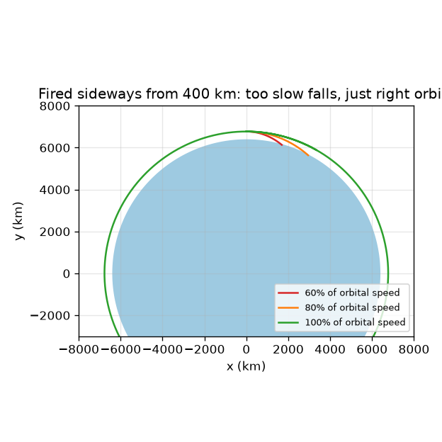
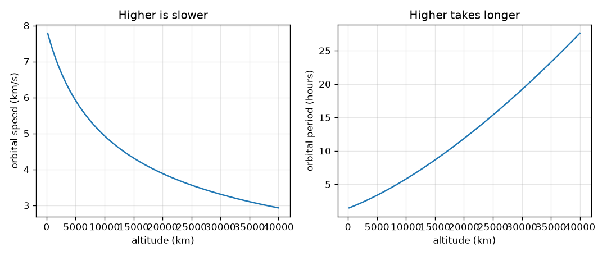

# सत्र 1: एक उपग्रह पृथ्वी के चारों ओर गिर रहा है

*स्तर 1 (वैचारिक इंटरैक्टिव मॉडल) · लगभग 60 मिनट · openorbit*

> यह एक सरलीकृत शैक्षिक मॉडल है। यह कोई प्रमाणित डिज़ाइन टूल नहीं है और इसका उपयोग वास्तविक संरचनाओं, बिजली की वायरिंग (electrical installations), वाहनों, औद्योगिक प्रक्रियाओं या चिकित्सा निर्णयों के लिए नहीं किया जाना चाहिए।

**पूर्व-आवश्यकताएँ (Prerequisites)**

- स्कूल का बीजगणित: वर्ग, वर्गमूल, अनुपात।
- आपने PRIMER.md पढ़ लिया है और एक बार `python start.py 1` चलाया है।

**सीखने के उद्देश्य (Learning objectives).** इस सत्र के बाद आप:

- समझा सकेंगे कि गुरुत्व (gravity) के खींचने के बावजूद एक उपग्रह (satellite) ज़मीन पर क्यों नहीं गिरता।
- किसी दी गई ऊँचाई पर वृत्ताकार कक्षा (circular orbit) की चाल और आवर्तकाल (period) हाथ से और Python में गणना कर सकेंगे।
- समझा सकेंगे कि ऊँची कक्षाएँ धीमी क्यों होती हैं और अधिक समय क्यों लेती हैं।
- केप्लर (Kepler) के तीनों नियम बता सकेंगे और हर एक को एक चित्र के रूप में पढ़ सकेंगे।

## A. वास्तविक दुनिया की समस्या
उपग्रह में कोई इंजन नहीं होता जो उसे आगे धकेले, फिर भी वह वर्षों तक ऊपर रहता है। वह आसमान से गिर क्यों नहीं जाता? उत्तर यह है कि वह गिरता है, हर समय, पर वह बग़ल में इतनी तेज़ी से चलता है कि पृथ्वी उसके नीचे उतनी ही तेज़ी से मुड़कर दूर होती जाती है जितनी तेज़ी से वह गिरता है। वह चाल कितनी है, और एक चक्कर में कितना समय लगता है? अंतरराष्ट्रीय अंतरिक्ष स्टेशन (International Space Station) और एक मौसम उपग्रह को चक्कर लगाने में इतना अलग-अलग समय क्यों लगता है? शैक्षिक मॉडल: एक बिंदु उपग्रह और एक पूर्णतः गोल पृथ्वी।

## B. अवधारणा और सिद्धांत
पृथ्वी के केंद्र से दूरी r पर गुरुत्व हर वस्तु को त्वरण g = mu / r^2 देता है, जहाँ mu = 3.986004418e14 m^3/s^2 पृथ्वी का गुरुत्वीय प्राचल (gravitational parameter) है। एक तोप के गोले को चाल v से बग़ल में दागिए: समय t में वह एक सीधी रेखा d = v t चलेगा जबकि गुरुत्व उसे लगभग 0.5 g t^2 नीचे खींचेगा, और गोल ज़मीन सीधी रेखा से r - sqrt(r^2 - d^2) दूर मुड़ जाती है। जब ये दोनों बराबर हों तो गोला ज़मीन से लगातार चूकता रहता है: वह चाल v = sqrt(mu / r) है, और एक चक्कर में T = 2 pi r / v लगता है। क्योंकि गुरुत्व दूरी के साथ कमज़ोर होता है, r बढ़ने पर v घटता है, और T और भी तेज़ी से बढ़ता है। केप्लर ने तीन नियम खोजे जो हर कक्षा का वर्णन करते हैं: (1) कक्षाएँ दीर्घवृत्त (ellipses) हैं जिनकी एक नाभि (focus) पर पृथ्वी है; (2) पृथ्वी से उपग्रह तक की रेखा समान समय में समान क्षेत्रफल तय करती है, इसलिए उपग्रह पास होने पर तेज़ और दूर होने पर धीमा होता है; (3) पृथ्वी के चारों ओर सभी कक्षाओं के लिए T^2 भाग a^3 समान है, जहाँ a अर्ध-दीर्घ अक्ष (semi-major axis) है (वृत्त के लिए त्रिज्या)।

| प्रतीक | अर्थ | इकाई |
|---|---|---|
| mu | पृथ्वी का गुरुत्वीय प्राचल, G गुणा द्रव्यमान | m^3/s^2 |
| r | पृथ्वी के केंद्र से दूरी (ऊँचाई जमा 6371 km) | m |
| g | दूरी r पर गुरुत्वीय त्वरण | m/s^2 |
| v | उपग्रह की चाल | m/s |
| T | एक चक्कर का समय (आवर्तकाल) | s |
| a | अर्ध-दीर्घ अक्ष: दीर्घवृत्त की लंबी भुजा का आधा | m |

**मान्यताएँ (Assumptions)**

- पृथ्वी 6371 km माध्य त्रिज्या वाला एक पूर्ण गोला है और उपग्रह एक बिंदु है।
- केवल पृथ्वी का गुरुत्व कार्य करता है: कोई वायु कर्षण (air drag) नहीं, न चंद्रमा न सूर्य।
- जब तक अन्यथा न कहा जाए कक्षा वृत्ताकार है (दीर्घवृत्त सत्र 2 में हैं)।

$$ g(r)=\frac{\mu}{r^{2}} $$

$$ v=\sqrt{\frac{\mu}{r}} $$

$$ T=\frac{2\pi r}{v}=2\pi\sqrt{\frac{r^{3}}{\mu}} $$

$$ \frac{T^{2}}{a^{3}}=\frac{4\pi^{2}}{\mu}\quad\text{(the same for every orbit)} $$

## C. दृश्य व्याख्या
पहला चित्र 400 km की ऊँचाई से तीन चालों पर एक तोप के गोले को बग़ल में दागता है। वृत्तीय चाल के 60 प्रतिशत और 80 प्रतिशत पर मार्ग बहुत तेज़ी से मुड़ता है और ज़मीन से मिल जाता है; ठीक वृत्तीय चाल पर मार्ग उसी ऊँचाई पर रहता है और चक्कर लगाता है। दूसरा चित्र ऊँचाई के सापेक्ष वृत्तीय चाल और आवर्तकाल दर्शाता है: ऊपर जाने पर चाल लगातार घटती है, जबकि आवर्तकाल तेज़ी से चढ़ता है, ज़मीन के पास लगभग डेढ़ घंटे से भूस्थिर (geostationary) ऊँचाई पर लगभग एक दिन तक।

*400 km से बग़ल में दागा गया: बहुत धीमा तो ज़मीन पर गिर जाता है, ठीक-ठीक तो चक्कर लगाता है।*

*ऊँचाई के साथ चाल घटती है और आवर्तकाल बढ़ता है।*

## D. इंटरैक्टिव सिमुलेशन
पाठ चलाइए (`python start.py 1`), फिर लाइव ऐप खोलिए: [सत्र 1: एक उपग्रह को बग़ल में दागिए](https://krunalpanchal1995.github.io/pan-iit-oss/openorbit/session-01/) (या इसी फ़ोल्डर में `app.html`)। ऊँचाई का स्लाइडर खिसकाइए और ग्राफ़ व्यू पर आवर्तकाल पढ़िए। फिर प्रक्षेपण चाल (launch speed) को 100 प्रतिशत से नीचे लाइए और देखिए कि मार्ग वृत्त से बदलकर एक ऐसा दीर्घवृत्त बन जाता है जो ज़मीन में धँसता है। इसे 100 प्रतिशत से ऊपर बढ़ाइए और दूरस्थ बिंदु को चढ़ते देखिए।

**चुनौती।** 400 km ऊँचाई पर, उपग्रह को ज़मीन से चुकाइए (उसका निम्नतम बिंदु पृथ्वी की सतह से ऊपर रहना चाहिए)।

## E. हल किया गया उदाहरण और प्रयोग
**समस्या।** ज़मीन से 400 km ऊपर एक उपग्रह के लिए चाल, आवर्तकाल और गुरुत्व ज्ञात कीजिए, और जाँचिए कि एक सेकंड में पृथ्वी उतनी ही तेज़ी से मुड़कर दूर होती है जितना उपग्रह गिरता है।

1. त्रिज्या r = 6371 + 400 = 6771 km = 6.771e6 m।
2. गुरुत्व g = mu / r^2 = 3.986e14 / (6.771e6)^2 = 8.69 m/s^2 (सतह पर 9.82 m/s^2 से तुलना कीजिए)।
3. चाल v = sqrt(mu / r) = 7.67 km/s।
4. आवर्तकाल T = 2 pi r / v = 2 pi * 6771 / 7.673 = 5545 s = 92.4 min।
5. 1 s में उपग्रह 0.5 * 8.69 * 1^2 = 4.35 m गिरता है। 1 s में वह 7.67 km बग़ल में चलता है, और 6771 km त्रिज्या का वृत्त सीधी रेखा से 6771 - sqrt(6771^2 - 7.67^2) km = 4.35 m दूर हट जाता है। दोनों मेल खाते हैं।

**उत्तर।** v = 7.67 km/s, T = 92.4 min, g = 8.69 m/s^2, और एक सेकंड में गिरना और मुड़कर दूर होना दोनों 4.35 m हैं।

**प्रयोग।** स्वयं करके: अपने हाथ से एक गेंद गिराइए और समय नापकर पुष्टि कीजिए कि सतह पर g लगभग 9.8 m/s^2 है। कक्षाओं के लिए, आकाश-ट्रैकिंग ऐप से अंतरराष्ट्रीय अंतरिक्ष स्टेशन का एक गुज़रना ढूँढिए: वह कुछ ही मिनटों में आकाश पार करता है और लगभग हर 92 मिनट या उसके आसपास लौटता है। मॉडल बनाम वास्तविकता: वास्तविक स्टेशन सप्ताह-दर-सप्ताह थोड़ा ऊँचा या नीचा होता है और पतली हवा से थोड़ा धीमा होता है, इसलिए उसका वास्तविक आवर्तकाल मॉडल से तीसरे अंक में भिन्न होता है।

## F. मूल्यांकन और डिज़ाइन चुनौती
**प्रश्न प्रकार A: वैचारिक।** स्टेशन पर अंतरिक्ष यात्री तैरते हैं। क्या वहाँ ऊपर गुरुत्व बंद हो गया है? समझाइए कि 'भारहीन' (weightless) का क्या अर्थ है।

संकेत

400 km पर गुरुत्व की तुलना सतह के मान से कीजिए, और साथ-साथ गिरने के बारे में सोचिए।

चरण-दर-चरण हल

नहीं। 400 km पर गुरुत्व 8.69 m/s^2 है, सतह पर 9.82 m/s^2 की तुलना में, इसलिए यह अब भी प्रबल है। अंतरिक्ष यात्री और स्टेशन एक ही त्वरण के साथ पृथ्वी के चारों ओर साथ-साथ गिरते हैं, इसलिए कुछ भी उन्हें फ़र्श से नहीं दबाता। वे भारहीन महसूस करते हैं क्योंकि वे मुक्त पतन (free fall) में हैं, इसलिए नहीं कि गुरुत्व अनुपस्थित है।

**प्रश्न प्रकार B: संख्यात्मक।** ज़मीन से 1000 km ऊपर एक वृत्ताकार कक्षा की चाल और आवर्तकाल ज्ञात कीजिए। 400 km की कक्षा से तुलना करके अपने उत्तर की समझदारी जाँचिए।

संकेत

r = 6371 + 1000 km। v = sqrt(mu / r) और T = 2 pi r / v का उपयोग कीजिए।

चरण-दर-चरण हल

r = 7371 km। v = 7.35 km/s और T = 105.0 min। समझदारी जाँच (sanity check): 400 km की कक्षा से ऊँची, इसलिए धीमी (7.35, 7.67 km/s से कम) और लंबा आवर्तकाल (105.0, 92.4 min से अधिक)। इकाइयाँ: km/s और मिनट।

**प्रश्न प्रकार C: ग्राफ़ और सिमुलेशन की व्याख्या।** चाल और आवर्तकाल के ग्राफ़ों में, 200 km के पास और भूस्थिर ऊँचाई पर चाल क्या है, और आवर्तकाल का क्या होता है? आवर्तकाल वक्र चाल वक्र से अधिक तीव्र क्यों है?

संकेत

दोनों वक्रों के बाएँ और दाएँ सिरे पढ़िए। याद रखिए T = 2 pi r / v।

चरण-दर-चरण हल

200 km पर: 7.79 km/s और 88.4 min का आवर्तकाल। 35786 km पर: 3.07 km/s और 1435.7 min का आवर्तकाल, लगभग 23.93 घंटे। आवर्तकाल एक साथ दो कारणों से बढ़ता है: मार्ग 2 pi r लंबा है, और चाल v कम है, इसलिए आवर्तकाल इनमें से किसी एक की तुलना में तेज़ी से बदलता है।

**प्रश्न प्रकार D: डिज़ाइन और अनुकूलन (optimisation) चुनौती।** डिज़ाइन: एक पृथ्वी-अवलोकन उपग्रह को एक वृत्ताकार कक्षा में हर 100 मिनट में एक चक्कर लगाना चाहिए। उसे किस ऊँचाई पर उड़ना चाहिए और वह कितनी तेज़ी से चलता है? क्या उत्तर एक वास्तविक उपग्रह के लिए उचित है?

संकेत

T = 6000 s के साथ केप्लर 3 को त्रिज्या के लिए हल कीजिए: r = (mu (T / 2 pi)^2)^(1/3)।

चरण-दर-चरण हल

r से 765.6 km की ऊँचाई और 7.473 km/s की चाल मिलती है। यह उचित है: यह वास्तविक इमेजिंग उपग्रहों की सीमा में है, उस अधिकांश पतली हवा से ऊपर जो निचली कक्षाओं को धीमा करती है। समझौता (trade-off): ऊँचा होने का अर्थ है लंबा चक्कर और चौड़ा दृश्य पर चित्र में कम बारीकी; नीचा होने का अर्थ है तीक्ष्ण चित्र पर अधिक कर्षण (drag)।

[RUBRIC.md](../../RUBRIC.md) से स्वयं को अंक दीजिए। काग़ज़ पर काम करने के लिए [गतिविधि पत्रक (activity sheet)](activity_sheet.md) प्रिंट कीजिए।

## आम भ्रांतियाँ (Common misconceptions)
| आम भ्रांति | वास्तव में क्या सही है |
|---|---|
| अंतरिक्ष में कोई गुरुत्व नहीं है। | 400 km पर गुरुत्व 8.69 m/s^2 है, सतह के 9.82 m/s^2 के क़रीब। कक्षा में घूमना गिरना है, गुरुत्व से बचना नहीं। |
| तेज़ चलने के लिए उपग्रह को ऊँचा होना चाहिए। | ऊँची कक्षाएँ धीमी हैं: r बढ़ने पर चाल sqrt(mu / r) घटती है। ऊपर जाने के लिए आप पहले गति बढ़ाते हैं, फिर पहुँचने पर धीमे होते हैं। |
| उपग्रह को चलते रहने के लिए इंजन चाहिए। | एक बार सही बग़ली चाल मिल जाए, तो मॉडल में कुछ भी उसे धीमा नहीं करता, इसलिए वह बिना प्रणोद (thrust) के चारों ओर गिरता रहता है। |
| केप्लर के दूसरे नियम का अर्थ स्थिर चाल है। | इसका अर्थ है प्रति सेकंड स्थिर क्षेत्रफल। जब उपग्रह पृथ्वी के पास होता है तो उसे उतना ही क्षेत्रफल तय करने के लिए तेज़ होना पड़ता है। |

## शब्दावली (Glossary)
- **कक्षा (orbit)**: किसी दूसरे पिंड के चारों ओर गिरती वस्तु का मार्ग
- **आवर्तकाल (period)**: एक पूरे चक्कर का समय
- **अर्ध-दीर्घ अक्ष (semi-major axis)**: दीर्घवृत्त की लंबी भुजा का आधा; वृत्त के लिए त्रिज्या के बराबर
- **ऊँचाई (altitude)**: ज़मीन से ऊँचाई, पृथ्वी के केंद्र से दूरी नहीं
- **गुरुत्वीय प्राचल mu (gravitational parameter mu)**: G गुणा पृथ्वी के द्रव्यमान की संख्या; एक संख्या जो गुरुत्व की प्रबलता तय करती है

## समापन
1. [exercises.md](exercises.md) में दिए गए तीन कोडिंग कार्य कीजिए।
2. अपने बदलावों के बाद `python start.py 1` फिर से चलाइए। यह चेकपॉइंट (checkpoint) के साथ समाप्त होता है; जब यह `PASS` प्रिंट करे, तो आपका काम पूरा हुआ। (केवल चेकपॉइंट: `python start.py check 1`।)

आगे: [सत्र 2](../session-02/README.md)
