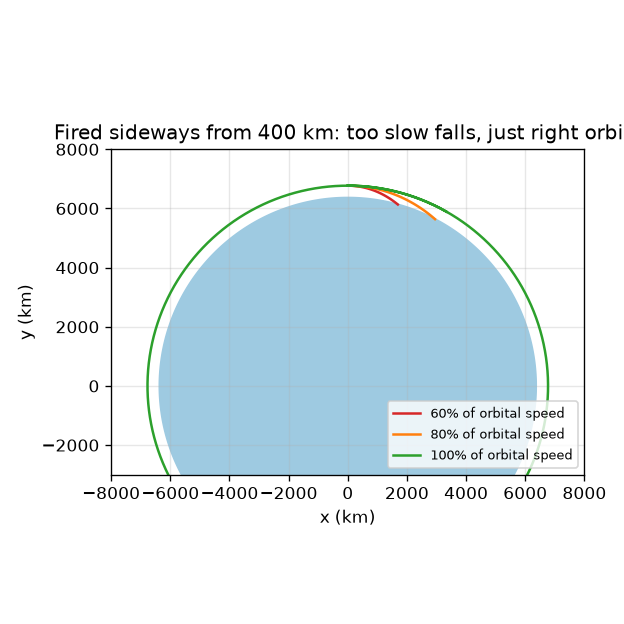
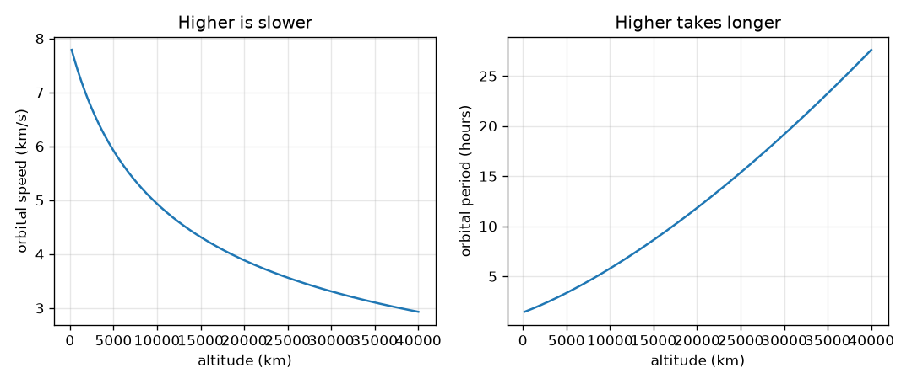

# സെഷൻ 1: ഒരു ഉപഗ്രഹം ഭൂമിക്കു ചുറ്റും വീണുകൊണ്ടിരിക്കുന്നു

[Session 1 — हिन्दी](README.hi.md)

*ലെവൽ 1 (ആശയപരമായ ഇന്ററാക്ടീവ് മോഡൽ) · ഏകദേശം 60 മിനിറ്റ് · openorbit*

> ഇത് ലളിതമാക്കിയ ഒരു വിദ്യാഭ്യാസ മോഡൽ (educational model) ആണ്. ഇത് സാധൂകരിക്കപ്പെട്ട ഒരു ഡിസൈൻ ഉപകരണമല്ല; യഥാർത്ഥ നിർമ്മിതികൾ, വൈദ്യുത ഇൻസ്റ്റലേഷനുകൾ, വാഹനങ്ങൾ, വ്യാവസായിക പ്രക്രിയകൾ അല്ലെങ്കിൽ വൈദ്യശാസ്ത്ര തീരുമാനങ്ങൾ എന്നിവയ്ക്ക് ഇത് ഉപയോഗിക്കരുത്.

**മുൻ‌അറിവ് (Prerequisites)**

- സ്കൂൾ ബീജഗണിതം: വർഗ്ഗം, വർഗ്ഗമൂലം, അനുപാതം.
- നിങ്ങൾ PRIMER.md വായിക്കുകയും `python start.py 1` ഒരിക്കൽ റൺ ചെയ്യുകയും ചെയ്തിട്ടുണ്ട്.

**പഠന ലക്ഷ്യങ്ങൾ (Learning objectives).** ഈ സെഷനു ശേഷം നിങ്ങൾക്ക് കഴിയും:

- ഗുരുത്വാകർഷണം വലിക്കുന്നുണ്ടെങ്കിലും ഒരു ഉപഗ്രഹം നിലത്തു വീഴാത്തത് എന്തുകൊണ്ടെന്ന് വിശദീകരിക്കാൻ.
- നൽകിയ ഉയരത്തിൽ വൃത്താകാര ഭ്രമണപഥത്തിന്റെ വേഗവും പരിക്രമണകാലവും (period) കൈകൊണ്ടും Python-ലും കണക്കാക്കാൻ.
- ഉയർന്ന ഭ്രമണപഥങ്ങൾ വേഗം കുറഞ്ഞതും കൂടുതൽ സമയം എടുക്കുന്നതും എന്തുകൊണ്ടെന്ന് വിശദീകരിക്കാൻ.
- കെപ്ലറുടെ മൂന്ന് നിയമങ്ങൾ പ്രസ്താവിക്കാനും ഓരോന്നും ഒരു ചിത്രമായി വായിക്കാനും.

## A. യഥാർത്ഥ ജീവിതത്തിലെ പ്രശ്നം
ഒരു ഉപഗ്രഹത്തെ മുന്നോട്ടു തള്ളുന്ന എഞ്ചിൻ ഇല്ല, എങ്കിലും അത് വർഷങ്ങളോളം മുകളിൽ നിൽക്കുന്നു. അത് ആകാശത്തുനിന്ന് വീഴാത്തത് എന്തുകൊണ്ട്? ഉത്തരം: അത് എപ്പോഴും വീഴുന്നുണ്ട്, എന്നാൽ അത് വശത്തേക്ക് ഇത്ര വേഗത്തിൽ നീങ്ങുന്നതിനാൽ അത് വീഴുന്ന അതേ വേഗത്തിൽ ഭൂമി അതിനു താഴെ വളഞ്ഞു മാറുന്നു. അത് എത്ര വേഗമാണ്, ഒരു ചുറ്റിന് എത്ര സമയം വേണം? അന്താരാഷ്ട്ര ബഹിരാകാശ നിലയവും ഒരു കാലാവസ്ഥാ ഉപഗ്രഹവും ചുറ്റാൻ ഇത്ര വ്യത്യസ്ത സമയം എടുക്കുന്നത് എന്തുകൊണ്ട്? വിദ്യാഭ്യാസ മോഡൽ: ഒരു ബിന്ദു ഉപഗ്രഹവും പൂർണ്ണമായി വൃത്താകാരമായ ഭൂമിയും.

## B. ആശയവും സിദ്ധാന്തവും
ഭൂമിയുടെ കേന്ദ്രത്തിൽ നിന്ന് r ദൂരത്തിൽ ഗുരുത്വാകർഷണം ഓരോ വസ്തുവിനും g = mu / r^2 എന്ന ത്വരണം നൽകുന്നു, ഇവിടെ mu = 3.986004418e14 m^3/s^2 ഭൂമിയുടെ ഗുരുത്വ പരാമീറ്ററാണ്. ഒരു പീരങ്കിയുണ്ട വശത്തേക്ക് v വേഗത്തിൽ വെടിവയ്ക്കുക: t സമയത്തിൽ അത് d = v t എന്ന നേർരേഖയിൽ സഞ്ചരിക്കും, ഗുരുത്വാകർഷണം അതിനെ ഏകദേശം 0.5 g t^2 താഴേക്ക് വലിക്കും, വൃത്താകാര നിലം നേർരേഖയിൽ നിന്ന് r - sqrt(r^2 - d^2) അകന്നു വളയുന്നു. ഇവ രണ്ടും തുല്യമാകുമ്പോൾ പീരങ്കിയുണ്ട നിലത്ത് എത്താതെ പോകുന്നു: ആ വേഗം v = sqrt(mu / r) ആണ്, ഒരു ചുറ്റിന് T = 2 pi r / v എടുക്കുന്നു. ദൂരത്തിനനുസരിച്ച് ഗുരുത്വാകർഷണം ദുർബലമാകുന്നതിനാൽ r കൂടുമ്പോൾ v കുറയുന്നു, T അതിലും വേഗത്തിൽ കൂടുന്നു. എല്ലാ ഭ്രമണപഥങ്ങളെയും വിവരിക്കുന്ന മൂന്ന് നിയമങ്ങൾ കെപ്ലർ കണ്ടെത്തി: (1) ഭ്രമണപഥങ്ങൾ ദീർഘവൃത്തങ്ങളാണ്, ഭൂമി ഒരു ഫോക്കസിൽ; (2) ഭൂമിയിൽ നിന്ന് ഉപഗ്രഹത്തിലേക്കുള്ള രേഖ തുല്യ സമയങ്ങളിൽ തുല്യ വിസ്തീർണ്ണങ്ങൾ തൂത്തുവാരുന്നു, അതിനാൽ ഉപഗ്രഹം അടുത്തായിരിക്കുമ്പോൾ വേഗത്തിലും അകലെയായിരിക്കുമ്പോൾ പതുക്കെയുമാണ്; (3) ഭൂമിക്കു ചുറ്റുമുള്ള എല്ലാ ഭ്രമണപഥങ്ങൾക്കും T^2 നെ a^3 കൊണ്ട് ഹരിച്ചത് ഒന്നുതന്നെയാണ്, ഇവിടെ a അർദ്ധ-മുഖ്യ അക്ഷമാണ് (semi-major axis) (വൃത്തത്തിന് ആരം).

| ചിഹ്നം | അർത്ഥം | യൂണിറ്റ് |
|---|---|---|
| mu | ഭൂമിയുടെ ഗുരുത്വ പരാമീറ്റർ G ഗുണം പിണ്ഡം | m^3/s^2 |
| r | ഭൂമിയുടെ കേന്ദ്രത്തിൽ നിന്നുള്ള ദൂരം (ഉയരം കൂടെ 6371 km) | m |
| g | r ദൂരത്തിലെ ഗുരുത്വ ത്വരണം | m/s^2 |
| v | ഉപഗ്രഹത്തിന്റെ വേഗം | m/s |
| T | ഒരു ചുറ്റിനുള്ള സമയം (പരിക്രമണകാലം) | s |
| a | അർദ്ധ-മുഖ്യ അക്ഷം: ദീർഘവൃത്തത്തിന്റെ നീളമുള്ള വശത്തിന്റെ പകുതി | m |

**അനുമാനങ്ങൾ (Assumptions)**

- ഭൂമി ശരാശരി ആരം 6371 km ഉള്ള പൂർണ്ണ ഗോളമാണ്, ഉപഗ്രഹം ഒരു ബിന്ദുവാണ്.
- ഭൂമിയുടെ ഗുരുത്വാകർഷണം മാത്രമേ പ്രവർത്തിക്കുന്നുള്ളൂ: വായു പ്രതിരോധമോ ചന്ദ്രനോ സൂര്യനോ ഇല്ല.
- പറഞ്ഞിട്ടില്ലെങ്കിൽ ഭ്രമണപഥം വൃത്താകാരമാണ് (ദീർഘവൃത്തങ്ങൾ സെഷൻ 2-ൽ).

$$ g(r)=\frac{\mu}{r^{2}} $$

$$ v=\sqrt{\frac{\mu}{r}} $$

$$ T=\frac{2\pi r}{v}=2\pi\sqrt{\frac{r^{3}}{\mu}} $$

$$ \frac{T^{2}}{a^{3}}=\frac{4\pi^{2}}{\mu}\quad\text{(the same for every orbit)} $$

## C. ദൃശ്യ വിശദീകരണം
ആദ്യ ചിത്രം 400 km ഉയരത്തിൽ നിന്ന് മൂന്ന് വേഗങ്ങളിൽ ഒരു പീരങ്കിയുണ്ട വശത്തേക്ക് വെടിവയ്ക്കുന്നു. വൃത്തവേഗത്തിന്റെ 60 ശതമാനത്തിലും 80 ശതമാനത്തിലും പാത വല്ലാതെ വളഞ്ഞ് നിലത്ത് മുട്ടുന്നു; കൃത്യം വൃത്തവേഗത്തിൽ പാത അതേ ഉയരത്തിൽ തുടർന്ന് ചുറ്റുന്നു. രണ്ടാമത്തെ ചിത്രം ഉയരത്തിനെതിരെ വൃത്തവേഗവും പരിക്രമണകാലവും വരയ്ക്കുന്നു: മുകളിലേക്ക് പോകുമ്പോൾ വേഗം ക്രമമായി കുറയുന്നു, പരിക്രമണകാലം കുത്തനെ കൂടുന്നു, നിലത്തിനടുത്ത് ഏകദേശം ഒന്നര മണിക്കൂറിൽ നിന്ന് ഭൂസ്ഥിര (geostationary) ഉയരത്തിൽ ഏകദേശം ഒരു ദിവസം വരെ.

*400 km-ൽ നിന്ന് വശത്തേക്ക് വെടിവച്ചാൽ: വേഗം കുറഞ്ഞാൽ നിലത്തു വീഴും, കൃത്യമായാൽ ചുറ്റും.*

*ഉയരം കൂടുമ്പോൾ വേഗം കുറയുകയും പരിക്രമണകാലം കൂടുകയും ചെയ്യുന്നു.*

## D. ഇന്ററാക്ടീവ് സിമുലേഷൻ
പാഠം റൺ ചെയ്യുക (`python start.py 1`), എന്നിട്ട് ലൈവ് ആപ്പ് തുറക്കുക: [സെഷൻ 1: ഒരു ഉപഗ്രഹത്തെ വശത്തേക്ക് വെടിവയ്ക്കുക](https://krunalpanchal1995.github.io/pan-iit-oss/openorbit/session-01/) (അല്ലെങ്കിൽ ഈ ഫോൾഡറിലെ `app.html`). ഉയരം സ്ലൈഡർ നീക്കി ഗ്രാഫ് വ്യൂവിൽ പരിക്രമണകാലം വായിക്കുക. പിന്നെ വിക്ഷേപണ വേഗം 100 ശതമാനത്തിൽ താഴെയാക്കി, പാത വൃത്തത്തിൽ നിന്ന് നിലത്തേക്ക് താഴുന്ന ദീർഘവൃത്തമായി മാറുന്നത് നിരീക്ഷിക്കുക. 100 ശതമാനത്തിനു മുകളിലാക്കി അകലെയുള്ള ബിന്ദു ഉയരുന്നത് കാണുക.

**വെല്ലുവിളി.** 400 km ഉയരത്തിൽ, ഉപഗ്രഹം നിലത്ത് മുട്ടാതെ പോകുന്ന രീതിയിലാക്കുക (അതിന്റെ ഏറ്റവും താഴ്ന്ന ബിന്ദു ഭൂമിയുടെ ഉപരിതലത്തിനു മുകളിൽ നിൽക്കണം).

## E. ഉദാഹരണവും പരീക്ഷണവും
**പ്രശ്നം.** നിലത്തുനിന്ന് 400 km മുകളിലുള്ള ഒരു ഉപഗ്രഹത്തിന്റെ വേഗം, പരിക്രമണകാലം, ഗുരുത്വ ത്വരണം എന്നിവ കണ്ടെത്തുക, ഒരു സെക്കൻഡിൽ ഉപഗ്രഹം വീഴുന്ന അതേ വേഗത്തിൽ ഭൂമി വളഞ്ഞു മാറുന്നുണ്ടോ എന്ന് പരിശോധിക്കുക.

1. ആരം r = 6371 + 400 = 6771 km = 6.771e6 m.
2. ഗുരുത്വ ത്വരണം g = mu / r^2 = 3.986e14 / (6.771e6)^2 = 8.69 m/s^2 (ഉപരിതലത്തിലെ 9.82 m/s^2 മായി താരതമ്യം ചെയ്യുക).
3. വേഗം v = sqrt(mu / r) = 7.67 km/s.
4. പരിക്രമണകാലം T = 2 pi r / v = 2 pi * 6771 / 7.673 = 5545 s = 92.4 min.
5. 1 s-ൽ ഉപഗ്രഹം 0.5 * 8.69 * 1^2 = 4.35 m വീഴുന്നു. 1 s-ൽ അത് വശത്തേക്ക് 7.67 km നീങ്ങുന്നു, 6771 km ആരമുള്ള വൃത്തം ഒരു നേർരേഖയിൽ നിന്ന് 6771 - sqrt(6771^2 - 7.67^2) km = 4.35 m താഴുന്നു. രണ്ടും യോജിക്കുന്നു.

**ഉത്തരം.** v = 7.67 km/s, T = 92.4 min, g = 8.69 m/s^2, വീഴ്ചയും വളഞ്ഞുമാറലും ഒരു സെക്കൻഡിൽ 4.35 m വീതമാണ്.

**പരീക്ഷണം.** പ്രായോഗികമായി: ഒരു പന്ത് കൈയിൽ നിന്ന് വിട്ട് സമയം അളന്ന് ഉപരിതലത്തിൽ g ഏകദേശം 9.8 m/s^2 ആണെന്ന് സ്ഥിരീകരിക്കുക. ഭ്രമണപഥങ്ങൾക്ക്, ഒരു ആകാശ-ട്രാക്കിംഗ് ആപ്പ് ഉപയോഗിച്ച് അന്താരാഷ്ട്ര ബഹിരാകാശ നിലയത്തിന്റെ ഒരു കടന്നുപോകൽ കണ്ടെത്തുക: അത് ഏതാനും മിനിറ്റുകൾ കൊണ്ട് ആകാശം കടക്കുകയും ഏകദേശം ഓരോ 92 മിനിറ്റിലും തിരിച്ചെത്തുകയും ചെയ്യുന്നു. മോഡലും യഥാർത്ഥവും: യഥാർത്ഥ നിലയം ആഴ്ചതോറും അല്പം ഉയരത്തിലോ താഴെയോ ആണ്, നേർത്ത വായു അതിനെ അല്പം മന്ദഗതിയിലാക്കുന്നു, അതിനാൽ അതിന്റെ യഥാർത്ഥ പരിക്രമണകാലം മോഡലിൽ നിന്ന് മൂന്നാമത്തെ അക്കത്തിൽ വ്യത്യാസപ്പെടുന്നു.

## F. വിലയിരുത്തലും ഡിസൈൻ വെല്ലുവിളിയും
**ചോദ്യ തരം A: ആശയപരം.** നിലയത്തിലെ ബഹിരാകാശയാത്രികർ പൊങ്ങിക്കിടക്കുന്നു. അവിടെ ഗുരുത്വാകർഷണം ഓഫ് ആക്കിയിട്ടുണ്ടോ? 'ഭാരമില്ലായ്മ' (weightless) എന്താണ് അർത്ഥമാക്കുന്നതെന്ന് വിശദീകരിക്കുക.

സൂചന

400 km-ലെ ഗുരുത്വാകർഷണത്തെ ഉപരിതല വിലയുമായി താരതമ്യം ചെയ്യുക, ഒരുമിച്ച് വീഴുന്നതിനെക്കുറിച്ച് ചിന്തിക്കുക.

ഘട്ടം ഘട്ടമായുള്ള പരിഹാരം

ഇല്ല. 400 km-ൽ ഗുരുത്വാകർഷണം 8.69 m/s^2 ആണ്, ഉപരിതലത്തിൽ 9.82 m/s^2, അതിനാൽ അത് ഇപ്പോഴും ശക്തമാണ്. ബഹിരാകാശയാത്രികരും നിലയവും ഒരേ ത്വരണത്തോടെ ഭൂമിക്കു ചുറ്റും ഒരുമിച്ച് വീഴുന്നു, അതിനാൽ ഒന്നും അവരെ തറയിലേക്ക് അമർത്തുന്നില്ല. ഗുരുത്വാകർഷണം ഇല്ലാത്തതുകൊണ്ടല്ല, സ്വതന്ത്ര പതനത്തിൽ (free fall) ആയതുകൊണ്ടാണ് അവർക്ക് ഭാരമില്ലായ്മ അനുഭവപ്പെടുന്നത്.

**ചോദ്യ തരം B: സംഖ്യാപരം.** നിലത്തുനിന്ന് 1000 km മുകളിലുള്ള വൃത്താകാര ഭ്രമണപഥത്തിന്റെ വേഗവും പരിക്രമണകാലവും കണ്ടെത്തുക. 400 km ഭ്രമണപഥവുമായി താരതമ്യം ചെയ്ത് ഉത്തരം യുക്തിസഹമാണോ എന്ന് പരിശോധിക്കുക.

സൂചന

r = 6371 + 1000 km. v = sqrt(mu / r), T = 2 pi r / v ഉപയോഗിക്കുക.

ഘട്ടം ഘട്ടമായുള്ള പരിഹാരം

r = 7371 km. v = 7.35 km/s, T = 105.0 min. യുക്തി പരിശോധന: 400 km ഭ്രമണപഥത്തേക്കാൾ ഉയരത്തിലായതിനാൽ വേഗം കുറവ് (7.67 km/s-ന് താഴെ 7.35), പരിക്രമണകാലം കൂടുതൽ (92.4 min-ന് മുകളിൽ 105.0). യൂണിറ്റുകൾ: km/s, മിനിറ്റ്.

**ചോദ്യ തരം C: ഗ്രാഫും സിമുലേഷനും വ്യാഖ്യാനിക്കൽ.** വേഗം, പരിക്രമണകാലം ഗ്രാഫുകളിൽ, 200 km-നടുത്തും ഭൂസ്ഥിര ഉയരത്തിലും വേഗം എത്ര, പരിക്രമണകാലത്തിന് എന്തു സംഭവിക്കുന്നു? പരിക്രമണകാല വക്രം വേഗ വക്രത്തേക്കാൾ കുത്തനെയുള്ളത് എന്തുകൊണ്ട്?

സൂചന

രണ്ട് വക്രങ്ങളുടെയും ഇടത്തും വലത്തും അറ്റങ്ങൾ വായിക്കുക. T = 2 pi r / v ഓർക്കുക.

ഘട്ടം ഘട്ടമായുള്ള പരിഹാരം

200 km-ൽ: 7.79 km/s, പരിക്രമണകാലം 88.4 min. 35786 km-ൽ: 3.07 km/s, പരിക്രമണകാലം 1435.7 min, ഏകദേശം 23.93 മണിക്കൂർ. പരിക്രമണകാലം രണ്ട് കാരണങ്ങളാൽ ഒരേസമയം കൂടുന്നു: പാത 2 pi r നീളമുള്ളതാകുന്നു, വേഗം v കുറയുന്നു, അതിനാൽ പരിക്രമണകാലം ഓരോന്നിനെക്കാളും വേഗത്തിൽ മാറുന്നു.

**ചോദ്യ തരം D: ഡിസൈനും ഒപ്റ്റിമൈസേഷൻ (optimisation) വെല്ലുവിളിയും.** ഡിസൈൻ: ഒരു ഭൗമനിരീക്ഷണ ഉപഗ്രഹം വൃത്താകാര ഭ്രമണപഥത്തിൽ ഓരോ 100 മിനിറ്റിലും ഒരു തവണ ചുറ്റണം. അത് ഏത് ഉയരത്തിൽ പറക്കണം, എത്ര വേഗത്തിൽ നീങ്ങും? ഉത്തരം ഒരു യഥാർത്ഥ ഉപഗ്രഹത്തിന് യുക്തിസഹമാണോ?

സൂചന

ആരത്തിനായി കെപ്ലർ 3 നിർധാരണം ചെയ്യുക: T = 6000 s ഉപയോഗിച്ച് r = (mu (T / 2 pi)^2)^(1/3).

ഘട്ടം ഘട്ടമായുള്ള പരിഹാരം

r ഒരു ഉയരം 765.6 km-ഉം വേഗം 7.473 km/s-ഉം നൽകുന്നു. ഇത് യുക്തിസഹമാണ്: ഇത് യഥാർത്ഥ ഇമേജിംഗ് ഉപഗ്രഹങ്ങളുടെ പരിധിയിലാണ്, താഴ്ന്ന ഭ്രമണപഥങ്ങളെ മന്ദഗതിയിലാക്കുന്ന നേർത്ത വായുവിന്റെ ഭൂരിഭാഗത്തിനും മുകളിൽ. ട്രേഡ്-ഓഫ് (trade-off): ഉയരം കൂടുന്നത് നീണ്ട ചുറ്റും വിശാലമായ കാഴ്ചയും എന്നാൽ ചിത്രത്തിന്റെ വിശദാംശം കുറവും നൽകുന്നു; താഴ്ന്നത് കൂടുതൽ വ്യക്തമായ ചിത്രങ്ങളും എന്നാൽ കൂടുതൽ വലിവും (drag) നൽകുന്നു.

[RUBRIC.md](../../RUBRIC.md) ഉപയോഗിച്ച് സ്വയം സ്കോർ ചെയ്യുക. പേപ്പറിൽ ചെയ്യാൻ [ആക്ടിവിറ്റി ഷീറ്റ്](activity_sheet.md) പ്രിന്റ് ചെയ്യുക.

## സാധാരണ തെറ്റിദ്ധാരണകൾ
| സാധാരണ തെറ്റിദ്ധാരണ | യഥാർത്ഥത്തിൽ ശരിയായത് |
|---|---|
| ബഹിരാകാശത്ത് ഗുരുത്വാകർഷണം ഇല്ല. | 400 km-ൽ ഗുരുത്വാകർഷണം 8.69 m/s^2 ആണ്, ഉപരിതലത്തിലെ 9.82 m/s^2-നോട് അടുത്ത്. ഭ്രമണം ചെയ്യുക എന്നാൽ വീഴുക എന്നതാണ്, ഗുരുത്വാകർഷണത്തിൽ നിന്ന് രക്ഷപ്പെടുക എന്നതല്ല. |
| വേഗത്തിൽ പോകാൻ ഒരു ഉപഗ്രഹം ഉയരത്തിലായിരിക്കണം. | ഉയർന്ന ഭ്രമണപഥങ്ങൾ വേഗം കുറഞ്ഞവയാണ്: r കൂടുമ്പോൾ വേഗം sqrt(mu / r) കുറയുന്നു. മുകളിലേക്ക് പോകാൻ ആദ്യം വേഗം കൂട്ടുന്നു, എത്തുമ്പോൾ വേഗം കുറയ്ക്കുന്നു. |
| തുടർന്നു പോകാൻ ഒരു ഉപഗ്രഹത്തിന് എഞ്ചിൻ വേണം. | ശരിയായ വശത്തേക്കുള്ള വേഗം കിട്ടിക്കഴിഞ്ഞാൽ, മോഡലിൽ ഒന്നും അതിനെ മന്ദഗതിയിലാക്കുന്നില്ല, അതിനാൽ ത്രസ്റ്റ് ഇല്ലാതെ അത് ചുറ്റും വീഴുന്നത് തുടരുന്നു. |
| കെപ്ലറുടെ രണ്ടാം നിയമം സ്ഥിരവേഗം എന്നാണ് അർത്ഥമാക്കുന്നത്. | സെക്കൻഡിൽ സ്ഥിര വിസ്തീർണ്ണം എന്നാണ് അർത്ഥം. ഉപഗ്രഹം ഭൂമിക്ക് അടുത്തായിരിക്കുമ്പോൾ അതേ വിസ്തീർണ്ണം തൂത്തുവാരാൻ അത് വേഗത്തിലായിരിക്കണം. |

## പദാവലി (Glossary)
- **ഭ്രമണപഥം (orbit)**: മറ്റൊരു വസ്തുവിനു ചുറ്റും വീഴുന്ന ഒരു വസ്തുവിന്റെ പാത
- **പരിക്രമണകാലം (period)**: ഒരു മുഴുവൻ ചുറ്റിനുള്ള സമയം
- **അർദ്ധ-മുഖ്യ അക്ഷം (semi-major axis)**: ദീർഘവൃത്തത്തിന്റെ നീളമുള്ള വശത്തിന്റെ പകുതി; വൃത്തത്തിന് ആരത്തിന് തുല്യം
- **ഉയരം (altitude)**: നിലത്തുനിന്നുള്ള ഉയരം, ഭൂമിയുടെ കേന്ദ്രത്തിൽ നിന്നുള്ള ദൂരമല്ല
- **ഗുരുത്വ പരാമീറ്റർ mu (gravitational parameter)**: G ഗുണം ഭൂമിയുടെ പിണ്ഡം; ഗുരുത്വാകർഷണത്തിന്റെ ശക്തി നിശ്ചയിക്കുന്ന ഒരൊറ്റ സംഖ്യ

## പൂർത്തിയാക്കുക
1. [exercises.md](exercises.md)-ലെ മൂന്ന് കോഡിംഗ് ടാസ്കുകൾ ചെയ്യുക.
2. മാറ്റങ്ങൾക്കു ശേഷം `python start.py 1` വീണ്ടും റൺ ചെയ്യുക. അത് ചെക്ക്‌പോയിന്റോടെ (checkpoint) അവസാനിക്കുന്നു; അത് `PASS` എന്ന് പ്രിന്റ് ചെയ്യുമ്പോൾ നിങ്ങൾ പൂർത്തിയാക്കി. (ചെക്ക്‌പോയിന്റ് മാത്രം: `python start.py check 1`.)

അടുത്തത്: [സെഷൻ 2](../session-02/README.md)
